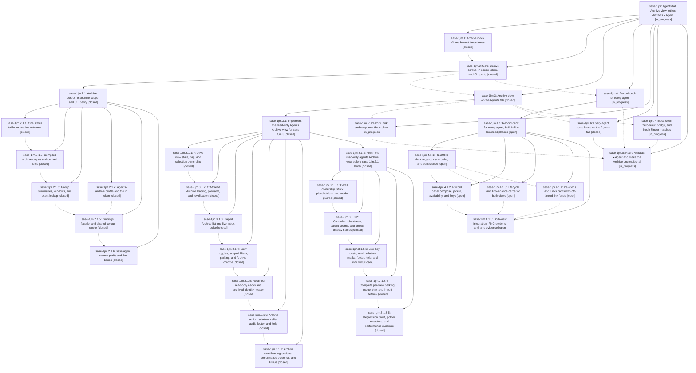

# Bead: sase-1jm — Agents tab Archive view retires Artifacts ▸ Agent

[Bead Pages](../README.md) / sase-1jm

**Status:** ◐ in_progress · **Type:** ▸ plan · **Tier:** epic
**Owner:** `bryanbugyi34@gmail.com` · **Created by:** [bbugyi200.athena.research.45.linker.w0](https://github.com/sase-org/sase--agents/blob/main/sessions/bbugyi200.athena.research.45.linker.w0.md) · **Assignee:** `sase-1jm.land`
**Created:** 2026-10-10 06:41:07 EDT
**Plan:** [202610/agents\_archive\_view.md](https://github.com/sase-org/sase--plans/blob/main/202610/agents_archive_view.md)

<!-- sase:links:start -->

## Links

| Relation | Artifact | Why |
| --- | --- | --- |
| implemented-by | [plan:202610/agents_archive_view.md][1] | derived from the plan's `bead_id:` frontmatter field |

_Plus 5 automatic references — see [Referenced By](#referenced-by)._

[1]: https://github.com/sase-org/sase--plans/blob/main/202610/agents_archive_view.md

<!-- sase:links:end -->

## Description

Every agent that ran on this machine can be found and read on the Agents tab. The Inbox stays exactly as it is today. A new Archive view (`,a`) lists dismissed runs by day and opens any of them read-only in the real decks. Restoring is one deliberate `⏎`. Every `agent:` route lands on the Agents tab. The Artifacts ▸ Agent sub-tab is retired behind a sunset flag.

## Notes

[2026-10-11T13:09:08Z · 6p--code] DISCOVERED ISSUE: at master 8122d44255 (also origin/master cca1773157, which only adds the git-lock and symvision-privatize commits), `sase tool run check` fails three tests that this epic's archive work causes. (1) tests/completion/test_snapshot.py::test_checked_in_snapshot_has_no_drift and ::test_current_structural_view_matches_checked_in_snapshot: the only drift is description_digest of `sase agent search` (d0bf3fe5c8158622 current vs f75a3fcb2bbd4075 in tests/completion/snapshots/cli_spec.json), changed by the archive search CLI parity commits (5f47d11935, 04ed4b33cb); regenerate with `just sync-completion-spec`. (2) tests/completion/test_candidates_providers.py::test_flag_candidates_come_from_the_in_process_registry: the in-process flag registry now holds {'agents_archive_view'} while the test asserts it is empty; either register the expectation or let sase-1ju (Retire agents_archive_view) clear it. Found while verifying an unrelated plan-propose change; none of these files were touched by it.

[2026-10-12T06:36:46Z · sase-1jm.3.1.8.land] DISCOVERED ISSUE (sase-1jm.3.1.8 land agent, master 791c1797b9): every AceApp startup imports the Archive modules even with the agents_archive_view beta off. actions/_state_init_runtime.py:init_runtime_state (since 69f647d912, sase-1jm.3.1) calls init_agents_archive_view_state, which imports actions.agents._archive_view, models.agent_archive_view (module-level) and _archive_controller, loads the Archive grouping preference, and initializes the controller. So sase-1jm.3.1.8's static import deferral (both modules are off the sase.ace.tui.app closure) gives no runtime startup saving; a verifier's mounted probe confirmed both modules are in sys.modules after startup. Remediation: lazy-init _agents_archive_view on first Archive access (agents_archive_is_active already tolerates the missing attribute), or skip init entirely while the beta is off, without breaking the Archive prewarm budget (warm ,a < 100 ms). Can wait for the retire-pane phase that removes the beta flag.

[2026-10-12T06:36:51Z · sase-1jm.3.1.8.land] DISCOVERED ISSUE (sase-1jm.3.1.8 land agent, from phase sase-1jm.3.1.8.5 evidence): Archive j/k latency has not been confirmed against the 16 ms p95 budget on a quiet host. Same-host back-to-back runs on loaded athena (load1 11-15): bench_tui_jk_archive p50 ~42 ms, p95 ~47-53 ms over 2 runs; axe bench_tui_jk Inbox control p50 17-56 ms, p95 45-65 ms. That is a loaded-host band, not an Archive regression (Archive is within the control's range). Warm ,a first-row median 99.6 ms passes the 100 ms budget. Re-measure both benches back to back on a quiet host before sase-1jm retires the beta flag; related host-load reports: sase-1ge, sase-199.

## Phases

| Bead | Title | Status | Size | Created | Agents | Commits |
|---|---|---|---|---|---:|---:|
| [sase-1jm.1](sase-1jm.1.md) | Archive index v3 and honest timestamps | ✓ closed | medium | 2026-10-10 | 1 | 1 |
| [sase-1jm.2](sase-1jm.2.md) | Core archive corpus, in scope token, and CLI parity | ✓ closed | large | 2026-10-10 | 1 | 0 |
| [sase-1jm.3](sase-1jm.3.md) | Archive view on the Agents tab | ✓ closed | large | 2026-10-10 | 1 | 0 |
| [sase-1jm.4](sase-1jm.4.md) | Record deck for every agent | ◐ in_progress | medium | 2026-10-10 | 1 | 1 |
| [sase-1jm.5](sase-1jm.5.md) | Restore, fork, and copy from the Archive | ◐ in_progress | medium | 2026-10-10 | 1 | 0 |
| [sase-1jm.6](sase-1jm.6.md) | Every agent route lands on the Agents tab | ✓ closed | medium | 2026-10-10 | 1 | 1 |
| [sase-1jm.7](sase-1jm.7.md) | Inbox shelf, zero-result bridge, and Node Finder matches | ◐ in_progress | medium | 2026-10-10 | 1 | 0 |
| [sase-1jm.8](sase-1jm.8.md) | Retire Artifacts ▸ Agent and make the Archive unconditional | ◐ in_progress | medium | 2026-10-10 | 1 | 0 |

## Lineage

## Agents

| Agent | Bead | Commits |
|---|---|---:|
| [bbugyi200.athena.sase-1jm.1](https://github.com/sase-org/sase--agents/blob/main/agents/bbugyi200.athena.sase-1jm.1/README.md) | [sase-1jm.1](sase-1jm.1.md) | 1 |
| [bbugyi200.athena.sase-1jm.2](https://github.com/sase-org/sase--agents/blob/main/sessions/bbugyi200.athena.sase-1jm.2.md) | [sase-1jm.2](sase-1jm.2.md) | 0 |
| [bbugyi200.athena.sase-1jm.2.1.1](https://github.com/sase-org/sase--agents/blob/main/agents/bbugyi200.athena.sase-1jm.2.1.1/README.md) | [sase-1jm.2.1.1](sase-1jm.2.1.1.md) | 2 |
| [bbugyi200.athena.sase-1jm.2.1.2](https://github.com/sase-org/sase--agents/blob/main/agents/bbugyi200.athena.sase-1jm.2.1.2/README.md) | [sase-1jm.2.1.2](sase-1jm.2.1.2.md) | 1 |
| [bbugyi200.athena.sase-1jm.2.1.3](https://github.com/sase-org/sase--agents/blob/main/agents/bbugyi200.athena.sase-1jm.2.1.3/README.md) | [sase-1jm.2.1.3](sase-1jm.2.1.3.md) | 1 |
| [bbugyi200.athena.sase-1jm.2.1.4](https://github.com/sase-org/sase--agents/blob/main/agents/bbugyi200.athena.sase-1jm.2.1.4/README.md) | [sase-1jm.2.1.4](sase-1jm.2.1.4.md) | 1 |
| [bbugyi200.athena.sase-1jm.2.1.5](https://github.com/sase-org/sase--agents/blob/main/agents/bbugyi200.athena.sase-1jm.2.1.5/README.md) | [sase-1jm.2.1.5](sase-1jm.2.1.5.md) | 2 |
| [bbugyi200.athena.sase-1jm.2.1.6](https://github.com/sase-org/sase--agents/blob/main/sessions/bbugyi200.athena.sase-1jm.2.1.6.md) | [sase-1jm.2.1.6](sase-1jm.2.1.6.md) | 1 |
| [bbugyi200.athena.sase-1jm.2.1.land](https://github.com/sase-org/sase--agents/blob/main/sessions/bbugyi200.athena.sase-1jm.2.1.land.md) | [sase-1jm.2.1](sase-1jm.2.1.md) | 2 |
| [bbugyi200.athena.sase-1jm.3](https://github.com/sase-org/sase--agents/blob/main/sessions/bbugyi200.athena.sase-1jm.3.md) | [sase-1jm.3](sase-1jm.3.md) | 0 |
| [bbugyi200.athena.sase-1jm.3.1.1](https://github.com/sase-org/sase--agents/blob/main/agents/bbugyi200.athena.sase-1jm.3.1.1/README.md) | [sase-1jm.3.1.1](sase-1jm.3.1.1.md) | 1 |
| [bbugyi200.athena.sase-1jm.3.1.2](https://github.com/sase-org/sase--agents/blob/main/agents/bbugyi200.athena.sase-1jm.3.1.2/README.md) | [sase-1jm.3.1.2](sase-1jm.3.1.2.md) | 1 |
| [bbugyi200.athena.sase-1jm.3.1.3](https://github.com/sase-org/sase--agents/blob/main/agents/bbugyi200.athena.sase-1jm.3.1.3/README.md) | [sase-1jm.3.1.3](sase-1jm.3.1.3.md) | 1 |
| [bbugyi200.athena.sase-1jm.3.1.4](https://github.com/sase-org/sase--agents/blob/main/agents/bbugyi200.athena.sase-1jm.3.1.4/README.md) | [sase-1jm.3.1.4](sase-1jm.3.1.4.md) | 1 |
| [bbugyi200.athena.sase-1jm.3.1.5](https://github.com/sase-org/sase--agents/blob/main/agents/bbugyi200.athena.sase-1jm.3.1.5/README.md) | [sase-1jm.3.1.5](sase-1jm.3.1.5.md) | 1 |
| [bbugyi200.athena.sase-1jm.3.1.6](https://github.com/sase-org/sase--agents/blob/main/agents/bbugyi200.athena.sase-1jm.3.1.6/README.md) | [sase-1jm.3.1.6](sase-1jm.3.1.6.md) | 1 |
| [bbugyi200.athena.sase-1jm.3.1.7](https://github.com/sase-org/sase--agents/blob/main/sessions/bbugyi200.athena.sase-1jm.3.1.7.md) | [sase-1jm.3.1.7](sase-1jm.3.1.7.md) | 1 |
| [bbugyi200.athena.sase-1jm.3.1.8.1](https://github.com/sase-org/sase--agents/blob/main/agents/bbugyi200.athena.sase-1jm.3.1.8.1/README.md) | [sase-1jm.3.1.8.1](sase-1jm.3.1.8.1.md) | 1 |
| [bbugyi200.athena.sase-1jm.3.1.8.2](https://github.com/sase-org/sase--agents/blob/main/sessions/bbugyi200.athena.sase-1jm.3.1.8.2.md) | [sase-1jm.3.1.8.2](sase-1jm.3.1.8.2.md) | 1 |
| [bbugyi200.athena.sase-1jm.3.1.8.3](https://github.com/sase-org/sase--agents/blob/main/agents/bbugyi200.athena.sase-1jm.3.1.8.3/README.md) | [sase-1jm.3.1.8.3](sase-1jm.3.1.8.3.md) | 1 |
| [bbugyi200.athena.sase-1jm.3.1.8.4](https://github.com/sase-org/sase--agents/blob/main/agents/bbugyi200.athena.sase-1jm.3.1.8.4/README.md) | [sase-1jm.3.1.8.4](sase-1jm.3.1.8.4.md) | 1 |
| [bbugyi200.athena.sase-1jm.3.1.8.5](https://github.com/sase-org/sase--agents/blob/main/agents/bbugyi200.athena.sase-1jm.3.1.8.5/README.md) | [sase-1jm.3.1.8.5](sase-1jm.3.1.8.5.md) | 1 |
| [bbugyi200.athena.sase-1jm.3.1.8.land](https://github.com/sase-org/sase--agents/blob/main/sessions/bbugyi200.athena.sase-1jm.3.1.8.land.md) | [sase-1jm.3.1.8](sase-1jm.3.1.8.md) | 0 |
| [bbugyi200.athena.sase-1jm.3.1.land](https://github.com/sase-org/sase--agents/blob/main/sessions/bbugyi200.athena.sase-1jm.3.1.land.md) | [sase-1jm.3.1](sase-1jm.3.1.md) | 0 |
| [bbugyi200.athena.sase-1jm.4](https://github.com/sase-org/sase--agents/blob/main/agents/bbugyi200.athena.sase-1jm.4/README.md) | [sase-1jm.4](sase-1jm.4.md) | 1 |
| [bbugyi200.athena.sase-1jm.5](https://github.com/sase-org/sase--agents/blob/main/agents/bbugyi200.athena.sase-1jm.5/README.md) | [sase-1jm.5](sase-1jm.5.md) | 0 |
| [bbugyi200.athena.sase-1jm.6](https://github.com/sase-org/sase--agents/blob/main/agents/bbugyi200.athena.sase-1jm.6/README.md) | [sase-1jm.6](sase-1jm.6.md) | 1 |
| [bbugyi200.athena.sase-1jm.7](https://github.com/sase-org/sase--agents/blob/main/agents/bbugyi200.athena.sase-1jm.7/README.md) | [sase-1jm.7](sase-1jm.7.md) | 0 |
| [bbugyi200.athena.sase-1jm.8](https://github.com/sase-org/sase--agents/blob/main/agents/bbugyi200.athena.sase-1jm.8/README.md) | [sase-1jm.8](sase-1jm.8.md) | 0 |
| [bbugyi200.athena.sase-1jm.land](https://github.com/sase-org/sase--agents/blob/main/agents/bbugyi200.athena.sase-1jm.land/README.md) | [sase-1jm](README.md) | 0 |

## Commits

| Repo | Commit | Subject | Bead | Committed |
|---|---|---|---|---|
| sase | [`e200cf6`](https://github.com/sase-org/sase/commit/e200cf6d677fcb6473d070d6a9a800f088eac3e6) | feat(agents): add v3 dismissed archive index | [sase-1jm.1](sase-1jm.1.md) | 2026-10-10 07:06:42 EDT |
| sase-core | [`sase-core@9f6ce0c`](https://github.com/sase-org/sase-core/commit/9f6ce0c63e6d4694055e8aa195c331e6db138f6d) | feat(agent-archive): add live status-bucket match with outcome derived from bucket | [sase-1jm.2.1.1](sase-1jm.2.1.1.md) | 2026-10-10 10:12:47 EDT |
| sase | [`166289a`](https://github.com/sase-org/sase/commit/166289ac43de125720807da2c935af04c2470311) | feat(agent): add status\_bucket\_for\_values thin wrapper over Rust status bucket binding | [sase-1jm.2.1.1](sase-1jm.2.1.1.md) | 2026-10-10 11:22:40 EDT |
| sase | [`18f53d3`](https://github.com/sase-org/sase/commit/18f53d3e57626ac868975005e6d0fb4e720c09ab) | feat(query): add agents-archive profile and host-owned in: token | [sase-1jm.2.1.4](sase-1jm.2.1.4.md) | 2026-10-10 11:40:40 EDT |
| sase-core | [`sase-core@e4e72c2`](https://github.com/sase-org/sase-core/commit/e4e72c2a357b230d16af0aecbfdef389213cc7de) | feat(archive): compile v3 archive corpus | [sase-1jm.2.1.2](sase-1jm.2.1.2.md) | 2026-10-10 12:34:13 EDT |
| sase-core | [`sase-core@431599f`](https://github.com/sase-org/sase-core/commit/431599f402c3167b499a2bdc0d20a693558e54bb) | feat(archive): query compiled corpus for summary, rows, lookup, and count | [sase-1jm.2.1.3](sase-1jm.2.1.3.md) | 2026-10-10 13:49:40 EDT |
| sase-core | [`sase-core@bc40675`](https://github.com/sase-org/sase-core/commit/bc40675233d35f370e7bf915ddda170e695abf04) | feat(archive): bind corpus compile, summary, rows, lookup, and count | [sase-1jm.2.1.5](sase-1jm.2.1.5.md) | 2026-10-10 15:20:15 EDT |
| sase | [`f7026aa`](https://github.com/sase-org/sase/commit/f7026aa2f2d6a1bd5b3858ed10282e2c7d2fe748) | feat(archive): add AgentArchiveCorpus facade and shared TUI/CLI cache | [sase-1jm.2.1.5](sase-1jm.2.1.5.md) | 2026-10-10 15:25:29 EDT |
| sase | [`5f47d11`](https://github.com/sase-org/sase/commit/5f47d119356f02a87ec850aba52c6bd5090bd365) | feat(agents): add archive search CLI parity | [sase-1jm.2.1.6](sase-1jm.2.1.6.md) | 2026-10-10 16:04:53 EDT |
| sase-core | [`sase-core@cd2a72e`](https://github.com/sase-org/sase-core/commit/cd2a72eda5e92ee838f2567246db8b4f99e33ae9) | feat(archive): keep compiled corpus in Rust and resolve child owners | [sase-1jm.2.1](sase-1jm.2.1.md) | 2026-10-10 20:12:05 EDT |
| sase | [`69f647d`](https://github.com/sase-org/sase/commit/69f647d9125f3014b7aa38629fc59963af098544) | feat(agents-archive): add Archive view state, flag, and selection ownership | [sase-1jm.3.1.1](sase-1jm.3.1.1.md) | 2026-10-10 20:46:00 EDT |
| sase | [`04ed4b3`](https://github.com/sase-org/sase/commit/04ed4b33cbd426c34c8282aef702dc261e6bee45) | feat(archive): query the Rust-held corpus handle from the facade and CLI | [sase-1jm.2.1](sase-1jm.2.1.md) | 2026-10-10 21:12:36 EDT |
| sase | [`254d93c`](https://github.com/sase-org/sase/commit/254d93cc5808b7f12850027883a7be86c64ef195) | feat(tui): add pump-free Archive corpus controller | [sase-1jm.3.1.2](sase-1jm.3.1.2.md) | 2026-10-10 23:06:31 EDT |
| sase | [`b6acacf`](https://github.com/sase-org/sase/commit/b6acacfa082643fa298e217b9159256acc40b5ba) | feat(tui): add paged Archive list column and live Inbox pulse | [sase-1jm.3.1.3](sase-1jm.3.1.3.md) | 2026-10-11 01:08:10 EDT |
| sase | [`5349e04`](https://github.com/sase-org/sase/commit/5349e046cdad8356bc382d65f87f30f910cb777b) | feat(ace): add Agents Archive view | [sase-1jm.3.1.4](sase-1jm.3.1.4.md) | 2026-10-11 02:03:39 EDT |
| sase--plans | [`sase--plans@109c5ff`](https://github.com/sase-org/sase--plans/commit/109c5ff3f8b22923618a2ac8226aa836dc2837fe) | feat(plans): add record-deck child epic plan for sase-1jm.4 | [sase-1jm.4](sase-1jm.4.md) | 2026-10-11 05:32:31 EDT |
| sase | [`7ad439f`](https://github.com/sase-org/sase/commit/7ad439fd42dc6615321b05a5d64320a13cfebe4a) | feat(tui): hydrate archived agent detail off-thread as read-only | [sase-1jm.3.1.5](sase-1jm.3.1.5.md) | 2026-10-11 12:45:41 EDT |
| sase | [`4841439`](https://github.com/sase-org/sase/commit/4841439aeed3e217ec0e3c7037786ddb5c8fd7eb) | feat(agents): isolate Archive action boundary with read-only guards | [sase-1jm.3.1.6](sase-1jm.3.1.6.md) | 2026-10-11 16:08:20 EDT |
| sase | [`11e73e8`](https://github.com/sase-org/sase/commit/11e73e82325a3506489419bec9bcabc45a2dc194) | feat(agents-archive): proof coverage, benchmarks, and PNG goldens with test-wait lint fixes | [sase-1jm.3.1.7](sase-1jm.3.1.7.md) | 2026-10-11 18:30:07 EDT |
| sase | [`1b837fa`](https://github.com/sase-org/sase/commit/1b837fa132e932f6cdf319e86649689980e436bb) | refactor(agents): consolidate archive detail ownership into dedicated modules | [sase-1jm.3.1.8.1](sase-1jm.3.1.8.1.md) | 2026-10-11 20:16:47 EDT |
| sase | [`fb46ff6`](https://github.com/sase-org/sase/commit/fb46ff6f72a0b8b567ea10cf3504977f039f9062) | fix(tui): harden Archive controller seams and show project names | [sase-1jm.3.1.8.2](sase-1jm.3.1.8.2.md) | 2026-10-11 21:35:54 EDT |
| sase | [`8270bf7`](https://github.com/sase-org/sase/commit/8270bf768fed558909db3ef5371bca298cecd42f) | fix(tui): keep Archive actions read-only | [sase-1jm.3.1.8.3](sase-1jm.3.1.8.3.md) | 2026-10-11 22:38:57 EDT |
| sase | [`273d6f0`](https://github.com/sase-org/sase/commit/273d6f0d9bc38b9ebeb96eba4bf2dfe9d33cd104) | feat(tui): park Archive views and defer Archive imports | [sase-1jm.3.1.8.4](sase-1jm.3.1.8.4.md) | 2026-10-12 00:45:48 EDT |
| sase | [`17010f2`](https://github.com/sase-org/sase/commit/17010f2c6e8e3fda0482e70be075a3d4e1ffc900) | test(tui): add Archive remaining-proof regressions and marked/restored goldens | [sase-1jm.3.1.8.5](sase-1jm.3.1.8.5.md) | 2026-10-12 02:02:03 EDT |
| sase | [`c4c7846`](https://github.com/sase-org/sase/commit/c4c7846f57dfee7c054b0ce71fe8d7b039521670) | feat(ace): route agent arrivals to Archive | [sase-1jm.6](sase-1jm.6.md) | 2026-10-12 04:32:15 EDT |

<!-- sase:referenced-by:start -->

## Referenced By

| Relation | Artifact | Why | Uses |
| --- | --- | --- | ---: |
| read-by | [agent:6p--code][1] | Need the epic scope for archive work that registers the agents_archive_view flag | 1 |
| read-by | [agent:sase-1jm.1][2] | Find the epic design and confirm phase notes and linked plan references | 1 |
| read-by | [agent:sase-1jm.2.1.2][3] | Need the epic decisions and phase constraints | 1 |
| read-by | [agent:sase-1jm.2.1.5][4] | Need epic DECISIONS for phase work | 1 |
| read-by | [agent:sase-1jm.3.1.1][5] | Need epic decisions | 1 |

[1]: https://github.com/sase-org/sase--agents/blob/main/sessions/bbugyi200.athena.6p.md
[2]: https://github.com/sase-org/sase--agents/blob/main/agents/bbugyi200.athena.sase-1jm.1/README.md
[3]: https://github.com/sase-org/sase--agents/blob/main/agents/bbugyi200.athena.sase-1jm.2.1.2/README.md
[4]: https://github.com/sase-org/sase--agents/blob/main/agents/bbugyi200.athena.sase-1jm.2.1.5/README.md
[5]: https://github.com/sase-org/sase--agents/blob/main/agents/bbugyi200.athena.sase-1jm.3.1.1/README.md

<!-- sase:referenced-by:end -->
