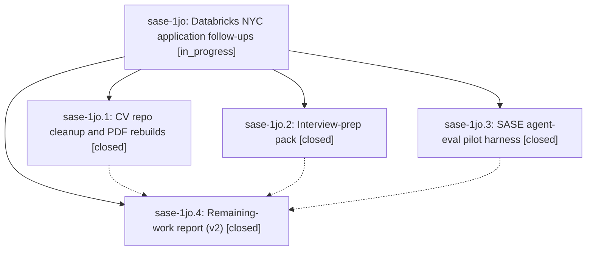

# Bead: sase-1jo — Databricks NYC application follow-ups

[Bead Pages](../README.md) / sase-1jo

**Status:** ◐ in_progress · **Type:** ▸ plan · **Tier:** epic
**Owner:** `bryanbugyi34@gmail.com` · **Created by:** [bbugyi200.apollo.6k](https://github.com/sase-org/sase--agents/blob/main/sessions/bbugyi200.apollo.6k.md) · **Assignee:** `sase-1jo.land`
**Created:** 2026-10-10 15:45:42 EDT
**Plan:** [202610/databricks\_followups.md](https://github.com/sase-org/sase--plans/blob/main/202610/databricks_followups.md)

<!-- sase:links:start -->

## Links

| Relation | Artifact | Why |
| --- | --- | --- |
| implemented-by | [plan:202610/databricks_followups.md][1] | derived from the plan's `bead_id:` frontmatter field |

_Plus 1 automatic references — see [Referenced By](#referenced-by)._

[1]: https://github.com/sase-org/sase--plans/blob/main/202610/databricks_followups.md

<!-- sase:links:end -->

## Description

Every recommendation in the research report databricks_nyc_cv_and_role_pitches.md that an agent can safely finish is done: the public CV repo is free of stale claims with all five PDFs rebuilt, the interview-prep material exists, and the eval-pilot harness is built. A concise databricks_nyc_cv_and_role_pitches_v2.md report next to the original lists exactly what Bryan still has to do himself.

## Phases

| Bead | Title | Status | Size | Created | Agents | Commits |
|---|---|---|---|---|---:|---:|
| [sase-1jo.1](sase-1jo.1.md) | CV repo cleanup and PDF rebuilds | ✓ closed | medium | 2026-10-10 | 1 | 0 |
| [sase-1jo.2](sase-1jo.2.md) | Interview-prep pack | ✓ closed | medium | 2026-10-10 | 1 | 1 |
| [sase-1jo.3](sase-1jo.3.md) | SASE agent-eval pilot harness | ✓ closed | large | 2026-10-10 | 1 | 0 |
| [sase-1jo.4](sase-1jo.4.md) | Remaining-work report (v2) | ✓ closed | small | 2026-10-10 | 1 | 1 |

## Lineage

## Agents

| Agent | Bead | Commits |
|---|---|---:|
| [bbugyi200.apollo.sase-1jo.1](https://github.com/sase-org/sase--agents/blob/main/agents/bbugyi200.apollo.sase-1jo.1/README.md) | [sase-1jo.1](sase-1jo.1.md) | 0 |
| [bbugyi200.apollo.sase-1jo.2](https://github.com/sase-org/sase--agents/blob/main/agents/bbugyi200.apollo.sase-1jo.2/README.md) | [sase-1jo.2](sase-1jo.2.md) | 1 |
| [bbugyi200.apollo.sase-1jo.3](https://github.com/sase-org/sase--agents/blob/main/sessions/bbugyi200.apollo.sase-1jo.3.md) | [sase-1jo.3](sase-1jo.3.md) | 0 |
| [bbugyi200.apollo.sase-1jo.4](https://github.com/sase-org/sase--agents/blob/main/agents/bbugyi200.apollo.sase-1jo.4/README.md) | [sase-1jo.4](sase-1jo.4.md) | 1 |
| [bbugyi200.apollo.sase-1jo.land](https://github.com/sase-org/sase--agents/blob/main/agents/bbugyi200.apollo.sase-1jo.land/README.md) | [sase-1jo](README.md) | 0 |

## Commits

| Repo | Commit | Subject | Bead | Committed |
|---|---|---|---|---|
| sase--research | [`sase--research@2fe342a`](https://github.com/sase-org/sase--research/commit/2fe342a01ae76e025a939a5a8dae220ed6d800f2) | docs(research): add Databricks NYC interview-prep pack | [sase-1jo.2](sase-1jo.2.md) | 2026-10-10 16:05:17 EDT |
| sase--research | [`sase--research@15020bd`](https://github.com/sase-org/sase--research/commit/15020bda925074c23342aa378641649ade8fd5c0) | feat(research): add Databricks application follow-up report | [sase-1jo.4](sase-1jo.4.md) | 2026-10-10 16:20:31 EDT |

<!-- sase:referenced-by:start -->

## Referenced By

| Relation | Artifact | Why | Uses |
| --- | --- | --- | ---: |
| read-by | [agent:sase-1jo.2][1] | Need parent epic context and remaining phases | 1 |

[1]: https://github.com/sase-org/sase--agents/blob/main/agents/bbugyi200.apollo.sase-1jo.2/README.md

<!-- sase:referenced-by:end -->
