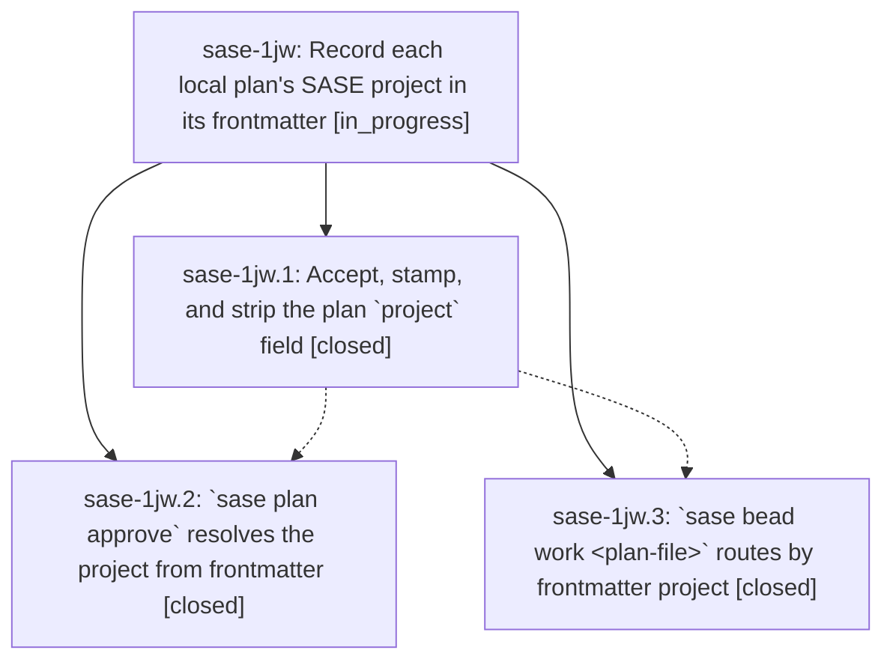

# Bead: sase-1jw — Record each local plan's SASE project in its frontmatter

[Bead Pages](../README.md) / sase-1jw

**Status:** ◐ in_progress · **Type:** ▸ plan · **Tier:** epic
**Owner:** `bryanbugyi34@gmail.com` · **Created by:** [bbugyi200.athena.0zl](https://github.com/sase-org/sase--agents/blob/main/sessions/bbugyi200.athena.0zl.md) · **Assignee:** `sase-1jw.land`
**Created:** 2026-10-11 07:37:56 EDT
**Plan:** [202610/plan\_project\_frontmatter.md](https://github.com/sase-org/sase--plans/blob/main/202610/plan_project_frontmatter.md)

<!-- sase:links:start -->

## Links

| Relation | Artifact | Why |
| --- | --- | --- |
| implemented-by | [plan:202610/plan_project_frontmatter.md][1] | derived from the plan's `bead_id:` frontmatter field |

[1]: https://github.com/sase-org/sase--plans/blob/main/202610/plan_project_frontmatter.md

<!-- sase:links:end -->

## Description

`sase plan propose` stamps the owning SASE project into every machine-local plan under `~/.sase/plans/`. `sase plan approve <plan-file>` and `sase bead work <plan-file>` use that field to pick the right project, so both work from any directory. The field never reaches a project's plan store.

## Phases

| Bead | Title | Status | Size | Created | Agents | Commits |
|---|---|---|---|---|---:|---:|
| [sase-1jw.1](sase-1jw.1.md) | Accept, stamp, and strip the plan \`project\` field | ✓ closed | medium | 2026-10-11 | 1 | 2 |
| [sase-1jw.2](sase-1jw.2.md) | \`sase plan approve\` resolves the project from frontmatter | ✓ closed | small | 2026-10-11 | 1 | 1 |
| [sase-1jw.3](sase-1jw.3.md) | \`sase bead work \<plan-file\>\` routes by frontmatter project | ✓ closed | medium | 2026-10-11 | 1 | 1 |

## Lineage

## Agents

| Agent | Bead | Commits |
|---|---|---:|
| [bbugyi200.athena.sase-1jw.1](https://github.com/sase-org/sase--agents/blob/main/agents/bbugyi200.athena.sase-1jw.1/README.md) | [sase-1jw.1](sase-1jw.1.md) | 1 |
| [bbugyi200.athena.sase-1jw.2](https://github.com/sase-org/sase--agents/blob/main/agents/bbugyi200.athena.sase-1jw.2/README.md) | [sase-1jw.2](sase-1jw.2.md) | 1 |
| [bbugyi200.athena.sase-1jw.3](https://github.com/sase-org/sase--agents/blob/main/agents/bbugyi200.athena.sase-1jw.3/README.md) | [sase-1jw.3](sase-1jw.3.md) | 1 |
| [bbugyi200.athena.sase-1jw.land](https://github.com/sase-org/sase--agents/blob/main/agents/bbugyi200.athena.sase-1jw.land/README.md) | [sase-1jw](README.md) | 0 |

## Commits

| Repo | Commit | Subject | Bead | Committed |
|---|---|---|---|---|
| sase-core | [`sase-core@96f7796`](https://github.com/sase-org/sase-core/commit/96f7796d06ac7524f7ba20a76633811b7b1aa32b) | feat(plan): validate machine-local project metadata | [sase-1jw.1](sase-1jw.1.md) | 2026-10-11 08:55:26 EDT |
| sase | [`e926d41`](https://github.com/sase-org/sase/commit/e926d4100b1a6960682f632dce5c7a3882f39a77) | feat: Accept, stamp, and strip the plan \`project\` field  (sase-1jw.1) | [sase-1jw.1](sase-1jw.1.md) | 2026-10-11 09:08:18 EDT |
| sase | [`465da09`](https://github.com/sase-org/sase/commit/465da09ead6efa7473f13fe18544be59f1731662) | feat(plan): resolve approval projects from frontmatter | [sase-1jw.2](sase-1jw.2.md) | 2026-10-11 10:43:16 EDT |
| sase | [`0c215c1`](https://github.com/sase-org/sase/commit/0c215c1f4c9fe8480e82c04d31a6eb39b7910f4c) | feat(bead): route plan-file work by frontmatter project | [sase-1jw.3](sase-1jw.3.md) | 2026-10-11 15:55:19 EDT |
