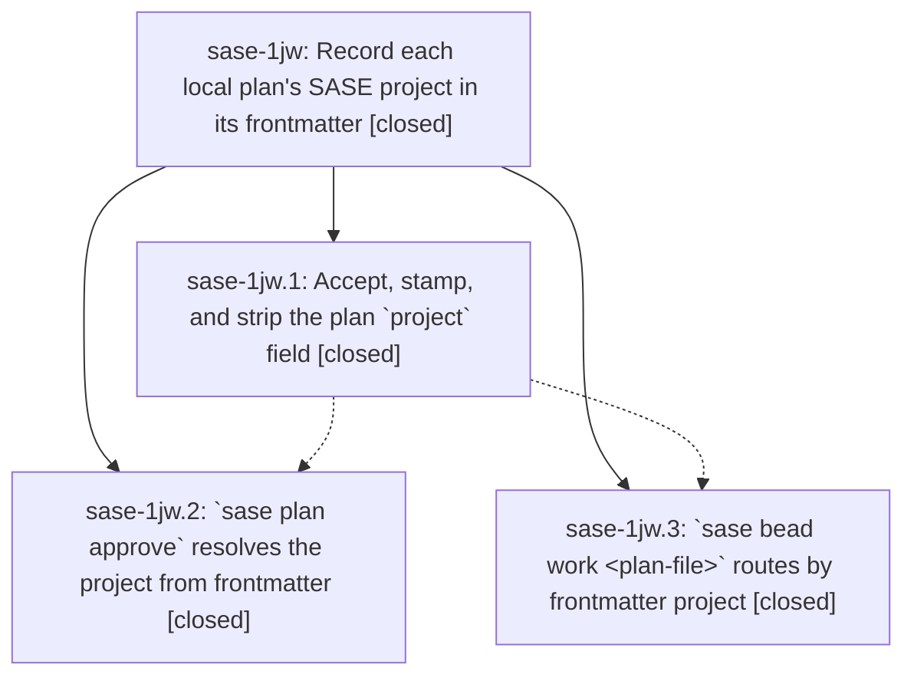

# Bead: sase-1jw — Record each local plan's SASE project in its frontmatter

[Bead Pages](../README.md) / sase-1jw

**Status:** ✓ closed · **Resolution:** done · **Type:** ▸ plan · **Tier:** epic
**Owner:** `bryanbugyi34@gmail.com` · **Created by:** [bbugyi200.athena.0zl](https://github.com/sase-org/sase--agents/blob/main/sessions/bbugyi200.athena.0zl.md) · **Assignee:** `sase-1jw.land`
**Created:** 2026-10-11 07:37:56 EDT · **Closed:** 2026-10-11 16:42:33 EDT
**Plan:** [202610/plan\_project\_frontmatter.md](https://github.com/sase-org/sase--plans/blob/main/202610/plan_project_frontmatter.md)

<!-- sase:links:start -->

## Links

| Relation | Artifact | Why |
| --- | --- | --- |
| implemented-by | [plan:202610/plan_project_frontmatter.md][1] | derived from the plan's `bead_id:` frontmatter field |

_Plus 1 automatic references — see [Referenced By](#referenced-by)._

[1]: https://github.com/sase-org/sase--plans/blob/main/202610/plan_project_frontmatter.md

<!-- sase:links:end -->

## Description

`sase plan propose` stamps the owning SASE project into every machine-local plan under `~/.sase/plans/`. `sase plan approve <plan-file>` and `sase bead work <plan-file>` use that field to pick the right project, so both work from any directory. The field never reaches a project's plan store.

## Notes

[2026-10-11T20:24:38Z · sase-1jw.land] FOLLOW-UP TRIAGE before the remaining-docs tale. Outcomes for the close note:

Declined. These proposals are not distinct open defects on current master:
- Symvision update_failure_geometry and project_for_done (sase-1jw.1 note #1). sase-1js and sase-1jp closed done on 2026-10-11 after that privatizing fix. The phase saw a stale workspace base. sase-1jw.3 reported symvision clean, and sase bead epic-symbols sase-1jw lists nothing.
- Flag-candidate registry (sase-1jw.1 note #2). ToolRun 367c8c7a986e162fb25f532f98e93c05 failed tests/completion/test_candidates_providers.py::test_flag_candidates_come_from_the_in_process_registry at assert keys == set() because agents_archive_view was present. Commit c10f074f59 changed that assertion to the live feature_flag_definitions() set. Isolated pytest on current master passed. No new task.
- Completion snapshot drift (sase-1jw.2 note #1 and sase-1jw.3 note #2, cited closed sase-1de). Both tests/completion/test_snapshot.py nodes passed in isolation on current master. sase-1de stays closed.
- Marker-path audit (sase-1by). That same ToolRun showed the known session_root_tab rename (run_agent_directive_metadata_preserved.py versus run_agent_directive_metadata.py). Isolated pytest on current master passed, so this landing does not add another +1.
- Bob highlights dry-run (sase-1jj). Isolated pytest of tests/test_file_hook_dispatch_regression.py::test_bob_dry_run_canonical_report_has_no_digest_suffix passed on current master. No +1.
- zsh smoke (sase-1jw.3 note #2). test_zsh_smoke.py produced warnings only in that ToolRun. The word zsh appeared inside the snapshot diff, not as its own FAILED node.
- Tool-run store locks (sase-1jw.3 note #2). Not among that run's seven FAILED nodes. The subprocess timeout is the git-identity node below. sase-18t stays the lock-contention bead and was not corroborated from this run.
- ACE reset-hook leak (sase-1jw.1 note #2). The phase said it passed on clean HEAD. Existing flake bead sase-13c. No new report.

Corroborated, not caused by sase-1jw:
- sase-1ic +1. tests/ace/tui/test_app_import_budget.py::test_tui_app_import_stays_under_startup_budget failed in isolation on current master: 3516 modules against the 3513 cap. Proposed by sase-1jw.3 note #1. That phase measured +0 sase.* growth versus its merge-base, and this epic does not import the TUI app.
- sase-120 +1. ToolRun 367c8c7a986e162fb25f532f98e93c05 failed tests/sdd/test_git_identity_fixture.py::test_sdd_git_identity_survives_empty_home_subprocess with subprocess.TimeoutExpired after 180s. Proposed by sase-1jw.2 note #1. The land agent inspected that log and did not re-run the full lane.

Integration, no code change: the display-snapshot commit builds labels from effective_project_name, which plan_project_for_artifacts_dir already returns. Formatted propose revalidation accepts the stamped project field. The only commit after sase-1jw.3 is the Agents Archive action boundary, which does not touch plan routing.

Remaining epic work: docs/sdd.md and the docs/cli.md sase plan approve row never say that a proposal's frontmatter project supplies the project when --project is omitted.

[2026-10-11T20:42:33Z · sase-1jw.land] Verified on master, by reading the phase beads, the three sase-1jw commits, and the current source: propose stamps the display name and archive/store writers strip it; gateless approve resolves frontmatter project after -P and refuses an unknown value; recovery uses the resolved project's primary checkout; bead work routes outside that project and does not grow a --project flag. Both reviewer decisions are honored. sase-core commit 96f7796d accepts the field and is inside the sase-core-revision.txt pin. Later display-snapshot and formatted-propose commits already share effective_project_name and authoring-mode acceptance of project, so they needed no further edit. The only commit after phase bead-work is the Agents Archive action boundary, which does not touch plan routing.

This tale added the missing approve docs: frontmatter project supplies the project when --project is omitted (docs/sdd.md and the docs/cli.md sase plan approve row).

Follow-ups, already recorded on sase-1jw and repeated here: declined symvision helpers (sase-1js and sase-1jp are closed; epic-symbols is empty), declined flag-candidate registry (current test matches feature_flag_definitions() and passed in isolation), declined completion-snapshot drift (both snapshot nodes passed; sase-1de stays closed), declined marker-path and Bob dry-run (both passed in isolation on current master), declined zsh smoke and tool-run store locks (not FAILED nodes in ToolRun 367c8c7a986e162fb25f532f98e93c05), declined the ACE reset-hook leak (passed on clean HEAD; sase-13c already tracks it). Corroborated sase-1ic (+1, import budget 3516 vs 3513, not caused by this epic) and sase-120 (+1, git-identity TimeoutExpired in that ToolRun, full lane not re-run).

## Phases

| Bead | Title | Status | Size | Created | Agents | Commits |
|---|---|---|---|---|---:|---:|
| [sase-1jw.1](sase-1jw.1.md) | Accept, stamp, and strip the plan \`project\` field | ✓ closed | medium | 2026-10-11 | 1 | 2 |
| [sase-1jw.2](sase-1jw.2.md) | \`sase plan approve\` resolves the project from frontmatter | ✓ closed | small | 2026-10-11 | 1 | 1 |
| [sase-1jw.3](sase-1jw.3.md) | \`sase bead work \<plan-file\>\` routes by frontmatter project | ✓ closed | medium | 2026-10-11 | 1 | 1 |

## Lineage

## Agents

| Agent | Bead | Commits |
|---|---|---:|
| [bbugyi200.athena.sase-1jw.1](https://github.com/sase-org/sase--agents/blob/main/agents/bbugyi200.athena.sase-1jw.1/README.md) | [sase-1jw.1](sase-1jw.1.md) | 1 |
| [bbugyi200.athena.sase-1jw.2](https://github.com/sase-org/sase--agents/blob/main/agents/bbugyi200.athena.sase-1jw.2/README.md) | [sase-1jw.2](sase-1jw.2.md) | 1 |
| [bbugyi200.athena.sase-1jw.3](https://github.com/sase-org/sase--agents/blob/main/agents/bbugyi200.athena.sase-1jw.3/README.md) | [sase-1jw.3](sase-1jw.3.md) | 1 |
| [bbugyi200.athena.sase-1jw.land](https://github.com/sase-org/sase--agents/blob/main/sessions/bbugyi200.athena.sase-1jw.land.md) | [sase-1jw](README.md) | 2 |

## Commits

| Repo | Commit | Subject | Bead | Committed |
|---|---|---|---|---|
| sase-core | [`sase-core@96f7796`](https://github.com/sase-org/sase-core/commit/96f7796d06ac7524f7ba20a76633811b7b1aa32b) | feat(plan): validate machine-local project metadata | [sase-1jw.1](sase-1jw.1.md) | 2026-10-11 08:55:26 EDT |
| sase | [`e926d41`](https://github.com/sase-org/sase/commit/e926d4100b1a6960682f632dce5c7a3882f39a77) | feat: Accept, stamp, and strip the plan \`project\` field  (sase-1jw.1) | [sase-1jw.1](sase-1jw.1.md) | 2026-10-11 09:08:18 EDT |
| sase | [`465da09`](https://github.com/sase-org/sase/commit/465da09ead6efa7473f13fe18544be59f1731662) | feat(plan): resolve approval projects from frontmatter | [sase-1jw.2](sase-1jw.2.md) | 2026-10-11 10:43:16 EDT |
| sase | [`0c215c1`](https://github.com/sase-org/sase/commit/0c215c1f4c9fe8480e82c04d31a6eb39b7910f4c) | feat(bead): route plan-file work by frontmatter project | [sase-1jw.3](sase-1jw.3.md) | 2026-10-11 15:55:19 EDT |
| sase | [`f21ef31`](https://github.com/sase-org/sase/commit/f21ef31d36880482196edaf6c9fff79d4d767c3e) | docs: document gateless approve project frontmatter | [sase-1jw](README.md) | 2026-10-11 16:44:01 EDT |
| sase--plans | [`sase--plans@af4f0da`](https://github.com/sase-org/sase--plans/commit/af4f0daed489f351272140e20c15b224d12b9e4c) | docs: mark plan\_project\_frontmatter epic done | [sase-1jw](README.md) | 2026-10-11 16:47:38 EDT |

<!-- sase:referenced-by:start -->

## Referenced By

| Relation | Artifact | Why | Uses |
| --- | --- | --- | ---: |
| read-by | [agent:sase-1jw.3][1] | Need parent epic status and sibling phases | 1 |

[1]: https://github.com/sase-org/sase--agents/blob/main/agents/bbugyi200.athena.sase-1jw.3/README.md

<!-- sase:referenced-by:end -->
