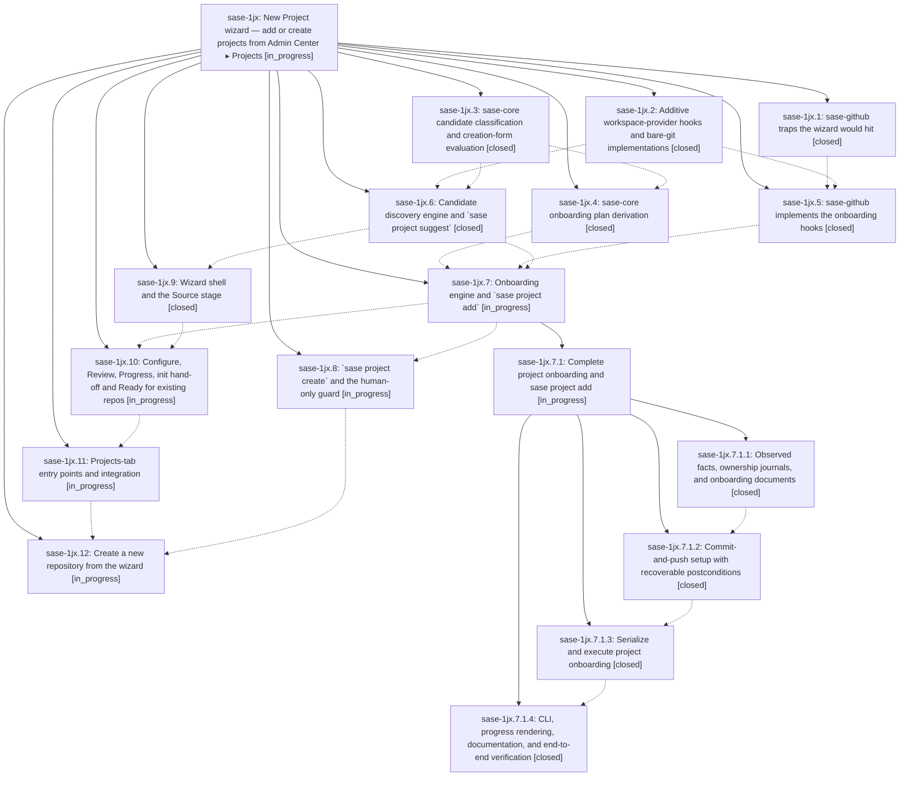

# Bead: sase-1jx — New Project wizard — add or create projects from Admin Center ▸ Projects

[Bead Pages](../README.md) / sase-1jx

**Status:** ◐ in_progress · **Type:** ▸ plan · **Tier:** epic
**Owner:** `bryanbugyi34@gmail.com` · **Created by:** [bbugyi200.athena.research.49.linker.w1](https://github.com/sase-org/sase--agents/blob/main/sessions/bbugyi200.athena.research.49.linker.w1.md) · **Assignee:** `sase-1jx.land`
**Created:** 2026-10-11 11:13:42 EDT
**Plan:** [202610/new\_project\_wizard.md](https://github.com/sase-org/sase--plans/blob/main/202610/new_project_wizard.md)

<!-- sase:links:start -->

## Links

| Relation | Artifact | Why |
| --- | --- | --- |
| implemented-by | [plan:202610/new_project_wizard.md][1] | derived from the plan's `bead_id:` frontmatter field |

_Plus 5 automatic references — see [Referenced By](#referenced-by)._

[1]: https://github.com/sase-org/sase--plans/blob/main/202610/new_project_wizard.md

<!-- sase:links:end -->

## Description

Pressing `n` on Admin Center ▸ Projects opens a beautiful three-stage New Project wizard (Source › Configure › Review). The user picks a provider, then either adds a repository SASE ranks as likely (local clones, unregistered repos in their GitHub owners, linked repos, disabled projects) or creates a brand-new repository through the provider plugin with every `gh repo create` option reachable. The project is registered enabled, set up so agents can launch in it, and ends on a Ready screen. The same behavior ships as `sase project suggest | add | create`, the CLI every frontend shares.

## Notes

[2026-10-11T23:08:05Z · sase-1jm.3.1.land] DISCOVERED ISSUE: just _lint-symvision (and so the lint stage of just check) fails on master d289b664a6 with: Error: --epic-symbol 'sase-1jx.6(classify_project_candidates)': bead 'sase-1jx.6' is closed. Remove this stale --epic-symbol entry and clean up the symbol. classify_project_candidates (src/sase/core/project_onboarding_facade.py:14) still has no non-test consumer; resolve it (wire up, privatize, delete) or re-key the Justfile line to the still-open consuming phase (e.g. sase-1jx.9/.10/.11). Found by the sase-1jm.3.1 land agent; not caused by sase-1jm.3.1.

## Phases

| Bead | Title | Status | Size | Created | Agents | Commits |
|---|---|---|---|---|---:|---:|
| [sase-1jx.1](sase-1jx.1.md) | sase-github traps the wizard would hit | ✓ closed | small | 2026-10-11 | 1 | 2 |
| [sase-1jx.10](sase-1jx.10.md) | Configure, Review, Progress, init hand-off and Ready for existing repos | ◐ in_progress | large | 2026-10-11 | 1 | 0 |
| [sase-1jx.11](sase-1jx.11.md) | Projects-tab entry points and integration | ◐ in_progress | medium | 2026-10-11 | 1 | 0 |
| [sase-1jx.12](sase-1jx.12.md) | Create a new repository from the wizard | ◐ in_progress | large | 2026-10-11 | 1 | 0 |
| [sase-1jx.2](sase-1jx.2.md) | Additive workspace-provider hooks and bare-git implementations | ✓ closed | medium | 2026-10-11 | 1 | 1 |
| [sase-1jx.3](sase-1jx.3.md) | sase-core candidate classification and creation-form evaluation | ✓ closed | medium | 2026-10-11 | 1 | 2 |
| [sase-1jx.4](sase-1jx.4.md) | sase-core onboarding plan derivation | ✓ closed | medium | 2026-10-11 | 1 | 2 |
| [sase-1jx.5](sase-1jx.5.md) | sase-github implements the onboarding hooks | ✓ closed | medium | 2026-10-11 | 1 | 1 |
| [sase-1jx.6](sase-1jx.6.md) | Candidate discovery engine and \`sase project suggest\` | ✓ closed | medium | 2026-10-11 | 1 | 1 |
| [sase-1jx.7](sase-1jx.7.md) | Onboarding engine and \`sase project add\` | ◐ in_progress | large | 2026-10-11 | 1 | 0 |
| [sase-1jx.8](sase-1jx.8.md) | \`sase project create\` and the human-only guard | ◐ in_progress | medium | 2026-10-11 | 1 | 0 |
| [sase-1jx.9](sase-1jx.9.md) | Wizard shell and the Source stage | ✓ closed | medium | 2026-10-11 | 1 | 1 |

## Lineage

## Agents

| Agent | Bead | Commits |
|---|---|---:|
| [bbugyi200.athena.sase-1jx.1](https://github.com/sase-org/sase--agents/blob/main/agents/bbugyi200.athena.sase-1jx.1/README.md) | [sase-1jx.1](sase-1jx.1.md) | 2 |
| [bbugyi200.athena.sase-1jx.10](https://github.com/sase-org/sase--agents/blob/main/agents/bbugyi200.athena.sase-1jx.10/README.md) | [sase-1jx.10](sase-1jx.10.md) | 0 |
| [bbugyi200.athena.sase-1jx.11](https://github.com/sase-org/sase--agents/blob/main/agents/bbugyi200.athena.sase-1jx.11/README.md) | [sase-1jx.11](sase-1jx.11.md) | 0 |
| [bbugyi200.athena.sase-1jx.12](https://github.com/sase-org/sase--agents/blob/main/agents/bbugyi200.athena.sase-1jx.12/README.md) | [sase-1jx.12](sase-1jx.12.md) | 0 |
| [bbugyi200.athena.sase-1jx.2](https://github.com/sase-org/sase--agents/blob/main/sessions/bbugyi200.athena.sase-1jx.2.md) | [sase-1jx.2](sase-1jx.2.md) | 1 |
| [bbugyi200.athena.sase-1jx.3](https://github.com/sase-org/sase--agents/blob/main/agents/bbugyi200.athena.sase-1jx.3/README.md) | [sase-1jx.3](sase-1jx.3.md) | 2 |
| [bbugyi200.athena.sase-1jx.4](https://github.com/sase-org/sase--agents/blob/main/agents/bbugyi200.athena.sase-1jx.4/README.md) | [sase-1jx.4](sase-1jx.4.md) | 2 |
| [bbugyi200.athena.sase-1jx.5](https://github.com/sase-org/sase--agents/blob/main/agents/bbugyi200.athena.sase-1jx.5/README.md) | [sase-1jx.5](sase-1jx.5.md) | 1 |
| [bbugyi200.athena.sase-1jx.6](https://github.com/sase-org/sase--agents/blob/main/sessions/bbugyi200.athena.sase-1jx.6.md) | [sase-1jx.6](sase-1jx.6.md) | 1 |
| [bbugyi200.athena.sase-1jx.7](https://github.com/sase-org/sase--agents/blob/main/sessions/bbugyi200.athena.sase-1jx.7.md) | [sase-1jx.7](sase-1jx.7.md) | 0 |
| [bbugyi200.athena.sase-1jx.7.1.1](https://github.com/sase-org/sase--agents/blob/main/agents/bbugyi200.athena.sase-1jx.7.1.1/README.md) | [sase-1jx.7.1.1](sase-1jx.7.1.1.md) | 1 |
| [bbugyi200.athena.sase-1jx.7.1.2](https://github.com/sase-org/sase--agents/blob/main/agents/bbugyi200.athena.sase-1jx.7.1.2/README.md) | [sase-1jx.7.1.2](sase-1jx.7.1.2.md) | 2 |
| [bbugyi200.athena.sase-1jx.7.1.3](https://github.com/sase-org/sase--agents/blob/main/agents/bbugyi200.athena.sase-1jx.7.1.3/README.md) | [sase-1jx.7.1.3](sase-1jx.7.1.3.md) | 1 |
| [bbugyi200.athena.sase-1jx.7.1.4](https://github.com/sase-org/sase--agents/blob/main/sessions/bbugyi200.athena.sase-1jx.7.1.4.md) | [sase-1jx.7.1.4](sase-1jx.7.1.4.md) | 1 |
| [bbugyi200.athena.sase-1jx.7.1.land](https://github.com/sase-org/sase--agents/blob/main/agents/bbugyi200.athena.sase-1jx.7.1.land/README.md) | [sase-1jx.7.1](sase-1jx.7.1.md) | 0 |
| [bbugyi200.athena.sase-1jx.8](https://github.com/sase-org/sase--agents/blob/main/agents/bbugyi200.athena.sase-1jx.8/README.md) | [sase-1jx.8](sase-1jx.8.md) | 0 |
| [bbugyi200.athena.sase-1jx.9](https://github.com/sase-org/sase--agents/blob/main/sessions/bbugyi200.athena.sase-1jx.9.md) | [sase-1jx.9](sase-1jx.9.md) | 1 |
| [bbugyi200.athena.sase-1jx.land](https://github.com/sase-org/sase--agents/blob/main/agents/bbugyi200.athena.sase-1jx.land/README.md) | [sase-1jx](README.md) | 0 |

## Commits

| Repo | Commit | Subject | Bead | Committed |
|---|---|---|---|---|
| sase | [`fa897ce`](https://github.com/sase-org/sase/commit/fa897ced7232bd775f434e838b8b6d876da4826c) | docs(sase): correct github\_orgs description to owner completion plus PR gating, not clone transport | [sase-1jx.1](sase-1jx.1.md) | 2026-10-11 11:43:37 EDT |
| sase-github | [`sase-github@ad4827c`](https://github.com/sase-org/sase-github/commit/ad4827c5e97ece193a715cbd4d4933989e0e8d0b) | fix(sase-github): bound git clone with timeout, honor SASE\_HOME, narrow host detection, fix github\_orgs docs | [sase-1jx.1](sase-1jx.1.md) | 2026-10-11 11:48:38 EDT |
| sase-core | [`sase-core@aaec3bf`](https://github.com/sase-org/sase-core/commit/aaec3bf2e888411b66852c00faeadf45b853e8f4) | feat(project-onboarding): classify candidates and evaluate creation forms | [sase-1jx.3](sase-1jx.3.md) | 2026-10-11 13:07:04 EDT |
| sase | [`1a169fb`](https://github.com/sase-org/sase/commit/1a169fb90904d78092ef31c6f00fe37947537142) | feat(core): add project\_onboarding facade for classify and form evaluation | [sase-1jx.3](sase-1jx.3.md) | 2026-10-11 14:05:35 EDT |
| sase | [`2b576ef`](https://github.com/sase-org/sase/commit/2b576ef33c54eac46cd35f1c5b298067450904ad) | feat(workspace): add repository onboarding hooks | [sase-1jx.2](sase-1jx.2.md) | 2026-10-11 16:56:58 EDT |
| sase-core | [`sase-core@792255d`](https://github.com/sase-org/sase-core/commit/792255d53b6ba2aacaf1fef103ec45cac65f487b) | feat(project-onboarding): derive ordered onboarding plans from facts | [sase-1jx.4](sase-1jx.4.md) | 2026-10-11 17:05:10 EDT |
| sase | [`4f95a21`](https://github.com/sase-org/sase/commit/4f95a21e4a9c760a3818356d73c34eb84943cf46) | feat(project-onboarding): wrap plan\_project\_onboarding in the Python facade | [sase-1jx.4](sase-1jx.4.md) | 2026-10-11 17:11:58 EDT |
| sase-github | [`sase-github@f1da372`](https://github.com/sase-org/sase-github/commit/f1da3725f0100839341e0eb89cdb202fc08d8444) | feat(github): add workspace onboarding hooks for GitHub repo refs | [sase-1jx.5](sase-1jx.5.md) | 2026-10-11 17:20:44 EDT |
| sase | [`d8d803f`](https://github.com/sase-org/sase/commit/d8d803f8cd97ace114a8162d9c97170a2b2e77cd) | feat(project-onboarding): add candidate discovery engine and sase project suggest | [sase-1jx.6](sase-1jx.6.md) | 2026-10-11 18:54:41 EDT |
| sase | [`4a5c040`](https://github.com/sase-org/sase/commit/4a5c04043b7b8711043a219c6585947e35274353) | feat(tui): add test-pushable New Project Source stage | [sase-1jx.9](sase-1jx.9.md) | 2026-10-11 20:02:18 EDT |
| sase | [`9756adf`](https://github.com/sase-org/sase/commit/9756adf38eb9c8c3e14ed2f291141eb9c3cdd8c0) | feat(project-onboarding): add plan documents, facts, journals, and actor detection | [sase-1jx.7.1.1](sase-1jx.7.1.1.md) | 2026-10-11 22:35:25 EDT |
| sase-core | [`sase-core@4bd08c6`](https://github.com/sase-org/sase-core/commit/4bd08c6e8039249f9cf454e814875fc35e8e820f) | feat(project-onboarding): preserve setup obligations during recovery | [sase-1jx.7.1.2](sase-1jx.7.1.2.md) | 2026-10-12 00:16:34 EDT |
| sase | [`431dfab`](https://github.com/sase-org/sase/commit/431dfab81263354512b349680024a53c363fc25c) | feat(project-onboarding): add recoverable management setup | [sase-1jx.7.1.2](sase-1jx.7.1.2.md) | 2026-10-12 00:21:20 EDT |
| sase | [`791c179`](https://github.com/sase-org/sase/commit/791c1797b92901137ff87a9f5663416d9ed5b2b8) | feat(project-onboarding): serialize and execute project onboarding (sase-1jx.7.1.3) | [sase-1jx.7.1.3](sase-1jx.7.1.3.md) | 2026-10-12 02:12:49 EDT |
| sase | [`4ccfc62`](https://github.com/sase-org/sase/commit/4ccfc62c8f05013317cfb1cd13ed42067f709ad8) | feat(project): add existing repository onboarding | [sase-1jx.7.1.4](sase-1jx.7.1.4.md) | 2026-10-12 03:26:38 EDT |

<!-- sase:referenced-by:start -->

## Referenced By

| Relation | Artifact | Why | Uses |
| --- | --- | --- | ---: |
| read-by | [agent:sase-1jx.1][1] | epic scope | 1 |
| read-by | [agent:sase-1jx.3][2] | Need parent epic context and remaining notes | 1 |
| read-by | [agent:sase-1jx.4][3] | Need parent epic decisions and full plan context | 1 |
| read-by | [agent:sase-1jx.5][4] | need epic scope and decisions | 1 |
| read-by | [agent:sase-1jx.7.1.1][5] | Need status to re-key stale epic-symbols | 1 |

[1]: https://github.com/sase-org/sase--agents/blob/main/agents/bbugyi200.athena.sase-1jx.1/README.md
[2]: https://github.com/sase-org/sase--agents/blob/main/agents/bbugyi200.athena.sase-1jx.3/README.md
[3]: https://github.com/sase-org/sase--agents/blob/main/agents/bbugyi200.athena.sase-1jx.4/README.md
[4]: https://github.com/sase-org/sase--agents/blob/main/agents/bbugyi200.athena.sase-1jx.5/README.md
[5]: https://github.com/sase-org/sase--agents/blob/main/agents/bbugyi200.athena.sase-1jx.7.1.1/README.md

<!-- sase:referenced-by:end -->
