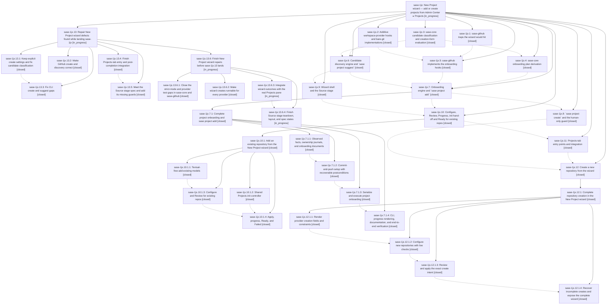

# Bead: sase-1jx — New Project wizard — add or create projects from Admin Center ▸ Projects

[Bead Pages](../README.md) / sase-1jx

**Status:** ◐ in_progress · **Type:** ▸ plan · **Tier:** epic
**Owner:** `bryanbugyi34@gmail.com` · **Created by:** [bbugyi200.athena.research.49.linker.w1](https://github.com/sase-org/sase--agents/blob/main/sessions/bbugyi200.athena.research.49.linker.w1.md) · **Assignee:** `sase-1jx.land`
**Created:** 2026-10-11 11:13:42 EDT
**Plan:** [202610/new\_project\_wizard.md](https://github.com/sase-org/sase--plans/blob/main/202610/new_project_wizard.md)

<!-- sase:links:start -->

## Links

| Relation | Artifact | Why |
| --- | --- | --- |
| implemented-by | [plan:202610/new_project_wizard.md][1] | derived from the plan's `bead_id:` frontmatter field |

_Plus 7 automatic references — see [Referenced By](#referenced-by)._

[1]: https://github.com/sase-org/sase--plans/blob/main/202610/new_project_wizard.md

<!-- sase:links:end -->

## Description

Pressing `n` on Admin Center ▸ Projects opens a beautiful three-stage New Project wizard (Source › Configure › Review). The user picks a provider, then either adds a repository SASE ranks as likely (local clones, unregistered repos in their GitHub owners, linked repos, disabled projects) or creates a brand-new repository through the provider plugin with every `gh repo create` option reachable. The project is registered enabled, set up so agents can launch in it, and ends on a Ready screen. The same behavior ships as `sase project suggest | add | create`, the CLI every frontend shares.

## Notes

[2026-10-11T23:08:05Z · sase-1jm.3.1.land] DISCOVERED ISSUE: just _lint-symvision (and so the lint stage of just check) fails on master d289b664a6 with: Error: --epic-symbol 'sase-1jx.6(classify_project_candidates)': bead 'sase-1jx.6' is closed. Remove this stale --epic-symbol entry and clean up the symbol. classify_project_candidates (src/sase/core/project_onboarding_facade.py:14) still has no non-test consumer; resolve it (wire up, privatize, delete) or re-key the Justfile line to the still-open consuming phase (e.g. sase-1jx.9/.10/.11). Found by the sase-1jm.3.1 land agent; not caused by sase-1jm.3.1.

[2026-10-12T07:48:47Z · sase-1jx.7.1.land] DISCOVERED ISSUE: tests/completion/test_kind_coverage.py::test_every_value_slot_is_kinded_choiced_or_hinted fails in isolation at master 4ccfc62c8f with the only uncaptioned slot project/suggest:owner. sase project suggest --owner was added by d8d803f8cd (phase sase-1jx.6), and project/add slots are captioned. Proposed inside sase-1jx.7.1.1's check triage and confirmed by the sase-1jx.7.1 land agent; not caused by the add engine. Fix by giving the owner action a completion kind, choices, or value_hint.

[2026-10-12T08:21:07Z · sase-1jx.7.1.land] DISCOVERED ISSUE: tests/main/test_project_handler_suggest.py::TestHandleSuggest::test_explicit_provider_is_remembered and test_options_forward_to_discovery failed in sase tool run check 795fed0da389e11f335ab004bfa3e6f4 (verdict new_failures: the first node NEW, the second KNOWN via witness 0409af70242a4314f4aa519ba6c48ebb) because handle_suggest returned 2: provider 'gh' was not in the live workspace-provider registry. Both pass in isolation (6 passed). Not caused by sase-1jx.7.1; the handler is the suggest phase. The suite-order dependency on registered providers is the defect.

[2026-10-12T15:47:58Z · sase-1ka.land] SKILL DEPLOY HANDOFF (sase-1ka land agent): workspace-build 'sase skill init --check' at master c9c1df82cc reports 14 provider skill files out of sync: sase_plan (choice-label guidance from sase-1ka.5, ace43b398a) and sase_project ('sase project create' section from this epic). sase-1ka's plan asked for a post-landing 'sase skill init --force' deploy, but a full deploy would also publish the sase_project create docs while the installed global sase CLI still lacks 'sase project create' and this epic is still landing, so sase-1ka deferred it. The deploy that follows this epic's landing (and the human global reinstall) will carry the sase_plan change too.

[2026-10-12T18:42:19Z · sase-1jm.land] DISCOVERED ISSUE (sase-1jm land agent, master 101c853939): just symvision is red on 14 unused public New Project symbols with only test consumers. new_project_create.py (3dc675fffe, sase-1jx.12.1.2): add_instead_seed, build_create_plan_request, create_identity_verdict, create_review_request, default_create_owner, default_create_visibility, lenient_effective_options, probe_result_current, supported_create_visibilities; new_project_resume.py: CreateRecovery (241e33a797, sase-1jx.12.1.4), ResumeContext (95e2115b16, sase-1jx.10.1); new_project_configure_facts.py: checkout_facts_from_source (95e2115b16); new_project_configure_model.py: validate_draft; project_onboarding/_apply_locks.py: apply_identity_lock_path (791c1797b9, sase-1jx.7.1.3). They were masked until b249bc5e69 removed the _load_archive_bundle private import that made symvision exit early (same masking as sase-1hp). Repro: just symvision. Fix per symvision policy (privatize in-file-only helpers, delete dead ones with their tests). Also proposed by sase-1jm.8 note #3 (build_create_plan_request). sase-1jm's own 5 symbols and sase-1ka's plan-decision symbols are tracked separately.

[2026-10-12T18:53:53Z · sase-1jx.land] LANDING AUDIT (sase-1jx.land, master 101c853939): read this epic, all 12 phases, the nested child epics sase-1jx.7.1/.10.1/.12.1 and their 12 phases, every note, and plan:202610/new_project_wizard.md. Reviewed the 22 commits that mention sase-1jx plus 313492a4f0/885f5c2f2d (apply split), sase-core aaec3bf2/792255d5/4bd08c6e (pinned 4bd08c6e; all three are ancestors of the pin) and sase-github ad4827c/f1da372 (released 0.2.23). DECISIONS honored: there is no decisions:project-create-human-only strand; glossary:sase-project now says add/create/the wizard also create projects. sase bead epic-symbols sase-1jx is empty.

INTEGRATION: the 54 non-epic commits since fa897ced72 (Archive/RECORD deck, Plan Review decision cards, wait_checks, test splits, project display labels) add no second registration or create path and duplicate nothing in the wizard. Overlap is limited to styles.tcss regions, the Justfile symvision comments, and the apply split, all already reconciled.

CANNOT CLOSE: three parallel audits (CLI, TUI, providers/core) confirmed epic-caused defects. Planned as child epic "Repair New Project wizard defects found while landing sase-1jx" (parent_bead sase-1jx), with five phases:
- core-repairs: explicit-false bools dropped from effective_options; strict false-conflict; numbered sibling hides its primary; ref-less inventory rows.
- gh-repairs: every template create fails because of --add-readme/-g/-l/-t with -p; incomplete post-create verify; timeout without re-probe; no pagination; host port; numbered copies; Enterprise refs; docs.
- cli-repairs: bare-git create apply_argv cannot be run (bare NAME, forced --visibility private); custom bare_dir orphaned; exists-without-evidence returns failed, not blocked; suggest -o fails providers without owners; non-hermetic suggest/gate tests (DISCOVERED ISSUE #3); skill bypass text; workspace.md registry table.
- tui-entry-repairs: palette opener reopens the wizard on every Projects activation; hints not width-aware; no current-project context; incomplete post-add sequence and filter handling; Ready esc/+/c; preferences lost after mid-run close; missing tests, goldens and docs.
- tui-source-repairs: loading rows selectable; t remedy unguarded; no 80x24 collapse; missing Source copy/states; teardown; preference clobbering; missing perf/debounce/paste tests.

EPIC NOTES: #1 classify_project_candidates is resolved (consumed by discovery.py and new_project_source_model.py; its row is gone). #2 project/suggest:owner is fixed (kinds.py, 597931b222; test_kind_coverage passes). #3 is child-epic work (cli-repairs). #4 skill deploy is deferred to after landing and after the human global reinstall.

FOLLOW-UP TRIAGE (complete):
- TUI import budget, 3517 vs 3513 in isolation (.2#1 .3#2 .4#2 .8#3 .9#1 .11#1): +1 on sase-1ic.
- Project: fake/tmp headers, reproduced (.4#3 .9#1 .11#1): +1 on sase-1k4.
- sdd git identity flake (.4#1): +1 on sase-120.
- sase-core federation flake (.3#1): +1 on sase-1gz.
- todo-highlight intermittent (.11#1): +1 on closed sase-xh.
- sase-github suite without built sase_core_rs, plus its released sase>=0.18.0 floor (.1#1): +1 on sase-16p (same remedy: ship sase 0.18.0; SASE's own installs use --no-deps and are unaffected).
- Audit-found pre-existing 'sase project --help' ==SUPPRESS== rows (since f47815df31): +1 on sase-18c.
- Declined, with reasons:
  - stale epic-symbol rows (.8#1): already removed by 8ed37c4ef8, 52e10f302a and ebd17bf5bf;
  - kind coverage (.8#2): fixed;
  - project-current help and marker-path audit (.9#1): both pass at HEAD;
  - revival-preview copy and _load_archive_bundle (.11#1): already declined as fixed by sase-1jx.12.1.land;
  - sase-github private sase imports: a pre-existing pattern, not a defect.
  - Grandchild proposals were triaged by their own child land agents.

POST-LANDING HANDOFF (for the resuming lander): after sase-1jx closes, propose through /sase_gate the human global reinstall, then sase skill init --force, then the design's disposable-repo smoke (sase project create gh:<you>/sase-wizard-smoke -v private --yes, deleted by hand).

## Phases

| Bead | Title | Status | Size | Created | Agents | Commits |
|---|---|---|---|---|---:|---:|
| [sase-1jx.1](sase-1jx.1.md) | sase-github traps the wizard would hit | ✓ closed | small | 2026-10-11 | 1 | 1 |
| [sase-1jx.10](sase-1jx.10.md) | Configure, Review, Progress, init hand-off and Ready for existing repos | ✓ closed | large | 2026-10-11 | 1 | 0 |
| [sase-1jx.11](sase-1jx.11.md) | Projects-tab entry points and integration | ✓ closed | medium | 2026-10-11 | 1 | 1 |
| [sase-1jx.12](sase-1jx.12.md) | Create a new repository from the wizard | ✓ closed | large | 2026-10-11 | 1 | 0 |
| [sase-1jx.2](sase-1jx.2.md) | Additive workspace-provider hooks and bare-git implementations | ✓ closed | medium | 2026-10-11 | 1 | 1 |
| [sase-1jx.3](sase-1jx.3.md) | sase-core candidate classification and creation-form evaluation | ✓ closed | medium | 2026-10-11 | 1 | 2 |
| [sase-1jx.4](sase-1jx.4.md) | sase-core onboarding plan derivation | ✓ closed | medium | 2026-10-11 | 1 | 2 |
| [sase-1jx.5](sase-1jx.5.md) | sase-github implements the onboarding hooks | ✓ closed | medium | 2026-10-11 | 1 | 0 |
| [sase-1jx.6](sase-1jx.6.md) | Candidate discovery engine and \`sase project suggest\` | ✓ closed | medium | 2026-10-11 | 1 | 1 |
| [sase-1jx.7](sase-1jx.7.md) | Onboarding engine and \`sase project add\` | ✓ closed | large | 2026-10-11 | 1 | 0 |
| [sase-1jx.8](sase-1jx.8.md) | \`sase project create\` and the human-only guard | ✓ closed | medium | 2026-10-11 | 1 | 1 |
| [sase-1jx.9](sase-1jx.9.md) | Wizard shell and the Source stage | ✓ closed | medium | 2026-10-11 | 1 | 1 |

## Lineage

## Agents

| Agent | Bead | Commits |
|---|---|---:|
| [bbugyi200.athena.sase-1jx.1](https://github.com/sase-org/sase--agents/blob/main/agents/bbugyi200.athena.sase-1jx.1/README.md) | [sase-1jx.1](sase-1jx.1.md) | 1 |
| [bbugyi200.athena.sase-1jx.10](https://github.com/sase-org/sase--agents/blob/main/sessions/bbugyi200.athena.sase-1jx.10.md) | [sase-1jx.10](sase-1jx.10.md) | 0 |
| [bbugyi200.athena.sase-1jx.10.1.1](https://github.com/sase-org/sase--agents/blob/main/sessions/bbugyi200.athena.sase-1jx.10.1.1.md) | [sase-1jx.10.1.1](sase-1jx.10.1.1.md) | 1 |
| [bbugyi200.athena.sase-1jx.10.1.2](https://github.com/sase-org/sase--agents/blob/main/agents/bbugyi200.athena.sase-1jx.10.1.2/README.md) | [sase-1jx.10.1.2](sase-1jx.10.1.2.md) | 1 |
| [bbugyi200.athena.sase-1jx.10.1.3](https://github.com/sase-org/sase--agents/blob/main/agents/bbugyi200.athena.sase-1jx.10.1.3/README.md) | [sase-1jx.10.1.3](sase-1jx.10.1.3.md) | 1 |
| [bbugyi200.athena.sase-1jx.10.1.4](https://github.com/sase-org/sase--agents/blob/main/agents/bbugyi200.athena.sase-1jx.10.1.4/README.md) | [sase-1jx.10.1.4](sase-1jx.10.1.4.md) | 1 |
| [bbugyi200.athena.sase-1jx.10.1.land](https://github.com/sase-org/sase--agents/blob/main/sessions/bbugyi200.athena.sase-1jx.10.1.land.md) | [sase-1jx.10.1](sase-1jx.10.1.md) | 2 |
| [bbugyi200.athena.sase-1jx.11](https://github.com/sase-org/sase--agents/blob/main/agents/bbugyi200.athena.sase-1jx.11/README.md) | [sase-1jx.11](sase-1jx.11.md) | 1 |
| [bbugyi200.athena.sase-1jx.12](https://github.com/sase-org/sase--agents/blob/main/sessions/bbugyi200.athena.sase-1jx.12.md) | [sase-1jx.12](sase-1jx.12.md) | 0 |
| [bbugyi200.athena.sase-1jx.12.1.1](https://github.com/sase-org/sase--agents/blob/main/agents/bbugyi200.athena.sase-1jx.12.1.1/README.md) | [sase-1jx.12.1.1](sase-1jx.12.1.1.md) | 1 |
| [bbugyi200.athena.sase-1jx.12.1.2](https://github.com/sase-org/sase--agents/blob/main/agents/bbugyi200.athena.sase-1jx.12.1.2/README.md) | [sase-1jx.12.1.2](sase-1jx.12.1.2.md) | 1 |
| [bbugyi200.athena.sase-1jx.12.1.3](https://github.com/sase-org/sase--agents/blob/main/sessions/bbugyi200.athena.sase-1jx.12.1.3.md) | [sase-1jx.12.1.3](sase-1jx.12.1.3.md) | 1 |
| [bbugyi200.athena.sase-1jx.12.1.4](https://github.com/sase-org/sase--agents/blob/main/sessions/bbugyi200.athena.sase-1jx.12.1.4.md) | [sase-1jx.12.1.4](sase-1jx.12.1.4.md) | 1 |
| [bbugyi200.athena.sase-1jx.12.1.land](https://github.com/sase-org/sase--agents/blob/main/agents/bbugyi200.athena.sase-1jx.12.1.land/README.md) | [sase-1jx.12.1](sase-1jx.12.1.md) | 2 |
| [bbugyi200.athena.sase-1jx.13.1](https://github.com/sase-org/sase--agents/blob/main/agents/bbugyi200.athena.sase-1jx.13.1/README.md) | [sase-1jx.13.1](sase-1jx.13.1.md) | 1 |
| [bbugyi200.athena.sase-1jx.13.2](https://github.com/sase-org/sase--agents/blob/main/agents/bbugyi200.athena.sase-1jx.13.2/README.md) | [sase-1jx.13.2](sase-1jx.13.2.md) | 0 |
| [bbugyi200.athena.sase-1jx.13.3](https://github.com/sase-org/sase--agents/blob/main/agents/bbugyi200.athena.sase-1jx.13.3/README.md) | [sase-1jx.13.3](sase-1jx.13.3.md) | 1 |
| [bbugyi200.athena.sase-1jx.13.4](https://github.com/sase-org/sase--agents/blob/main/agents/bbugyi200.athena.sase-1jx.13.4/README.md) | [sase-1jx.13.4](sase-1jx.13.4.md) | 1 |
| [bbugyi200.athena.sase-1jx.13.5](https://github.com/sase-org/sase--agents/blob/main/sessions/bbugyi200.athena.sase-1jx.13.5.md) | [sase-1jx.13.5](sase-1jx.13.5.md) | 1 |
| [bbugyi200.athena.sase-1jx.13.6.1](https://github.com/sase-org/sase--agents/blob/main/agents/bbugyi200.athena.sase-1jx.13.6.1/README.md) | [sase-1jx.13.6.1](sase-1jx.13.6.1.md) | 1 |
| [bbugyi200.athena.sase-1jx.13.6.2](https://github.com/sase-org/sase--agents/blob/main/agents/bbugyi200.athena.sase-1jx.13.6.2/README.md) | [sase-1jx.13.6.2](sase-1jx.13.6.2.md) | 1 |
| [bbugyi200.athena.sase-1jx.13.6.3](https://github.com/sase-org/sase--agents/blob/main/agents/bbugyi200.athena.sase-1jx.13.6.3/README.md) | [sase-1jx.13.6.3](sase-1jx.13.6.3.md) | 0 |
| [bbugyi200.athena.sase-1jx.13.6.4](https://github.com/sase-org/sase--agents/blob/main/agents/bbugyi200.athena.sase-1jx.13.6.4/README.md) | [sase-1jx.13.6.4](sase-1jx.13.6.4.md) | 0 |
| [bbugyi200.athena.sase-1jx.13.6.land](https://github.com/sase-org/sase--agents/blob/main/agents/bbugyi200.athena.sase-1jx.13.6.land/README.md) | [sase-1jx.13.6](sase-1jx.13.6.md) | 0 |
| [bbugyi200.athena.sase-1jx.13.land](https://github.com/sase-org/sase--agents/blob/main/sessions/bbugyi200.athena.sase-1jx.13.land.md) | [sase-1jx.13](sase-1jx.13.md) | 0 |
| [bbugyi200.athena.sase-1jx.2](https://github.com/sase-org/sase--agents/blob/main/sessions/bbugyi200.athena.sase-1jx.2.md) | [sase-1jx.2](sase-1jx.2.md) | 1 |
| [bbugyi200.athena.sase-1jx.3](https://github.com/sase-org/sase--agents/blob/main/agents/bbugyi200.athena.sase-1jx.3/README.md) | [sase-1jx.3](sase-1jx.3.md) | 2 |
| [bbugyi200.athena.sase-1jx.4](https://github.com/sase-org/sase--agents/blob/main/agents/bbugyi200.athena.sase-1jx.4/README.md) | [sase-1jx.4](sase-1jx.4.md) | 2 |
| [bbugyi200.athena.sase-1jx.5](https://github.com/sase-org/sase--agents/blob/main/agents/bbugyi200.athena.sase-1jx.5/README.md) | [sase-1jx.5](sase-1jx.5.md) | 0 |
| [bbugyi200.athena.sase-1jx.6](https://github.com/sase-org/sase--agents/blob/main/sessions/bbugyi200.athena.sase-1jx.6.md) | [sase-1jx.6](sase-1jx.6.md) | 1 |
| [bbugyi200.athena.sase-1jx.7](https://github.com/sase-org/sase--agents/blob/main/sessions/bbugyi200.athena.sase-1jx.7.md) | [sase-1jx.7](sase-1jx.7.md) | 0 |
| [bbugyi200.athena.sase-1jx.7.1.1](https://github.com/sase-org/sase--agents/blob/main/agents/bbugyi200.athena.sase-1jx.7.1.1/README.md) | [sase-1jx.7.1.1](sase-1jx.7.1.1.md) | 1 |
| [bbugyi200.athena.sase-1jx.7.1.2](https://github.com/sase-org/sase--agents/blob/main/agents/bbugyi200.athena.sase-1jx.7.1.2/README.md) | [sase-1jx.7.1.2](sase-1jx.7.1.2.md) | 2 |
| [bbugyi200.athena.sase-1jx.7.1.3](https://github.com/sase-org/sase--agents/blob/main/agents/bbugyi200.athena.sase-1jx.7.1.3/README.md) | [sase-1jx.7.1.3](sase-1jx.7.1.3.md) | 1 |
| [bbugyi200.athena.sase-1jx.7.1.4](https://github.com/sase-org/sase--agents/blob/main/sessions/bbugyi200.athena.sase-1jx.7.1.4.md) | [sase-1jx.7.1.4](sase-1jx.7.1.4.md) | 1 |
| [bbugyi200.athena.sase-1jx.7.1.land](https://github.com/sase-org/sase--agents/blob/main/agents/bbugyi200.athena.sase-1jx.7.1.land/README.md) | [sase-1jx.7.1](sase-1jx.7.1.md) | 2 |
| [bbugyi200.athena.sase-1jx.8](https://github.com/sase-org/sase--agents/blob/main/agents/bbugyi200.athena.sase-1jx.8/README.md) | [sase-1jx.8](sase-1jx.8.md) | 1 |
| [bbugyi200.athena.sase-1jx.9](https://github.com/sase-org/sase--agents/blob/main/sessions/bbugyi200.athena.sase-1jx.9.md) | [sase-1jx.9](sase-1jx.9.md) | 1 |
| [bbugyi200.athena.sase-1jx.land](https://github.com/sase-org/sase--agents/blob/main/sessions/bbugyi200.athena.sase-1jx.land.md) | [sase-1jx](README.md) | 0 |

## Commits

| Repo | Commit | Subject | Bead | Committed |
|---|---|---|---|---|
| sase | [`fa897ce`](https://github.com/sase-org/sase/commit/fa897ced7232bd775f434e838b8b6d876da4826c) | docs(sase): correct github\_orgs description to owner completion plus PR gating, not clone transport | [sase-1jx.1](sase-1jx.1.md) | 2026-10-11 11:43:37 EDT |
| sase-core | [`sase-core@aaec3bf`](https://github.com/sase-org/sase-core/commit/aaec3bf2e888411b66852c00faeadf45b853e8f4) | feat(project-onboarding): classify candidates and evaluate creation forms | [sase-1jx.3](sase-1jx.3.md) | 2026-10-11 13:07:04 EDT |
| sase | [`1a169fb`](https://github.com/sase-org/sase/commit/1a169fb90904d78092ef31c6f00fe37947537142) | feat(core): add project\_onboarding facade for classify and form evaluation | [sase-1jx.3](sase-1jx.3.md) | 2026-10-11 14:05:35 EDT |
| sase | [`2b576ef`](https://github.com/sase-org/sase/commit/2b576ef33c54eac46cd35f1c5b298067450904ad) | feat(workspace): add repository onboarding hooks | [sase-1jx.2](sase-1jx.2.md) | 2026-10-11 16:56:58 EDT |
| sase-core | [`sase-core@792255d`](https://github.com/sase-org/sase-core/commit/792255d53b6ba2aacaf1fef103ec45cac65f487b) | feat(project-onboarding): derive ordered onboarding plans from facts | [sase-1jx.4](sase-1jx.4.md) | 2026-10-11 17:05:10 EDT |
| sase | [`4f95a21`](https://github.com/sase-org/sase/commit/4f95a21e4a9c760a3818356d73c34eb84943cf46) | feat(project-onboarding): wrap plan\_project\_onboarding in the Python facade | [sase-1jx.4](sase-1jx.4.md) | 2026-10-11 17:11:58 EDT |
| sase | [`d8d803f`](https://github.com/sase-org/sase/commit/d8d803f8cd97ace114a8162d9c97170a2b2e77cd) | feat(project-onboarding): add candidate discovery engine and sase project suggest | [sase-1jx.6](sase-1jx.6.md) | 2026-10-11 18:54:41 EDT |
| sase | [`4a5c040`](https://github.com/sase-org/sase/commit/4a5c04043b7b8711043a219c6585947e35274353) | feat(tui): add test-pushable New Project Source stage | [sase-1jx.9](sase-1jx.9.md) | 2026-10-11 20:02:18 EDT |
| sase | [`9756adf`](https://github.com/sase-org/sase/commit/9756adf38eb9c8c3e14ed2f291141eb9c3cdd8c0) | feat(project-onboarding): add plan documents, facts, journals, and actor detection | [sase-1jx.7.1.1](sase-1jx.7.1.1.md) | 2026-10-11 22:35:25 EDT |
| sase-core | [`sase-core@4bd08c6`](https://github.com/sase-org/sase-core/commit/4bd08c6e8039249f9cf454e814875fc35e8e820f) | feat(project-onboarding): preserve setup obligations during recovery | [sase-1jx.7.1.2](sase-1jx.7.1.2.md) | 2026-10-12 00:16:34 EDT |
| sase | [`431dfab`](https://github.com/sase-org/sase/commit/431dfab81263354512b349680024a53c363fc25c) | feat(project-onboarding): add recoverable management setup | [sase-1jx.7.1.2](sase-1jx.7.1.2.md) | 2026-10-12 00:21:20 EDT |
| sase | [`791c179`](https://github.com/sase-org/sase/commit/791c1797b92901137ff87a9f5663416d9ed5b2b8) | feat(project-onboarding): serialize and execute project onboarding (sase-1jx.7.1.3) | [sase-1jx.7.1.3](sase-1jx.7.1.3.md) | 2026-10-12 02:12:49 EDT |
| sase | [`4ccfc62`](https://github.com/sase-org/sase/commit/4ccfc62c8f05013317cfb1cd13ed42067f709ad8) | feat(project): add existing repository onboarding | [sase-1jx.7.1.4](sase-1jx.7.1.4.md) | 2026-10-12 03:26:38 EDT |
| sase | [`8ed37c4`](https://github.com/sase-org/sase/commit/8ed37c4ef868db73fca1b870691d6f31f8846a4e) | fix(project-onboarding): retire sase-1jx.7.1 symbol exemptions | [sase-1jx.7.1](sase-1jx.7.1.md) | 2026-10-12 04:56:56 EDT |
| sase--plans | [`sase--plans@9d14f87`](https://github.com/sase-org/sase--plans/commit/9d14f8738c9477716d26d23c524cc1428342debf) | docs(plans): mark the project add engine plan done | [sase-1jx.7.1](sase-1jx.7.1.md) | 2026-10-12 05:01:37 EDT |
| sase | [`86b8fe2`](https://github.com/sase-org/sase/commit/86b8fe2cce33bced5819bdafd89f71e99e770b68) | feat(new-project): add Textual-free add-existing configure, review and progress models | [sase-1jx.10.1.1](sase-1jx.10.1.1.md) | 2026-10-12 05:12:11 EDT |
| sase | [`393d0a4`](https://github.com/sase-org/sase/commit/393d0a4a5a32ea0b4f59a8b0db119723ac2a0374) | feat(ace-tui): extract shared projects init controller into init flow module | [sase-1jx.10.1.2](sase-1jx.10.1.2.md) | 2026-10-12 05:13:02 EDT |
| sase | [`5714395`](https://github.com/sase-org/sase/commit/5714395778f3a97e9d276dafd419b5c6563c9a5c) | feat(ace): add existing project configure and review stages | [sase-1jx.10.1.3](sase-1jx.10.1.3.md) | 2026-10-12 05:52:00 EDT |
| sase | [`597931b`](https://github.com/sase-org/sase/commit/597931b2221aa4ab577b90e30ea8e34fbf48e124) | feat(project): add sase project create with human-only guard | [sase-1jx.8](sase-1jx.8.md) | 2026-10-12 07:08:28 EDT |
| sase | [`558a45e`](https://github.com/sase-org/sase/commit/558a45eca47b9e44b31c61f5f318333eae899c4f) | feat(tui): add durable New Project apply, Progress, Ready, and Failed | [sase-1jx.10.1.4](sase-1jx.10.1.4.md) | 2026-10-12 07:55:53 EDT |
| sase | [`95e2115`](https://github.com/sase-org/sase/commit/95e2115b16e8524b4d42230b333d11d6edb25199) | fix(tui): land add-existing New Project wizard repairs | [sase-1jx.10.1](sase-1jx.10.1.md) | 2026-10-12 09:14:25 EDT |
| sase--plans | [`sase--plans@81377d5`](https://github.com/sase-org/sase--plans/commit/81377d5c33d16e1bfa7bc40a23719d81ecdc5e98) | docs(plans): mark add-existing New Project epic plan done | [sase-1jx.10.1](sase-1jx.10.1.md) | 2026-10-12 09:18:02 EDT |
| sase | [`e4b3a85`](https://github.com/sase-org/sase/commit/e4b3a85f4ea576c97e8ed87b220ba6d5a778cfa0) | feat(ace): add Projects wizard entry and launch flow | [sase-1jx.11](sase-1jx.11.md) | 2026-10-12 09:48:31 EDT |
| sase | [`0defe76`](https://github.com/sase-org/sase/commit/0defe76db8bd45af79f5fe4b070b374f28fc34fd) | feat(tui): add provider repository creation form | [sase-1jx.12.1.1](sase-1jx.12.1.1.md) | 2026-10-12 10:35:53 EDT |
| sase | [`3dc675f`](https://github.com/sase-org/sase/commit/3dc675fffe0d5027be31ed47ffb1517fe237d228) | feat(tui): configure new repositories with live checks | [sase-1jx.12.1.2](sase-1jx.12.1.2.md) | 2026-10-12 11:53:56 EDT |
| sase | [`1de7cf6`](https://github.com/sase-org/sase/commit/1de7cf6c8d9590790cb00518e52ce3bdf7d9dcc8) | feat(tui): apply exact create intent from New Project Review | [sase-1jx.12.1.3](sase-1jx.12.1.3.md) | 2026-10-12 13:22:20 EDT |
| sase | [`241e33a`](https://github.com/sase-org/sase/commit/241e33a79721b725c4808f6988ad139bacd99ff5) | feat(new-project): recover incomplete creates and expose the complete wizard | [sase-1jx.12.1.4](sase-1jx.12.1.4.md) | 2026-10-12 14:00:25 EDT |
| sase | [`5cb48bd`](https://github.com/sase-org/sase/commit/5cb48bdd36933d2512dc0669f71b5a0bf22eaf30) | refactor(ace): privatize test-only symbols after the create wizard | [sase-1jx.12.1](sase-1jx.12.1.md) | 2026-10-12 14:59:57 EDT |
| sase--plans | [`sase--plans@81830f0`](https://github.com/sase-org/sase--plans/commit/81830f0439a5cc16ea72b5a0f11804f656b83599) | docs(plans): mark the create-repository wizard plan done | [sase-1jx.12.1](sase-1jx.12.1.md) | 2026-10-12 15:04:38 EDT |
| sase-core | [`sase-core@98c3682`](https://github.com/sase-org/sase-core/commit/98c3682f293892a4e9c9a31fa25dd0a05517d367) | fix(project-onboarding): keep explicit off bools, strict excluded-field conflicts, primary-sibling LOCAL merge, annotation-only inventory | [sase-1jx.13.1](sase-1jx.13.1.md) | 2026-10-12 15:37:56 EDT |
| sase | [`39a081d`](https://github.com/sase-org/sase/commit/39a081d3ea6bc55e6187d65f615d372ea5410f9d) | fix(ace): complete Projects wizard entry repair | [sase-1jx.13.4](sase-1jx.13.4.md) | 2026-10-12 16:53:49 EDT |
| sase | [`926645d`](https://github.com/sase-org/sase/commit/926645df890ea2ca6e11f381c0e355f45614d005) | fix(project): round-trip create apply\_argv and honor bare-git dirs | [sase-1jx.13.3](sase-1jx.13.3.md) | 2026-10-12 17:09:24 EDT |
| sase | [`90db7f7`](https://github.com/sase-org/sase/commit/90db7f78eb9a87413fb65b24945c152c999c98a4) | feat(new-project-wizard): meet Source stage spec and add missing guards | [sase-1jx.13.5](sase-1jx.13.5.md) | 2026-10-12 18:57:23 EDT |
| sase-core | [`sase-core@2fc3d77`](https://github.com/sase-org/sase-core/commit/2fc3d7754a3585180d0d2d7bd7ca1e034de31cdc) | fix(project-onboarding): conflict excluded fields at default in strict mode | [sase-1jx.13.6.1](sase-1jx.13.6.1.md) | 2026-10-12 20:25:01 EDT |
| sase | [`9d4e90e`](https://github.com/sase-org/sase/commit/9d4e90e51db406cd29e316089da6dac0103bb147) | fix(onboarding): repair create wizard provider flows | [sase-1jx.13.6.2](sase-1jx.13.6.2.md) | 2026-10-12 21:15:53 EDT |

<!-- sase:referenced-by:start -->

## Referenced By

| Relation | Artifact | Why | Uses |
| --- | --- | --- | ---: |
| read-by | [agent:sase-1jx.1][1] | epic scope | 1 |
| read-by | [agent:sase-1jx.12.1.land][2] | Confirm the containing epic stayed open | 1 |
| read-by | [agent:sase-1jx.3][3] | Need parent epic context and remaining notes | 1 |
| read-by | [agent:sase-1jx.4][4] | Need parent epic decisions and full plan context | 1 |
| read-by | [agent:sase-1jx.5][5] | need epic scope and decisions | 1 |
| read-by | [agent:sase-1jx.7.1.1][6] | Need status to re-key stale epic-symbols | 1 |
| read-by | [agent:sase-1jx.7.1.land][7] | Confirm epic and phase stay closed and the wizard epic stays open | 2 |

[1]: https://github.com/sase-org/sase--agents/blob/main/agents/bbugyi200.athena.sase-1jx.1/README.md
[2]: https://github.com/sase-org/sase--agents/blob/main/agents/bbugyi200.athena.sase-1jx.12.1.land/README.md
[3]: https://github.com/sase-org/sase--agents/blob/main/agents/bbugyi200.athena.sase-1jx.3/README.md
[4]: https://github.com/sase-org/sase--agents/blob/main/agents/bbugyi200.athena.sase-1jx.4/README.md
[5]: https://github.com/sase-org/sase--agents/blob/main/agents/bbugyi200.athena.sase-1jx.5/README.md
[6]: https://github.com/sase-org/sase--agents/blob/main/agents/bbugyi200.athena.sase-1jx.7.1.1/README.md
[7]: https://github.com/sase-org/sase--agents/blob/main/agents/bbugyi200.athena.sase-1jx.7.1.land/README.md

<!-- sase:referenced-by:end -->
