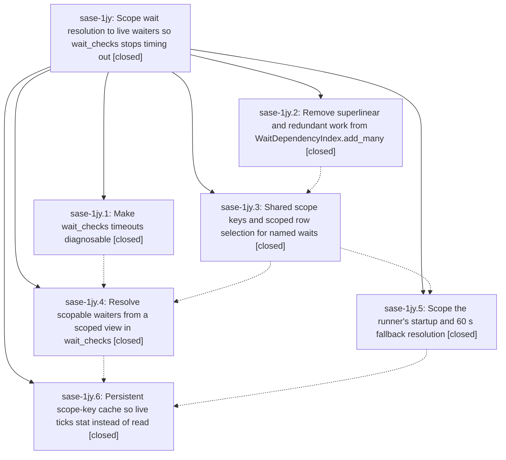

# Bead: sase-1jy — Scope wait resolution to live waiters so wait\_checks stops timing out

[Bead Pages](../README.md) / sase-1jy

**Status:** ✓ closed · **Resolution:** done · **Type:** ▸ plan · **Tier:** epic
**Owner:** `bryanbugyi34@gmail.com` · **Created by:** [bbugyi200.athena.0zo](https://github.com/sase-org/sase--agents/blob/main/sessions/bbugyi200.athena.0zo.md) · **Assignee:** `sase-1jy.land`
**Created:** 2026-10-11 11:18:28 EDT · **Closed:** 2026-10-11 19:28:41 EDT
**Plan:** [202610/wait\_checks\_scoped\_view.md](https://github.com/sase-org/sase--plans/blob/main/202610/wait_checks_scoped_view.md)

<!-- sase:links:start -->

## Links

| Relation | Artifact | Why |
| --- | --- | --- |
| implemented-by | [plan:202610/wait_checks_scoped_view.md][1] | derived from the plan's `bead_id:` frontmatter field |

_Plus 4 automatic references — see [Referenced By](#referenced-by)._

[1]: https://github.com/sase-org/sase--plans/blob/main/202610/wait_checks_scoped_view.md

<!-- sase:links:end -->

## Description

A wait_checks tick with live named-agent waiters loads only the artifact rows those waiters can depend on instead of the whole artifact history. Ticks stay far below the 2-minute job timeout under host load, release latency moves toward sase-1hn's p50 <= 5 s / p95 <= 15 s target, and parked runners' 60 s fallback stops rebuilding the full project history. Release decisions stay exactly what the full view would decide.

## Notes

[2026-10-11T23:08:10Z · sase-1jm.3.1.land] DISCOVERED ISSUE: tests/test_agent_artifact_marker_path_passing_audit.py::test_tracked_marker_path_passing_sites_are_reviewed fails deterministically on master d289b664a6 with an unreviewed tracked marker-path passing site 'src/sase/axe/run_agent_wait_deps.py:_scoped_project_rows', introduced by d289b664a6 (sase-1jy.6, persistent scope-key cache). Review the site and add it to the reviewed allowlist (or change it). Found by the sase-1jm.3.1 land agent; not caused by sase-1jm.3.1. Related older audit sites are tracked on task sase-1by.

[2026-10-11T23:19:24Z · sase-1jy.land] LAND MEASUREMENTS (scope-key-cache item 6, missing from sase-1jy.6 notes; recorded by the land agent on 2026-10-11, athena, load ~9-14). Read-only host parity sweep with a WARM scope-key cache (cold-built from the same snapshot into a throwaway path, never the real ~/.sase/cache file; no publish, no patch, no-op bead sync_hint): 919 waiting.json markers (827 pending, 92 already-ready), scopable=900 (waiting_for only 620, waiting_for+beads 143, beads only 3, other 134), unscopable=19, parse_failures=0, MISMATCHES=0 on resolve_wait_release (with fresh_index), dependency_member_dirs, and terminal_blockers. Warm-cache selection read only 901 metas across ~1.8k selection passes over 17,956 dirs (re-reads of actively-rewritten metas); scoped views p50=2 rows, max=29. Cache file: 17,935 entries, 4.7 MB, cold build+save 955 ms, warm load 53 ms. Live tick (24 live waiters, all scopable): full view 4,620 ms (17,935 rows; view 3,694 ms, resolve 540 ms) vs scoped warm cache 1,177 ms (112 rows; walk 413, view 762, resolve 1). Runner fallback for gh_sase-org__sase waiter on sase-63.3: full build_wait_dependency_index 3,229 ms (16,104 rows) vs scoped cold cache 1,880 ms vs scoped warm cache 522 ms (2 rows); full _resolve_marker_release with warm cache 489 ms, decision unchanged (blocked on sase-63.3).

[2026-10-11T23:28:41Z · sase-1jy.land] LANDED. Verification: I read all six closed phases and every note, and reviewed the six epic commits (b59b8a78bd, 9982db1942, fe77e92d56, 814dbcafb4, 89572caad6, d289b664a6) against the plan:
- ChopLogger flushes every line, and wait_checks emits walk/view progress lines plus walk_ms/view_ms/resolve_ms/view_rows/scoped_waiters/full_view_waiters.
- add_many batches clan-tribe refreshes and cache invalidation and gates plan_path reads.
- _add_prepared and artifact_scope_keys share the artifact_row_identity helper. marker_scope_keys returns None for artifacts, fork sources, hoods, wait_for_epics_of (a superset of armed targets), wait_epic_follows, and tribe-prefixed or non-string names.
- wait_checks reads live markers once, builds a scoped view (union keys plus waiter dirs) and a lazy full view, and keys scoped confirmation per waiter with the scope in the memo key.
- The runner's _resolve_marker_release and _release_satisfied_at build scoped project views (equivalent to WaitDependencyIndex.build), and unscopable shapes still call build_wait_dependency_index.
- Only wait_checks writes the scope-key cache, atomically and only on change. Runners read it read-only, and a corrupt cache reads as empty.
- docs/axe.md and default_config.yml are updated. No --epic-symbol entries.

Focused wait/scope/runner/chop-sdk suites: 392 passed.

The remaining phase-6 item 6 is now done (see the LAND MEASUREMENTS note): a warm-cache read-only host parity sweep found 0 mismatches over 900 scopable markers (919 total), a live tick took 4.6 s full vs 1.2 s scoped, and a runner fallback took 3.2 s full vs 0.5 s scoped.

Epic-caused issue fixed in landing: test_tracked_marker_path_passing_sites_are_reviewed failed on the new run_agent_wait_deps.py:_scoped_project_rows read-meta callback. I added a reviewed read-only exemption.

Integration: since the epic began, no non-epic commit touched wait resolution, the runner, chops, or the scan. I fast-forwarded to origin/master 117f4cebbc, and sase tool run check cc853a479d29c541e9856a9b216e5e7e succeeded.

sase-1hn: noted as item 1 implemented, with final timings. It stays open for item 2.

Follow-up triage:
- TUI import budget (.1 #1, .2 #2, .4 #2, .6 #1): +1 sase-1ic. The epic adds 0 TUI-closure modules.
- Git identity flake (.1, .2 #3): +1 sase-120.
- Wrapper fidelity (.1 #1): +1 sase-19c, with the sibling node noted.
- zsh sbd alias (.1, .2 #3): +1 sase-13a.
- Monitor capacity weight-two (.2 #3): +1 sase-12f.
- Commit view modal (.2 #3): new flake sase-1k6.
- empty_panel semicolon/escape (.4 #2): +1 sase-1al.
- agy warm probe (.4 #2): new flake sase-1k7.
- known_continuation continues_past_all_known (.4 #2): new flake sase-1k8, related to sase-1gi.
- Project: fake/tmp header tests (.4 #2, .6 #1): new ci sase-1k4, root cause df61663204.
- plan_validate corrects schema (.6 #1): filed as sase-1k5, then closed because upstream 117f4cebbc had already fixed it.
- muse missed-mint (.6 #2): new flake sase-1k9.
- settlement_retention supervisor-sigterm (.6 #2): +1 sase-18t, the same ToolRun-store database-locked contention.
- monitor_result persist (.6 #2): +1 sase-1a0.
No proposal was declined.

## Phases

| Bead | Title | Status | Size | Created | Agents | Commits |
|---|---|---|---|---|---:|---:|
| [sase-1jy.1](sase-1jy.1.md) | Make wait\_checks timeouts diagnosable | ✓ closed | small | 2026-10-11 | 1 | 1 |
| [sase-1jy.2](sase-1jy.2.md) | Remove superlinear and redundant work from WaitDependencyIndex.add\_many | ✓ closed | medium | 2026-10-11 | 1 | 1 |
| [sase-1jy.3](sase-1jy.3.md) | Shared scope keys and scoped row selection for named waits | ✓ closed | medium | 2026-10-11 | 1 | 1 |
| [sase-1jy.4](sase-1jy.4.md) | Resolve scopable waiters from a scoped view in wait\_checks | ✓ closed | medium | 2026-10-11 | 1 | 1 |
| [sase-1jy.5](sase-1jy.5.md) | Scope the runner's startup and 60 s fallback resolution | ✓ closed | small | 2026-10-11 | 1 | 1 |
| [sase-1jy.6](sase-1jy.6.md) | Persistent scope-key cache so live ticks stat instead of read | ✓ closed | medium | 2026-10-11 | 1 | 1 |

## Lineage

## Agents

| Agent | Bead | Commits |
|---|---|---:|
| [bbugyi200.athena.sase-1jy.1](https://github.com/sase-org/sase--agents/blob/main/agents/bbugyi200.athena.sase-1jy.1/README.md) | [sase-1jy.1](sase-1jy.1.md) | 1 |
| [bbugyi200.athena.sase-1jy.2](https://github.com/sase-org/sase--agents/blob/main/agents/bbugyi200.athena.sase-1jy.2/README.md) | [sase-1jy.2](sase-1jy.2.md) | 1 |
| [bbugyi200.athena.sase-1jy.3](https://github.com/sase-org/sase--agents/blob/main/sessions/bbugyi200.athena.sase-1jy.3.md) | [sase-1jy.3](sase-1jy.3.md) | 1 |
| [bbugyi200.athena.sase-1jy.4](https://github.com/sase-org/sase--agents/blob/main/agents/bbugyi200.athena.sase-1jy.4/README.md) | [sase-1jy.4](sase-1jy.4.md) | 1 |
| [bbugyi200.athena.sase-1jy.5](https://github.com/sase-org/sase--agents/blob/main/agents/bbugyi200.athena.sase-1jy.5/README.md) | [sase-1jy.5](sase-1jy.5.md) | 1 |
| [bbugyi200.athena.sase-1jy.6](https://github.com/sase-org/sase--agents/blob/main/sessions/bbugyi200.athena.sase-1jy.6.md) | [sase-1jy.6](sase-1jy.6.md) | 1 |
| [bbugyi200.athena.sase-1jy.land](https://github.com/sase-org/sase--agents/blob/main/agents/bbugyi200.athena.sase-1jy.land/README.md) | [sase-1jy](README.md) | 1 |

## Commits

| Repo | Commit | Subject | Bead | Committed |
|---|---|---|---|---|
| sase | [`b59b8a7`](https://github.com/sase-org/sase/commit/b59b8a78bdc1a7ee6b1573678b7be95c06ab5ad9) | feat(wait-checks): add tick diagnostics | [sase-1jy.1](sase-1jy.1.md) | 2026-10-11 12:15:08 EDT |
| sase | [`9982db1`](https://github.com/sase-org/sase/commit/9982db19428a0b3c6239b43cc5f7b7d4eae31b07) | perf(wait-index): batch add\_many with linear clan-tribe refresh and cached plan checks | [sase-1jy.2](sase-1jy.2.md) | 2026-10-11 12:55:12 EDT |
| sase | [`fe77e92`](https://github.com/sase-org/sase/commit/fe77e92d564bbc7a71ef7406bcca913cc6fc2212) | feat(wait): add scoped row selection for named waits | [sase-1jy.3](sase-1jy.3.md) | 2026-10-11 16:28:20 EDT |
| sase | [`814dbca`](https://github.com/sase-org/sase/commit/814dbcafb4eb6e3e465d00fb5bc1dd260cbbbe0d) | fix(axe): scope runner wait indexes to named-wait keys | [sase-1jy.5](sase-1jy.5.md) | 2026-10-11 16:59:36 EDT |
| sase | [`89572ca`](https://github.com/sase-org/sase/commit/89572caad6f9adb6097f1be7ced58ca35230b531) | feat(wait): resolve scopable waiters from a scoped wait\_checks view | [sase-1jy.4](sase-1jy.4.md) | 2026-10-11 17:28:01 EDT |
| sase | [`d289b66`](https://github.com/sase-org/sase/commit/d289b664a675a7a32f8cdb5540938190021a1580) | feat(wait): persist per-artifact scope-key cache for wait\_checks ticks | [sase-1jy.6](sase-1jy.6.md) | 2026-10-11 18:43:04 EDT |
| sase | [`9a2cde5`](https://github.com/sase-org/sase/commit/9a2cde5dada3e7e6219c9bb9f9b3afa6215b2d9e) | test(wait): review runner scoped-row meta reads in the marker path audit | [sase-1jy](README.md) | 2026-10-11 19:31:47 EDT |

<!-- sase:referenced-by:start -->

## Referenced By

| Relation | Artifact | Why | Uses |
| --- | --- | --- | ---: |
| read-by | [agent:sase-1jy.1][1] | Need the epic decisions governing this phase | 1 |
| read-by | [agent:sase-1jy.2][2] | need epic DECISIONS and scope for phase sase-1jy.2 | 1 |
| read-by | [agent:sase-1jy.4][3] | Need parent epic DECISIONS and sibling phase status | 1 |
| read-by | [agent:sase-1jy.5][4] | Need epic DECISIONS that are final for this phase | 1 |

[1]: https://github.com/sase-org/sase--agents/blob/main/agents/bbugyi200.athena.sase-1jy.1/README.md
[2]: https://github.com/sase-org/sase--agents/blob/main/agents/bbugyi200.athena.sase-1jy.2/README.md
[3]: https://github.com/sase-org/sase--agents/blob/main/agents/bbugyi200.athena.sase-1jy.4/README.md
[4]: https://github.com/sase-org/sase--agents/blob/main/agents/bbugyi200.athena.sase-1jy.5/README.md

<!-- sase:referenced-by:end -->
