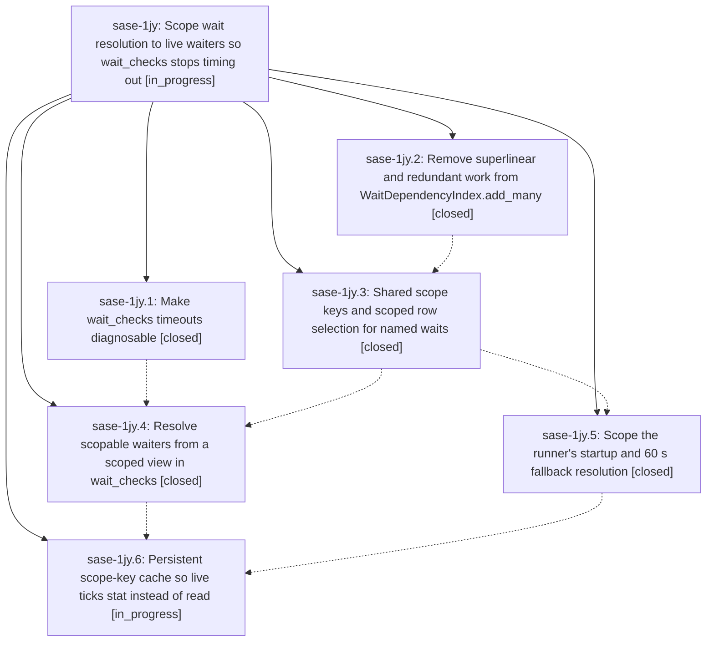

# Bead: sase-1jy — Scope wait resolution to live waiters so wait\_checks stops timing out

[Bead Pages](../README.md) / sase-1jy

**Status:** ◐ in_progress · **Type:** ▸ plan · **Tier:** epic
**Owner:** `bryanbugyi34@gmail.com` · **Created by:** [bbugyi200.athena.0zo](https://github.com/sase-org/sase--agents/blob/main/sessions/bbugyi200.athena.0zo.md) · **Assignee:** `sase-1jy.land`
**Created:** 2026-10-11 11:18:28 EDT
**Plan:** [202610/wait\_checks\_scoped\_view.md](https://github.com/sase-org/sase--plans/blob/main/202610/wait_checks_scoped_view.md)

<!-- sase:links:start -->

## Links

| Relation | Artifact | Why |
| --- | --- | --- |
| implemented-by | [plan:202610/wait_checks_scoped_view.md][1] | derived from the plan's `bead_id:` frontmatter field |

_Plus 3 automatic references — see [Referenced By](#referenced-by)._

[1]: https://github.com/sase-org/sase--plans/blob/main/202610/wait_checks_scoped_view.md

<!-- sase:links:end -->

## Description

A wait_checks tick with live named-agent waiters loads only the artifact rows those waiters can depend on instead of the whole artifact history. Ticks stay far below the 2-minute job timeout under host load, release latency moves toward sase-1hn's p50 <= 5 s / p95 <= 15 s target, and parked runners' 60 s fallback stops rebuilding the full project history. Release decisions stay exactly what the full view would decide.

## Phases

| Bead | Title | Status | Size | Created | Agents | Commits |
|---|---|---|---|---|---:|---:|
| [sase-1jy.1](sase-1jy.1.md) | Make wait\_checks timeouts diagnosable | ✓ closed | small | 2026-10-11 | 1 | 1 |
| [sase-1jy.2](sase-1jy.2.md) | Remove superlinear and redundant work from WaitDependencyIndex.add\_many | ✓ closed | medium | 2026-10-11 | 1 | 1 |
| [sase-1jy.3](sase-1jy.3.md) | Shared scope keys and scoped row selection for named waits | ✓ closed | medium | 2026-10-11 | 1 | 1 |
| [sase-1jy.4](sase-1jy.4.md) | Resolve scopable waiters from a scoped view in wait\_checks | ✓ closed | medium | 2026-10-11 | 1 | 1 |
| [sase-1jy.5](sase-1jy.5.md) | Scope the runner's startup and 60 s fallback resolution | ✓ closed | small | 2026-10-11 | 1 | 1 |
| [sase-1jy.6](sase-1jy.6.md) | Persistent scope-key cache so live ticks stat instead of read | ◐ in_progress | medium | 2026-10-11 | 1 | 0 |

## Lineage

## Agents

| Agent | Bead | Commits |
|---|---|---:|
| [bbugyi200.athena.sase-1jy.1](https://github.com/sase-org/sase--agents/blob/main/agents/bbugyi200.athena.sase-1jy.1/README.md) | [sase-1jy.1](sase-1jy.1.md) | 1 |
| [bbugyi200.athena.sase-1jy.2](https://github.com/sase-org/sase--agents/blob/main/agents/bbugyi200.athena.sase-1jy.2/README.md) | [sase-1jy.2](sase-1jy.2.md) | 1 |
| [bbugyi200.athena.sase-1jy.3](https://github.com/sase-org/sase--agents/blob/main/sessions/bbugyi200.athena.sase-1jy.3.md) | [sase-1jy.3](sase-1jy.3.md) | 1 |
| [bbugyi200.athena.sase-1jy.4](https://github.com/sase-org/sase--agents/blob/main/agents/bbugyi200.athena.sase-1jy.4/README.md) | [sase-1jy.4](sase-1jy.4.md) | 1 |
| [bbugyi200.athena.sase-1jy.5](https://github.com/sase-org/sase--agents/blob/main/agents/bbugyi200.athena.sase-1jy.5/README.md) | [sase-1jy.5](sase-1jy.5.md) | 1 |
| [bbugyi200.athena.sase-1jy.6](https://github.com/sase-org/sase--agents/blob/main/agents/bbugyi200.athena.sase-1jy.6/README.md) | [sase-1jy.6](sase-1jy.6.md) | 0 |
| [bbugyi200.athena.sase-1jy.land](https://github.com/sase-org/sase--agents/blob/main/agents/bbugyi200.athena.sase-1jy.land/README.md) | [sase-1jy](README.md) | 0 |

## Commits

| Repo | Commit | Subject | Bead | Committed |
|---|---|---|---|---|
| sase | [`b59b8a7`](https://github.com/sase-org/sase/commit/b59b8a78bdc1a7ee6b1573678b7be95c06ab5ad9) | feat(wait-checks): add tick diagnostics | [sase-1jy.1](sase-1jy.1.md) | 2026-10-11 12:15:08 EDT |
| sase | [`9982db1`](https://github.com/sase-org/sase/commit/9982db19428a0b3c6239b43cc5f7b7d4eae31b07) | perf(wait-index): batch add\_many with linear clan-tribe refresh and cached plan checks | [sase-1jy.2](sase-1jy.2.md) | 2026-10-11 12:55:12 EDT |
| sase | [`fe77e92`](https://github.com/sase-org/sase/commit/fe77e92d564bbc7a71ef7406bcca913cc6fc2212) | feat(wait): add scoped row selection for named waits | [sase-1jy.3](sase-1jy.3.md) | 2026-10-11 16:28:20 EDT |
| sase | [`814dbca`](https://github.com/sase-org/sase/commit/814dbcafb4eb6e3e465d00fb5bc1dd260cbbbe0d) | fix(axe): scope runner wait indexes to named-wait keys | [sase-1jy.5](sase-1jy.5.md) | 2026-10-11 16:59:36 EDT |
| sase | [`89572ca`](https://github.com/sase-org/sase/commit/89572caad6f9adb6097f1be7ced58ca35230b531) | feat(wait): resolve scopable waiters from a scoped wait\_checks view | [sase-1jy.4](sase-1jy.4.md) | 2026-10-11 17:28:01 EDT |

<!-- sase:referenced-by:start -->

## Referenced By

| Relation | Artifact | Why | Uses |
| --- | --- | --- | ---: |
| read-by | [agent:sase-1jy.1][1] | Need the epic decisions governing this phase | 1 |
| read-by | [agent:sase-1jy.2][2] | need epic DECISIONS and scope for phase sase-1jy.2 | 1 |
| read-by | [agent:sase-1jy.5][3] | Need epic DECISIONS that are final for this phase | 1 |

[1]: https://github.com/sase-org/sase--agents/blob/main/agents/bbugyi200.athena.sase-1jy.1/README.md
[2]: https://github.com/sase-org/sase--agents/blob/main/agents/bbugyi200.athena.sase-1jy.2/README.md
[3]: https://github.com/sase-org/sase--agents/blob/main/agents/bbugyi200.athena.sase-1jy.5/README.md

<!-- sase:referenced-by:end -->
