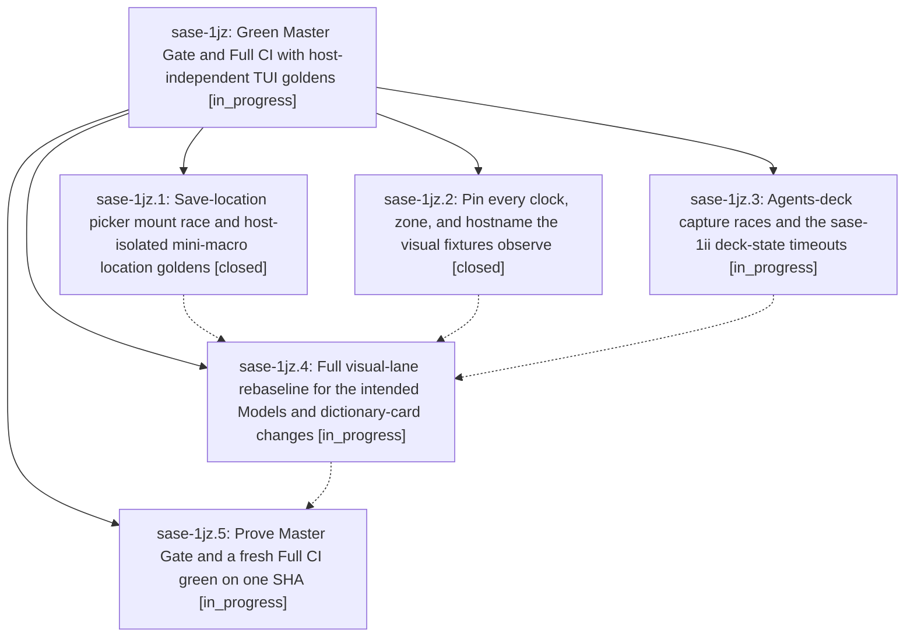

# Bead: sase-1jz — Green Master Gate and Full CI with host-independent TUI goldens

[Bead Pages](../README.md) / sase-1jz

**Status:** ◐ in_progress · **Type:** ▸ plan · **Tier:** epic
**Owner:** `bryanbugyi34@gmail.com` · **Created by:** [bbugyi200.athena.0zp](https://github.com/sase-org/sase--agents/blob/main/sessions/bbugyi200.athena.0zp.md) · **Assignee:** `sase-1jz.land`
**Created:** 2026-10-11 13:15:13 EDT
**Plan:** [202610/ci\_green\_visual\_lane.md](https://github.com/sase-org/sase--plans/blob/main/202610/ci_green_visual_lane.md)

<!-- sase:links:start -->

## Links

| Relation | Artifact | Why |
| --- | --- | --- |
| implemented-by | [plan:202610/ci_green_visual_lane.md][1] | derived from the plan's `bead_id:` frontmatter field |

[1]: https://github.com/sase-org/sase--plans/blob/main/202610/ci_green_visual_lane.md

<!-- sase:links:end -->

## Description

Master Gate stays green on master, and a fresh Full CI on the landed tip passes every job, including visual-test on GitHub's UTC runners, without raised timeouts, skips, or goldens copied from CI.

## Phases

| Bead | Title | Status | Size | Created | Agents | Commits |
|---|---|---|---|---|---:|---:|
| [sase-1jz.1](sase-1jz.1.md) | Save-location picker mount race and host-isolated mini-macro location goldens | ✓ closed | small | 2026-10-11 | 1 | 1 |
| [sase-1jz.2](sase-1jz.2.md) | Pin every clock, zone, and hostname the visual fixtures observe | ✓ closed | medium | 2026-10-11 | 1 | 0 |
| [sase-1jz.3](sase-1jz.3.md) | Agents-deck capture races and the sase-1ii deck-state timeouts | ◐ in_progress | medium | 2026-10-11 | 1 | 1 |
| [sase-1jz.4](sase-1jz.4.md) | Full visual-lane rebaseline for the intended Models and dictionary-card changes | ◐ in_progress | medium | 2026-10-11 | 1 | 0 |
| [sase-1jz.5](sase-1jz.5.md) | Prove Master Gate and a fresh Full CI green on one SHA | ◐ in_progress | small | 2026-10-11 | 1 | 0 |

## Lineage

## Agents

| Agent | Bead | Commits |
|---|---|---:|
| [bbugyi200.athena.sase-1jz.1](https://github.com/sase-org/sase--agents/blob/main/sessions/bbugyi200.athena.sase-1jz.1.md) | [sase-1jz.1](sase-1jz.1.md) | 1 |
| [bbugyi200.athena.sase-1jz.2](https://github.com/sase-org/sase--agents/blob/main/sessions/bbugyi200.athena.sase-1jz.2.md) | [sase-1jz.2](sase-1jz.2.md) | 0 |
| [bbugyi200.athena.sase-1jz.3](https://github.com/sase-org/sase--agents/blob/main/sessions/bbugyi200.athena.sase-1jz.3.md) | [sase-1jz.3](sase-1jz.3.md) | 1 |
| [bbugyi200.athena.sase-1jz.4](https://github.com/sase-org/sase--agents/blob/main/agents/bbugyi200.athena.sase-1jz.4/README.md) | [sase-1jz.4](sase-1jz.4.md) | 0 |
| [bbugyi200.athena.sase-1jz.5](https://github.com/sase-org/sase--agents/blob/main/agents/bbugyi200.athena.sase-1jz.5/README.md) | [sase-1jz.5](sase-1jz.5.md) | 0 |
| [bbugyi200.athena.sase-1jz.land](https://github.com/sase-org/sase--agents/blob/main/agents/bbugyi200.athena.sase-1jz.land/README.md) | [sase-1jz](README.md) | 0 |

## Commits

| Repo | Commit | Subject | Bead | Committed |
|---|---|---|---|---|
| sase | [`e74b09e`](https://github.com/sase-org/sase/commit/e74b09e100dd01a896312929b7f10202caec41e4) | fix(ace-tui): deliver mounted choices in save-location picker and host-isolate mini-macro location goldens | [sase-1jz.1](sase-1jz.1.md) | 2026-10-11 15:41:37 EDT |
| sase | [`4b99e45`](https://github.com/sase-org/sase/commit/4b99e4590758080dccd35800c0053ae920c7d99a) | feat(agents-deck): record timed-out joined check outcome on sase-1jz.3 | [sase-1jz.3](sase-1jz.3.md) | 2026-10-11 15:47:03 EDT |
