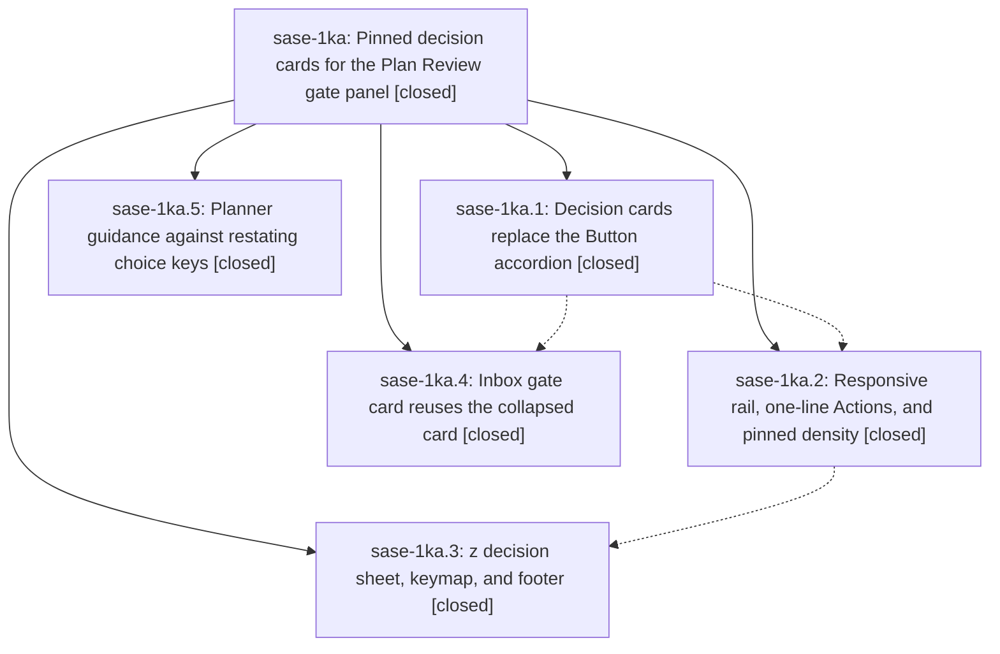

# Bead: sase-1ka — Pinned decision cards for the Plan Review gate panel

[Bead Pages](../README.md) / sase-1ka

**Status:** ✓ closed · **Resolution:** done · **Type:** ▸ plan · **Tier:** epic
**Owner:** `bryanbugyi34@gmail.com` · **Created by:** [bbugyi200.athena.research.4a.linker.w0](https://github.com/sase-org/sase--agents/blob/main/sessions/bbugyi200.athena.research.4a.linker.w0.md) · **Assignee:** `sase-1ka.land`
**Created:** 2026-10-12 09:11:08 EDT · **Closed:** 2026-10-12 12:18:09 EDT
**Plan:** [202610/gate\_panel\_decision\_cards.md](https://github.com/sase-org/sase--plans/blob/main/202610/gate_panel_decision_cards.md)

<!-- sase:links:start -->

## Links

| Relation | Artifact | Why |
| --- | --- | --- |
| implemented-by | [plan:202610/gate_panel_decision_cards.md][1] | derived from the plan's `bead_id:` frontmatter field |

_Plus 2 automatic references — see [Referenced By](#referenced-by)._

[1]: https://github.com/sase-org/sase--plans/blob/main/202610/gate_panel_decision_cards.md

<!-- sase:links:end -->

## Description

Plan and epic review modals render decisions as readable cards that never clip: every decision stays on screen, the current card shows its full question, options, and rationale, the rail grows with the terminal, a z sheet gives a full-width reading view, and the inbox gate card matches, with no changed keys and no sase-core change.

## Notes

[2026-10-12T15:48:09Z · sase-1ka.land] LAND TRIAGE (sase-1ka.land): PROPOSED FOLLOW-UP outcomes -- (1) sase-1ka.1 stale --epic-symbol sase-1jx.11(NewProjectModal): declined, already removed from the Justfile by e4b3a85f4e (sase-1jx.11). (2) sase-1ka.2/.4/.5 Symvision private import of _load_archive_bundle: caused by active epic sase-1jm (sase-1jm.5 ebd17bf5bf), already a DISCOVERED ISSUE there; corroborated with a note on sase-1jm, no task created. (3) sase-1ka.3 TUI import budget 3517 vs 3513: reproduced on c9c1df82cc, +1 on sase-1ic (epic modules are not in the app import closure). (4) sase-1ka.3 agent header Project: tmp tests: reproduced, +1 on sase-1k4. (5) sase-1ka.3 revival preview '250 most recent dismissed agents' test: caused by sase-1jm.6 (c4c7846f57), already a DISCOVERED ISSUE on sase-1jm; corroborated there. Skill deploy: the nudge source is on master, but 'sase skill init' would also publish sase-1jx's unlanded 'sase project create' skill text, which the installed CLI lacks, so the deploy is deferred to sase-1jx's landing (note recorded on sase-1jx). Integration: the four non-epic commits since 09:11 (e4b3a85f4e, f26ac18475, 0defe76db8, ee673ce10d) touch the Projects pane, Record deck, and repo creation form; no conflict or reuse opportunity with decision cards.

[2026-10-12T16:18:09Z · sase-1ka.land] Land verified all five phases against the plan and DECISIONS (cap84, narrow_sheet=no, cyan): cards/rail/sheet/inbox/nudge source and tests reviewed, goldens inspected. Landing tale fixed epic-caused builder defects: header spans used cell offsets as char offsets (memory rows mis-styled; gold leaked onto ›), ★ now muted and segmented (removes resvg letter-spaced chips, the inbox phase acceptance criterion), memory edits/chip lines wrap instead of clipping, two-column ★ dim + spec why hanging indent, dead .plan-decision-row CSS removed, NoMatches-only catch; decision goldens regenerated and inspected (16 updated, toast unchanged), --check clean twice (TZ=UTC). sase tool run check: no_new_failures (KNOWN _load_archive_bundle on sase-1jm). Integration: no conflicts with e4b3a85f4e/f26ac18475/0defe76db8/ee673ce10d. Follow-ups triaged in the LAND TRIAGE note (sase-1ic/sase-1k4 +1, sase-1jm corroborated, stale sase-1jx.11 symbol already removed); sase_plan skill deploy deferred to sase-1jx landing. epic-symbols: none.

## Phases

| Bead | Title | Status | Size | Created | Agents | Commits |
|---|---|---|---|---|---:|---:|
| [sase-1ka.1](sase-1ka.1.md) | Decision cards replace the Button accordion | ✓ closed | medium | 2026-10-12 | 1 | 1 |
| [sase-1ka.2](sase-1ka.2.md) | Responsive rail, one-line Actions, and pinned density | ✓ closed | medium | 2026-10-12 | 1 | 1 |
| [sase-1ka.3](sase-1ka.3.md) | z decision sheet, keymap, and footer | ✓ closed | medium | 2026-10-12 | 1 | 1 |
| [sase-1ka.4](sase-1ka.4.md) | Inbox gate card reuses the collapsed card | ✓ closed | small | 2026-10-12 | 1 | 1 |
| [sase-1ka.5](sase-1ka.5.md) | Planner guidance against restating choice keys | ✓ closed | xsmall | 2026-10-12 | 1 | 1 |

## Lineage

## Agents

| Agent | Bead | Commits |
|---|---|---:|
| [bbugyi200.athena.sase-1ka.1](https://github.com/sase-org/sase--agents/blob/main/agents/bbugyi200.athena.sase-1ka.1/README.md) | [sase-1ka.1](sase-1ka.1.md) | 1 |
| [bbugyi200.athena.sase-1ka.2](https://github.com/sase-org/sase--agents/blob/main/agents/bbugyi200.athena.sase-1ka.2/README.md) | [sase-1ka.2](sase-1ka.2.md) | 1 |
| [bbugyi200.athena.sase-1ka.3](https://github.com/sase-org/sase--agents/blob/main/agents/bbugyi200.athena.sase-1ka.3/README.md) | [sase-1ka.3](sase-1ka.3.md) | 1 |
| [bbugyi200.athena.sase-1ka.4](https://github.com/sase-org/sase--agents/blob/main/agents/bbugyi200.athena.sase-1ka.4/README.md) | [sase-1ka.4](sase-1ka.4.md) | 1 |
| [bbugyi200.athena.sase-1ka.5](https://github.com/sase-org/sase--agents/blob/main/agents/bbugyi200.athena.sase-1ka.5/README.md) | [sase-1ka.5](sase-1ka.5.md) | 1 |
| [bbugyi200.athena.sase-1ka.land](https://github.com/sase-org/sase--agents/blob/main/sessions/bbugyi200.athena.sase-1ka.land.md) | [sase-1ka](README.md) | 2 |

## Commits

| Repo | Commit | Subject | Bead | Committed |
|---|---|---|---|---|
| sase | [`ace43b3`](https://github.com/sase-org/sase/commit/ace43b398ab0e8a764289a49776d32fc3c00c458) | feat(plan): guide planners against restating choice keys in labels | [sase-1ka.5](sase-1ka.5.md) | 2026-10-12 09:51:41 EDT |
| sase | [`648ef1a`](https://github.com/sase-org/sase/commit/648ef1a390114436de898552144ada0d18497799) | feat(ace): replace Button accordion with decision cards in plan approval modal | [sase-1ka.1](sase-1ka.1.md) | 2026-10-12 09:58:56 EDT |
| sase | [`e216699`](https://github.com/sase-org/sase/commit/e21669907c91921468d90e8f4fcdbf00db7a5c15) | feat(tui): implement responsive plan decision rail | [sase-1ka.2](sase-1ka.2.md) | 2026-10-12 10:31:06 EDT |
| sase | [`a93229e`](https://github.com/sase-org/sase/commit/a93229e65d9adaf06cd4689c5c70b0fa9701a504) | feat(ace): reuse decision cards in inbox gates | [sase-1ka.4](sase-1ka.4.md) | 2026-10-12 10:32:14 EDT |
| sase | [`c9c1df8`](https://github.com/sase-org/sase/commit/c9c1df82ccf7279384ce6857c0cb190a988b6f4e) | feat(tui): add Plan Review z decision sheet and merged footer | [sase-1ka.3](sase-1ka.3.md) | 2026-10-12 11:29:03 EDT |
| sase | [`993f72c`](https://github.com/sase-org/sase/commit/993f72c2c330bc0dd044952841ee18c22f06aa18) | fix(ace): land Plan Review decision-card builder defects | [sase-1ka](README.md) | 2026-10-12 12:22:36 EDT |
| sase--plans | [`sase--plans@7a0c755`](https://github.com/sase-org/sase--plans/commit/7a0c755a61a25e595d92824d4aad46e561d0172e) | docs(plan): mark gate\_panel\_decision\_cards epic done | [sase-1ka](README.md) | 2026-10-12 12:24:01 EDT |

<!-- sase:referenced-by:start -->

## Referenced By

| Relation | Artifact | Why | Uses |
| --- | --- | --- | ---: |
| read-by | [agent:sase-1ka.1][1] | epic context for phase | 1 |
| read-by | [agent:sase-1ka.3][2] | Need parent epic context, decisions, and phase structure | 1 |

[1]: https://github.com/sase-org/sase--agents/blob/main/agents/bbugyi200.athena.sase-1ka.1/README.md
[2]: https://github.com/sase-org/sase--agents/blob/main/agents/bbugyi200.athena.sase-1ka.3/README.md

<!-- sase:referenced-by:end -->
