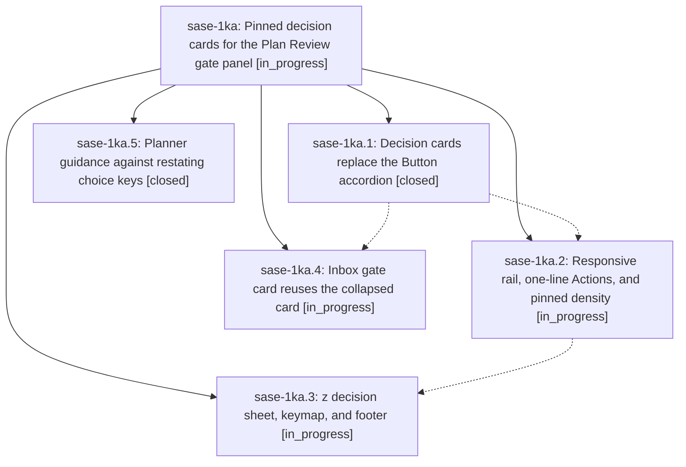

# Bead: sase-1ka — Pinned decision cards for the Plan Review gate panel

[Bead Pages](../README.md) / sase-1ka

**Status:** ◐ in_progress · **Type:** ▸ plan · **Tier:** epic
**Owner:** `bryanbugyi34@gmail.com` · **Created by:** [bbugyi200.athena.research.4a.linker.w0](https://github.com/sase-org/sase--agents/blob/main/sessions/bbugyi200.athena.research.4a.linker.w0.md) · **Assignee:** `sase-1ka.land`
**Created:** 2026-10-12 09:11:08 EDT
**Plan:** [202610/gate\_panel\_decision\_cards.md](https://github.com/sase-org/sase--plans/blob/main/202610/gate_panel_decision_cards.md)

<!-- sase:links:start -->

## Links

| Relation | Artifact | Why |
| --- | --- | --- |
| implemented-by | [plan:202610/gate_panel_decision_cards.md][1] | derived from the plan's `bead_id:` frontmatter field |

[1]: https://github.com/sase-org/sase--plans/blob/main/202610/gate_panel_decision_cards.md

<!-- sase:links:end -->

## Description

Plan and epic review modals render decisions as readable cards that never clip: every decision stays on screen, the current card shows its full question, options, and rationale, the rail grows with the terminal, a z sheet gives a full-width reading view, and the inbox gate card matches, with no changed keys and no sase-core change.

## Phases

| Bead | Title | Status | Size | Created | Agents | Commits |
|---|---|---|---|---|---:|---:|
| [sase-1ka.1](sase-1ka.1.md) | Decision cards replace the Button accordion | ✓ closed | medium | 2026-10-12 | 1 | 1 |
| [sase-1ka.2](sase-1ka.2.md) | Responsive rail, one-line Actions, and pinned density | ◐ in_progress | medium | 2026-10-12 | 1 | 0 |
| [sase-1ka.3](sase-1ka.3.md) | z decision sheet, keymap, and footer | ◐ in_progress | medium | 2026-10-12 | 1 | 0 |
| [sase-1ka.4](sase-1ka.4.md) | Inbox gate card reuses the collapsed card | ◐ in_progress | small | 2026-10-12 | 1 | 0 |
| [sase-1ka.5](sase-1ka.5.md) | Planner guidance against restating choice keys | ✓ closed | xsmall | 2026-10-12 | 1 | 1 |

## Lineage

## Agents

| Agent | Bead | Commits |
|---|---|---:|
| [bbugyi200.athena.sase-1ka.1](https://github.com/sase-org/sase--agents/blob/main/agents/bbugyi200.athena.sase-1ka.1/README.md) | [sase-1ka.1](sase-1ka.1.md) | 1 |
| [bbugyi200.athena.sase-1ka.2](https://github.com/sase-org/sase--agents/blob/main/agents/bbugyi200.athena.sase-1ka.2/README.md) | [sase-1ka.2](sase-1ka.2.md) | 0 |
| [bbugyi200.athena.sase-1ka.3](https://github.com/sase-org/sase--agents/blob/main/agents/bbugyi200.athena.sase-1ka.3/README.md) | [sase-1ka.3](sase-1ka.3.md) | 0 |
| [bbugyi200.athena.sase-1ka.4](https://github.com/sase-org/sase--agents/blob/main/agents/bbugyi200.athena.sase-1ka.4/README.md) | [sase-1ka.4](sase-1ka.4.md) | 0 |
| [bbugyi200.athena.sase-1ka.5](https://github.com/sase-org/sase--agents/blob/main/agents/bbugyi200.athena.sase-1ka.5/README.md) | [sase-1ka.5](sase-1ka.5.md) | 1 |
| [bbugyi200.athena.sase-1ka.land](https://github.com/sase-org/sase--agents/blob/main/agents/bbugyi200.athena.sase-1ka.land/README.md) | [sase-1ka](README.md) | 0 |

## Commits

| Repo | Commit | Subject | Bead | Committed |
|---|---|---|---|---|
| sase | [`ace43b3`](https://github.com/sase-org/sase/commit/ace43b398ab0e8a764289a49776d32fc3c00c458) | feat(plan): guide planners against restating choice keys in labels | [sase-1ka.5](sase-1ka.5.md) | 2026-10-12 09:51:41 EDT |
| sase | [`648ef1a`](https://github.com/sase-org/sase/commit/648ef1a390114436de898552144ada0d18497799) | feat(ace): replace Button accordion with decision cards in plan approval modal | [sase-1ka.1](sase-1ka.1.md) | 2026-10-12 09:58:56 EDT |
