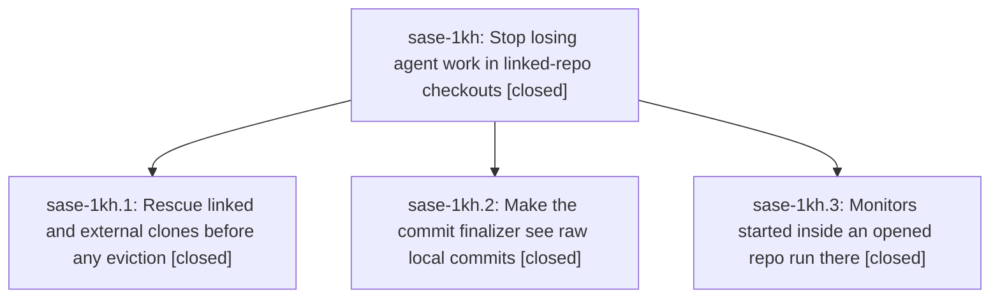

# Bead: sase-1kh — Stop losing agent work in linked-repo checkouts

[Bead Pages](../README.md) / sase-1kh

**Status:** ✓ closed · **Resolution:** done · **Type:** ▸ plan · **Tier:** epic
**Owner:** `bryanbugyi34@gmail.com` · **Created by:** [bbugyi200.apollo.7c.f0](https://github.com/sase-org/sase--agents/blob/main/sessions/bbugyi200.apollo.7c.f0.md) · **Assignee:** `sase-1kh.land`
**Created:** 2026-10-13 08:22:36 EDT · **Closed:** 2026-10-13 13:18:44 EDT
**Plan:** [202610/protect\_linked\_repo\_work.md](https://github.com/sase-org/sase--plans/blob/main/202610/protect_linked_repo_work.md)

<!-- sase:links:start -->

## Links

| Relation | Artifact | Why |
| --- | --- | --- |
| implemented-by | [plan:202610/protect_linked_repo_work.md][1] | derived from the plan's `bead_id:` frontmatter field |
| related | file:explicit:5a1c98b7060a59115e90bd29 | attached via sase artifact create --bead |
| related | file:explicit:9f6497f057c13ec447c0eac6 | attached via sase artifact create --bead |

[1]: https://github.com/sase-org/sase--plans/blob/main/202610/protect_linked_repo_work.md

<!-- sase:links:end -->

## Description

Agent work in linked and external repo checkouts survives workspace reuse, raw local commits can never end a turn as a silent finalizer success, and monitors started inside an opened repo run there.

## Notes

[2026-10-13T15:20:58Z · sase-1kh.land] LAND AUDIT: Read this epic, every note on children sase-1kh.1/.2/.3, approved plan:202610/protect_linked_repo_work.md, and source/commits 86a343de28, 64bd007204, 1a638eac95. Selected raw_commit_policy=absorb is implemented, but eligibility is incomplete: disposable real-Git repros show baseline dirt committed clean is wrongly absorbed, and a raw commit followed by a foreign-agent or host-recorded commit causes both to be soft-reset and staged. Detector filtering does not prove the reset range is a contiguous owned suffix; protection checks current dirt instead of historical baseline paths and the path scan is only a net diff. These are remaining epic work. Prepared completion already publishes context before observing repositories, but its absorption/binding regression is missing. All three commits are on fetched origin/master; history after the first epic commit parent 010185b0c4 and since creation 2026-10-13T12:22:36Z contains only this epic, so there is no unrelated post-start drift to integrate. 71 focused phase/baseline/monitor/live-finalizer tests passed, including all 14 live tests; all 13 discarded-work guards passed. No check-full run. epic-symbols currently lists no entries and the epic currently has no parent. Evidence: file:explicit:5a1c98b7060a59115e90bd29 and file:explicit:9f6497f057c13ec447c0eac6. Proposing a medium remaining-work tale that must repair eligibility, verify with just check, and perform this epic closeout itself; closing must not wait for its own commit/push/CI. The close note must mention redeployment of sase_monitor from a clean landed revision with sase skill init --force.

[2026-10-13T15:21:06Z · sase-1kh.land] FOLLOW-UP TRIAGE (complete before tale proposal): sase-1kh.1 note #1 changed-reply numbering is supplementary duplicate evidence on sase-1hy (+1); it passes alone but fails in the phase3 batch with the same duplicated raw.py hint. The missing session expanded-prompt hints duplicate sase-1ia (+1), reproduced along with the clan prompt-precedence node in isolation. sase-1kh.2 note #1 eight live-finalizer failures: declined a new task because all 14 live-e2e tests now pass; no current defect was reproduced. sase-1kh.3 note #1 batch: expanded-prompt/body preview/hidden-marker failures and duplicated/semantic raw-body hints corroborate sase-1ia and sase-1hy. Exact Muse missed-mint and agy rate-limit timeout reports corroborated sase-1k9 and sase-19m (+1 each), explicitly relaying the phase evidence and current isolated passes without claiming a retained assertion or measured load mechanism. Both completion snapshot nodes now pass after phase3 regeneration, so resolved. The deterministic bottom-pin loss failed in the batch and alone; created sized CI task sase-1ki (large because cause is undiagnosed), related to sase-1b8 because it touches neighboring pin machinery but loses the boolean pin state rather than settling to the wrong scroll offset. Declined a generic 26-failure umbrella and unconfirmed current tasks for the remaining historical nodes: phase3 check d56f2c2ab1ea33c7551a9a0b7a8aeb83 retained 25 grouped entries; their current rerun was 11 failed/14 passed. Current passes include cycle-edit highlight cache, logical project-name render nodes, clan artifact discovery, startup import budget, visual-capture xdist merge, midword completion, pager split-pane leak, idle-timeout settlement, and Muse over-quota preservation. Their old summaries do not retain enough assertion/root-cause evidence to establish a new true CI bug or unchanged-tree flake; retain the exact ToolRun and audit artifacts instead of filing speculative node tasks. Searched tasks in every status, swept all tasks created in the last week, and inspected active epic scopes/plausible leak-phase ownership; no credible causal active epic owns the deterministic pin-reset failure. Preserve all these outcomes in the eventual close note.

[2026-10-13T17:18:44Z · sase-1kh.land] FINAL CLOSEOUT: Implemented the approved raw_commit_policy=absorb completion. Absorption now requires the detected commits to be the complete contiguous, single-parent owned suffix from the oldest raw commit through the observed HEAD; filtered foreign or host-recorded commits and merges inside the range are rejected. A prior foreign, host, or remote commit remains before the suffix. The finalizer checks every touched path in every candidate commit, including both rename sides, against all historical baseline fingerprint keys, then revalidates and pins HEAD before soft reset. Added real-Git coverage for baseline dirt, protected-path restores and renames, interleaved commits, valid predecessors, and HEAD drift. Added prepared-completion coverage and updated docs/commit_workflows.md.

VERIFICATION: just fmt completed cleanly; git diff --check is clean. The latest raw-commit module run passed 26 tests (the host-context integration case was excluded because this direct uv invocation loaded sase_core_rs content-layout schema 5 while Python requires schema >=7). The earlier focused cross-suite run passed 150 tests, including prepared completion. sase tool run check ToolRun 2ece3b5f3bf2b1fb4494dd214c858e6b completed with exit 1: all lint, formatting, Symvision, and SASE validation stages passed; scoped tests reported 3 NEW and 15 KNOWN. The three NEW results are untouched ACE prompt/rendering nodes and were corroborated against existing tasks: duplicate src/raw.py hints on sase-1hy, and raw macro text in expanded prompt output on sase-1ia. Supplementary evidence was appended to both tasks; no duplicate task was created. The additional compact-section assertion on the done-agent prompt node is retained as supplementary evidence under sase-1ia. No check-full was run. The core-floor advisory reflects the published sase_core_rs pin lagging the linked checkout; no core changes were made.

TRIAGE PRESERVED: Phase 1's changed-reply duplicate hint is supplementary evidence on sase-1hy; missing session-expanded prompt bodies/hints corroborate sase-1ia. Phase 2's eight earlier live-finalizer failures were not filed because all 14 live-finalizer tests subsequently passed. Phase 3's two completion snapshot failures were resolved by checked-in regeneration and now pass. The deterministic bottom-pin loss reproduced in batch and isolation; task sase-1ki was created as a large CI task because its cause is undiagnosed and linked to sase-1b8. Muse missed-mint and agy rate-limit timeout reports corroborate sase-1k9 and sase-19m, without asserting a retained failure or measured mechanism. The other historical nodes remain unfiled: the prior grouped check retained 25 entries and a rerun had 11 failed/14 passed; old summaries do not establish a true CI defect or unchanged-tree flake. Current passes included cycle-edit highlight cache, logical project-name rendering, clan artifact discovery, startup import budget, visual-capture xdist merge, midword completion, pager split-pane handling, idle-timeout settlement, and Muse over-quota preservation. No generic umbrella task was created; exact ToolRun and audit evidence remain linked from the epic.

INTEGRATION: All three phase beads are closed. The epic has no parent. After fetch, origin/master is two commits ahead in tool-run loader and macro plugin files, outside this change; no conflicting paths or relevant post-start changes were found. After a clean landed revision is available, redeploy the monitor skill with `sase skill init --force`; do not deploy from this unlanded workspace.

[2026-10-13T17:22:06Z · sase-1kh.land] POST-CLOSE VERIFICATION: After just symvision rebuilt the stale local sase_core_rs extension from the linked checkout, .venv/bin/python -m pytest -q tests/llm_provider/test_commit_finalizer_raw_commits.py tests/test_final_prepare.py passed all 34 tests, including prepared completion. The earlier direct uv run's schema-5 failures were an environment issue and are resolved in this workspace.

## Phases

| Bead | Title | Status | Size | Created | Agents | Commits |
|---|---|---|---|---|---:|---:|
| [sase-1kh.1](sase-1kh.1.md) | Rescue linked and external clones before any eviction | ✓ closed | medium | 2026-10-13 | 1 | 1 |
| [sase-1kh.2](sase-1kh.2.md) | Make the commit finalizer see raw local commits | ✓ closed | medium | 2026-10-13 | 1 | 1 |
| [sase-1kh.3](sase-1kh.3.md) | Monitors started inside an opened repo run there | ✓ closed | small | 2026-10-13 | 1 | 1 |

## Lineage

## Agents

| Agent | Bead | Commits |
|---|---|---:|
| [bbugyi200.apollo.sase-1kh.1](https://github.com/sase-org/sase--agents/blob/main/agents/bbugyi200.apollo.sase-1kh.1/README.md) | [sase-1kh.1](sase-1kh.1.md) | 1 |
| [bbugyi200.apollo.sase-1kh.2](https://github.com/sase-org/sase--agents/blob/main/sessions/bbugyi200.apollo.sase-1kh.2.md) | [sase-1kh.2](sase-1kh.2.md) | 1 |
| [bbugyi200.apollo.sase-1kh.3](https://github.com/sase-org/sase--agents/blob/main/agents/bbugyi200.apollo.sase-1kh.3/README.md) | [sase-1kh.3](sase-1kh.3.md) | 1 |
| [bbugyi200.apollo.sase-1kh.land](https://github.com/sase-org/sase--agents/blob/main/sessions/bbugyi200.apollo.sase-1kh.land.md) | [sase-1kh](README.md) | 2 |

## Commits

| Repo | Commit | Subject | Bead | Committed |
|---|---|---|---|---|
| sase | [`86a343d`](https://github.com/sase-org/sase/commit/86a343de2860e17559cec2a0deb32208615b659b) | feat(finalizers): add raw-commit backstop with foreign-trailer exemption | [sase-1kh.2](sase-1kh.2.md) | 2026-10-13 09:44:51 EDT |
| sase | [`64bd007`](https://github.com/sase-org/sase/commit/64bd0072040862eb93916ea30bd0c899352cb9c4) | feat(monitor): default monitor cwd to linked clone directory | [sase-1kh.3](sase-1kh.3.md) | 2026-10-13 10:43:06 EDT |
| sase | [`1a638ea`](https://github.com/sase-org/sase/commit/1a638eac95b42c13014dd76c384dbfb56f5b323f) | feat(workspace): rescue linked and external clones before eviction | [sase-1kh.1](sase-1kh.1.md) | 2026-10-13 10:51:55 EDT |
| sase | [`c3d7a7e`](https://github.com/sase-org/sase/commit/c3d7a7e9b5bd4a5ef9697b3411a97a7a8f01c10e) | fix(finalizer): restrict raw commit absorption to owned suffixes | [sase-1kh](README.md) | 2026-10-13 13:24:06 EDT |
| sase--plans | [`sase--plans@bbc579f`](https://github.com/sase-org/sase--plans/commit/bbc579f9aef31bcaae61676fef8f90679db00698) | docs(plan): mark linked repo landing plan done | [sase-1kh](README.md) | 2026-10-13 13:26:45 EDT |
