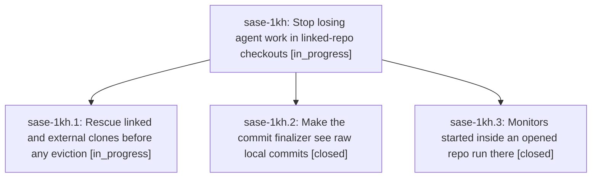

# Bead: sase-1kh — Stop losing agent work in linked-repo checkouts

[Bead Pages](../README.md) / sase-1kh

**Status:** ◐ in_progress · **Type:** ▸ plan · **Tier:** epic
**Owner:** `bryanbugyi34@gmail.com` · **Created by:** [bbugyi200.apollo.7c.f0](https://github.com/sase-org/sase--agents/blob/main/sessions/bbugyi200.apollo.7c.f0.md) · **Assignee:** `sase-1kh.land`
**Created:** 2026-10-13 08:22:36 EDT
**Plan:** [202610/protect\_linked\_repo\_work.md](https://github.com/sase-org/sase--plans/blob/main/202610/protect_linked_repo_work.md)

<!-- sase:links:start -->

## Links

| Relation | Artifact | Why |
| --- | --- | --- |
| implemented-by | [plan:202610/protect_linked_repo_work.md][1] | derived from the plan's `bead_id:` frontmatter field |

[1]: https://github.com/sase-org/sase--plans/blob/main/202610/protect_linked_repo_work.md

<!-- sase:links:end -->

## Description

Agent work in linked and external repo checkouts survives workspace reuse, raw local commits can never end a turn as a silent finalizer success, and monitors started inside an opened repo run there.

## Phases

| Bead | Title | Status | Size | Created | Agents | Commits |
|---|---|---|---|---|---:|---:|
| [sase-1kh.1](sase-1kh.1.md) | Rescue linked and external clones before any eviction | ◐ in_progress | medium | 2026-10-13 | 1 | 0 |
| [sase-1kh.2](sase-1kh.2.md) | Make the commit finalizer see raw local commits | ✓ closed | medium | 2026-10-13 | 1 | 1 |
| [sase-1kh.3](sase-1kh.3.md) | Monitors started inside an opened repo run there | ✓ closed | small | 2026-10-13 | 1 | 1 |

## Lineage

## Agents

| Agent | Bead | Commits |
|---|---|---:|
| [bbugyi200.apollo.sase-1kh.1](https://github.com/sase-org/sase--agents/blob/main/agents/bbugyi200.apollo.sase-1kh.1/README.md) | [sase-1kh.1](sase-1kh.1.md) | 0 |
| [bbugyi200.apollo.sase-1kh.2](https://github.com/sase-org/sase--agents/blob/main/sessions/bbugyi200.apollo.sase-1kh.2.md) | [sase-1kh.2](sase-1kh.2.md) | 1 |
| [bbugyi200.apollo.sase-1kh.3](https://github.com/sase-org/sase--agents/blob/main/agents/bbugyi200.apollo.sase-1kh.3/README.md) | [sase-1kh.3](sase-1kh.3.md) | 1 |
| [bbugyi200.apollo.sase-1kh.land](https://github.com/sase-org/sase--agents/blob/main/agents/bbugyi200.apollo.sase-1kh.land/README.md) | [sase-1kh](README.md) | 0 |

## Commits

| Repo | Commit | Subject | Bead | Committed |
|---|---|---|---|---|
| sase | [`86a343d`](https://github.com/sase-org/sase/commit/86a343de2860e17559cec2a0deb32208615b659b) | feat(finalizers): add raw-commit backstop with foreign-trailer exemption | [sase-1kh.2](sase-1kh.2.md) | 2026-10-13 09:44:51 EDT |
| sase | [`64bd007`](https://github.com/sase-org/sase/commit/64bd0072040862eb93916ea30bd0c899352cb9c4) | feat(monitor): default monitor cwd to linked clone directory | [sase-1kh.3](sase-1kh.3.md) | 2026-10-13 10:43:06 EDT |
