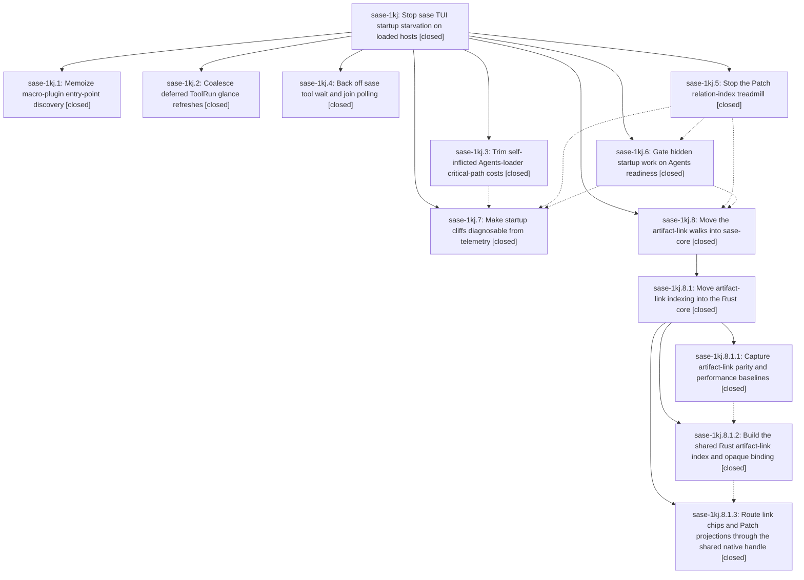

# Bead: sase-1kj — Stop sase TUI startup starvation on loaded hosts

[Bead Pages](../README.md) / sase-1kj

**Status:** ✓ closed · **Resolution:** done · **Type:** ▸ plan · **Tier:** epic
**Owner:** `bryanbugyi34@gmail.com` · **Created by:** [bbugyi200.athena.102](https://github.com/sase-org/sase--agents/blob/main/sessions/bbugyi200.athena.102.md) · **Assignee:** `sase-1kj.land`
**Created:** 2026-10-13 11:47:17 EDT · **Closed:** 2026-10-14 02:29:15 EDT
**Plan:** [202610/apollo\_tui\_startup.md](https://github.com/sase-org/sase--plans/blob/main/202610/apollo_tui_startup.md)

<!-- sase:links:start -->

## Links

| Relation | Artifact | Why |
| --- | --- | --- |
| implemented-by | [plan:202610/apollo_tui_startup.md][1] | derived from the plan's `bead_id:` frontmatter field |

_Plus 1 automatic references — see [Referenced By](#referenced-by)._

[1]: https://github.com/sase-org/sase--plans/blob/main/202610/apollo_tui_startup.md

<!-- sase:links:end -->

## Description

On a loaded host such as apollo, the Agents roster is usable soon after first paint. Hidden-surface and maintenance work no longer competes with the Agents loader through the GIL. The verified CPU hogs (plugin rescans, the Patch relation treadmill, and the app-wide link walk) are fixed. Startup cliffs can be diagnosed from telemetry alone.

## Notes

[2026-10-14T01:51:00Z · sase-1kj.8.1.land] DISCOVERED ISSUE: During nested epic sase-1kj.8.1 landing, triaged PROPOSED FOLLOW-UP from sase-1kj.8.1.3 note #3. ToolRun 3652943e582592c9f19aec77808f3907 failed tests/test_ace_testing.py::test_ace_page_real_startup_policy_invokes_production_boundaries at line 313: the only missing recorded call was update-check. Phase rerun and lander focused rerun at d69cd499dd pass. Credible causal link to sase-1kj.6: _run_deferred_startup_maintenance_chain now puts update_toast after prompt_catalog and link_index; AcePage real-startup test immediately exits its context without explicitly awaiting the maintenance step. Please verify deterministic test synchronization before containing-epic close; preserve 45s startup decision and sequential maintenance rather than weakening production gating. Not duplicate sase-1kf (leaked _collect_artifacts_project_choices override), and not a new task because this active epic owns the sequencing change. Evidence and retained run details: file:explicit:405b9f024864d71654e1cb54. Child repair tale will close only sase-1kj.8.1 and phase sase-1kj.8, leaving your landing ownership intact.

[2026-10-14T04:40:32Z · sase-1kj.land] LANDER FOLLOW-UP TRIAGE (sase-1kj.land): Every PROPOSED FOLLOW-UP across phases .1-.8 and nested .8.1.* reviewed. (1) TUI import-budget overage reported by .1#1, .2#1, .3#1, .4#5, .5#1, .7#1, .8.1.3#2: the clean-base overage was resolved by f7458363b1's cap ratchet to 3520; sase-1ic already holds +20 incl. the .8.1 lander's +1, so declined a new task/+1. Current master measures 3526 (+5 from toobig split 456291d81d agent_scan_facade modules); the pending sase-1kj.8.1 landing repair lazifies those imports and defers this epic's own 2 native-link modules, so the epic-owned part is repair work, not follow-up. (2) .2#2 nested-run StopIteration: +1 on existing flake sase-1jl. (3) .2#3 bounded-drain 31s vs <5s under load: semantic duplicate of closed flake sase-xo; +1 reopened it (observation postdates its stale-sweep close). (4) .4#1 sase-core touch_write_meta no-op commits (plan-mandated follow-up): no duplicate or causal active epic; created task sase-1kw (bug, small). (5) .4#4 xdist worker crash on test_done_row_dismissed_without_signal_and_stays_hidden: declined, single unreproduced crash in a dismissed-index test observed 2026-10-13 14:23 before sase-1kk (dual-SQLite SIGBUS fix) landed; no recurrence in later full checks. (6) .1#1 'zsh sbd smoke and fakey gate-capacity failures': declined, no node IDs or evidence and not seen by any later phase check. (7) .8.1.1#2 stale sase-1kj.7 epic-symbol: declined, already removed (sase bead epic-symbols sase-1kj is empty). (8) .8.1.3#1 instruction_manifest v2/v1: declined, fixed by 96090a52cf. (9) .8.1.3#3 flakes: already routed by the .8.1 lander (sase-1em +1, sase-1kr +1, AcePage update-check -> this epic as DISCOVERED ISSUE #1); not re-corroborated. (10) .8.1 lander's sase-19g +1 and sase-1ko delivery-plan note stand.

[2026-10-14T04:53:43Z · sase-1kj.land] LANDER AUDIT (sase-1kj.land): Read every phase and nested .8.1.* bead and note; reviewed commits 82aa8a7a88, ce1940f39f, 099fcee221, 731b7b18b5, 085f5eceb7, bda93bab64, 3c69bf5a97, bad0d0ac36, 16252682b2 against plan:202610/apollo_tui_startup.md in current source. Phases .1 .2 .5 .7 fully match; .6 honors DECISION sec_45 (_STARTUP_DEFERRED_FALLBACK_SECONDS=45.0) and coordinator invariants; phase focused suites 74/74 and 68/68 pass; no --epic-symbol entries. Remaining epic work found: (a) INTEGRATION: sase-1kk (e8ec9cb291 + core d30e1337) moved dismissed-index queries to Rust store.rs query_summaries/query_summary_identities which open_archive_store_writable (WAL pragma, BEGIN IMMEDIATE, ensure_schema, schema_version rewrite; legacy index tables dropped on read), regressing .3's read-only guarantee; Python's post-query signature re-read workaround is racy. (b) .4: _ingest_events_if_changed caches the file signature even when ingest returned diagnostics, so failed lost-run ingests never retry. (c) .6: hold ticks accept the agents token mid-load and release clears _dirty_agents, so Agents watcher/token changes during the startup Agents load can be lost until the 300s sanity refresh. (d) .6: set_axe_running from _render_dashboard/_render_footer before first axe load ends the neutral chip early. (e) .6: AcePage real-startup test races the sequential maintenance chain (note #1; reproduced deterministically with a 1.5s link-snapshot delay). sase-1kj.8.1 landing repair is still uncommitted (session sase-1kj.8.1.land continuing in another workspace). Declined: .5 nit that tab-switch refresh never clears _dirty_patches (repeat refreshes are memo hits). Planned all of (a)-(e) plus closeout as one medium tale.

[2026-10-14T06:29:15Z · sase-1kj.land] Lander audit: all 8 phases verified against plan:202610/apollo_tui_startup.md in source and commits 82aa8a7a88, ce1940f39f, 099fcee221, 731b7b18b5, 085f5eceb7, bda93bab64, 3c69bf5a97, bad0d0ac36, 16252682b2 plus the sase-1kj.8.1 landing repair e07c6007c3 (sase: bounded per-ref chip cache, async cold queries, native build fences, Patch build counters, lazified agent-scan facade imports) and sase-core b2b66266 (legacy Python string/count coercion for artifact-link rows). DECISION fallback_seconds=sec_45 honored (_STARTUP_DEFERRED_FALLBACK_SECONDS=45.0); coordinator invariants intact. Integration: restored read-only dismissed-index queries in sase-core after sase-1kk moved them to Rust (open_archive_store_read_only, version/compat check returns None, no table drops), removed the racy post-query signature re-read, pin written by the host. Repairs: ToolRun ingest skip now retries after diagnostics; startup release no longer loses Agents watcher/token updates during the startup Agents load; axe chip stays neutral until the first axe load; AcePage real-startup test waits for the sequential maintenance chain. Follow-ups triaged in note #2 (sase-1kw created; sase-1jl and sase-xo +1; others declined with reasons). Verification: sase-core store_queries 3 passed; focused Python 155 passed then axe-footer 13/13 and post-8.1 import/link/patch 65 passed (TUI import closure 3519 < 3520 cap); sase-core sase tool run check ad9a3b0f3f39795e1b413f819939587d succeeded; sase sase tool run check c7410810d41e7e4b5841f34a6b7012cc 55682 passed / 3 NEW before merging e07c6007c3 (import-budget now green at 3519; remaining instruction tests test_declared_legacy_hookimpls_resolve_to_provider_legacy and test_conformance_warns_for_duplicate_root_and_leaked_helper_markers routed to active epic sase-1ko). sase bead epic-symbols sase-1kj empty. just symvision reports 7 unused instruction-delivery symbols owned by sase-1ko (KNOWN in the wrapped check).

## Phases

| Bead | Title | Status | Size | Created | Agents | Commits |
|---|---|---|---|---|---:|---:|
| [sase-1kj.1](sase-1kj.1.md) | Memoize macro-plugin entry-point discovery | ✓ closed | small | 2026-10-13 | 1 | 1 |
| [sase-1kj.2](sase-1kj.2.md) | Coalesce deferred ToolRun glance refreshes | ✓ closed | small | 2026-10-13 | 1 | 1 |
| [sase-1kj.3](sase-1kj.3.md) | Trim self-inflicted Agents-loader critical-path costs | ✓ closed | small | 2026-10-13 | 1 | 1 |
| [sase-1kj.4](sase-1kj.4.md) | Back off sase tool wait and join polling | ✓ closed | small | 2026-10-13 | 1 | 1 |
| [sase-1kj.5](sase-1kj.5.md) | Stop the Patch relation-index treadmill | ✓ closed | medium | 2026-10-13 | 1 | 1 |
| [sase-1kj.6](sase-1kj.6.md) | Gate hidden startup work on Agents readiness | ✓ closed | medium | 2026-10-13 | 1 | 1 |
| [sase-1kj.7](sase-1kj.7.md) | Make startup cliffs diagnosable from telemetry | ✓ closed | small | 2026-10-13 | 1 | 1 |
| [sase-1kj.8](sase-1kj.8.md) | Move the artifact-link walks into sase-core | ✓ closed | large | 2026-10-13 | 1 | 0 |

## Lineage

## Agents

| Agent | Bead | Commits |
|---|---|---:|
| [bbugyi200.athena.sase-1kj.1](https://github.com/sase-org/sase--agents/blob/main/sessions/bbugyi200.athena.sase-1kj.1.md) | [sase-1kj.1](sase-1kj.1.md) | 1 |
| [bbugyi200.athena.sase-1kj.2](https://github.com/sase-org/sase--agents/blob/main/agents/bbugyi200.athena.sase-1kj.2/README.md) | [sase-1kj.2](sase-1kj.2.md) | 1 |
| [bbugyi200.athena.sase-1kj.3](https://github.com/sase-org/sase--agents/blob/main/agents/bbugyi200.athena.sase-1kj.3/README.md) | [sase-1kj.3](sase-1kj.3.md) | 1 |
| [bbugyi200.athena.sase-1kj.4](https://github.com/sase-org/sase--agents/blob/main/sessions/bbugyi200.athena.sase-1kj.4.md) | [sase-1kj.4](sase-1kj.4.md) | 1 |
| [bbugyi200.athena.sase-1kj.5](https://github.com/sase-org/sase--agents/blob/main/sessions/bbugyi200.athena.sase-1kj.5.md) | [sase-1kj.5](sase-1kj.5.md) | 1 |
| [bbugyi200.athena.sase-1kj.6](https://github.com/sase-org/sase--agents/blob/main/agents/bbugyi200.athena.sase-1kj.6/README.md) | [sase-1kj.6](sase-1kj.6.md) | 1 |
| [bbugyi200.athena.sase-1kj.7](https://github.com/sase-org/sase--agents/blob/main/sessions/bbugyi200.athena.sase-1kj.7.md) | [sase-1kj.7](sase-1kj.7.md) | 1 |
| [bbugyi200.athena.sase-1kj.8](https://github.com/sase-org/sase--agents/blob/main/sessions/bbugyi200.athena.sase-1kj.8.md) | [sase-1kj.8](sase-1kj.8.md) | 0 |
| [bbugyi200.athena.sase-1kj.8.1.1](https://github.com/sase-org/sase--agents/blob/main/agents/bbugyi200.athena.sase-1kj.8.1.1/README.md) | [sase-1kj.8.1.1](sase-1kj.8.1.1.md) | 1 |
| [bbugyi200.athena.sase-1kj.8.1.2](https://github.com/sase-org/sase--agents/blob/main/agents/bbugyi200.athena.sase-1kj.8.1.2/README.md) | [sase-1kj.8.1.2](sase-1kj.8.1.2.md) | 1 |
| [bbugyi200.athena.sase-1kj.8.1.3](https://github.com/sase-org/sase--agents/blob/main/agents/bbugyi200.athena.sase-1kj.8.1.3/README.md) | [sase-1kj.8.1.3](sase-1kj.8.1.3.md) | 2 |
| [bbugyi200.athena.sase-1kj.8.1.land](https://github.com/sase-org/sase--agents/blob/main/sessions/bbugyi200.athena.sase-1kj.8.1.land.md) | [sase-1kj.8.1](sase-1kj.8.1.md) | 3 |
| [bbugyi200.athena.sase-1kj.land](https://github.com/sase-org/sase--agents/blob/main/sessions/bbugyi200.athena.sase-1kj.land.md) | [sase-1kj](README.md) | 3 |

## Commits

| Repo | Commit | Subject | Bead | Committed |
|---|---|---|---|---|
| sase | [`82aa8a7`](https://github.com/sase-org/sase/commit/82aa8a7a88b10c0d3aba515a834e0503cc99771c) | fix(tui): coalesce deferred ToolRun glance refreshes behind Agents load | [sase-1kj.2](sase-1kj.2.md) | 2026-10-13 12:47:34 EDT |
| sase | [`ce1940f`](https://github.com/sase-org/sase/commit/ce1940f39fd733f5777f4142c2703042b2a8b82b) | feat(macro): add plugin discovery and plugin input types | [sase-1kj.1](sase-1kj.1.md) | 2026-10-13 13:11:33 EDT |
| sase | [`099fcee`](https://github.com/sase-org/sase/commit/099fcee22102465e479348d817023a34fb40364b) | perf(ace): trim agents loader startup costs | [sase-1kj.3](sase-1kj.3.md) | 2026-10-13 13:23:04 EDT |
| sase | [`731b7b1`](https://github.com/sase-org/sase/commit/731b7b18b5ac8f31fcce9b84d3894dfe49e2295a) | perf(tool): throttle wait polling and skip unchanged event ingest | [sase-1kj.4](sase-1kj.4.md) | 2026-10-13 14:24:57 EDT |
| sase | [`085f5ec`](https://github.com/sase-org/sase/commit/085f5eceb79272a04a41f236dbfadac948945fb9) | perf(ace): memoize and defer Patch relation-index builds | [sase-1kj.5](sase-1kj.5.md) | 2026-10-13 15:55:03 EDT |
| sase | [`bda93ba`](https://github.com/sase-org/sase/commit/bda93bab64d99a98c1bf5570be42c666bf56fc5c) | feat(tui): gate hidden startup work on Agents readiness | [sase-1kj.6](sase-1kj.6.md) | 2026-10-13 17:36:02 EDT |
| sase | [`3c69bf5`](https://github.com/sase-org/sase/commit/3c69bf5a976ab97154a63a317393519c6616a338) | feat(tui): add startup telemetry and agent loader observability | [sase-1kj.7](sase-1kj.7.md) | 2026-10-13 18:19:06 EDT |
| sase | [`bad0d0a`](https://github.com/sase-org/sase/commit/bad0d0ac361be172f5d200f86390f64f6a8fc5f6) | test(artifact-links): pin link-index parity oracle and perf baseline helper | [sase-1kj.8.1.1](sase-1kj.8.1.1.md) | 2026-10-13 18:24:51 EDT |
| sase-core | [`sase-core@daad8f2`](https://github.com/sase-org/sase-core/commit/daad8f261cb09c1553fca5b3a531ee61e12977e9) | feat(artifact\_link): add immutable inverted index and PyO3 handle | [sase-1kj.8.1.2](sase-1kj.8.1.2.md) | 2026-10-13 19:16:43 EDT |
| sase-core | [`sase-core@d776d75`](https://github.com/sase-org/sase-core/commit/d776d751046f26c212898a8520d9eccc9028e1a0) | fix(artifact-link-index): resolve colliding alias spellings in deterministic row order | [sase-1kj.8.1.3](sase-1kj.8.1.3.md) | 2026-10-13 20:59:18 EDT |
| sase | [`1625268`](https://github.com/sase-org/sase/commit/16252682b27e345d2b061923835c4a98fbada5ed) | feat(artifact-links): route link chips and patch projections through shared native handle | [sase-1kj.8.1.3](sase-1kj.8.1.3.md) | 2026-10-13 21:30:17 EDT |
| sase-core | [`sase-core@b2b6626`](https://github.com/sase-org/sase-core/commit/b2b662664d64b7e42c770ab04b9f27291b18b6bd) | fix(artifact-link): preserve legacy coercion in native index | [sase-1kj.8.1](sase-1kj.8.1.md) | 2026-10-14 01:20:55 EDT |
| sase | [`e07c600`](https://github.com/sase-org/sase/commit/e07c6007c3a3b52306e3d60c9cf90492ddbea5a4) | feat(artifact-links): finish indexed queries and verification repairs | [sase-1kj.8.1](sase-1kj.8.1.md) | 2026-10-14 01:50:40 EDT |
| sase--plans | [`sase--plans@64277bd`](https://github.com/sase-org/sase--plans/commit/64277bd74d50d4d81d030f6be7e3c01266a358a5) | docs(plan): record artifact-link inverted index plan | [sase-1kj.8.1](sase-1kj.8.1.md) | 2026-10-14 01:56:11 EDT |
| sase-core | [`sase-core@a89eac0`](https://github.com/sase-org/sase-core/commit/a89eac09c29e2f493ef1152c0d6b0f94e3cce51c) | fix(agent-archive): keep dismissed-index queries read-only | [sase-1kj](README.md) | 2026-10-14 02:30:46 EDT |
| sase | [`3cff3be`](https://github.com/sase-org/sase/commit/3cff3bea4f2d684b1122edccf12c1780b343e3c6) | fix(tui): preserve startup Agents updates and retry ToolRun ingest | [sase-1kj](README.md) | 2026-10-14 02:34:11 EDT |
| sase--plans | [`sase--plans@7764903`](https://github.com/sase-org/sase--plans/commit/77649035a56177f15561adf8fafa1ba31fa84d8a) | docs(plans): mark sase-1kj epic and landing tale done | [sase-1kj](README.md) | 2026-10-14 02:37:36 EDT |

<!-- sase:referenced-by:start -->

## Referenced By

| Relation | Artifact | Why | Uses |
| --- | --- | --- | ---: |
| read-by | [agent:sase-1kj.8.1.land--3][1] | Reconfirm the containing epic remains open for its lander | 4 |

[1]: https://github.com/sase-org/sase--agents/blob/main/sessions/bbugyi200.athena.sase-1kj.8.1.land.md

<!-- sase:referenced-by:end -->
