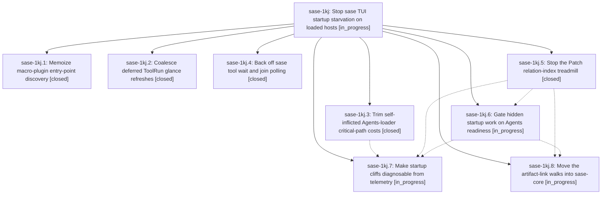

# Bead: sase-1kj — Stop sase TUI startup starvation on loaded hosts

[Bead Pages](../README.md) / sase-1kj

**Status:** ◐ in_progress · **Type:** ▸ plan · **Tier:** epic
**Owner:** `bryanbugyi34@gmail.com` · **Created by:** [bbugyi200.athena.102](https://github.com/sase-org/sase--agents/blob/main/sessions/bbugyi200.athena.102.md) · **Assignee:** `sase-1kj.land`
**Created:** 2026-10-13 11:47:17 EDT
**Plan:** [202610/apollo\_tui\_startup.md](https://github.com/sase-org/sase--plans/blob/main/202610/apollo_tui_startup.md)

<!-- sase:links:start -->

## Links

| Relation | Artifact | Why |
| --- | --- | --- |
| implemented-by | [plan:202610/apollo_tui_startup.md][1] | derived from the plan's `bead_id:` frontmatter field |

[1]: https://github.com/sase-org/sase--plans/blob/main/202610/apollo_tui_startup.md

<!-- sase:links:end -->

## Description

On a loaded host such as apollo, the Agents roster is usable soon after first paint. Hidden-surface and maintenance work no longer competes with the Agents loader through the GIL. The verified CPU hogs (plugin rescans, the Patch relation treadmill, and the app-wide link walk) are fixed. Startup cliffs can be diagnosed from telemetry alone.

## Phases

| Bead | Title | Status | Size | Created | Agents | Commits |
|---|---|---|---|---|---:|---:|
| [sase-1kj.1](sase-1kj.1.md) | Memoize macro-plugin entry-point discovery | ✓ closed | small | 2026-10-13 | 1 | 1 |
| [sase-1kj.2](sase-1kj.2.md) | Coalesce deferred ToolRun glance refreshes | ✓ closed | small | 2026-10-13 | 1 | 1 |
| [sase-1kj.3](sase-1kj.3.md) | Trim self-inflicted Agents-loader critical-path costs | ✓ closed | small | 2026-10-13 | 1 | 1 |
| [sase-1kj.4](sase-1kj.4.md) | Back off sase tool wait and join polling | ✓ closed | small | 2026-10-13 | 1 | 1 |
| [sase-1kj.5](sase-1kj.5.md) | Stop the Patch relation-index treadmill | ✓ closed | medium | 2026-10-13 | 1 | 1 |
| [sase-1kj.6](sase-1kj.6.md) | Gate hidden startup work on Agents readiness | ◐ in_progress | medium | 2026-10-13 | 1 | 0 |
| [sase-1kj.7](sase-1kj.7.md) | Make startup cliffs diagnosable from telemetry | ◐ in_progress | small | 2026-10-13 | 1 | 0 |
| [sase-1kj.8](sase-1kj.8.md) | Move the artifact-link walks into sase-core | ◐ in_progress | large | 2026-10-13 | 1 | 0 |

## Lineage

## Agents

| Agent | Bead | Commits |
|---|---|---:|
| [bbugyi200.athena.sase-1kj.1](https://github.com/sase-org/sase--agents/blob/main/sessions/bbugyi200.athena.sase-1kj.1.md) | [sase-1kj.1](sase-1kj.1.md) | 1 |
| [bbugyi200.athena.sase-1kj.2](https://github.com/sase-org/sase--agents/blob/main/agents/bbugyi200.athena.sase-1kj.2/README.md) | [sase-1kj.2](sase-1kj.2.md) | 1 |
| [bbugyi200.athena.sase-1kj.3](https://github.com/sase-org/sase--agents/blob/main/agents/bbugyi200.athena.sase-1kj.3/README.md) | [sase-1kj.3](sase-1kj.3.md) | 1 |
| [bbugyi200.athena.sase-1kj.4](https://github.com/sase-org/sase--agents/blob/main/sessions/bbugyi200.athena.sase-1kj.4.md) | [sase-1kj.4](sase-1kj.4.md) | 1 |
| [bbugyi200.athena.sase-1kj.5](https://github.com/sase-org/sase--agents/blob/main/sessions/bbugyi200.athena.sase-1kj.5.md) | [sase-1kj.5](sase-1kj.5.md) | 1 |
| [bbugyi200.athena.sase-1kj.6](https://github.com/sase-org/sase--agents/blob/main/agents/bbugyi200.athena.sase-1kj.6/README.md) | [sase-1kj.6](sase-1kj.6.md) | 0 |
| [bbugyi200.athena.sase-1kj.7](https://github.com/sase-org/sase--agents/blob/main/agents/bbugyi200.athena.sase-1kj.7/README.md) | [sase-1kj.7](sase-1kj.7.md) | 0 |
| [bbugyi200.athena.sase-1kj.8](https://github.com/sase-org/sase--agents/blob/main/agents/bbugyi200.athena.sase-1kj.8/README.md) | [sase-1kj.8](sase-1kj.8.md) | 0 |
| [bbugyi200.athena.sase-1kj.land](https://github.com/sase-org/sase--agents/blob/main/agents/bbugyi200.athena.sase-1kj.land/README.md) | [sase-1kj](README.md) | 0 |

## Commits

| Repo | Commit | Subject | Bead | Committed |
|---|---|---|---|---|
| sase | [`82aa8a7`](https://github.com/sase-org/sase/commit/82aa8a7a88b10c0d3aba515a834e0503cc99771c) | fix(tui): coalesce deferred ToolRun glance refreshes behind Agents load | [sase-1kj.2](sase-1kj.2.md) | 2026-10-13 12:47:34 EDT |
| sase | [`ce1940f`](https://github.com/sase-org/sase/commit/ce1940f39fd733f5777f4142c2703042b2a8b82b) | feat(macro): add plugin discovery and plugin input types | [sase-1kj.1](sase-1kj.1.md) | 2026-10-13 13:11:33 EDT |
| sase | [`099fcee`](https://github.com/sase-org/sase/commit/099fcee22102465e479348d817023a34fb40364b) | perf(ace): trim agents loader startup costs | [sase-1kj.3](sase-1kj.3.md) | 2026-10-13 13:23:04 EDT |
| sase | [`731b7b1`](https://github.com/sase-org/sase/commit/731b7b18b5ac8f31fcce9b84d3894dfe49e2295a) | perf(tool): throttle wait polling and skip unchanged event ingest | [sase-1kj.4](sase-1kj.4.md) | 2026-10-13 14:24:57 EDT |
| sase | [`085f5ec`](https://github.com/sase-org/sase/commit/085f5eceb79272a04a41f236dbfadac948945fb9) | perf(ace): memoize and defer Patch relation-index builds | [sase-1kj.5](sase-1kj.5.md) | 2026-10-13 15:55:03 EDT |
