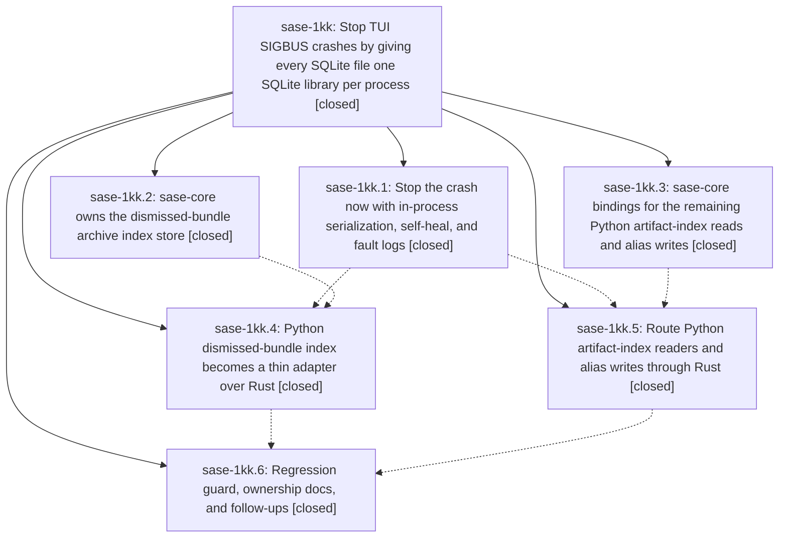

# Bead: sase-1kk — Stop TUI SIGBUS crashes by giving every SQLite file one SQLite library per process

[Bead Pages](../README.md) / sase-1kk

**Status:** ✓ closed · **Resolution:** done · **Type:** ▸ plan · **Tier:** epic
**Owner:** `bryanbugyi34@gmail.com` · **Created by:** [bbugyi200.athena.104](https://github.com/sase-org/sase--agents/blob/main/sessions/bbugyi200.athena.104.md) · **Assignee:** `sase-1kk.land`
**Created:** 2026-10-13 12:24:27 EDT · **Closed:** 2026-10-13 18:55:08 EDT
**Plan:** [202610/tui\_sigbus\_single\_sqlite\_owner.md](https://github.com/sase-org/sase--plans/blob/main/202610/tui_sigbus_single_sqlite_owner.md)

<!-- sase:links:start -->

## Links

| Relation | Artifact | Why |
| --- | --- | --- |
| implemented-by | [plan:202610/tui_sigbus_single_sqlite_owner.md][1] | derived from the plan's `bead_id:` frontmatter field |
| related | [bead:sase-1kp][2] | Epic that established the one-SQLite-library-per-file rule; its guard phase sase-1kk.6 proposed this follow-up |

_Plus 2 automatic references — see [Referenced By](#referenced-by)._

[1]: https://github.com/sase-org/sase--plans/blob/main/202610/tui_sigbus_single_sqlite_owner.md
[2]: https://github.com/sase-org/sase--beads/blob/main/pages/sase-1kp/README.md

<!-- sase:links:end -->

## Description

The sase TUI no longer dies with `bus error (core dumped)` or corrupts its SQLite indexes, because no process ever opens the same SQLite database file through both Python's stdlib `sqlite3` and the Rust core's bundled SQLite; the existing corrupt dismissed-bundle index heals itself, future fatal signals leave Python stacks behind, and a regression guard keeps the invariant from silently returning.

## Notes

[2026-10-13T22:40:56Z · sase-1kk.land] LAND FOLLOW-UP TRIAGE (sase-1kk.land): (1) sase-1kk.1 #1 + sase-1kk.5 #1 TUI import budget 3519 vs 3513, reproduced on clean base -> duplicate of sase-1ic, corroborated with +1 (not caused by this epic). (2) sase-1kk.2 #1 sase_gateway listener_creates_private_socket_and_rejects_symlink parallel-gate flake -> duplicate of sase-1gz, +1. (3) sase-1kk.3 #1 tool_run private_argv_is_not_serialized_on_queries flake -> duplicate of sase-17n, +1. (4) sase-1kk.6 #1 beads.db dual-use (Rust mutation lock file vs Python WAL mirror) -> no duplicate, no owning epic; created task sase-1kp (bug, large, ready). Typed related link to sase-1kk not recorded: sase artifact link add hung past 2 min (known sase-1gs); the task body names this epic. (5) sase-1kk.6 #2 migration_kit stdlib sqlite3 on live Rust-owned DBs -> causally owned by active epic sase-x7 (built by sase-x7.2.1.2, slated for removal by sase-x7.14); recorded as a DISCOVERED ISSUE note on sase-x7 rather than a task. No proposal declined.

[2026-10-13T22:42:57Z · sase-1kk.land] LAND AUDIT (sase-1kk.land): Verified all six phases against plan and source. sase commits 96e003ce12/432dd1f759/e8ec9cb291/73a61e6944 and sase-core d30e1337/6306bd2b are in the sase-core-revision.txt pin. sqlite3.connect in src/sase matches only the guard allowlist. No epic-symbol entries. 120 targeted tests pass. Integration since start: 78e967bd3d (dismissed-index test split) and 099fcee221 (read-only identity tests) were preserved on the Rust backend, with no conflicts. Remaining gaps, proposed as a lander tale that also closes this epic: (a) stopgap step 5's required faulthandler unit test is missing; (b) docs/rust_backend.md still calls the dismissed summary index Python-owned in two bullets; (c) test_projection_sync.py, test_core_agent_scan_records_index.py, and perf/bench_agent_catalog.py still open agent_artifact_index.sqlite with in-process stdlib sqlite3, violating the py-index-readers test rule; (d) a redundant outer artifact-index lock remains in chat_catalog_provenance/artifacts.py, and test_chat_catalog_provenance.py has an unused sqlite3 import.

[2026-10-13T22:55:08Z · sase-1kk.land] Verified all six phases against the plan and source. sase commits 96e003ce12, 432dd1f759, e8ec9cb291, and 73a61e6944 plus sase-core commits d30e1337 and 6306bd2b are contained in the sase-core-revision.txt pin. Integration review found no conflicts; 78e967bd3d's dismissed-index test split and 099fcee221's read-only index tests remain on the Rust backend. This tale added the faulthandler header/idempotence test, corrected dismissed-index ownership docs, moved Rust-owned artifact-index fixtures to subprocess/Rust projection access, removed the redundant facade lock and unused sqlite3 import. Targeted coverage passed (91 tests) and the benchmark smoke loaded the synthetic index. sase tool run check succeeded (473474ms); epic-symbols is empty. Follow-up triage is already recorded: +1 sase-1ic, sase-1gz, sase-17n; task sase-1kp; DISCOVERED ISSUE on sase-x7.

## Phases

| Bead | Title | Status | Size | Created | Agents | Commits |
|---|---|---|---|---|---:|---:|
| [sase-1kk.1](sase-1kk.1.md) | Stop the crash now with in-process serialization, self-heal, and fault logs | ✓ closed | small | 2026-10-13 | 1 | 1 |
| [sase-1kk.2](sase-1kk.2.md) | sase-core owns the dismissed-bundle archive index store | ✓ closed | medium | 2026-10-13 | 1 | 1 |
| [sase-1kk.3](sase-1kk.3.md) | sase-core bindings for the remaining Python artifact-index reads and alias writes | ✓ closed | small | 2026-10-13 | 1 | 1 |
| [sase-1kk.4](sase-1kk.4.md) | Python dismissed-bundle index becomes a thin adapter over Rust | ✓ closed | medium | 2026-10-13 | 1 | 1 |
| [sase-1kk.5](sase-1kk.5.md) | Route Python artifact-index readers and alias writes through Rust | ✓ closed | small | 2026-10-13 | 1 | 1 |
| [sase-1kk.6](sase-1kk.6.md) | Regression guard, ownership docs, and follow-ups | ✓ closed | small | 2026-10-13 | 1 | 1 |

## Lineage

## Agents

| Agent | Bead | Commits |
|---|---|---:|
| [bbugyi200.athena.sase-1kk.1](https://github.com/sase-org/sase--agents/blob/main/agents/bbugyi200.athena.sase-1kk.1/README.md) | [sase-1kk.1](sase-1kk.1.md) | 1 |
| [bbugyi200.athena.sase-1kk.2](https://github.com/sase-org/sase--agents/blob/main/agents/bbugyi200.athena.sase-1kk.2/README.md) | [sase-1kk.2](sase-1kk.2.md) | 1 |
| [bbugyi200.athena.sase-1kk.3](https://github.com/sase-org/sase--agents/blob/main/agents/bbugyi200.athena.sase-1kk.3/README.md) | [sase-1kk.3](sase-1kk.3.md) | 1 |
| [bbugyi200.athena.sase-1kk.4](https://github.com/sase-org/sase--agents/blob/main/sessions/bbugyi200.athena.sase-1kk.4.md) | [sase-1kk.4](sase-1kk.4.md) | 1 |
| [bbugyi200.athena.sase-1kk.5](https://github.com/sase-org/sase--agents/blob/main/agents/bbugyi200.athena.sase-1kk.5/README.md) | [sase-1kk.5](sase-1kk.5.md) | 1 |
| [bbugyi200.athena.sase-1kk.6](https://github.com/sase-org/sase--agents/blob/main/sessions/bbugyi200.athena.sase-1kk.6.md) | [sase-1kk.6](sase-1kk.6.md) | 1 |
| [bbugyi200.athena.sase-1kk.land](https://github.com/sase-org/sase--agents/blob/main/sessions/bbugyi200.athena.sase-1kk.land.md) | [sase-1kk](README.md) | 1 |

## Commits

| Repo | Commit | Subject | Bead | Committed |
|---|---|---|---|---|
| sase-core | [`sase-core@6306bd2`](https://github.com/sase-org/sase-core/commit/6306bd2bb6dfc2be595edaeb5e7c8663dcef59fa) | feat(agent-scan): add no-migrate index readers and alias bindings | [sase-1kk.3](sase-1kk.3.md) | 2026-10-13 13:23:35 EDT |
| sase-core | [`sase-core@d30e133`](https://github.com/sase-org/sase-core/commit/d30e1337a848f0bef8978153de3731badee00d46) | feat(agent-archive): move dismissed-bundle archive index into sase\_core store | [sase-1kk.2](sase-1kk.2.md) | 2026-10-13 13:30:13 EDT |
| sase | [`96e003c`](https://github.com/sase-org/sase/commit/96e003ce12de0dd53ad244c051e61ccb86df185d) | fix(tui): serialize SQLite access and recover dismissed index | [sase-1kk.1](sase-1kk.1.md) | 2026-10-13 14:17:30 EDT |
| sase | [`432dd1f`](https://github.com/sase-org/sase/commit/432dd1f75952cc1505b28a308d477192a4cf7a51) | feat(agent-index): route Python readers through Rust | [sase-1kk.5](sase-1kk.5.md) | 2026-10-13 15:17:50 EDT |
| sase | [`e8ec9cb`](https://github.com/sase-org/sase/commit/e8ec9cb29138643fb04f3fea9e947de883d9fc75) | refactor(ace): route dismissed bundle index through Rust | [sase-1kk.4](sase-1kk.4.md) | 2026-10-13 17:53:48 EDT |
| sase | [`73a61e6`](https://github.com/sase-org/sase/commit/73a61e694495691e2add372947503aa4151adba2) | test(sqlite): guard single-library ownership and document it | [sase-1kk.6](sase-1kk.6.md) | 2026-10-13 18:18:11 EDT |
| sase | [`9271ed1`](https://github.com/sase-org/sase/commit/9271ed1ed9d4891c0b3fc5c595bb26c9d1453e17) | fix(sqlite): finish single-owner landing gaps | [sase-1kk](README.md) | 2026-10-13 19:05:46 EDT |

<!-- sase:referenced-by:start -->

## Referenced By

| Relation | Artifact | Why | Uses |
| --- | --- | --- | ---: |
| read-by | [agent:sase-1kk.2][1] | epic scope | 1 |
| read-by | [agent:sase-1kk.3][2] | Need parent epic status and sibling phases | 1 |

[1]: https://github.com/sase-org/sase--agents/blob/main/agents/bbugyi200.athena.sase-1kk.2/README.md
[2]: https://github.com/sase-org/sase--agents/blob/main/agents/bbugyi200.athena.sase-1kk.3/README.md

<!-- sase:referenced-by:end -->
