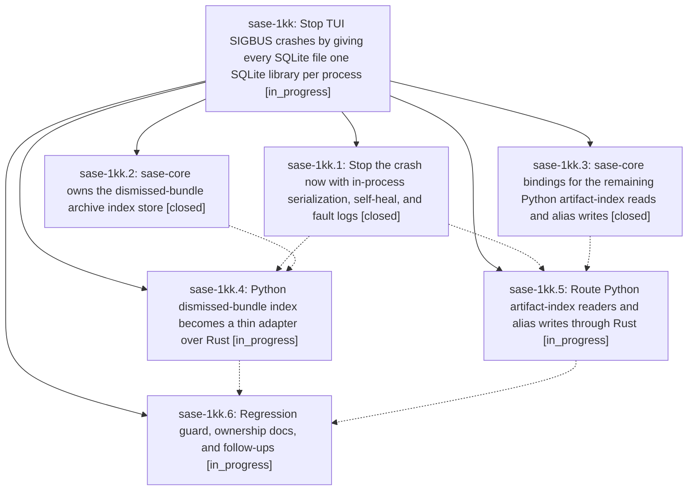

# Bead: sase-1kk — Stop TUI SIGBUS crashes by giving every SQLite file one SQLite library per process

[Bead Pages](../README.md) / sase-1kk

**Status:** ◐ in_progress · **Type:** ▸ plan · **Tier:** epic
**Owner:** `bryanbugyi34@gmail.com` · **Created by:** [bbugyi200.athena.104](https://github.com/sase-org/sase--agents/blob/main/sessions/bbugyi200.athena.104.md) · **Assignee:** `sase-1kk.land`
**Created:** 2026-10-13 12:24:27 EDT
**Plan:** [202610/tui\_sigbus\_single\_sqlite\_owner.md](https://github.com/sase-org/sase--plans/blob/main/202610/tui_sigbus_single_sqlite_owner.md)

<!-- sase:links:start -->

## Links

| Relation | Artifact | Why |
| --- | --- | --- |
| implemented-by | [plan:202610/tui_sigbus_single_sqlite_owner.md][1] | derived from the plan's `bead_id:` frontmatter field |

_Plus 1 automatic references — see [Referenced By](#referenced-by)._

[1]: https://github.com/sase-org/sase--plans/blob/main/202610/tui_sigbus_single_sqlite_owner.md

<!-- sase:links:end -->

## Description

The sase TUI no longer dies with `bus error (core dumped)` or corrupts its SQLite indexes, because no process ever opens the same SQLite database file through both Python's stdlib `sqlite3` and the Rust core's bundled SQLite; the existing corrupt dismissed-bundle index heals itself, future fatal signals leave Python stacks behind, and a regression guard keeps the invariant from silently returning.

## Phases

| Bead | Title | Status | Size | Created | Agents | Commits |
|---|---|---|---|---|---:|---:|
| [sase-1kk.1](sase-1kk.1.md) | Stop the crash now with in-process serialization, self-heal, and fault logs | ✓ closed | small | 2026-10-13 | 1 | 0 |
| [sase-1kk.2](sase-1kk.2.md) | sase-core owns the dismissed-bundle archive index store | ✓ closed | medium | 2026-10-13 | 1 | 1 |
| [sase-1kk.3](sase-1kk.3.md) | sase-core bindings for the remaining Python artifact-index reads and alias writes | ✓ closed | small | 2026-10-13 | 1 | 1 |
| [sase-1kk.4](sase-1kk.4.md) | Python dismissed-bundle index becomes a thin adapter over Rust | ◐ in_progress | medium | 2026-10-13 | 1 | 0 |
| [sase-1kk.5](sase-1kk.5.md) | Route Python artifact-index readers and alias writes through Rust | ◐ in_progress | small | 2026-10-13 | 1 | 0 |
| [sase-1kk.6](sase-1kk.6.md) | Regression guard, ownership docs, and follow-ups | ◐ in_progress | small | 2026-10-13 | 1 | 0 |

## Lineage

## Agents

| Agent | Bead | Commits |
|---|---|---:|
| [bbugyi200.athena.sase-1kk.1](https://github.com/sase-org/sase--agents/blob/main/agents/bbugyi200.athena.sase-1kk.1/README.md) | [sase-1kk.1](sase-1kk.1.md) | 0 |
| [bbugyi200.athena.sase-1kk.2](https://github.com/sase-org/sase--agents/blob/main/agents/bbugyi200.athena.sase-1kk.2/README.md) | [sase-1kk.2](sase-1kk.2.md) | 1 |
| [bbugyi200.athena.sase-1kk.3](https://github.com/sase-org/sase--agents/blob/main/agents/bbugyi200.athena.sase-1kk.3/README.md) | [sase-1kk.3](sase-1kk.3.md) | 1 |
| [bbugyi200.athena.sase-1kk.4](https://github.com/sase-org/sase--agents/blob/main/agents/bbugyi200.athena.sase-1kk.4/README.md) | [sase-1kk.4](sase-1kk.4.md) | 0 |
| [bbugyi200.athena.sase-1kk.5](https://github.com/sase-org/sase--agents/blob/main/agents/bbugyi200.athena.sase-1kk.5/README.md) | [sase-1kk.5](sase-1kk.5.md) | 0 |
| [bbugyi200.athena.sase-1kk.6](https://github.com/sase-org/sase--agents/blob/main/agents/bbugyi200.athena.sase-1kk.6/README.md) | [sase-1kk.6](sase-1kk.6.md) | 0 |
| [bbugyi200.athena.sase-1kk.land](https://github.com/sase-org/sase--agents/blob/main/agents/bbugyi200.athena.sase-1kk.land/README.md) | [sase-1kk](README.md) | 0 |

## Commits

| Repo | Commit | Subject | Bead | Committed |
|---|---|---|---|---|
| sase-core | [`sase-core@6306bd2`](https://github.com/sase-org/sase-core/commit/6306bd2bb6dfc2be595edaeb5e7c8663dcef59fa) | feat(agent-scan): add no-migrate index readers and alias bindings | [sase-1kk.3](sase-1kk.3.md) | 2026-10-13 13:23:35 EDT |
| sase-core | [`sase-core@d30e133`](https://github.com/sase-org/sase-core/commit/d30e1337a848f0bef8978153de3731badee00d46) | feat(agent-archive): move dismissed-bundle archive index into sase\_core store | [sase-1kk.2](sase-1kk.2.md) | 2026-10-13 13:30:13 EDT |

<!-- sase:referenced-by:start -->

## Referenced By

| Relation | Artifact | Why | Uses |
| --- | --- | --- | ---: |
| read-by | [agent:sase-1kk.3][1] | Need parent epic status and sibling phases | 1 |

[1]: https://github.com/sase-org/sase--agents/blob/main/agents/bbugyi200.athena.sase-1kk.3/README.md

<!-- sase:referenced-by:end -->
