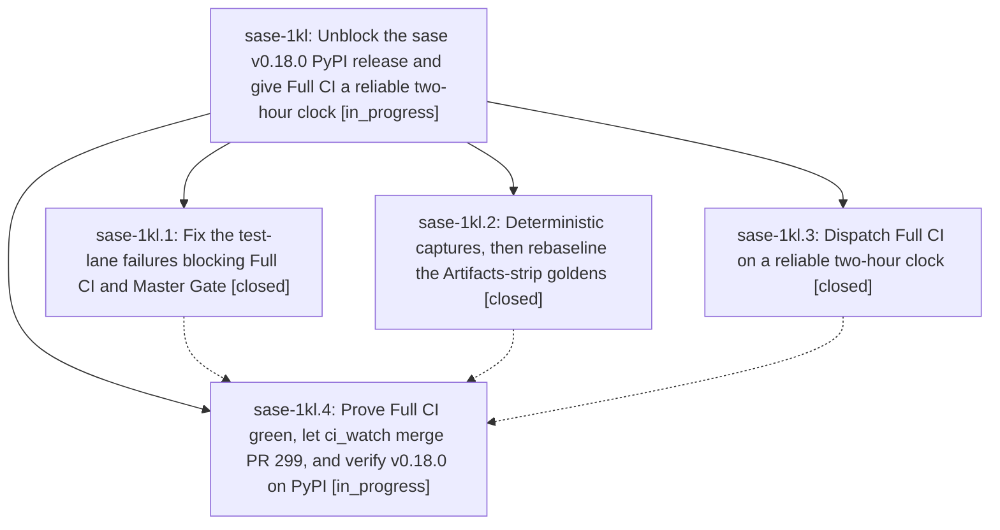

# Bead: sase-1kl — Unblock the sase v0.18.0 PyPI release and give Full CI a reliable two-hour clock

[Bead Pages](../README.md) / sase-1kl

**Status:** ◐ in_progress · **Type:** ▸ plan · **Tier:** epic
**Owner:** `bryanbugyi34@gmail.com` · **Created by:** [bbugyi200.athena.106](https://github.com/sase-org/sase--agents/blob/main/sessions/bbugyi200.athena.106.md) · **Assignee:** `sase-1kl.land`
**Created:** 2026-10-13 14:15:35 EDT
**Plan:** [202610/v0\_18\_0\_release\_unblock.md](https://github.com/sase-org/sase--plans/blob/main/202610/v0_18_0_release_unblock.md)

<!-- sase:links:start -->

## Links

| Relation | Artifact | Why |
| --- | --- | --- |
| implemented-by | [plan:202610/v0_18_0_release_unblock.md][1] | derived from the plan's `bead_id:` frontmatter field |

_Plus 1 automatic references — see [Referenced By](#referenced-by)._

[1]: https://github.com/sase-org/sase--plans/blob/main/202610/v0_18_0_release_unblock.md

<!-- sase:links:end -->

## Description

sase v0.18.0 is on PyPI and `pip install sase` works again. It ships through the normal `ci_watch` path: a green Full CI no more than 6h old, plus a green Master Gate at master HEAD. Full CI on sase master starts about every two hours, driven by a clock that GitHub's backlogged cron scheduler cannot drop.

## Phases

| Bead | Title | Status | Size | Created | Agents | Commits |
|---|---|---|---|---|---:|---:|
| [sase-1kl.1](sase-1kl.1.md) | Fix the test-lane failures blocking Full CI and Master Gate | ✓ closed | medium | 2026-10-13 | 1 | 1 |
| [sase-1kl.2](sase-1kl.2.md) | Deterministic captures, then rebaseline the Artifacts-strip goldens | ✓ closed | medium | 2026-10-13 | 1 | 1 |
| [sase-1kl.3](sase-1kl.3.md) | Dispatch Full CI on a reliable two-hour clock | ✓ closed | medium | 2026-10-13 | 1 | 0 |
| [sase-1kl.4](sase-1kl.4.md) | Prove Full CI green, let ci\_watch merge PR 299, and verify v0.18.0 on PyPI | ◐ in_progress | medium | 2026-10-13 | 1 | 0 |

## Lineage

## Agents

| Agent | Bead | Commits |
|---|---|---:|
| [bbugyi200.athena.sase-1kl.1](https://github.com/sase-org/sase--agents/blob/main/agents/bbugyi200.athena.sase-1kl.1/README.md) | [sase-1kl.1](sase-1kl.1.md) | 1 |
| [bbugyi200.athena.sase-1kl.2](https://github.com/sase-org/sase--agents/blob/main/agents/bbugyi200.athena.sase-1kl.2/README.md) | [sase-1kl.2](sase-1kl.2.md) | 1 |
| [bbugyi200.athena.sase-1kl.3](https://github.com/sase-org/sase--agents/blob/main/agents/bbugyi200.athena.sase-1kl.3/README.md) | [sase-1kl.3](sase-1kl.3.md) | 0 |
| [bbugyi200.athena.sase-1kl.4](https://github.com/sase-org/sase--agents/blob/main/agents/bbugyi200.athena.sase-1kl.4/README.md) | [sase-1kl.4](sase-1kl.4.md) | 0 |
| [bbugyi200.athena.sase-1kl.land](https://github.com/sase-org/sase--agents/blob/main/agents/bbugyi200.athena.sase-1kl.land/README.md) | [sase-1kl](README.md) | 0 |

## Commits

| Repo | Commit | Subject | Bead | Committed |
|---|---|---|---|---|
| sase | [`8959b0e`](https://github.com/sase-org/sase/commit/8959b0e6fc6b048ee60f79731e676db994cb2ce7) | fix(tests): stabilize New Project flows and sudo checks | [sase-1kl.1](sase-1kl.1.md) | 2026-10-13 16:15:33 EDT |
| sase | [`cf550a0`](https://github.com/sase-org/sase/commit/cf550a0e57065750c73bb9cafa7700039f18b868) | fix(ace-tui): fix Main-deck sink races and top-bar pre-layout density | [sase-1kl.2](sase-1kl.2.md) | 2026-10-13 17:18:39 EDT |

<!-- sase:referenced-by:start -->

## Referenced By

| Relation | Artifact | Why | Uses |
| --- | --- | --- | ---: |
| read-by | [agent:sase-1kl.1][1] | Need parent epic scope and final decisions for this phase | 1 |

[1]: https://github.com/sase-org/sase--agents/blob/main/agents/bbugyi200.athena.sase-1kl.1/README.md

<!-- sase:referenced-by:end -->
