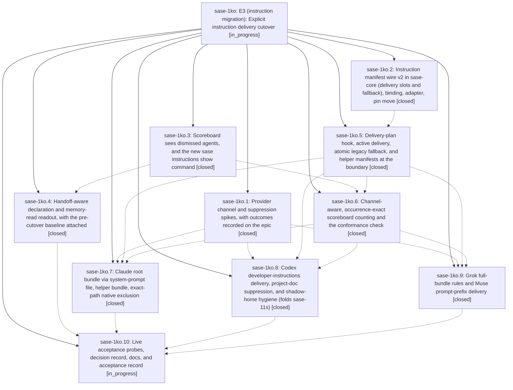

# Bead: sase-1ko — E3 (instruction migration): Explicit instruction delivery cutover

[Bead Pages](../README.md) / sase-1ko

**Status:** ◐ in_progress · **Type:** ▸ plan · **Tier:** epic
**Owner:** `bryanbugyi34@gmail.com` · **Created by:** [bbugyi200.apollo.research.13.linker.w0](https://github.com/sase-org/sase--agents/blob/main/sessions/bbugyi200.apollo.research.13.linker.w0.md) · **Assignee:** `sase-1ko.land`
**Created:** 2026-10-13 18:10:34 EDT
**Plan:** [202610/e3\_explicit\_delivery\_cutover.md](https://github.com/sase-org/sase--plans/blob/main/202610/e3_explicit_delivery_cutover.md)

<!-- sase:links:start -->

## Links

| Relation | Artifact | Why |
| --- | --- | --- |
| implemented-by | [plan:202610/e3_explicit_delivery_cutover.md][1] | derived from the plan's `bead_id:` frontmatter field |

_Plus 3 automatic references — see [Referenced By](#referenced-by)._

[1]: https://github.com/sase-org/sase--plans/blob/main/202610/e3_explicit_delivery_cutover.md

<!-- sase:links:end -->

## Description

Every SASE root agent on Claude, Codex, Grok, and Muse (unless its trust spike fails) gets its memory-built instruction bundle exactly once through an explicit adapter channel, with SASE-owned native instruction files suppressed. Claude helpers get the helper bundle. Each provider switch has a per-provider sunset kill switch and an atomic per-invocation legacy fallback. A trustworthy scoreboard, `sase instructions show`, and a handoff-aware readout prove the result and support the soak.

## Notes

[2026-10-13T22:22:40Z · sase-1ko.1] Sanitized CLI probe evidence for the E3 provider spikes

🔒 E3\_SPIKE\_RESULTS.md

[2026-10-13T22:23:03Z · sase-1ko.1] E3 SPIKE RESULTS: Claude Code 2.1.296 — pass: exact-path `claudeMdExcludes` suppressed workspace and home root files; excluding only CLAUDE.md also prevented AGENTS.md fallback, so no `instructionFiles` override is needed. Nested linked-repo CLAUDE.md with `@AGENTS.md` and nested tools/AGENTS.md still loaded on read. 20 KB `--append-system-prompt-file` and `--append-subagent-system-prompt-file` each appeared in their respective snapshots; helper had no root marker, and `--resume` retained the root snapshot. `autoMemoryEnabled: false` and `CLAUDE_CODE_DISABLE_AUTO_MEMORY=1` both yielded snapshots without an auto-memory section; prefer the per-run setting. Codex CLI 0.162.1 — pass: on a managed fixture, `-c project_doc_max_bytes=0` suppressed project AGENTS.md while 20 KB `developer_instructions` remained; an unmanaged fixture retained its own AGENTS.md without the override. Allowlist-shadow `codex exec` succeeded and wrote rollout to real `~/.codex/sessions` without stale-path errors. No real-home state was linked; Codex created local SQLite files in the shadow during execution (including `memories_1.sqlite`), not symlinks. Multi-agent v2 fork child: unprobed. Muse Code 1.4.7 — pass without `--trust-workspace`: project AGENTS.md was skipped, user skills listed with activation on, and a completed model run successfully used shell and file-edit tools. Grok 1.0.52 — pass: `GROK_MEMORY=0` yielded `prompt_context.json` with `memory_v2_enabled: false` and `agents_md_files: []`; the `--max-turns 1` CLI then exited with “max turns reached,” after writing that evidence. Sanitized evidence attached as E3_SPIKE_RESULTS.md.

[2026-10-13T22:32:27Z · sase-1ko.1] E3 spike addendum: exact settings and Claude auto-memory fingerprint for channel-counting

🔒 E3\_SPIKE\_FINGERPRINTS.md

[2026-10-13T22:32:44Z · sase-1ko.1] E3 SPIKE RESULTS: addendum — Claude auto-memory fingerprint for channel-counting is the prompt_snapshot heading `# Memory` plus lead-in `You have a persistent file-based memory at` (path is per-project). Prefer per-run `--settings` `autoMemoryEnabled: false`; `CLAUDE_CODE_DISABLE_AUTO_MEMORY=1` also removes it. Do not use `"Memory" in snapshot`. Claude 2.1.296 (a–e) pass with exact-path `claudeMdExcludes` and no `instructionFiles` override. Codex 0.162.1 (a,b) pass; (c) unprobed. Muse 1.4.7 pass without `--trust-workspace` (create muse flag). Grok 1.0.52 pass with `GROK_MEMORY=0` (`memory_v2_enabled: false`). Details attached as E3_SPIKE_FINGERPRINTS.md.

[2026-10-14T02:06:13Z · sase-1ko.4] Pre-cutover readout baseline Sep 10-Oct 5: handoff-aware misses per provider and mode with memory reads. Totals match planning baseline; misses within tolerance except Grok/Muse explained in phase note.

🔒 e3\_readout\_baseline\_20260910\_20261005.json

[2026-10-14T02:06:22Z · sase-1ko.4] Pre-cutover readout baseline Oct 6-Oct 13: handoff-aware misses per provider and mode with memory reads. No explicit manifests yet; first_explicit empty, watch starts at first explicit render.

🔒 e3\_readout\_baseline\_20261006\_20261013.json

[2026-10-14T03:37:38Z · sase-1kj.8.1.land] DISCOVERED ISSUE: During artifact-link implementation verification, required ToolRun e3290324a8eee4f12f8877a8d66b4b99 failed tests/instructions/test_delivery_plan.py::test_render_failure_notifies_once. Reproduced standalone with .venv/bin/python -m pytest -n 0 tests/instructions/test_delivery_plan.py::test_render_failure_notifies_once (1 failed in 2.57s): the test monkeypatches sase.llm_provider._instruction_boundary.notify_instruction_fallback, but invoke_with_instructions imports that function from sase.llm_provider.instruction_delivery. Neither file is in the artifact-link diff. This falls directly within this epic's sase-1ko.5 delivery-plan fallback/test seam; update the test patch target or expose an intentional seam, then rerun the node and gate. No task bead created.

[2026-10-14T05:50:07Z · sase-1kj.8.1.land--3] DISCOVERED ISSUE: The required `sase tool run check` during the main stitch conflict repair failed at `lint (symvision)` in ToolRun 13807f8ad336e1fcca8c3dc83eca023d with seven NEW unused public symbols in unchanged instruction-delivery files: `claude_helper_sources` (coverage_sources.py), `contains_contract` and `count_contract_sources` (fingerprints.py), `human_rules_blocks` (grok.py), and `prompt_prefixes`, `prompt_texts`, `rules_texts` (muse.py). These paths are outside the artifact-link change. The gate stopped before validation and scoped tests; the three affected artifact-link test modules passed separately in ToolRun 42d28af5cee04160810f641d3a0d39d1 (70 passed). The symbols are in the completed Grok/Muse delivery area (sase-1ko.9); the acceptance phase sase-1ko.10 remains active. Review each against real non-test consumers and remove dead APIs or wire their intended consumer; do not restore epic-symbol exemptions for symbols the linter reports unused.

[2026-10-14T06:29:03Z · sase-1kj.land] DISCOVERED ISSUE: sase-1kj.land wrapped check c7410810d41e7e4b5841f34a6b7012cc failed two instruction tests outside the startup-starvation diff: tests/instructions/test_delivery_plan.py::test_declared_legacy_hookimpls_resolve_to_provider_legacy (assert 'explicit' == 'inherits_native') and tests/instructions/test_scoreboard_conformance.py::test_conformance_warns_for_duplicate_root_and_leaked_helper_markers (ImportError: cannot import name '_RunManifest' from sase.instructions.manifests). Neither file is in the sase-1kj landing-repair diff. just symvision also reports unused public symbols claude_helper_sources, contains_contract, count_contract_sources, human_rules_blocks, prompt_prefixes, prompt_texts, rules_texts in instructions/* (KNOWN in that ToolRun). Active sase-1ko.10 owns this cutover.

## Attachments

- 🔒 E3\_SPIKE\_RESULTS.md · text/markdown · 2.92383 KiB (private attachment)
- 🔒 E3\_SPIKE\_FINGERPRINTS.md · text/markdown · 4.25586 KiB (private attachment)
- 🔒 e3\_readout\_baseline\_20260910\_20261005.json · application/json · 4.40625 KiB (private attachment)
- 🔒 e3\_readout\_baseline\_20261006\_20261013.json · application/json · 7.26074 KiB (private attachment)

## Phases

| Bead | Title | Status | Size | Created | Agents | Commits |
|---|---|---|---|---|---:|---:|
| [sase-1ko.1](sase-1ko.1.md) | Provider channel and suppression spikes, with outcomes recorded on the epic | ✓ closed | small | 2026-10-13 | 1 | 0 |
| [sase-1ko.10](sase-1ko.10.md) | Live acceptance probes, decision record, docs, and acceptance record | ◐ in_progress | medium | 2026-10-13 | 1 | 0 |
| [sase-1ko.2](sase-1ko.2.md) | Instruction manifest wire v2 in sase-core (delivery slots and fallback), binding, adapter, pin move | ✓ closed | medium | 2026-10-13 | 1 | 2 |
| [sase-1ko.3](sase-1ko.3.md) | Scoreboard sees dismissed agents, and the new sase instructions show command | ✓ closed | medium | 2026-10-13 | 1 | 1 |
| [sase-1ko.4](sase-1ko.4.md) | Handoff-aware declaration and memory-read readout, with the pre-cutover baseline attached | ✓ closed | medium | 2026-10-13 | 1 | 1 |
| [sase-1ko.5](sase-1ko.5.md) | Delivery-plan hook, active delivery, atomic legacy fallback, and helper manifests at the boundary | ✓ closed | medium | 2026-10-13 | 1 | 1 |
| [sase-1ko.6](sase-1ko.6.md) | Channel-aware, occurrence-exact scoreboard counting and the conformance check | ✓ closed | medium | 2026-10-13 | 1 | 1 |
| [sase-1ko.7](sase-1ko.7.md) | Claude root bundle via system-prompt file, helper bundle, exact-path native exclusion | ✓ closed | medium | 2026-10-13 | 1 | 0 |
| [sase-1ko.8](sase-1ko.8.md) | Codex developer-instructions delivery, project-doc suppression, and shadow-home hygiene (folds sase-11s) | ✓ closed | medium | 2026-10-13 | 1 | 1 |
| [sase-1ko.9](sase-1ko.9.md) | Grok full-bundle rules and Muse prompt-prefix delivery | ✓ closed | medium | 2026-10-13 | 1 | 1 |

## Lineage

## Agents

| Agent | Bead | Commits |
|---|---|---:|
| [bbugyi200.apollo.sase-1ko.1](https://github.com/sase-org/sase--agents/blob/main/agents/bbugyi200.apollo.sase-1ko.1/README.md) | [sase-1ko.1](sase-1ko.1.md) | 0 |
| [bbugyi200.apollo.sase-1ko.10](https://github.com/sase-org/sase--agents/blob/main/agents/bbugyi200.apollo.sase-1ko.10/README.md) | [sase-1ko.10](sase-1ko.10.md) | 0 |
| [bbugyi200.apollo.sase-1ko.2](https://github.com/sase-org/sase--agents/blob/main/agents/bbugyi200.apollo.sase-1ko.2/README.md) | [sase-1ko.2](sase-1ko.2.md) | 2 |
| [bbugyi200.apollo.sase-1ko.3](https://github.com/sase-org/sase--agents/blob/main/agents/bbugyi200.apollo.sase-1ko.3/README.md) | [sase-1ko.3](sase-1ko.3.md) | 1 |
| [bbugyi200.apollo.sase-1ko.4](https://github.com/sase-org/sase--agents/blob/main/sessions/bbugyi200.apollo.sase-1ko.4.md) | [sase-1ko.4](sase-1ko.4.md) | 1 |
| [bbugyi200.apollo.sase-1ko.5](https://github.com/sase-org/sase--agents/blob/main/agents/bbugyi200.apollo.sase-1ko.5/README.md) | [sase-1ko.5](sase-1ko.5.md) | 1 |
| [bbugyi200.apollo.sase-1ko.6](https://github.com/sase-org/sase--agents/blob/main/agents/bbugyi200.apollo.sase-1ko.6/README.md) | [sase-1ko.6](sase-1ko.6.md) | 1 |
| [bbugyi200.apollo.sase-1ko.7](https://github.com/sase-org/sase--agents/blob/main/sessions/bbugyi200.apollo.sase-1ko.7.md) | [sase-1ko.7](sase-1ko.7.md) | 0 |
| [bbugyi200.apollo.sase-1ko.8](https://github.com/sase-org/sase--agents/blob/main/agents/bbugyi200.apollo.sase-1ko.8/README.md) | [sase-1ko.8](sase-1ko.8.md) | 1 |
| [bbugyi200.apollo.sase-1ko.9](https://github.com/sase-org/sase--agents/blob/main/sessions/bbugyi200.apollo.sase-1ko.9.md) | [sase-1ko.9](sase-1ko.9.md) | 1 |
| [bbugyi200.apollo.sase-1ko.land](https://github.com/sase-org/sase--agents/blob/main/agents/bbugyi200.apollo.sase-1ko.land/README.md) | [sase-1ko](README.md) | 0 |

## Commits

| Repo | Commit | Subject | Bead | Committed |
|---|---|---|---|---|
| sase-core | [`sase-core@973017b`](https://github.com/sase-org/sase-core/commit/973017b6b6a91c0e843d60a65040c9496e94d423) | feat(instruction-manifest)!: add v2 delivery slots and fallback | [sase-1ko.2](sase-1ko.2.md) | 2026-10-13 19:38:10 EDT |
| sase | [`96090a5`](https://github.com/sase-org/sase/commit/96090a52cfb4b38a64e8a05a23d305bf0009080b) | feat(instructions): adopt manifest v2 delivery slots | [sase-1ko.2](sase-1ko.2.md) | 2026-10-13 19:44:26 EDT |
| sase | [`d69cd49`](https://github.com/sase-org/sase/commit/d69cd499dd26b04534b9b4a11af540e14a6c73af) | feat(instructions): land delivery-plan hook and declared-legacy fallback | [sase-1ko.5](sase-1ko.5.md) | 2026-10-13 21:37:34 EDT |
| sase | [`c5e4da7`](https://github.com/sase-org/sase/commit/c5e4da7065cc40a5e81163a949a499713994db06) | feat(instructions): enumerate dismissed runs and add instructions show | [sase-1ko.3](sase-1ko.3.md) | 2026-10-13 21:44:32 EDT |
| sase | [`26a12b6`](https://github.com/sase-org/sase/commit/26a12b63df1c995c6d24a408f43991f8cdca0e44) | feat(instructions): add channel-aware conformance scoreboard | [sase-1ko.6](sase-1ko.6.md) | 2026-10-13 23:20:38 EDT |
| sase | [`429353b`](https://github.com/sase-org/sase/commit/429353b015be5e4f644a6ee5762be5dd3df64e6b) | feat(codex): deliver explicit root instructions | [sase-1ko.8](sase-1ko.8.md) | 2026-10-14 00:17:31 EDT |
| sase | [`e79a89d`](https://github.com/sase-org/sase/commit/e79a89d755a1f91cb032bd2199709994ab9d5d9d) | feat(instructions): add handoff-aware declaration readout | [sase-1ko.4](sase-1ko.4.md) | 2026-10-14 00:20:55 EDT |
| sase | [`8847d07`](https://github.com/sase-org/sase/commit/8847d07a086b9e930f1a787425ec4c3272ea6824) | feat(instructions): add Grok and Muse explicit delivery | [sase-1ko.9](sase-1ko.9.md) | 2026-10-14 04:42:35 EDT |

<!-- sase:referenced-by:start -->

## Referenced By

| Relation | Artifact | Why | Uses |
| --- | --- | --- | ---: |
| read-by | [agent:sase-1kl.4--1][1] | Check whether instructions epic owns the Master Gate reds | 1 |
| read-by | [agent:sase-1ko.6][2] | Need the spike-recorded auto-memory fingerprint for channel-counting | 1 |
| read-by | [agent:sase-1ko.8][3] | Read E3 spike outcomes required by the Codex phase | 1 |

[1]: https://github.com/sase-org/sase--agents/blob/main/sessions/bbugyi200.apollo.sase-1kl.4.md
[2]: https://github.com/sase-org/sase--agents/blob/main/agents/bbugyi200.apollo.sase-1ko.6/README.md
[3]: https://github.com/sase-org/sase--agents/blob/main/agents/bbugyi200.apollo.sase-1ko.8/README.md

<!-- sase:referenced-by:end -->
