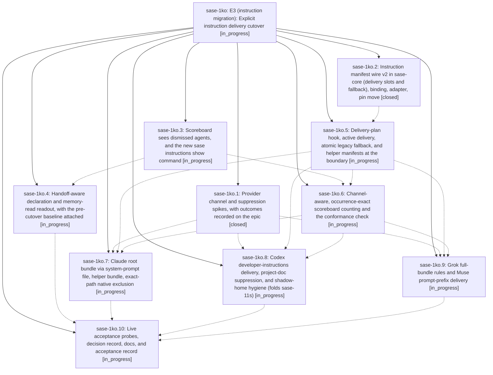

# Bead: sase-1ko — E3 (instruction migration): Explicit instruction delivery cutover

[Bead Pages](../README.md) / sase-1ko

**Status:** ◐ in_progress · **Type:** ▸ plan · **Tier:** epic
**Owner:** `bryanbugyi34@gmail.com` · **Created by:** [bbugyi200.apollo.research.13.linker.w0](https://github.com/sase-org/sase--agents/blob/main/sessions/bbugyi200.apollo.research.13.linker.w0.md) · **Assignee:** `sase-1ko.land`
**Created:** 2026-10-13 18:10:34 EDT
**Plan:** [202610/e3\_explicit\_delivery\_cutover.md](https://github.com/sase-org/sase--plans/blob/main/202610/e3_explicit_delivery_cutover.md)

<!-- sase:links:start -->

## Links

| Relation | Artifact | Why |
| --- | --- | --- |
| implemented-by | [plan:202610/e3_explicit_delivery_cutover.md][1] | derived from the plan's `bead_id:` frontmatter field |

[1]: https://github.com/sase-org/sase--plans/blob/main/202610/e3_explicit_delivery_cutover.md

<!-- sase:links:end -->

## Description

Every SASE root agent on Claude, Codex, Grok, and Muse (unless its trust spike fails) gets its memory-built instruction bundle exactly once through an explicit adapter channel, with SASE-owned native instruction files suppressed. Claude helpers get the helper bundle. Each provider switch has a per-provider sunset kill switch and an atomic per-invocation legacy fallback. A trustworthy scoreboard, `sase instructions show`, and a handoff-aware readout prove the result and support the soak.

## Notes

[2026-10-13T22:22:40Z · sase-1ko.1] Sanitized CLI probe evidence for the E3 provider spikes

🔒 E3\_SPIKE\_RESULTS.md

[2026-10-13T22:23:03Z · sase-1ko.1] E3 SPIKE RESULTS: Claude Code 2.1.296 — pass: exact-path `claudeMdExcludes` suppressed workspace and home root files; excluding only CLAUDE.md also prevented AGENTS.md fallback, so no `instructionFiles` override is needed. Nested linked-repo CLAUDE.md with `@AGENTS.md` and nested tools/AGENTS.md still loaded on read. 20 KB `--append-system-prompt-file` and `--append-subagent-system-prompt-file` each appeared in their respective snapshots; helper had no root marker, and `--resume` retained the root snapshot. `autoMemoryEnabled: false` and `CLAUDE_CODE_DISABLE_AUTO_MEMORY=1` both yielded snapshots without an auto-memory section; prefer the per-run setting. Codex CLI 0.162.1 — pass: on a managed fixture, `-c project_doc_max_bytes=0` suppressed project AGENTS.md while 20 KB `developer_instructions` remained; an unmanaged fixture retained its own AGENTS.md without the override. Allowlist-shadow `codex exec` succeeded and wrote rollout to real `~/.codex/sessions` without stale-path errors. No real-home state was linked; Codex created local SQLite files in the shadow during execution (including `memories_1.sqlite`), not symlinks. Multi-agent v2 fork child: unprobed. Muse Code 1.4.7 — pass without `--trust-workspace`: project AGENTS.md was skipped, user skills listed with activation on, and a completed model run successfully used shell and file-edit tools. Grok 1.0.52 — pass: `GROK_MEMORY=0` yielded `prompt_context.json` with `memory_v2_enabled: false` and `agents_md_files: []`; the `--max-turns 1` CLI then exited with “max turns reached,” after writing that evidence. Sanitized evidence attached as E3_SPIKE_RESULTS.md.

[2026-10-13T22:32:27Z · sase-1ko.1] E3 spike addendum: exact settings and Claude auto-memory fingerprint for channel-counting

🔒 E3\_SPIKE\_FINGERPRINTS.md

[2026-10-13T22:32:44Z · sase-1ko.1] E3 SPIKE RESULTS: addendum — Claude auto-memory fingerprint for channel-counting is the prompt_snapshot heading `# Memory` plus lead-in `You have a persistent file-based memory at` (path is per-project). Prefer per-run `--settings` `autoMemoryEnabled: false`; `CLAUDE_CODE_DISABLE_AUTO_MEMORY=1` also removes it. Do not use `"Memory" in snapshot`. Claude 2.1.296 (a–e) pass with exact-path `claudeMdExcludes` and no `instructionFiles` override. Codex 0.162.1 (a,b) pass; (c) unprobed. Muse 1.4.7 pass without `--trust-workspace` (create muse flag). Grok 1.0.52 pass with `GROK_MEMORY=0` (`memory_v2_enabled: false`). Details attached as E3_SPIKE_FINGERPRINTS.md.

## Attachments

- 🔒 E3\_SPIKE\_RESULTS.md · text/markdown · 2.92383 KiB (private attachment)
- 🔒 E3\_SPIKE\_FINGERPRINTS.md · text/markdown · 4.25586 KiB (private attachment)

## Phases

| Bead | Title | Status | Size | Created | Agents | Commits |
|---|---|---|---|---|---:|---:|
| [sase-1ko.1](sase-1ko.1.md) | Provider channel and suppression spikes, with outcomes recorded on the epic | ✓ closed | small | 2026-10-13 | 1 | 0 |
| [sase-1ko.10](sase-1ko.10.md) | Live acceptance probes, decision record, docs, and acceptance record | ◐ in_progress | medium | 2026-10-13 | 1 | 0 |
| [sase-1ko.2](sase-1ko.2.md) | Instruction manifest wire v2 in sase-core (delivery slots and fallback), binding, adapter, pin move | ✓ closed | medium | 2026-10-13 | 1 | 1 |
| [sase-1ko.3](sase-1ko.3.md) | Scoreboard sees dismissed agents, and the new sase instructions show command | ◐ in_progress | medium | 2026-10-13 | 1 | 0 |
| [sase-1ko.4](sase-1ko.4.md) | Handoff-aware declaration and memory-read readout, with the pre-cutover baseline attached | ◐ in_progress | medium | 2026-10-13 | 1 | 0 |
| [sase-1ko.5](sase-1ko.5.md) | Delivery-plan hook, active delivery, atomic legacy fallback, and helper manifests at the boundary | ◐ in_progress | medium | 2026-10-13 | 1 | 0 |
| [sase-1ko.6](sase-1ko.6.md) | Channel-aware, occurrence-exact scoreboard counting and the conformance check | ◐ in_progress | medium | 2026-10-13 | 1 | 0 |
| [sase-1ko.7](sase-1ko.7.md) | Claude root bundle via system-prompt file, helper bundle, exact-path native exclusion | ◐ in_progress | medium | 2026-10-13 | 1 | 0 |
| [sase-1ko.8](sase-1ko.8.md) | Codex developer-instructions delivery, project-doc suppression, and shadow-home hygiene (folds sase-11s) | ◐ in_progress | medium | 2026-10-13 | 1 | 0 |
| [sase-1ko.9](sase-1ko.9.md) | Grok full-bundle rules and Muse prompt-prefix delivery | ◐ in_progress | medium | 2026-10-13 | 1 | 0 |

## Lineage

## Agents

| Agent | Bead | Commits |
|---|---|---:|
| [bbugyi200.apollo.sase-1ko.1](https://github.com/sase-org/sase--agents/blob/main/agents/bbugyi200.apollo.sase-1ko.1/README.md) | [sase-1ko.1](sase-1ko.1.md) | 0 |
| [bbugyi200.apollo.sase-1ko.10](https://github.com/sase-org/sase--agents/blob/main/agents/bbugyi200.apollo.sase-1ko.10/README.md) | [sase-1ko.10](sase-1ko.10.md) | 0 |
| [bbugyi200.apollo.sase-1ko.2](https://github.com/sase-org/sase--agents/blob/main/agents/bbugyi200.apollo.sase-1ko.2/README.md) | [sase-1ko.2](sase-1ko.2.md) | 1 |
| [bbugyi200.apollo.sase-1ko.3](https://github.com/sase-org/sase--agents/blob/main/agents/bbugyi200.apollo.sase-1ko.3/README.md) | [sase-1ko.3](sase-1ko.3.md) | 0 |
| [bbugyi200.apollo.sase-1ko.4](https://github.com/sase-org/sase--agents/blob/main/agents/bbugyi200.apollo.sase-1ko.4/README.md) | [sase-1ko.4](sase-1ko.4.md) | 0 |
| [bbugyi200.apollo.sase-1ko.5](https://github.com/sase-org/sase--agents/blob/main/agents/bbugyi200.apollo.sase-1ko.5/README.md) | [sase-1ko.5](sase-1ko.5.md) | 0 |
| [bbugyi200.apollo.sase-1ko.6](https://github.com/sase-org/sase--agents/blob/main/agents/bbugyi200.apollo.sase-1ko.6/README.md) | [sase-1ko.6](sase-1ko.6.md) | 0 |
| [bbugyi200.apollo.sase-1ko.7](https://github.com/sase-org/sase--agents/blob/main/agents/bbugyi200.apollo.sase-1ko.7/README.md) | [sase-1ko.7](sase-1ko.7.md) | 0 |
| [bbugyi200.apollo.sase-1ko.8](https://github.com/sase-org/sase--agents/blob/main/agents/bbugyi200.apollo.sase-1ko.8/README.md) | [sase-1ko.8](sase-1ko.8.md) | 0 |
| [bbugyi200.apollo.sase-1ko.9](https://github.com/sase-org/sase--agents/blob/main/agents/bbugyi200.apollo.sase-1ko.9/README.md) | [sase-1ko.9](sase-1ko.9.md) | 0 |
| [bbugyi200.apollo.sase-1ko.land](https://github.com/sase-org/sase--agents/blob/main/agents/bbugyi200.apollo.sase-1ko.land/README.md) | [sase-1ko](README.md) | 0 |

## Commits

| Repo | Commit | Subject | Bead | Committed |
|---|---|---|---|---|
| sase-core | [`sase-core@973017b`](https://github.com/sase-org/sase-core/commit/973017b6b6a91c0e843d60a65040c9496e94d423) | feat(instruction-manifest)!: add v2 delivery slots and fallback | [sase-1ko.2](sase-1ko.2.md) | 2026-10-13 19:38:10 EDT |
