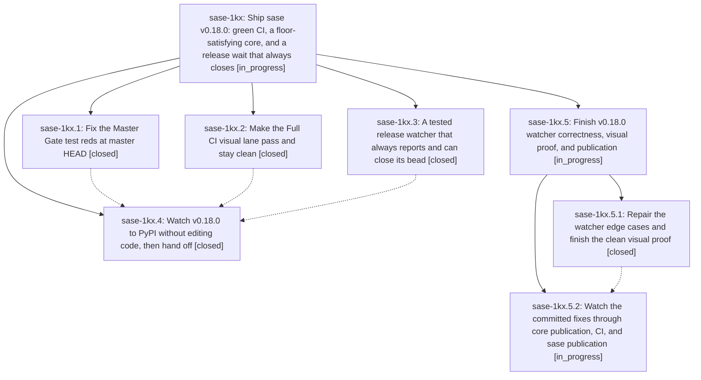

# Bead: sase-1kx — Ship sase v0.18.0: green CI, a floor-satisfying core, and a release wait that always closes

[Bead Pages](../README.md) / sase-1kx

**Status:** ◐ in_progress · **Type:** ▸ plan · **Tier:** epic
**Owner:** `bryanbugyi34@gmail.com` · **Created by:** [bbugyi200.athena.10b](https://github.com/sase-org/sase--agents/blob/main/sessions/bbugyi200.athena.10b.md) · **Assignee:** `sase-1kx.land`
**Created:** 2026-10-14 07:18:02 EDT
**Plan:** [202610/v0\_18\_0\_release.md](https://github.com/sase-org/sase--plans/blob/main/202610/v0_18_0_release.md)

<!-- sase:links:start -->

## Links

| Relation | Artifact | Why |
| --- | --- | --- |
| implemented-by | [plan:202610/v0_18_0_release.md][1] | derived from the plan's `bead_id:` frontmatter field |
| related | file:explicit:fa8533e2fbc2b13048be7360 | attached via sase artifact create --bead |

_Plus 2 automatic references — see [Referenced By](#referenced-by)._

[1]: https://github.com/sase-org/sase--plans/blob/main/202610/v0_18_0_release.md

<!-- sase:links:end -->

## Description

sase 0.18.0 is on PyPI and `pip install sase` works again. It ships through ci_watch's guarded merge of release PR #299, after Master Gate and Full CI go green on master. The release-wait phase always closes its bead, whatever happens, so the land agent always runs. The land agent confirms the release before it lands the epic, and finishes the release itself when something unexpected blocks it.

## Notes

[2026-10-14T13:27:49Z · sase-1kx.land] LANDING AUDIT at 508eb963a3: reviewed all four children and notes, all epic commits and actual source, concurrent changes since creation, and fetched base branch. Master Gate 38567573367 is green. Release is NOT confirmed: .4 closed canceled, core release 38568657352 still in progress, #299 floor red, no Full CI proof of fixes. No parent and no epic-symbol entries. Existing watcher suite: 26 passed; independent probes reproduce false visual-drift classification, wrong startup signal verdict, and accepted blank terminal conclusion. Three visual mismatches and integrated check evidence remain. Preparing a child epic with one fix phase and a separate no-edit post-commit release wait; parent remains open and original plan status unchanged. Decisions dispatch/notes preserved. Full evidence: file:explicit:fa8533e2fbc2b13048be7360.

FOLLOW-UP TRIAGE COMPLETED:

- sase-1kx.1 #1: created large flake task sase-1ky for the timeboxed archive Today
  expand race. The task identifies the proposing bead, CI run, 20 serial passes,
  three parallel file passes, new diagnostics, and unproven coalescing hypothesis.
- sase-1kx.1 #2: corroborated existing sase-172; same provider-MRU pruning node.
  A stale binding remains a hypothesis, not a proven diagnosis.
- sase-1kx.2 #1: retained all three drifts as remaining release acceptance work;
  appended DISCOVERED ISSUE to active sase-1jz for the causal gate-footer overlap.
  No duplicate task: the child repair plan owns completing the missing proof.
- sase-1kx.2 #2: declined an omnibus task with no established root cause. The exact
  ToolRun remains a verification concern in the repair plan, not waived as unrelated.
- sase-1kx.3 #1: corroborated existing sase-xo, relaying the 30.56s vs <5s result
  and 0.80s clean isolated rerun without claiming a new lander reproduction.
- sase-1kl.1 #1 and the import-budget portion of sase-1kl.2 #2: corroborated sase-1ic
  with clean-base 432dd1f759 evidence (3519 vs 3513).
- sase-1kl.2 #1-3: recorded causal Tool Runs/gate-footer/clock capture context on
  sase-1jz. Gate-footer drift remains in the repair plan. Declined separate tasks for
  old tool_runs_session_rail, renamed_generic_session_root, archive_list duration,
  settled_monitor_lane_badge, and cleanup-count symptoms: latest full visual run
  reported 1366 passing tests and only the three named current drifts; no current
  reproduction or independently pinned new defect was supplied. Re-inventory remains
  part of full visual verification; do not discard a recurrence if it appears.
- sase-1kl.3 #1: corroborated sase-1gn for obsolete bugyi-chops planning/bridge tests.
- sase-1kl.4 #5: declined a duplicate task; gate-reds fixes the lazy-export poisoning,
  with green Master Gates on the integrated code.
- sase-1kl.4 #6: declined a speculative code task for stale local bindings. Refresh
  the isolated workspace environment when needed; do not alter tests or globally
  reinstall from this landing. Actual missing published core is already release work.
- sase-1kl.4 #7: created large feature task sase-1kz for validated reusable CI waits.
  A general monitor cannot infer semantic success from arbitrary command output;
  the task requires an explicit polling contract/helper, not global prose heuristics.

Task searches covered all statuses, named nodes and semantic alternatives, the
last-week task sweep, and active epic scopes. New tasks were marked ready.
Existing task corroborations are explicitly relayed phase evidence.

[2026-10-14T13:31:24Z · sase-1kx.land] RELEASE-RUN PROVENANCE CORRECTION to landing audit file:explicit:fa8533e2fbc2b13048be7360: gh run view confirms the approved urgent core workflow_dispatch was 38568273048 (13:00:41Z), which ended canceled. The newer 38568657352 is event=schedule and still runs its Merge release PR job. The dispatch decision was exercised; an equivalent release cut remains live, so no duplicate dispatch was sent. The remaining-work plan now distinguishes these runs explicitly.

[2026-10-14T13:32:02Z · sase-1kx.land] Fresh publication check before remaining-work proposal: PyPI JSON reports sase latest 0.17.1 with no 0.18.0 release, and sase-core-rs latest 0.39.1. gh release view v0.18.0 -R sase-org/sase returns release not found. The epic is not ready to close. Remaining-work child epic plan passed validation with --explain, was refined, then passed revalidation without --explain (0 warnings).

## Phases

| Bead | Title | Status | Size | Created | Agents | Commits |
|---|---|---|---|---|---:|---:|
| [sase-1kx.1](sase-1kx.1.md) | Fix the Master Gate test reds at master HEAD | ✓ closed | medium | 2026-10-14 | 1 | 1 |
| [sase-1kx.2](sase-1kx.2.md) | Make the Full CI visual lane pass and stay clean | ✓ closed | medium | 2026-10-14 | 1 | 1 |
| [sase-1kx.3](sase-1kx.3.md) | A tested release watcher that always reports and can close its bead | ✓ closed | medium | 2026-10-14 | 1 | 1 |
| [sase-1kx.4](sase-1kx.4.md) | Watch v0.18.0 to PyPI without editing code, then hand off | ✓ closed | small | 2026-10-14 | 1 | 0 |

## Lineage

## Agents

| Agent | Bead | Commits |
|---|---|---:|
| [bbugyi200.athena.sase-1kx.1](https://github.com/sase-org/sase--agents/blob/main/agents/bbugyi200.athena.sase-1kx.1/README.md) | [sase-1kx.1](sase-1kx.1.md) | 1 |
| [bbugyi200.athena.sase-1kx.2](https://github.com/sase-org/sase--agents/blob/main/sessions/bbugyi200.athena.sase-1kx.2.md) | [sase-1kx.2](sase-1kx.2.md) | 1 |
| [bbugyi200.athena.sase-1kx.3](https://github.com/sase-org/sase--agents/blob/main/agents/bbugyi200.athena.sase-1kx.3/README.md) | [sase-1kx.3](sase-1kx.3.md) | 1 |
| [bbugyi200.athena.sase-1kx.4](https://github.com/sase-org/sase--agents/blob/main/sessions/bbugyi200.athena.sase-1kx.4.md) | [sase-1kx.4](sase-1kx.4.md) | 0 |
| [bbugyi200.athena.sase-1kx.5.1](https://github.com/sase-org/sase--agents/blob/main/sessions/bbugyi200.athena.sase-1kx.5.1.md) | [sase-1kx.5.1](sase-1kx.5.1.md) | 1 |
| [bbugyi200.athena.sase-1kx.5.2](https://github.com/sase-org/sase--agents/blob/main/agents/bbugyi200.athena.sase-1kx.5.2/README.md) | [sase-1kx.5.2](sase-1kx.5.2.md) | 0 |
| [bbugyi200.athena.sase-1kx.5.land](https://github.com/sase-org/sase--agents/blob/main/agents/bbugyi200.athena.sase-1kx.5.land/README.md) | [sase-1kx.5](sase-1kx.5.md) | 0 |
| [bbugyi200.athena.sase-1kx.land](https://github.com/sase-org/sase--agents/blob/main/sessions/bbugyi200.athena.sase-1kx.land.md) | [sase-1kx](README.md) | 0 |

## Commits

| Repo | Commit | Subject | Bead | Committed |
|---|---|---|---|---|
| sase | [`7710ce5`](https://github.com/sase-org/sase/commit/7710ce5ffa9dbb389e2d8ff4de59130c5ad12e79) | feat(release): add stdlib release watcher | [sase-1kx.3](sase-1kx.3.md) | 2026-10-14 08:21:09 EDT |
| sase | [`c699972`](https://github.com/sase-org/sase/commit/c69997274d859113526852cb1c99f0767790f4df) | fix(tui): repair visual-lane loader, fleet, and stitches snapshot waits | [sase-1kx.2](sase-1kx.2.md) | 2026-10-14 08:35:03 EDT |
| sase | [`9f4e6c4`](https://github.com/sase-org/sase/commit/9f4e6c44309453eec4b43ed48192e778e5bece5d) | fix(tests): stop lazy-export patches emptying the git registry | [sase-1kx.1](sase-1kx.1.md) | 2026-10-14 08:49:09 EDT |
| sase | [`960f1e1`](https://github.com/sase-org/sase/commit/960f1e1b670a6993ef885506359f9b3166ae318b) | fix(release): close watcher edge cases and host-independent goldens | [sase-1kx.5.1](sase-1kx.5.1.md) | 2026-10-14 11:16:19 EDT |

<!-- sase:referenced-by:start -->

## Referenced By

| Relation | Artifact | Why | Uses |
| --- | --- | --- | ---: |
| read-by | [agent:sase-1kx.1][1] | Need parent epic scope, notes, and phase list for gate-reds | 1 |
| read-by | [agent:sase-1kx.2--1][2] | Need parent epic context before recording follow-up and closing the visual-lane phase | 1 |

[1]: https://github.com/sase-org/sase--agents/blob/main/agents/bbugyi200.athena.sase-1kx.1/README.md
[2]: https://github.com/sase-org/sase--agents/blob/main/sessions/bbugyi200.athena.sase-1kx.2.md

<!-- sase:referenced-by:end -->
