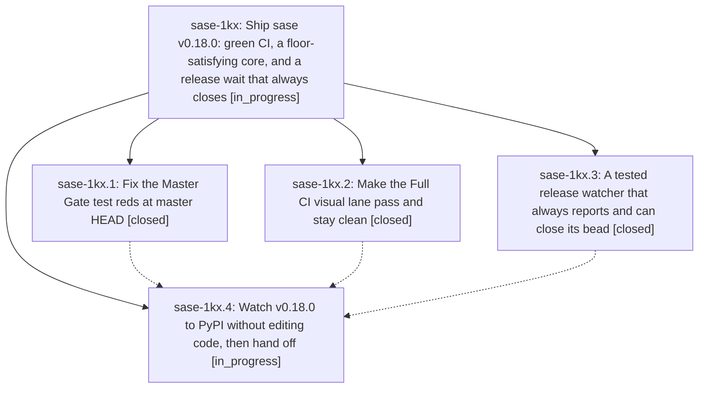

# Bead: sase-1kx — Ship sase v0.18.0: green CI, a floor-satisfying core, and a release wait that always closes

[Bead Pages](../README.md) / sase-1kx

**Status:** ◐ in_progress · **Type:** ▸ plan · **Tier:** epic
**Owner:** `bryanbugyi34@gmail.com` · **Created by:** [bbugyi200.athena.10b](https://github.com/sase-org/sase--agents/blob/main/sessions/bbugyi200.athena.10b.md) · **Assignee:** `sase-1kx.land`
**Created:** 2026-10-14 07:18:02 EDT
**Plan:** [202610/v0\_18\_0\_release.md](https://github.com/sase-org/sase--plans/blob/main/202610/v0_18_0_release.md)

<!-- sase:links:start -->

## Links

| Relation | Artifact | Why |
| --- | --- | --- |
| implemented-by | [plan:202610/v0_18_0_release.md][1] | derived from the plan's `bead_id:` frontmatter field |

_Plus 1 automatic references — see [Referenced By](#referenced-by)._

[1]: https://github.com/sase-org/sase--plans/blob/main/202610/v0_18_0_release.md

<!-- sase:links:end -->

## Description

sase 0.18.0 is on PyPI and `pip install sase` works again. It ships through ci_watch's guarded merge of release PR #299, after Master Gate and Full CI go green on master. The release-wait phase always closes its bead, whatever happens, so the land agent always runs. The land agent confirms the release before it lands the epic, and finishes the release itself when something unexpected blocks it.

## Phases

| Bead | Title | Status | Size | Created | Agents | Commits |
|---|---|---|---|---|---:|---:|
| [sase-1kx.1](sase-1kx.1.md) | Fix the Master Gate test reds at master HEAD | ✓ closed | medium | 2026-10-14 | 1 | 1 |
| [sase-1kx.2](sase-1kx.2.md) | Make the Full CI visual lane pass and stay clean | ✓ closed | medium | 2026-10-14 | 1 | 1 |
| [sase-1kx.3](sase-1kx.3.md) | A tested release watcher that always reports and can close its bead | ✓ closed | medium | 2026-10-14 | 1 | 1 |
| [sase-1kx.4](sase-1kx.4.md) | Watch v0.18.0 to PyPI without editing code, then hand off | ◐ in_progress | small | 2026-10-14 | 1 | 0 |

## Lineage

## Agents

| Agent | Bead | Commits |
|---|---|---:|
| [bbugyi200.athena.sase-1kx.1](https://github.com/sase-org/sase--agents/blob/main/agents/bbugyi200.athena.sase-1kx.1/README.md) | [sase-1kx.1](sase-1kx.1.md) | 1 |
| [bbugyi200.athena.sase-1kx.2](https://github.com/sase-org/sase--agents/blob/main/sessions/bbugyi200.athena.sase-1kx.2.md) | [sase-1kx.2](sase-1kx.2.md) | 1 |
| [bbugyi200.athena.sase-1kx.3](https://github.com/sase-org/sase--agents/blob/main/agents/bbugyi200.athena.sase-1kx.3/README.md) | [sase-1kx.3](sase-1kx.3.md) | 1 |
| [bbugyi200.athena.sase-1kx.4](https://github.com/sase-org/sase--agents/blob/main/agents/bbugyi200.athena.sase-1kx.4/README.md) | [sase-1kx.4](sase-1kx.4.md) | 0 |
| [bbugyi200.athena.sase-1kx.land](https://github.com/sase-org/sase--agents/blob/main/agents/bbugyi200.athena.sase-1kx.land/README.md) | [sase-1kx](README.md) | 0 |

## Commits

| Repo | Commit | Subject | Bead | Committed |
|---|---|---|---|---|
| sase | [`7710ce5`](https://github.com/sase-org/sase/commit/7710ce5ffa9dbb389e2d8ff4de59130c5ad12e79) | feat(release): add stdlib release watcher | [sase-1kx.3](sase-1kx.3.md) | 2026-10-14 08:21:09 EDT |
| sase | [`c699972`](https://github.com/sase-org/sase/commit/c69997274d859113526852cb1c99f0767790f4df) | fix(tui): repair visual-lane loader, fleet, and stitches snapshot waits | [sase-1kx.2](sase-1kx.2.md) | 2026-10-14 08:35:03 EDT |
| sase | [`9f4e6c4`](https://github.com/sase-org/sase/commit/9f4e6c44309453eec4b43ed48192e778e5bece5d) | fix(tests): stop lazy-export patches emptying the git registry | [sase-1kx.1](sase-1kx.1.md) | 2026-10-14 08:49:09 EDT |

<!-- sase:referenced-by:start -->

## Referenced By

| Relation | Artifact | Why | Uses |
| --- | --- | --- | ---: |
| read-by | [agent:sase-1kx.2--1][1] | Need parent epic context before recording follow-up and closing the visual-lane phase | 1 |

[1]: https://github.com/sase-org/sase--agents/blob/main/sessions/bbugyi200.athena.sase-1kx.2.md

<!-- sase:referenced-by:end -->
