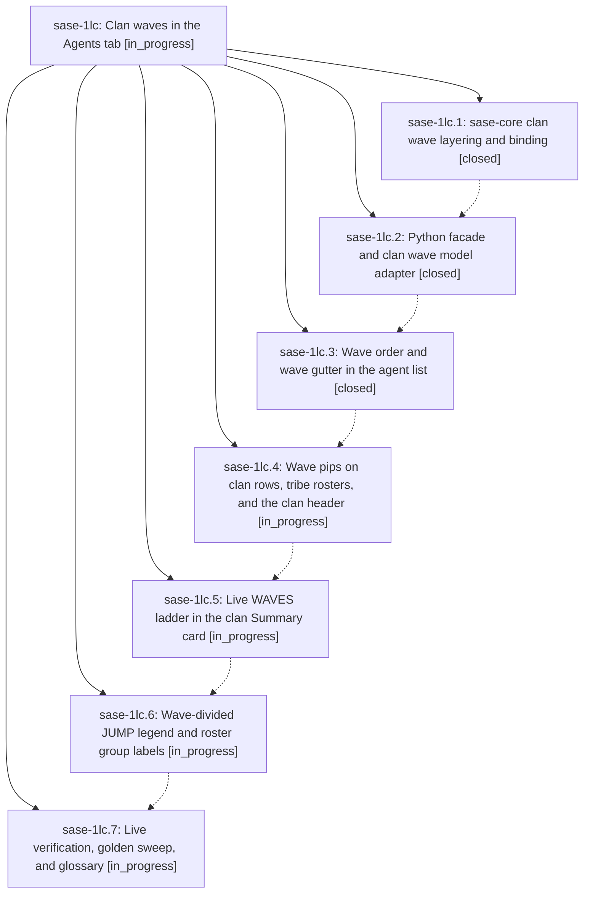

# Bead: sase-1lc — Clan waves in the Agents tab

[Bead Pages](../README.md) / sase-1lc

**Status:** ◐ in_progress · **Type:** ▸ plan · **Tier:** epic
**Owner:** `bryanbugyi34@gmail.com` · **Created by:** [bbugyi200.athena.research.4j.linker.w0](https://github.com/sase-org/sase--agents/blob/main/sessions/bbugyi200.athena.research.4j.linker.w0.md) · **Assignee:** `sase-1lc.land`
**Created:** 2026-10-15 15:02:47 EDT
**Plan:** [202610/clan\_waves\_in\_agents\_tab.md](https://github.com/sase-org/sase--plans/blob/main/202610/clan_waves_in_agents_tab.md)

<!-- sase:links:start -->

## Links

| Relation | Artifact | Why |
| --- | --- | --- |
| implemented-by | [plan:202610/clan_waves_in_agents_tab.md][1] | derived from the plan's `bead_id:` frontmatter field |

[1]: https://github.com/sase-org/sase--plans/blob/main/202610/clan_waves_in_agents_tab.md

<!-- sase:links:end -->

## Description

Every agent clan with two or more dependency layers (epics, research swarms, toobig chains, custom clans) reads top to bottom in execution order. The Agents tab derives clan waves from declared waits in sase-core and shows them through a zero-row wave gutter, per-wave progress pips, a live WAVES ladder, and a wave-divided JUMP legend. One-wave clans look exactly as they do today.

## Phases

| Bead | Title | Status | Size | Created | Agents | Commits |
|---|---|---|---|---|---:|---:|
| [sase-1lc.1](sase-1lc.1.md) | sase-core clan wave layering and binding | ✓ closed | medium | 2026-10-15 | 1 | 1 |
| [sase-1lc.2](sase-1lc.2.md) | Python facade and clan wave model adapter | ✓ closed | medium | 2026-10-15 | 1 | 1 |
| [sase-1lc.3](sase-1lc.3.md) | Wave order and wave gutter in the agent list | ✓ closed | medium | 2026-10-15 | 1 | 1 |
| [sase-1lc.4](sase-1lc.4.md) | Wave pips on clan rows, tribe rosters, and the clan header | ◐ in_progress | small | 2026-10-15 | 1 | 0 |
| [sase-1lc.5](sase-1lc.5.md) | Live WAVES ladder in the clan Summary card | ◐ in_progress | medium | 2026-10-15 | 1 | 0 |
| [sase-1lc.6](sase-1lc.6.md) | Wave-divided JUMP legend and roster group labels | ◐ in_progress | medium | 2026-10-15 | 1 | 0 |
| [sase-1lc.7](sase-1lc.7.md) | Live verification, golden sweep, and glossary | ◐ in_progress | small | 2026-10-15 | 1 | 0 |

## Lineage

## Agents

| Agent | Bead | Commits |
|---|---|---:|
| [bbugyi200.athena.sase-1lc.1](https://github.com/sase-org/sase--agents/blob/main/agents/bbugyi200.athena.sase-1lc.1/README.md) | [sase-1lc.1](sase-1lc.1.md) | 1 |
| [bbugyi200.athena.sase-1lc.2](https://github.com/sase-org/sase--agents/blob/main/sessions/bbugyi200.athena.sase-1lc.2.md) | [sase-1lc.2](sase-1lc.2.md) | 1 |
| [bbugyi200.athena.sase-1lc.3](https://github.com/sase-org/sase--agents/blob/main/sessions/bbugyi200.athena.sase-1lc.3.md) | [sase-1lc.3](sase-1lc.3.md) | 1 |
| [bbugyi200.athena.sase-1lc.4](https://github.com/sase-org/sase--agents/blob/main/agents/bbugyi200.athena.sase-1lc.4/README.md) | [sase-1lc.4](sase-1lc.4.md) | 0 |
| [bbugyi200.athena.sase-1lc.5](https://github.com/sase-org/sase--agents/blob/main/agents/bbugyi200.athena.sase-1lc.5/README.md) | [sase-1lc.5](sase-1lc.5.md) | 0 |
| [bbugyi200.athena.sase-1lc.6](https://github.com/sase-org/sase--agents/blob/main/agents/bbugyi200.athena.sase-1lc.6/README.md) | [sase-1lc.6](sase-1lc.6.md) | 0 |
| [bbugyi200.athena.sase-1lc.7](https://github.com/sase-org/sase--agents/blob/main/agents/bbugyi200.athena.sase-1lc.7/README.md) | [sase-1lc.7](sase-1lc.7.md) | 0 |
| [bbugyi200.athena.sase-1lc.land](https://github.com/sase-org/sase--agents/blob/main/agents/bbugyi200.athena.sase-1lc.land/README.md) | [sase-1lc](README.md) | 0 |

## Commits

| Repo | Commit | Subject | Bead | Committed |
|---|---|---|---|---|
| sase-core | [`sase-core@ce9779f`](https://github.com/sase-org/sase-core/commit/ce9779f734713146ecf2b8ad9052a8def9c17b9b) | feat(clan-waves): project clan dependency waves | [sase-1lc.1](sase-1lc.1.md) | 2026-10-15 15:43:12 EDT |
| sase | [`91350ad`](https://github.com/sase-org/sase/commit/91350ad5b63d83f1df186862131cff7429533d51) | feat(tui): add clan wave model adapter | [sase-1lc.2](sase-1lc.2.md) | 2026-10-15 17:42:38 EDT |
| sase | [`8953f46`](https://github.com/sase-org/sase/commit/8953f46b806e221a96143b8bf77cf616b5fae631) | feat(agents): show clan dependency waves in agent lists | [sase-1lc.3](sase-1lc.3.md) | 2026-10-15 19:21:19 EDT |
