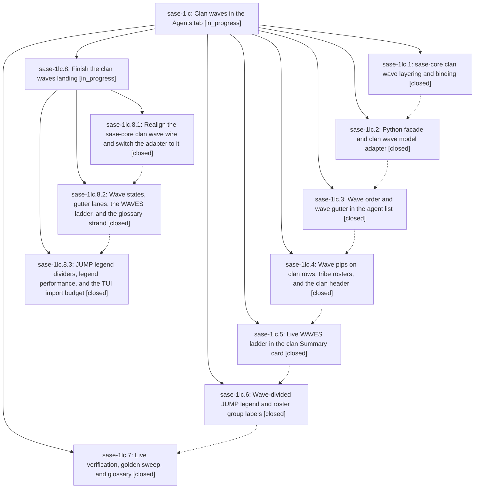

# Bead: sase-1lc — Clan waves in the Agents tab

[Bead Pages](../README.md) / sase-1lc

**Status:** ◐ in_progress · **Type:** ▸ plan · **Tier:** epic
**Owner:** `bryanbugyi34@gmail.com` · **Created by:** [bbugyi200.athena.research.4j.linker.w0](https://github.com/sase-org/sase--agents/blob/main/sessions/bbugyi200.athena.research.4j.linker.w0.md) · **Assignee:** `sase-1lc.land`
**Created:** 2026-10-15 15:02:47 EDT
**Plan:** [202610/clan\_waves\_in\_agents\_tab.md](https://github.com/sase-org/sase--plans/blob/main/202610/clan_waves_in_agents_tab.md)

<!-- sase:links:start -->

## Links

| Relation | Artifact | Why |
| --- | --- | --- |
| implemented-by | [plan:202610/clan_waves_in_agents_tab.md][1] | derived from the plan's `bead_id:` frontmatter field |
| related | [bead:sase-1lf][2] | Extends the clan wave surfaces shipped by sase-1lc |
| related | [bead:sase-1lg][3] | Builds on sase-1lc's clan wave projection; wait for its child-epic wire realignment to land |

_Plus 1 automatic references — see [Referenced By](#referenced-by)._

[1]: https://github.com/sase-org/sase--plans/blob/main/202610/clan_waves_in_agents_tab.md
[2]: https://github.com/sase-org/sase--beads/blob/main/pages/sase-1lf/README.md
[3]: https://github.com/sase-org/sase--beads/blob/main/pages/sase-1lg/README.md

<!-- sase:links:end -->

## Description

Every agent clan with two or more dependency layers (epics, research swarms, toobig chains, custom clans) reads top to bottom in execution order. The Agents tab derives clan waves from declared waits in sase-core and shows them through a zero-row wave gutter, per-wave progress pips, a live WAVES ladder, and a wave-divided JUMP legend. One-wave clans look exactly as they do today.

## Notes

[2026-10-16T03:23:30Z · sase-1lc.land] LANDING FOLLOW-UP TRIAGE (sase-1lc.land). Every PROPOSED FOLLOW-UP on the children, with outcome:
- sase-1lc.7 #1 dependency-cone highlight: filed as feature task sase-1lf (large).
- sase-1lc.7 #5 wave line in sase agent show + #6 editor-integration wave fields: merged into feature task sase-1lg (large, related to sase-vx and sase-1lc) because both consume the same core projection outside the TUI.
- sase-1lc.7 #2 done-prefix compaction for long chains: declined; the 12-wave compact pip form plus row folds already bound long chains and there is no evidence of an unreadable chain; refile if live use shows one.
- sase-1lc.7 #3 Gantt card: declined; exploratory with no concrete need (feature tasks must not become a wish list).
- sase-1lc.7 #4 optional producer stage labels: declined; undefined scope with no demonstrated need.
- sase-1lc.7 #7 epic phase titles in the WAVES ladder: declined; cosmetic, and the ladder deliberately reuses JUMP cell labels so the two surfaces read as one system.
- sase-1lc.7 #8 wave gutters in rail density: declined; the plan deliberately kept rail connectors and the 19-cell rail has no room for a 5-cell gutter.
- sase-1lc.7 #9 render_docs vs prettier drift (fmt-docs-check): caused by docs epic sase-1le (generated glossary/design-decisions renderers), already a DISCOVERED ISSUE there from sase-1le.9; corroborating note added to sase-1le.
- sase-1lc.4 #1 / sase-1lc.5 #1 clean-base failures: test_pdf_check_recipe_keeps_strict_mkdocs_export and test_rss_plugin_images_use_the_default_social_image trace to sase-1le's handbook PDF curation and are already proposed on sase-1le.7/.9; corroborating note added to sase-1le. test_fix_uses_formatter_venv_without_application_setup no longer exists in the tree, so declined. test_tui_app_import_stays_under_startup_budget was MIS-TRIAGED as pre-existing: tools/tui_import_closure --diff 91350ad5b6^ shows 3519 before this epic and +5 clan-wave modules after (3524 vs the 3520 cap), so it is epic work for the child landing; attribution note added to sase-1ic, cap not raised.
- Integration: open memory task sase-1lb (Agent Clan says members run in parallel) was resolved by this epic's glossary decisions and closed as superseded. The docs concept hubs, guides, and reference pages that landed during the epic do not describe clans, so no other integration is needed beyond the generated glossary page, which re-renders from the strands.

[2026-10-16T03:28:31Z · sase-1lc.land] LANDING VERIFICATION (sase-1lc.land): not closable yet; remaining work planned as a child epic ("Finish the clan waves landing": phases wire -> states -> legend). Verified: all 7 phases closed; commits 91350ad5b6, 8953f46b80, c2d476e432, 8f5ae77334, 96baa9011a, 7e1edb8d76 plus sase-core ce9779f7 (pinned and on origin/master); core tests pass (30/30); focused Python tests pass; the glossary_agent_clan decision was applied correctly; no epic-symbol entries. Gaps found:
(1) The core wire deviates from the plan's normative wire: no member key or clan_names; no layered/rank/display-order/placement fields; ghosts mixed into member lists; predecessors in launch order, not display order; no serde defaults; no py.allow_threads; several required Rust tests missing. Python re-derives that core layout logic, against the Rust core boundary rule.
(2) Wave state folds over session-turn descendants, and Done plus ghost reads IN_FLIGHT with a dim number.
(3) Workflow-step children lose their gutter lane (_clan_wave_gutter.py:98).
(4) The WAVES ladder hides its rows at COLLAPSED, contrary to Surface 3.
(5) The ladder and roster after-phrases disagree.
(6) Wording: "1 WAVES + LAND" and "0 waves ·  ·".
(7) The NEIGHBORS JUMP map now draws wave dividers (_member_roster.py:272).
(8) Dividers are grid cells that land at row edges (committed goldens show it).
(9) Legend layout is 4-25x slower for every roster.
(10) The title suffix budget subtracts the bottom-border subtitle.
(11) The TUI import budget fails 3524<3520: all +5 modules come from this epic, and the overrun was mis-triaged as pre-existing.
(12) The clan-wave glossary strand has keyword clan-wave plus a stray H1.
Possible, not confirmed: a reused fleet row may miss its dim repaint; the child plan adds a test first.

## Phases

| Bead | Title | Status | Size | Created | Agents | Commits |
|---|---|---|---|---|---:|---:|
| [sase-1lc.1](sase-1lc.1.md) | sase-core clan wave layering and binding | ✓ closed | medium | 2026-10-15 | 1 | 1 |
| [sase-1lc.2](sase-1lc.2.md) | Python facade and clan wave model adapter | ✓ closed | medium | 2026-10-15 | 1 | 1 |
| [sase-1lc.3](sase-1lc.3.md) | Wave order and wave gutter in the agent list | ✓ closed | medium | 2026-10-15 | 1 | 1 |
| [sase-1lc.4](sase-1lc.4.md) | Wave pips on clan rows, tribe rosters, and the clan header | ✓ closed | small | 2026-10-15 | 1 | 1 |
| [sase-1lc.5](sase-1lc.5.md) | Live WAVES ladder in the clan Summary card | ✓ closed | medium | 2026-10-15 | 1 | 1 |
| [sase-1lc.6](sase-1lc.6.md) | Wave-divided JUMP legend and roster group labels | ✓ closed | medium | 2026-10-15 | 1 | 1 |
| [sase-1lc.7](sase-1lc.7.md) | Live verification, golden sweep, and glossary | ✓ closed | small | 2026-10-15 | 1 | 1 |

## Lineage

## Agents

| Agent | Bead | Commits |
|---|---|---:|
| [bbugyi200.athena.sase-1lc.1](https://github.com/sase-org/sase--agents/blob/main/agents/bbugyi200.athena.sase-1lc.1/README.md) | [sase-1lc.1](sase-1lc.1.md) | 1 |
| [bbugyi200.athena.sase-1lc.2](https://github.com/sase-org/sase--agents/blob/main/sessions/bbugyi200.athena.sase-1lc.2.md) | [sase-1lc.2](sase-1lc.2.md) | 1 |
| [bbugyi200.athena.sase-1lc.3](https://github.com/sase-org/sase--agents/blob/main/sessions/bbugyi200.athena.sase-1lc.3.md) | [sase-1lc.3](sase-1lc.3.md) | 1 |
| [bbugyi200.athena.sase-1lc.4](https://github.com/sase-org/sase--agents/blob/main/sessions/bbugyi200.athena.sase-1lc.4.md) | [sase-1lc.4](sase-1lc.4.md) | 1 |
| [bbugyi200.athena.sase-1lc.5](https://github.com/sase-org/sase--agents/blob/main/sessions/bbugyi200.athena.sase-1lc.5.md) | [sase-1lc.5](sase-1lc.5.md) | 1 |
| [bbugyi200.athena.sase-1lc.6](https://github.com/sase-org/sase--agents/blob/main/sessions/bbugyi200.athena.sase-1lc.6.md) | [sase-1lc.6](sase-1lc.6.md) | 1 |
| [bbugyi200.athena.sase-1lc.7](https://github.com/sase-org/sase--agents/blob/main/sessions/bbugyi200.athena.sase-1lc.7.md) | [sase-1lc.7](sase-1lc.7.md) | 1 |
| [bbugyi200.athena.sase-1lc.8.1](https://github.com/sase-org/sase--agents/blob/main/sessions/bbugyi200.athena.sase-1lc.8.1.md) | [sase-1lc.8.1](sase-1lc.8.1.md) | 2 |
| [bbugyi200.athena.sase-1lc.8.2](https://github.com/sase-org/sase--agents/blob/main/agents/bbugyi200.athena.sase-1lc.8.2/README.md) | [sase-1lc.8.2](sase-1lc.8.2.md) | 1 |
| [bbugyi200.athena.sase-1lc.8.3](https://github.com/sase-org/sase--agents/blob/main/agents/bbugyi200.athena.sase-1lc.8.3/README.md) | [sase-1lc.8.3](sase-1lc.8.3.md) | 1 |
| [bbugyi200.athena.sase-1lc.8.land](https://github.com/sase-org/sase--agents/blob/main/agents/bbugyi200.athena.sase-1lc.8.land/README.md) | [sase-1lc.8](sase-1lc.8.md) | 0 |
| [bbugyi200.athena.sase-1lc.land](https://github.com/sase-org/sase--agents/blob/main/sessions/bbugyi200.athena.sase-1lc.land.md) | [sase-1lc](README.md) | 0 |

## Commits

| Repo | Commit | Subject | Bead | Committed |
|---|---|---|---|---|
| sase-core | [`sase-core@ce9779f`](https://github.com/sase-org/sase-core/commit/ce9779f734713146ecf2b8ad9052a8def9c17b9b) | feat(clan-waves): project clan dependency waves | [sase-1lc.1](sase-1lc.1.md) | 2026-10-15 15:43:12 EDT |
| sase | [`91350ad`](https://github.com/sase-org/sase/commit/91350ad5b63d83f1df186862131cff7429533d51) | feat(tui): add clan wave model adapter | [sase-1lc.2](sase-1lc.2.md) | 2026-10-15 17:42:38 EDT |
| sase | [`8953f46`](https://github.com/sase-org/sase/commit/8953f46b806e221a96143b8bf77cf616b5fae631) | feat(agents): show clan dependency waves in agent lists | [sase-1lc.3](sase-1lc.3.md) | 2026-10-15 19:21:19 EDT |
| sase | [`c2d476e`](https://github.com/sase-org/sase/commit/c2d476e43205204108e72ed382dac56c693f1f9a) | feat(tui): show clan wave state pips | [sase-1lc.4](sase-1lc.4.md) | 2026-10-15 20:06:46 EDT |
| sase | [`8f5ae77`](https://github.com/sase-org/sase/commit/8f5ae77334e20976d0483cc557c5de37951ddcce) | feat(ace): add live clan WAVES ladder | [sase-1lc.5](sase-1lc.5.md) | 2026-10-15 21:25:54 EDT |
| sase | [`96baa90`](https://github.com/sase-org/sase/commit/96baa9011a0775ed26e07ae16805bf27b88ea00e) | feat(tui): add clan waves to JUMP legend and roster | [sase-1lc.6](sase-1lc.6.md) | 2026-10-15 22:12:30 EDT |
| sase | [`7e1edb8`](https://github.com/sase-org/sase/commit/7e1edb8d76b753f98d9f2a31fd0d1eb8b82a3136) | feat(ace): finish clan wave verification | [sase-1lc.7](sase-1lc.7.md) | 2026-10-15 22:46:44 EDT |
| sase-core | [`sase-core@4c83f2d`](https://github.com/sase-org/sase-core/commit/4c83f2de965791ae78a2d0a6a12c823ebc76d2eb) | feat(clan-waves): return key-based layout wire | [sase-1lc.8.1](sase-1lc.8.1.md) | 2026-10-16 00:44:27 EDT |
| sase | [`04fee05`](https://github.com/sase-org/sase/commit/04fee055590e2fe67b072b5cd88b1ebd2c6e779f) | feat(ace): consume key-based clan wave layout wire | [sase-1lc.8.1](sase-1lc.8.1.md) | 2026-10-16 00:49:08 EDT |
| sase | [`375bceb`](https://github.com/sase-org/sase/commit/375bceb6eaf207a34cce7bf5e65ede343e7ff50d) | feat(ace): wave states, gutter lanes, WAVES ladder rows and shared after-phrases (sase-1lc.8.2) | [sase-1lc.8.2](sase-1lc.8.2.md) | 2026-10-16 01:28:34 EDT |
| sase | [`d5efed6`](https://github.com/sase-org/sase/commit/d5efed653553978194eeb8f28192b7fe651da849) | feat(ace): scope layered wave dividers to clan roster and restore jump layout cost | [sase-1lc.8.3](sase-1lc.8.3.md) | 2026-10-16 02:21:23 EDT |

<!-- sase:referenced-by:start -->

## Referenced By

| Relation | Artifact | Why | Uses |
| --- | --- | --- | ---: |
| read-by | [agent:sase-1lc.3--3][1] | Confirm the parent epic remains open after closing the completed phase | 1 |

[1]: https://github.com/sase-org/sase--agents/blob/main/sessions/bbugyi200.athena.sase-1lc.3.md

<!-- sase:referenced-by:end -->
