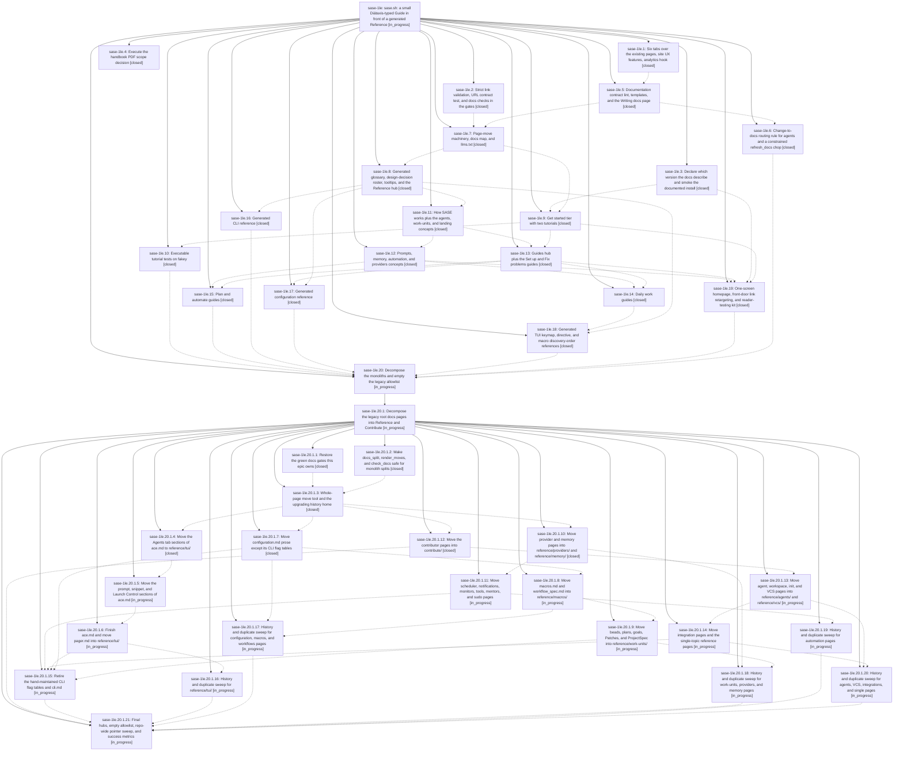

# Bead: sase-1le — sase.sh: a small Diátaxis-typed Guide in front of a generated Reference

[Bead Pages](../README.md) / sase-1le

**Status:** ◐ in_progress · **Type:** ▸ plan · **Tier:** epic
**Owner:** `bryanbugyi34@gmail.com` · **Created by:** [bbugyi200.athena.research.4l.linker.w0](https://github.com/sase-org/sase--agents/blob/main/sessions/bbugyi200.athena.research.4l.linker.w0.md) · **Assignee:** `sase-1le.land`
**Created:** 2026-10-15 18:11:08 EDT
**Plan:** [202610/sase\_sh\_docs\_redesign.md](https://github.com/sase-org/sase--plans/blob/main/202610/sase_sh_docs_redesign.md)

<!-- sase:links:start -->

## Links

| Relation | Artifact | Why |
| --- | --- | --- |
| implemented-by | [plan:202610/sase_sh_docs_redesign.md][1] | derived from the plan's `bead_id:` frontmatter field |

_Plus 12 automatic references — see [Referenced By](#referenced-by)._

[1]: https://github.com/sase-org/sase--plans/blob/main/202610/sase_sh_docs_redesign.md

<!-- sase:links:end -->

## Description

A newcomer on sase.sh meets one walked path: a one-screen homepage, two tested tutorials, about eight concept pages, and about fifteen goal-titled guides (~30K words). These sit in front of a lookup-sized Reference generated from the code that owns each fact. A lint-enforced documentation contract keeps the site from growing back.

## Notes

[2026-10-16T02:32:29Z · sase-1le.9] DISCOVERED ISSUE: During conflict repair at HEAD 96baa901, ToolRun 3635b8d75acc2bc20408a04178e2d4b1 failed first at Markdown formatting after generated docs were refreshed. On the unchanged tracked docs, ToolRun f8cdf6623991d1f73f8ee009c9cb8043 failed at fmt-docs-check. Direct just fmt-docs-check also exits 1: render_glossary and render_design_decisions report drift in docs/reference/glossary.md and docs/reference/design-decisions.md although both are unchanged from HEAD. The strict just docs-check build and URL contract pass with 277 URLs. Reproduce with just fmt-docs-check. The required check gate blocks agents until generated output and Markdown formatting agree; phase sase-1le.8 owns this generated documentation pipeline.

[2026-10-16T03:22:54Z · sase-1lc.land] DISCOVERED ISSUE (corroboration from the sase-1lc land agent, not a new report): at master bfa78040eb, just fmt-docs-check still exits 1 with render_glossary/render_design_decisions drift in docs/reference/glossary.md, docs/_includes/abbreviations.md, and docs/reference/design-decisions.md (renderer emits *...* emphasis and unwrapped lines that prettier rewrites to _..._ and wraps; fmt-md-check itself passes). This was also proposed as sase-1lc.7 note #9. Separately, tests/test_docs_pdf_tools.py::test_pdf_check_recipe_keeps_strict_mkdocs_export (expects 'mkdocs build --strict -f mkdocs-pdf.yml' in the docs-pdf-check recipe) and tests/test_docs_social_card.py::test_rss_plugin_images_use_the_default_social_image ('rss image missing from mkdocs-pdf.yml') still fail at bfa78040eb; they were proposed on sase-1lc.4 #1, sase-1le.7 #1 and sase-1le.9, and trace to this epic's handbook PDF curation (3b099950e8 / 2d701e4dc6), not to sase-1lc. test_fix_uses_formatter_venv_without_application_setup (also proposed on sase-1lc.4/.5) no longer exists in the tree.

[2026-10-16T06:37:04Z · sase-1lc.8.land] DISCOVERED ISSUE: Independent landing triage for sase-1lc.8 at master d5efed6535 (proposing phases sase-1lc.8.1 note #1, sase-1lc.8.2 notes #1/#2, sase-1lc.8.3 notes #1/#2/#4):
1. Generated-doc formatting drift still fails clean-tree sase tool run check (ToolRun 129a12ae52c8dfb624dc0c3fa1f3fe33, exit 1, 17.4 s): render_glossary and render_design_decisions differ from Prettier. Same defect as this epic notes #1/#2 and owned by sase-1le.8; no duplicate task.
2. .venv/bin/mypy tools/render_cli independently exits 1 with 8 errors at lines 238, 251, 252, 261, 262, 306, 381, 407: invariant list[tuple[str,...]] arguments, incompatible reused rows variable, and wrong _gather tuple annotation. tools/render_cli was introduced by 8f22863f32 / sase-1le.16, before the clan-wave repair epic. This belongs to this active epic, not a standalone task.
3. Focused pytest independently reproduces three terminology failures entirely in the new generated Reference: test_macro_docs_and_memory_avoid_xprompt_terms flags glossary.md alias/former-name xprompt lines; test_current_docs_skills_and_memory_avoid_stale_shell_phrases flags cli/gate.md (gate shell), design-decisions.md (gate shell/shells), glossary.md (sase shell/agent shell); test_current_docs_skills_and_memory_avoid_stale_family_phrases flags glossary.md (agent family). Generated pages from sase-1le.8/.16 re-expose intentional historical source wording without corresponding guard handling. Existing sase-1hr instead concerns source-string allowlist drift from a test split; its test currently passes, so it is not a duplicate.
4. The same focused run reproduces test_pdf_check_recipe_keeps_strict_mkdocs_export and test_rss_plugin_images_use_the_default_social_image, already documented here in note #2 and KNOWN-witnessed by the repair phases. All five docs tests fail, 16 other tests pass. These remain this docs epic's work. No new task created for any of these causally owned failures.

[2026-10-16T11:04:41Z · sase-1le.14--1] DISCOVERED ISSUE: During conflict repair on master at 30c3500495, required ToolRun 51e399dd01efffd2d78fe7ca73947fe8 exited 1 at fmt-docs-check. The independent targeted reproduction ToolRun bdc66a3335d97d6fdfd620af1b4bd911 also exited 1: render_glossary and render_design_decisions report drift in docs/reference/glossary.md and docs/reference/design-decisions.md because generated Markdown differs from Prettier output. These files are outside the repaired diff. docs-lint passed (ToolRun 6d45622cf39189cc6fdd94710876bffd), and strict docs build plus URL contract passed (ToolRun 5501a77997b7f13d0b61690089703e76). This corroborates the existing generated-doc formatting issue already owned by this epic; no duplicate task bead created.

## Phases

| Bead | Title | Status | Size | Created | Agents | Commits |
|---|---|---|---|---|---:|---:|
| [sase-1le.1](sase-1le.1.md) | Six tabs over the existing pages, site UX features, analytics hook | ✓ closed | small | 2026-10-15 | 1 | 1 |
| [sase-1le.10](sase-1le.10.md) | Executable tutorial tests on fakey | ✓ closed | medium | 2026-10-15 | 1 | 1 |
| [sase-1le.11](sase-1le.11.md) | How SASE works plus the agents, work-units, and landing concepts | ✓ closed | medium | 2026-10-15 | 1 | 1 |
| [sase-1le.12](sase-1le.12.md) | Prompts, memory, automation, and providers concepts | ✓ closed | medium | 2026-10-15 | 1 | 1 |
| [sase-1le.13](sase-1le.13.md) | Guides hub plus the Set up and Fix problems guides | ✓ closed | medium | 2026-10-15 | 1 | 1 |
| [sase-1le.14](sase-1le.14.md) | Daily work guides | ✓ closed | medium | 2026-10-15 | 1 | 0 |
| [sase-1le.15](sase-1le.15.md) | Plan and automate guides | ✓ closed | medium | 2026-10-15 | 1 | 1 |
| [sase-1le.16](sase-1le.16.md) | Generated CLI reference | ✓ closed | medium | 2026-10-15 | 1 | 1 |
| [sase-1le.17](sase-1le.17.md) | Generated configuration reference | ✓ closed | medium | 2026-10-15 | 1 | 1 |
| [sase-1le.18](sase-1le.18.md) | Generated TUI keymap, directive, and macro discovery-order references | ✓ closed | medium | 2026-10-15 | 1 | 1 |
| [sase-1le.19](sase-1le.19.md) | One-screen homepage, front-door link retargeting, and reader-testing kit | ✓ closed | medium | 2026-10-15 | 1 | 1 |
| [sase-1le.2](sase-1le.2.md) | Strict link validation, URL contract test, and docs checks in the gates | ✓ closed | medium | 2026-10-15 | 1 | 1 |
| [sase-1le.20](sase-1le.20.md) | Decompose the monoliths and empty the legacy allowlist | ◐ in_progress | xlarge | 2026-10-15 | 1 | 0 |
| [sase-1le.3](sase-1le.3.md) | Declare which version the docs describe and smoke the documented install | ✓ closed | small | 2026-10-15 | 1 | 1 |
| [sase-1le.4](sase-1le.4.md) | Execute the handbook PDF scope decision | ✓ closed | small | 2026-10-15 | 1 | 1 |
| [sase-1le.5](sase-1le.5.md) | Documentation contract lint, templates, and the Writing docs page | ✓ closed | medium | 2026-10-15 | 1 | 1 |
| [sase-1le.6](sase-1le.6.md) | Change-to-docs routing rule for agents and a constrained refresh\_docs chop | ✓ closed | small | 2026-10-15 | 1 | 1 |
| [sase-1le.7](sase-1le.7.md) | Page-move machinery, docs map, and llms.txt | ✓ closed | medium | 2026-10-15 | 1 | 1 |
| [sase-1le.8](sase-1le.8.md) | Generated glossary, design-decision roster, tooltips, and the Reference hub | ✓ closed | medium | 2026-10-15 | 1 | 1 |
| [sase-1le.9](sase-1le.9.md) | Get started tier with two tutorials | ✓ closed | medium | 2026-10-15 | 1 | 1 |

## Lineage

## Agents

| Agent | Bead | Commits |
|---|---|---:|
| [bbugyi200.athena.sase-1le.1](https://github.com/sase-org/sase--agents/blob/main/agents/bbugyi200.athena.sase-1le.1/README.md) | [sase-1le.1](sase-1le.1.md) | 1 |
| [bbugyi200.athena.sase-1le.10](https://github.com/sase-org/sase--agents/blob/main/agents/bbugyi200.athena.sase-1le.10/README.md) | [sase-1le.10](sase-1le.10.md) | 1 |
| [bbugyi200.athena.sase-1le.11](https://github.com/sase-org/sase--agents/blob/main/agents/bbugyi200.athena.sase-1le.11/README.md) | [sase-1le.11](sase-1le.11.md) | 1 |
| [bbugyi200.athena.sase-1le.12](https://github.com/sase-org/sase--agents/blob/main/agents/bbugyi200.athena.sase-1le.12/README.md) | [sase-1le.12](sase-1le.12.md) | 1 |
| [bbugyi200.athena.sase-1le.13](https://github.com/sase-org/sase--agents/blob/main/agents/bbugyi200.athena.sase-1le.13/README.md) | [sase-1le.13](sase-1le.13.md) | 1 |
| [bbugyi200.athena.sase-1le.14](https://github.com/sase-org/sase--agents/blob/main/sessions/bbugyi200.athena.sase-1le.14.md) | [sase-1le.14](sase-1le.14.md) | 0 |
| [bbugyi200.athena.sase-1le.15](https://github.com/sase-org/sase--agents/blob/main/agents/bbugyi200.athena.sase-1le.15/README.md) | [sase-1le.15](sase-1le.15.md) | 1 |
| [bbugyi200.athena.sase-1le.16](https://github.com/sase-org/sase--agents/blob/main/agents/bbugyi200.athena.sase-1le.16/README.md) | [sase-1le.16](sase-1le.16.md) | 1 |
| [bbugyi200.athena.sase-1le.17](https://github.com/sase-org/sase--agents/blob/main/agents/bbugyi200.athena.sase-1le.17/README.md) | [sase-1le.17](sase-1le.17.md) | 1 |
| [bbugyi200.athena.sase-1le.18](https://github.com/sase-org/sase--agents/blob/main/agents/bbugyi200.athena.sase-1le.18/README.md) | [sase-1le.18](sase-1le.18.md) | 1 |
| [bbugyi200.athena.sase-1le.19](https://github.com/sase-org/sase--agents/blob/main/agents/bbugyi200.athena.sase-1le.19/README.md) | [sase-1le.19](sase-1le.19.md) | 1 |
| [bbugyi200.athena.sase-1le.2](https://github.com/sase-org/sase--agents/blob/main/sessions/bbugyi200.athena.sase-1le.2.md) | [sase-1le.2](sase-1le.2.md) | 1 |
| [bbugyi200.athena.sase-1le.20](https://github.com/sase-org/sase--agents/blob/main/sessions/bbugyi200.athena.sase-1le.20.md) | [sase-1le.20](sase-1le.20.md) | 0 |
| [bbugyi200.athena.sase-1le.20.1.1](https://github.com/sase-org/sase--agents/blob/main/agents/bbugyi200.athena.sase-1le.20.1.1/README.md) | [sase-1le.20.1.1](sase-1le.20.1.1.md) | 1 |
| [bbugyi200.athena.sase-1le.20.1.10](https://github.com/sase-org/sase--agents/blob/main/sessions/bbugyi200.athena.sase-1le.20.1.10.md) | [sase-1le.20.1.10](sase-1le.20.1.10.md) | 0 |
| [bbugyi200.athena.sase-1le.20.1.11](https://github.com/sase-org/sase--agents/blob/main/agents/bbugyi200.athena.sase-1le.20.1.11/README.md) | [sase-1le.20.1.11](sase-1le.20.1.11.md) | 0 |
| [bbugyi200.athena.sase-1le.20.1.12](https://github.com/sase-org/sase--agents/blob/main/agents/bbugyi200.athena.sase-1le.20.1.12/README.md) | [sase-1le.20.1.12](sase-1le.20.1.12.md) | 1 |
| [bbugyi200.athena.sase-1le.20.1.13](https://github.com/sase-org/sase--agents/blob/main/agents/bbugyi200.athena.sase-1le.20.1.13/README.md) | [sase-1le.20.1.13](sase-1le.20.1.13.md) | 0 |
| [bbugyi200.athena.sase-1le.20.1.14](https://github.com/sase-org/sase--agents/blob/main/agents/bbugyi200.athena.sase-1le.20.1.14/README.md) | [sase-1le.20.1.14](sase-1le.20.1.14.md) | 0 |
| [bbugyi200.athena.sase-1le.20.1.15](https://github.com/sase-org/sase--agents/blob/main/agents/bbugyi200.athena.sase-1le.20.1.15/README.md) | [sase-1le.20.1.15](sase-1le.20.1.15.md) | 0 |
| [bbugyi200.athena.sase-1le.20.1.16](https://github.com/sase-org/sase--agents/blob/main/agents/bbugyi200.athena.sase-1le.20.1.16/README.md) | [sase-1le.20.1.16](sase-1le.20.1.16.md) | 0 |
| [bbugyi200.athena.sase-1le.20.1.17](https://github.com/sase-org/sase--agents/blob/main/agents/bbugyi200.athena.sase-1le.20.1.17/README.md) | [sase-1le.20.1.17](sase-1le.20.1.17.md) | 0 |
| [bbugyi200.athena.sase-1le.20.1.18](https://github.com/sase-org/sase--agents/blob/main/agents/bbugyi200.athena.sase-1le.20.1.18/README.md) | [sase-1le.20.1.18](sase-1le.20.1.18.md) | 0 |
| [bbugyi200.athena.sase-1le.20.1.19](https://github.com/sase-org/sase--agents/blob/main/agents/bbugyi200.athena.sase-1le.20.1.19/README.md) | [sase-1le.20.1.19](sase-1le.20.1.19.md) | 0 |
| [bbugyi200.athena.sase-1le.20.1.2](https://github.com/sase-org/sase--agents/blob/main/agents/bbugyi200.athena.sase-1le.20.1.2/README.md) | [sase-1le.20.1.2](sase-1le.20.1.2.md) | 1 |
| [bbugyi200.athena.sase-1le.20.1.20](https://github.com/sase-org/sase--agents/blob/main/agents/bbugyi200.athena.sase-1le.20.1.20/README.md) | [sase-1le.20.1.20](sase-1le.20.1.20.md) | 0 |
| [bbugyi200.athena.sase-1le.20.1.21](https://github.com/sase-org/sase--agents/blob/main/agents/bbugyi200.athena.sase-1le.20.1.21/README.md) | [sase-1le.20.1.21](sase-1le.20.1.21.md) | 0 |
| [bbugyi200.athena.sase-1le.20.1.3](https://github.com/sase-org/sase--agents/blob/main/agents/bbugyi200.athena.sase-1le.20.1.3/README.md) | [sase-1le.20.1.3](sase-1le.20.1.3.md) | 1 |
| [bbugyi200.athena.sase-1le.20.1.4](https://github.com/sase-org/sase--agents/blob/main/agents/bbugyi200.athena.sase-1le.20.1.4/README.md) | [sase-1le.20.1.4](sase-1le.20.1.4.md) | 1 |
| [bbugyi200.athena.sase-1le.20.1.5](https://github.com/sase-org/sase--agents/blob/main/agents/bbugyi200.athena.sase-1le.20.1.5/README.md) | [sase-1le.20.1.5](sase-1le.20.1.5.md) | 0 |
| [bbugyi200.athena.sase-1le.20.1.6](https://github.com/sase-org/sase--agents/blob/main/agents/bbugyi200.athena.sase-1le.20.1.6/README.md) | [sase-1le.20.1.6](sase-1le.20.1.6.md) | 0 |
| [bbugyi200.athena.sase-1le.20.1.7](https://github.com/sase-org/sase--agents/blob/main/agents/bbugyi200.athena.sase-1le.20.1.7/README.md) | [sase-1le.20.1.7](sase-1le.20.1.7.md) | 1 |
| [bbugyi200.athena.sase-1le.20.1.8](https://github.com/sase-org/sase--agents/blob/main/agents/bbugyi200.athena.sase-1le.20.1.8/README.md) | [sase-1le.20.1.8](sase-1le.20.1.8.md) | 0 |
| [bbugyi200.athena.sase-1le.20.1.9](https://github.com/sase-org/sase--agents/blob/main/agents/bbugyi200.athena.sase-1le.20.1.9/README.md) | [sase-1le.20.1.9](sase-1le.20.1.9.md) | 0 |
| [bbugyi200.athena.sase-1le.20.1.land](https://github.com/sase-org/sase--agents/blob/main/agents/bbugyi200.athena.sase-1le.20.1.land/README.md) | [sase-1le.20.1](sase-1le.20.1.md) | 0 |
| [bbugyi200.athena.sase-1le.3](https://github.com/sase-org/sase--agents/blob/main/agents/bbugyi200.athena.sase-1le.3/README.md) | [sase-1le.3](sase-1le.3.md) | 1 |
| [bbugyi200.athena.sase-1le.4](https://github.com/sase-org/sase--agents/blob/main/sessions/bbugyi200.athena.sase-1le.4.md) | [sase-1le.4](sase-1le.4.md) | 1 |
| [bbugyi200.athena.sase-1le.5](https://github.com/sase-org/sase--agents/blob/main/agents/bbugyi200.athena.sase-1le.5/README.md) | [sase-1le.5](sase-1le.5.md) | 1 |
| [bbugyi200.athena.sase-1le.6](https://github.com/sase-org/sase--agents/blob/main/agents/bbugyi200.athena.sase-1le.6/README.md) | [sase-1le.6](sase-1le.6.md) | 1 |
| [bbugyi200.athena.sase-1le.7](https://github.com/sase-org/sase--agents/blob/main/agents/bbugyi200.athena.sase-1le.7/README.md) | [sase-1le.7](sase-1le.7.md) | 1 |
| [bbugyi200.athena.sase-1le.8](https://github.com/sase-org/sase--agents/blob/main/agents/bbugyi200.athena.sase-1le.8/README.md) | [sase-1le.8](sase-1le.8.md) | 1 |
| [bbugyi200.athena.sase-1le.9](https://github.com/sase-org/sase--agents/blob/main/agents/bbugyi200.athena.sase-1le.9/README.md) | [sase-1le.9](sase-1le.9.md) | 1 |
| [bbugyi200.athena.sase-1le.land](https://github.com/sase-org/sase--agents/blob/main/agents/bbugyi200.athena.sase-1le.land/README.md) | [sase-1le](README.md) | 0 |

## Commits

| Repo | Commit | Subject | Bead | Committed |
|---|---|---|---|---|
| sase | [`1a7a80a`](https://github.com/sase-org/sase/commit/1a7a80a306161a67029a01daf067578c422bebb8) | feat(docs): add six-tab navigation and analytics hook | [sase-1le.1](sase-1le.1.md) | 2026-10-15 18:53:24 EDT |
| sase | [`741afba`](https://github.com/sase-org/sase/commit/741afba3b5ab8da15d0ce9060268a902b657d39a) | feat(docs): declare documented version and smoke the install (sase-1le.3) | [sase-1le.3](sase-1le.3.md) | 2026-10-15 19:01:30 EDT |
| sase | [`ad3aa46`](https://github.com/sase-org/sase/commit/ad3aa463e41633db1f8607d876c63f71485ffb74) | feat(docs): add check\_docs lint, budgets, templates and contribute hub | [sase-1le.5](sase-1le.5.md) | 2026-10-15 19:12:19 EDT |
| sase | [`3b09995`](https://github.com/sase-org/sase/commit/3b099950e86a680c21757947c716411be243a377) | feat(docs): curate handbook PDF scope | [sase-1le.4](sase-1le.4.md) | 2026-10-15 19:22:30 EDT |
| sase | [`8947f92`](https://github.com/sase-org/sase/commit/8947f92b3a52e487f226cc32aecc29f3f17a9b3e) | feat(docs): add docs\_writing routing note and constrain refresh\_docs chop (sase-1le.6) | [sase-1le.6](sase-1le.6.md) | 2026-10-15 19:57:03 EDT |
| sase | [`fd8adfb`](https://github.com/sase-org/sase/commit/fd8adfbe9be2262491249c09e138e24022f3b253) | feat(docs): validate published URL contracts in gates | [sase-1le.2](sase-1le.2.md) | 2026-10-15 20:24:47 EDT |
| sase | [`a619baa`](https://github.com/sase-org/sase/commit/a619baa9106f878a3532236d0aeee11ab9208f18) | feat(docs): add page move and reference map generators | [sase-1le.7](sase-1le.7.md) | 2026-10-15 21:31:49 EDT |
| sase | [`a1dd710`](https://github.com/sase-org/sase/commit/a1dd710acd31bd0346bf4d17e8eb30eb749608cd) | docs(reference): add glossary and design-decisions reference pages with render tooling | [sase-1le.8](sase-1le.8.md) | 2026-10-15 21:48:48 EDT |
| sase | [`ecaad7f`](https://github.com/sase-org/sase/commit/ecaad7fed830cefdac2ab1778e4e9f38acf9fcb7) | docs(sase.sh): add concepts and move architecture page | [sase-1le.11](sase-1le.11.md) | 2026-10-15 22:09:33 EDT |
| sase | [`8f22863`](https://github.com/sase-org/sase/commit/8f22863f3293b190e3767b32ddc3d4084dbdbe66) | docs(cli): generate CLI reference from live argparse tree | [sase-1le.16](sase-1le.16.md) | 2026-10-15 22:09:36 EDT |
| sase | [`e5fb914`](https://github.com/sase-org/sase/commit/e5fb91454fa2c3e89dfd534873521bd969e2cc29) | docs(concepts): add system concept hubs | [sase-1le.12](sase-1le.12.md) | 2026-10-15 22:26:15 EDT |
| sase | [`2d701e4`](https://github.com/sase-org/sase/commit/2d701e4dc6834672594730475f95c9d0683c0da8) | feat(docs): add the guided start tier | [sase-1le.9](sase-1le.9.md) | 2026-10-15 22:36:51 EDT |
| sase | [`bfa7804`](https://github.com/sase-org/sase/commit/bfa78040ebac10a348ba84bc0b97175bbe3d3ab9) | docs(guides): add setup and fix-problems guides, move recovery pages to reference | [sase-1le.13](sase-1le.13.md) | 2026-10-15 22:57:30 EDT |
| sase | [`82c595d`](https://github.com/sase-org/sase/commit/82c595d8400a5a52c70345b3afd56cd7f56d9ee1) | feat(tutorials): add tutorial test harness with Justfile recipe and CI job | [sase-1le.10](sase-1le.10.md) | 2026-10-15 23:00:54 EDT |
| sase | [`da699e0`](https://github.com/sase-org/sase/commit/da699e0236303182503dce685f81036143336300) | docs(guides): add Plan and automate how-to guides | [sase-1le.15](sase-1le.15.md) | 2026-10-15 23:12:46 EDT |
| sase | [`8676f92`](https://github.com/sase-org/sase/commit/8676f92f2f0d2c4cc1ce3580f4bc835af09144ad) | feat(docs): rebuild homepage as one-screen front door with reader-testing kit (sase-1le.19) | [sase-1le.19](sase-1le.19.md) | 2026-10-15 23:20:09 EDT |
| sase | [`9250c75`](https://github.com/sase-org/sase/commit/9250c75ea4efad0737e4b56ad190ac45ef8c9087) | feat(docs): generate configuration reference pages | [sase-1le.17](sase-1le.17.md) | 2026-10-15 23:26:51 EDT |
| sase | [`b94cffe`](https://github.com/sase-org/sase/commit/b94cffe0d3a506805def63d8f60e1c145909b82f) | feat(docs): generate TUI and macro reference catalogs | [sase-1le.18](sase-1le.18.md) | 2026-10-16 07:31:12 EDT |
| sase | [`900925c`](https://github.com/sase-org/sase/commit/900925c99486c8b08528b8773ff4295f6ea36bf6) | feat(docs): harden split and move tooling | [sase-1le.20.1.2](sase-1le.20.1.2.md) | 2026-10-16 08:24:56 EDT |
| sase | [`8531a39`](https://github.com/sase-org/sase/commit/8531a39a0a0d856e1a929dc6dd441e756bb74598) | fix(docs): repair gates-phase failures for sase-1le.20.1.1 | [sase-1le.20.1.1](sase-1le.20.1.1.md) | 2026-10-16 08:35:23 EDT |
| sase | [`a0ad470`](https://github.com/sase-org/sase/commit/a0ad4700459b7e8df330e2d66713495814227efb) | feat(docs): add whole-page move tooling and upgrading hub | [sase-1le.20.1.3](sase-1le.20.1.3.md) | 2026-10-16 09:10:54 EDT |
| sase | [`d8b361b`](https://github.com/sase-org/sase/commit/d8b361b7d709940b42208310d07c215faea2f9f6) | feat(docs): move Agents tab sections of ace.md to reference/tui/ (sase-1le.20.1.4) | [sase-1le.20.1.4](sase-1le.20.1.4.md) | 2026-10-16 09:46:24 EDT |
| sase | [`1c5e871`](https://github.com/sase-org/sase/commit/1c5e871e7827fecd6e28527b9d8f7f157a076410) | docs(configuration): split prose into reference pages | [sase-1le.20.1.7](sase-1le.20.1.7.md) | 2026-10-16 10:04:17 EDT |
| sase | [`0176c69`](https://github.com/sase-org/sase/commit/0176c6997d9da6cabbd920366dbd178b40ed417a) | feat(docs): move contributor pages into contribute | [sase-1le.20.1.12](sase-1le.20.1.12.md) | 2026-10-16 10:19:04 EDT |

<!-- sase:referenced-by:start -->

## Referenced By

| Relation | Artifact | Why | Uses |
| --- | --- | --- | ---: |
| read-by | [agent:sase-1le.10][1] | epic context | 1 |
| read-by | [agent:sase-1le.14--1][2] | Check whether earlier phases or the parent already record the clean-base generated-doc formatting failure | 1 |
| read-by | [agent:sase-1le.15][3] | epic context for phase | 1 |
| read-by | [agent:sase-1le.16][4] | Need epic decisions and plan context | 1 |
| read-by | [agent:sase-1le.18][5] | Confirm the epic note tracking the known generated-docs check drift before recording this phase follow-up | 2 |
| read-by | [agent:sase-1le.19][6] | Need epic context and decisions for homepage phase | 1 |
| read-by | [agent:sase-1le.20.1.1][7] | epic notes remainder | 2 |
| read-by | [agent:sase-1le.20.1.2][8] | Identify the existing owner of the clean-base generated-docs check failure | 1 |
| read-by | [agent:sase-1le.3][9] | epic context | 1 |
| read-by | [agent:sase-1le.4--2][10] | Need parent epic design decisions and implementation constraints for PDF failure | 1 |
| read-by | [agent:sase-1le.5][11] | Need parent epic scope and decisions | 1 |
| read-by | [agent:sase-1le.9][12] | Need to check whether the active docs-redesign epic owns the generated-docs formatting drift. | 2 |

[1]: https://github.com/sase-org/sase--agents/blob/main/agents/bbugyi200.athena.sase-1le.10/README.md
[2]: https://github.com/sase-org/sase--agents/blob/main/sessions/bbugyi200.athena.sase-1le.14.md
[3]: https://github.com/sase-org/sase--agents/blob/main/agents/bbugyi200.athena.sase-1le.15/README.md
[4]: https://github.com/sase-org/sase--agents/blob/main/agents/bbugyi200.athena.sase-1le.16/README.md
[5]: https://github.com/sase-org/sase--agents/blob/main/agents/bbugyi200.athena.sase-1le.18/README.md
[6]: https://github.com/sase-org/sase--agents/blob/main/agents/bbugyi200.athena.sase-1le.19/README.md
[7]: https://github.com/sase-org/sase--agents/blob/main/agents/bbugyi200.athena.sase-1le.20.1.1/README.md
[8]: https://github.com/sase-org/sase--agents/blob/main/agents/bbugyi200.athena.sase-1le.20.1.2/README.md
[9]: https://github.com/sase-org/sase--agents/blob/main/agents/bbugyi200.athena.sase-1le.3/README.md
[10]: https://github.com/sase-org/sase--agents/blob/main/sessions/bbugyi200.athena.sase-1le.4.md
[11]: https://github.com/sase-org/sase--agents/blob/main/agents/bbugyi200.athena.sase-1le.5/README.md
[12]: https://github.com/sase-org/sase--agents/blob/main/agents/bbugyi200.athena.sase-1le.9/README.md

<!-- sase:referenced-by:end -->
