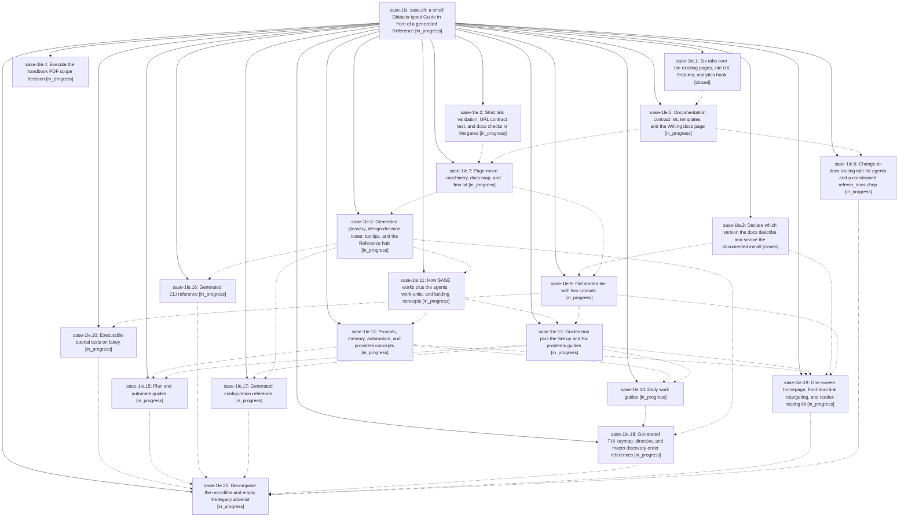

# Bead: sase-1le — sase.sh: a small Diátaxis-typed Guide in front of a generated Reference

[Bead Pages](../README.md) / sase-1le

**Status:** ◐ in_progress · **Type:** ▸ plan · **Tier:** epic
**Owner:** `bryanbugyi34@gmail.com` · **Created by:** [bbugyi200.athena.research.4l.linker.w0](https://github.com/sase-org/sase--agents/blob/main/sessions/bbugyi200.athena.research.4l.linker.w0.md) · **Assignee:** `sase-1le.land`
**Created:** 2026-10-15 18:11:08 EDT
**Plan:** [202610/sase\_sh\_docs\_redesign.md](https://github.com/sase-org/sase--plans/blob/main/202610/sase_sh_docs_redesign.md)

## Description

A newcomer on sase.sh meets one walked path: a one-screen homepage, two tested tutorials, about eight concept pages, and about fifteen goal-titled guides (~30K words). These sit in front of a lookup-sized Reference generated from the code that owns each fact. A lint-enforced documentation contract keeps the site from growing back.

## Phases

| Bead | Title | Status | Size | Created | Agents | Commits |
|---|---|---|---|---|---:|---:|
| [sase-1le.1](sase-1le.1.md) | Six tabs over the existing pages, site UX features, analytics hook | ✓ closed | small | 2026-10-15 | 1 | 1 |
| [sase-1le.10](sase-1le.10.md) | Executable tutorial tests on fakey | ◐ in_progress | medium | 2026-10-15 | 1 | 0 |
| [sase-1le.11](sase-1le.11.md) | How SASE works plus the agents, work-units, and landing concepts | ◐ in_progress | medium | 2026-10-15 | 1 | 0 |
| [sase-1le.12](sase-1le.12.md) | Prompts, memory, automation, and providers concepts | ◐ in_progress | medium | 2026-10-15 | 1 | 0 |
| [sase-1le.13](sase-1le.13.md) | Guides hub plus the Set up and Fix problems guides | ◐ in_progress | medium | 2026-10-15 | 1 | 0 |
| [sase-1le.14](sase-1le.14.md) | Daily work guides | ◐ in_progress | medium | 2026-10-15 | 1 | 0 |
| [sase-1le.15](sase-1le.15.md) | Plan and automate guides | ◐ in_progress | medium | 2026-10-15 | 1 | 0 |
| [sase-1le.16](sase-1le.16.md) | Generated CLI reference | ◐ in_progress | medium | 2026-10-15 | 1 | 0 |
| [sase-1le.17](sase-1le.17.md) | Generated configuration reference | ◐ in_progress | medium | 2026-10-15 | 1 | 0 |
| [sase-1le.18](sase-1le.18.md) | Generated TUI keymap, directive, and macro discovery-order references | ◐ in_progress | medium | 2026-10-15 | 1 | 0 |
| [sase-1le.19](sase-1le.19.md) | One-screen homepage, front-door link retargeting, and reader-testing kit | ◐ in_progress | medium | 2026-10-15 | 1 | 0 |
| [sase-1le.2](sase-1le.2.md) | Strict link validation, URL contract test, and docs checks in the gates | ◐ in_progress | medium | 2026-10-15 | 1 | 0 |
| [sase-1le.20](sase-1le.20.md) | Decompose the monoliths and empty the legacy allowlist | ◐ in_progress | xlarge | 2026-10-15 | 1 | 0 |
| [sase-1le.3](sase-1le.3.md) | Declare which version the docs describe and smoke the documented install | ✓ closed | small | 2026-10-15 | 1 | 1 |
| [sase-1le.4](sase-1le.4.md) | Execute the handbook PDF scope decision | ◐ in_progress | small | 2026-10-15 | 1 | 0 |
| [sase-1le.5](sase-1le.5.md) | Documentation contract lint, templates, and the Writing docs page | ◐ in_progress | medium | 2026-10-15 | 1 | 0 |
| [sase-1le.6](sase-1le.6.md) | Change-to-docs routing rule for agents and a constrained refresh\_docs chop | ◐ in_progress | small | 2026-10-15 | 1 | 0 |
| [sase-1le.7](sase-1le.7.md) | Page-move machinery, docs map, and llms.txt | ◐ in_progress | medium | 2026-10-15 | 1 | 0 |
| [sase-1le.8](sase-1le.8.md) | Generated glossary, design-decision roster, tooltips, and the Reference hub | ◐ in_progress | medium | 2026-10-15 | 1 | 0 |
| [sase-1le.9](sase-1le.9.md) | Get started tier with two tutorials | ◐ in_progress | medium | 2026-10-15 | 1 | 0 |

## Lineage

## Agents

| Agent | Bead | Commits |
|---|---|---:|
| [bbugyi200.athena.sase-1le.1](https://github.com/sase-org/sase--agents/blob/main/agents/bbugyi200.athena.sase-1le.1/README.md) | [sase-1le.1](sase-1le.1.md) | 1 |
| [bbugyi200.athena.sase-1le.10](https://github.com/sase-org/sase--agents/blob/main/agents/bbugyi200.athena.sase-1le.10/README.md) | [sase-1le.10](sase-1le.10.md) | 0 |
| [bbugyi200.athena.sase-1le.11](https://github.com/sase-org/sase--agents/blob/main/agents/bbugyi200.athena.sase-1le.11/README.md) | [sase-1le.11](sase-1le.11.md) | 0 |
| [bbugyi200.athena.sase-1le.12](https://github.com/sase-org/sase--agents/blob/main/agents/bbugyi200.athena.sase-1le.12/README.md) | [sase-1le.12](sase-1le.12.md) | 0 |
| [bbugyi200.athena.sase-1le.13](https://github.com/sase-org/sase--agents/blob/main/agents/bbugyi200.athena.sase-1le.13/README.md) | [sase-1le.13](sase-1le.13.md) | 0 |
| [bbugyi200.athena.sase-1le.14](https://github.com/sase-org/sase--agents/blob/main/agents/bbugyi200.athena.sase-1le.14/README.md) | [sase-1le.14](sase-1le.14.md) | 0 |
| [bbugyi200.athena.sase-1le.15](https://github.com/sase-org/sase--agents/blob/main/agents/bbugyi200.athena.sase-1le.15/README.md) | [sase-1le.15](sase-1le.15.md) | 0 |
| [bbugyi200.athena.sase-1le.16](https://github.com/sase-org/sase--agents/blob/main/agents/bbugyi200.athena.sase-1le.16/README.md) | [sase-1le.16](sase-1le.16.md) | 0 |
| [bbugyi200.athena.sase-1le.17](https://github.com/sase-org/sase--agents/blob/main/agents/bbugyi200.athena.sase-1le.17/README.md) | [sase-1le.17](sase-1le.17.md) | 0 |
| [bbugyi200.athena.sase-1le.18](https://github.com/sase-org/sase--agents/blob/main/agents/bbugyi200.athena.sase-1le.18/README.md) | [sase-1le.18](sase-1le.18.md) | 0 |
| [bbugyi200.athena.sase-1le.19](https://github.com/sase-org/sase--agents/blob/main/agents/bbugyi200.athena.sase-1le.19/README.md) | [sase-1le.19](sase-1le.19.md) | 0 |
| [bbugyi200.athena.sase-1le.2](https://github.com/sase-org/sase--agents/blob/main/agents/bbugyi200.athena.sase-1le.2/README.md) | [sase-1le.2](sase-1le.2.md) | 0 |
| [bbugyi200.athena.sase-1le.20](https://github.com/sase-org/sase--agents/blob/main/agents/bbugyi200.athena.sase-1le.20/README.md) | [sase-1le.20](sase-1le.20.md) | 0 |
| [bbugyi200.athena.sase-1le.3](https://github.com/sase-org/sase--agents/blob/main/agents/bbugyi200.athena.sase-1le.3/README.md) | [sase-1le.3](sase-1le.3.md) | 1 |
| [bbugyi200.athena.sase-1le.4](https://github.com/sase-org/sase--agents/blob/main/sessions/bbugyi200.athena.sase-1le.4.md) | [sase-1le.4](sase-1le.4.md) | 0 |
| [bbugyi200.athena.sase-1le.5](https://github.com/sase-org/sase--agents/blob/main/agents/bbugyi200.athena.sase-1le.5/README.md) | [sase-1le.5](sase-1le.5.md) | 0 |
| [bbugyi200.athena.sase-1le.6](https://github.com/sase-org/sase--agents/blob/main/agents/bbugyi200.athena.sase-1le.6/README.md) | [sase-1le.6](sase-1le.6.md) | 0 |
| [bbugyi200.athena.sase-1le.7](https://github.com/sase-org/sase--agents/blob/main/agents/bbugyi200.athena.sase-1le.7/README.md) | [sase-1le.7](sase-1le.7.md) | 0 |
| [bbugyi200.athena.sase-1le.8](https://github.com/sase-org/sase--agents/blob/main/agents/bbugyi200.athena.sase-1le.8/README.md) | [sase-1le.8](sase-1le.8.md) | 0 |
| [bbugyi200.athena.sase-1le.9](https://github.com/sase-org/sase--agents/blob/main/agents/bbugyi200.athena.sase-1le.9/README.md) | [sase-1le.9](sase-1le.9.md) | 0 |
| [bbugyi200.athena.sase-1le.land](https://github.com/sase-org/sase--agents/blob/main/agents/bbugyi200.athena.sase-1le.land/README.md) | [sase-1le](README.md) | 0 |

## Commits

| Repo | Commit | Subject | Bead | Committed |
|---|---|---|---|---|
| sase | [`1a7a80a`](https://github.com/sase-org/sase/commit/1a7a80a306161a67029a01daf067578c422bebb8) | feat(docs): add six-tab navigation and analytics hook | [sase-1le.1](sase-1le.1.md) | 2026-10-15 18:53:24 EDT |
| sase | [`741afba`](https://github.com/sase-org/sase/commit/741afba3b5ab8da15d0ce9060268a902b657d39a) | feat(docs): declare documented version and smoke the install (sase-1le.3) | [sase-1le.3](sase-1le.3.md) | 2026-10-15 19:01:30 EDT |
