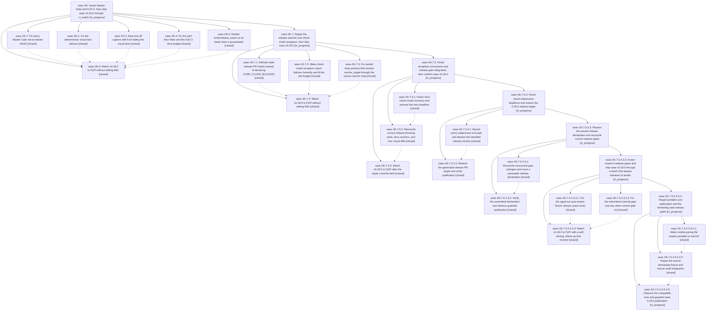

# Bead: sase-1lh — Green Master Gate and Full CI, then ship sase v0.18.0 through ci\_watch

[Bead Pages](../README.md) / sase-1lh

**Status:** ◐ in_progress · **Type:** ▸ plan · **Tier:** epic
**Owner:** `bryanbugyi34@gmail.com` · **Created by:** [bbugyi200.athena.10q](https://github.com/sase-org/sase--agents/blob/main/sessions/bbugyi200.athena.10q.md) · **Assignee:** `sase-1lh.land`
**Created:** 2026-10-16 13:00:19 EDT
**Plan:** [202610/v0\_18\_0\_green\_ci\_release.md](https://github.com/sase-org/sase--plans/blob/main/202610/v0_18_0_green_ci_release.md)

<!-- sase:links:start -->

## Links

| Relation | Artifact | Why |
| --- | --- | --- |
| implemented-by | [plan:202610/v0_18_0_green_ci_release.md][1] | derived from the plan's `bead_id:` frontmatter field |

_Plus 10 automatic references — see [Referenced By](#referenced-by)._

[1]: https://github.com/sase-org/sase--plans/blob/main/202610/v0_18_0_green_ci_release.md

<!-- sase:links:end -->

## Description

Master Gate is green at master HEAD and a fresh Full CI run passes every job, so ci_watch merges release-please PR #299 and sase 0.18.0 installs from PyPI. The release-wait phase closes its bead on every path that does not need a human. The land agent confirms the release before it lands, and repairs the release itself when something unexpected blocks it.

## Notes

[2026-10-16T20:38:52Z · sase-1lh.land] LANDER FOLLOW-UP TRIAGE (sase-1lh.land, 2026-10-16, master 97825eee1d). Every PROPOSED FOLLOW-UP and every plan-named known non-blocker that does not depend on the release:
- sase-1lh.1 #1 (provider_drain JSONDecodeError, Master Gate 38935192508/38935262082) -> +1 on existing flake sase-1k2.
- sase-1lh.1 #2, sase-1lh.4 #1, sase-1lh.5 #1 (docs-gen-check CLI drift) -> one task, sase-1lm. Root cause: tools/render_cli output depends on the Python version's argparse; it fails on 18 pages under 3.12 and 5 under 3.13, passes on 3.14; CI never runs docs-gen-check. Not caused by this epic; e69c455bd6 only regenerated the pages on 3.14. Related: sase-14p.
- sase-1lh.1 #3 (16 local rendering failures) -> new task sase-1ll. Root cause: the ambient TERM=dumb. Same failures with or without NO_COLOR; all pass with a real TERM. Related: sase-18s.
- sase-1lh.2 #2 (_lint-pyscripts Rule 1) -> DECLINED. `just _lint-pyscripts` passes on 97825eee1d; later docs commits resolved it.
- sase-1lh.2 #3 (zsh PTY smoke timeout) -> +1 on existing flake sase-13a.
- sase-1lh.2 #4 (parked-reader guard) -> new bug task sase-1ln. Notes that test_main_deck_reply_steal_recovery asserts the buggy state as a precondition.
- sase-1lh.3 #1:
  - Docs-test reds and the KNOWN plus-one close docs -> DECLINED; c0ac5e5f56 fixed them.
  - next-word peek -> +1 on existing flake sase-1l7.
  - tool-run reconnect timeout -> new flake sase-1lo.
  - KNOWN monitor reparent -> new flake sase-1lp (related: sase-19b).
- Plan known non-blockers:
  - `<deleted>` cwd warnings from os.chdir in run_agent_exec_retry -> new task sase-1lq (reproduced locally; related: sase-j7).
  - test_link_follow_seam flake -> new flake sase-1lr. Its introducing epic, sase-16t, is closed, so a task rather than a DISCOVERED ISSUE note.
  - CI Telemetry never green -> new task sase-1lt. contention-test gets a runner shutdown signal ~30.5 min into its 26-worker soak on every run.
- Extra Master Gate flake seen during the integration review: test_mounted_arrival_then_clear_name_keeps_selection (run 38953378752 at 4bd2252f07; the next SHA was green) -> new flake sase-1ls.
- STILL OPEN, post-release (for the resumed landing): Install smoke healed after 0.18.0, and every node recapture reports `unstable` in the Full CI run ci_watch relied on.

[2026-10-16T20:42:07Z · sase-1lh.land] LANDING AUDIT, incomplete (sase-1lh.land, 2026-10-16, master 97825eee1d). Remaining work is going to a child epic plan with parent_bead sase-1lh: watcher-repair, recapture-repair, and docs-split-anchor, then a fresh release-watch.

Verified:
- All five code commits are on master: e69c455bd6 (.4), 909d55df5e (.5), c0ac5e5f56 (.1), 2e94255b21 (.2), ae7f9dc91a (.3).
- Master Gate is green at ae7f9dc91a and 881f444778.
- ci-budget meets its spec: the persistent_query_keystroke 3.10x ceiling is 206.78us and perf-floors is green in Full CI 38944787812.
- gate-fix's docs-test fixes and narrow xprompt allowlist meet the spec. The mypy fixes and the hub trim had already landed in 39f9ca9300 (sase-1le).
- visual-drift's readiness wait keeps the 15s budget and checks semantic state.
- No epic-symbols entries remain.
- Integration: commits since the epic started (docs epic 6a26d90945/3c4d340935/4bd2252f07/7e3af4c8ad, 881f444778, a9701c36e6, 97825eee1d) do not conflict with the epic's files. 97825eee1d's ci.yml edit is independent of the recapture steps.

Release NOT confirmed:
- sase-1lh.6's CORE_FLOOR_BLOCKED was a misdiagnosis. PR #299 head ccec317e72 was built on 558e075a4d. Its release-core-floor-smoke (run 38934272211) failed only on two docs tests that c0ac5e5f56 later fixed, so the head is stale, not floor-blocked.
- No Full CI run yet contains every fix. Run 38944787812 at 6a26d90945 predates gate-fix. Run 38960097707 at 97825eee1d was in progress.

Epic-caused defects for the child to fix:
- Watcher (909d55df5e): `_floor_blocked` cannot tell a stale head from a floor block and has no refresh path. `dispatch_due` counts pre-start reds against --max-red-full-ci. A signal during the close retries loses the close.
- Recapture (ae7f9dc91a):
  - a persistent test failure now reports drift/exit 1 instead of failed/exit 3;
  - a recovered retry skips the strict completeness checks;
  - retries have no time guard against the 45-minute job timeout;
  - check mode runs its own retry loop.
  - Docs: development.md ~1148 needs a zero-unstable requirement, and tui_screenshot.md's host proof is now misleading (memory decision in the child plan).
- docs_split (c0ac5e5f56): a nested drop pointer's explicit anchor_target is rewritten through the source anchor map.

Declined:
- A pre-close bead read on the signal path, because that path must exit at once and a redundant close is harmless.

After the child lands, the resumed landing still owes:
- post-release triage (Install smoke healed; nodes reported unstable in the release's Full CI);
- stale_epics = supersede for the sase-1kx tree and sase-1jz;
- close sase-1lh, run `just symvision`, and mark its plan done.

## Phases

| Bead | Title | Status | Size | Created | Agents | Commits |
|---|---|---|---|---|---:|---:|
| [sase-1lh.1](sase-1lh.1.md) | Fix every Master Gate red at master HEAD | ✓ closed | medium | 2026-10-16 | 1 | 1 |
| [sase-1lh.2](sase-1lh.2.md) | Fix the deterministic visual-test failures | ✓ closed | medium | 2026-10-16 | 1 | 1 |
| [sase-1lh.3](sase-1lh.3.md) | Stop one-off capture drift from failing the visual lane | ✓ closed | medium | 2026-10-16 | 1 | 1 |
| [sase-1lh.4](sase-1lh.4.md) | Fix the perf-floor flake and the Full CI time budget | ✓ closed | small | 2026-10-16 | 1 | 1 |
| [sase-1lh.5](sase-1lh.5.md) | Harden tools/release\_watch so its bead close is guaranteed | ✓ closed | medium | 2026-10-16 | 1 | 1 |
| [sase-1lh.6](sase-1lh.6.md) | Watch v0.18.0 to PyPI without editing files | ✓ closed | small | 2026-10-16 | 1 | 0 |

## Lineage

## Agents

| Agent | Bead | Commits |
|---|---|---:|
| [bbugyi200.athena.sase-1lh.1](https://github.com/sase-org/sase--agents/blob/main/agents/bbugyi200.athena.sase-1lh.1/README.md) | [sase-1lh.1](sase-1lh.1.md) | 1 |
| [bbugyi200.athena.sase-1lh.2](https://github.com/sase-org/sase--agents/blob/main/agents/bbugyi200.athena.sase-1lh.2/README.md) | [sase-1lh.2](sase-1lh.2.md) | 1 |
| [bbugyi200.athena.sase-1lh.3](https://github.com/sase-org/sase--agents/blob/main/agents/bbugyi200.athena.sase-1lh.3/README.md) | [sase-1lh.3](sase-1lh.3.md) | 1 |
| [bbugyi200.athena.sase-1lh.4](https://github.com/sase-org/sase--agents/blob/main/agents/bbugyi200.athena.sase-1lh.4/README.md) | [sase-1lh.4](sase-1lh.4.md) | 1 |
| [bbugyi200.athena.sase-1lh.5](https://github.com/sase-org/sase--agents/blob/main/agents/bbugyi200.athena.sase-1lh.5/README.md) | [sase-1lh.5](sase-1lh.5.md) | 1 |
| [bbugyi200.athena.sase-1lh.6](https://github.com/sase-org/sase--agents/blob/main/sessions/bbugyi200.athena.sase-1lh.6.md) | [sase-1lh.6](sase-1lh.6.md) | 0 |
| [bbugyi200.athena.sase-1lh.7.1](https://github.com/sase-org/sase--agents/blob/main/agents/bbugyi200.athena.sase-1lh.7.1/README.md) | [sase-1lh.7.1](sase-1lh.7.1.md) | 1 |
| [bbugyi200.athena.sase-1lh.7.2](https://github.com/sase-org/sase--agents/blob/main/sessions/bbugyi200.athena.sase-1lh.7.2.md) | [sase-1lh.7.2](sase-1lh.7.2.md) | 1 |
| [bbugyi200.athena.sase-1lh.7.3](https://github.com/sase-org/sase--agents/blob/main/agents/bbugyi200.athena.sase-1lh.7.3/README.md) | [sase-1lh.7.3](sase-1lh.7.3.md) | 1 |
| [bbugyi200.athena.sase-1lh.7.4](https://github.com/sase-org/sase--agents/blob/main/sessions/bbugyi200.athena.sase-1lh.7.4.md) | [sase-1lh.7.4](sase-1lh.7.4.md) | 0 |
| [bbugyi200.athena.sase-1lh.7.5.1](https://github.com/sase-org/sase--agents/blob/main/sessions/bbugyi200.athena.sase-1lh.7.5.1.md) | [sase-1lh.7.5.1](sase-1lh.7.5.1.md) | 1 |
| [bbugyi200.athena.sase-1lh.7.5.2](https://github.com/sase-org/sase--agents/blob/main/agents/bbugyi200.athena.sase-1lh.7.5.2/README.md) | [sase-1lh.7.5.2](sase-1lh.7.5.2.md) | 1 |
| [bbugyi200.athena.sase-1lh.7.5.3](https://github.com/sase-org/sase--agents/blob/main/sessions/bbugyi200.athena.sase-1lh.7.5.3.md) | [sase-1lh.7.5.3](sase-1lh.7.5.3.md) | 0 |
| [bbugyi200.athena.sase-1lh.7.5.4.1](https://github.com/sase-org/sase--agents/blob/main/agents/bbugyi200.athena.sase-1lh.7.5.4.1/README.md) | [sase-1lh.7.5.4.1](sase-1lh.7.5.4.1.md) | 1 |
| [bbugyi200.athena.sase-1lh.7.5.4.2](https://github.com/sase-org/sase--agents/blob/main/sessions/bbugyi200.athena.sase-1lh.7.5.4.2.md) | [sase-1lh.7.5.4.2](sase-1lh.7.5.4.2.md) | 0 |
| [bbugyi200.athena.sase-1lh.7.5.4.3.1](https://github.com/sase-org/sase--agents/blob/main/agents/bbugyi200.athena.sase-1lh.7.5.4.3.1/README.md) | [sase-1lh.7.5.4.3.1](sase-1lh.7.5.4.3.1.md) | 1 |
| [bbugyi200.athena.sase-1lh.7.5.4.3.2](https://github.com/sase-org/sase--agents/blob/main/sessions/bbugyi200.athena.sase-1lh.7.5.4.3.2.md) | [sase-1lh.7.5.4.3.2](sase-1lh.7.5.4.3.2.md) | 0 |
| [bbugyi200.athena.sase-1lh.7.5.4.3.3.1](https://github.com/sase-org/sase--agents/blob/main/agents/bbugyi200.athena.sase-1lh.7.5.4.3.3.1/README.md) | [sase-1lh.7.5.4.3.3.1](sase-1lh.7.5.4.3.3.1.md) | 1 |
| [bbugyi200.athena.sase-1lh.7.5.4.3.3.2](https://github.com/sase-org/sase--agents/blob/main/sessions/bbugyi200.athena.sase-1lh.7.5.4.3.3.2.md) | [sase-1lh.7.5.4.3.3.2](sase-1lh.7.5.4.3.3.2.md) | 1 |
| [bbugyi200.athena.sase-1lh.7.5.4.3.3.3](https://github.com/sase-org/sase--agents/blob/main/sessions/bbugyi200.athena.sase-1lh.7.5.4.3.3.3.md) | [sase-1lh.7.5.4.3.3.3](sase-1lh.7.5.4.3.3.3.md) | 0 |
| [bbugyi200.athena.sase-1lh.7.5.4.3.3.4.1](https://github.com/sase-org/sase--agents/blob/main/agents/bbugyi200.athena.sase-1lh.7.5.4.3.3.4.1/README.md) | [sase-1lh.7.5.4.3.3.4.1](sase-1lh.7.5.4.3.3.4.1.md) | 1 |
| [bbugyi200.athena.sase-1lh.7.5.4.3.3.4.2](https://github.com/sase-org/sase--agents/blob/main/sessions/bbugyi200.athena.sase-1lh.7.5.4.3.3.4.2.md) | [sase-1lh.7.5.4.3.3.4.2](sase-1lh.7.5.4.3.3.4.2.md) | 1 |
| [bbugyi200.athena.sase-1lh.7.5.4.3.3.4.3](https://github.com/sase-org/sase--agents/blob/main/agents/bbugyi200.athena.sase-1lh.7.5.4.3.3.4.3/README.md) | [sase-1lh.7.5.4.3.3.4.3](sase-1lh.7.5.4.3.3.4.3.md) | 0 |
| [bbugyi200.athena.sase-1lh.7.5.4.3.3.4.land](https://github.com/sase-org/sase--agents/blob/main/agents/bbugyi200.athena.sase-1lh.7.5.4.3.3.4.land/README.md) | [sase-1lh.7.5.4.3.3.4](sase-1lh.7.5.4.3.3.4.md) | 0 |
| [bbugyi200.athena.sase-1lh.7.5.4.3.3.land](https://github.com/sase-org/sase--agents/blob/main/sessions/bbugyi200.athena.sase-1lh.7.5.4.3.3.land.md) | [sase-1lh.7.5.4.3.3](sase-1lh.7.5.4.3.3.md) | 0 |
| [bbugyi200.athena.sase-1lh.7.5.4.3.land](https://github.com/sase-org/sase--agents/blob/main/agents/bbugyi200.athena.sase-1lh.7.5.4.3.land/README.md) | [sase-1lh.7.5.4.3](sase-1lh.7.5.4.3.md) | 0 |
| [bbugyi200.athena.sase-1lh.7.5.4.land](https://github.com/sase-org/sase--agents/blob/main/sessions/bbugyi200.athena.sase-1lh.7.5.4.land.md) | [sase-1lh.7.5.4](sase-1lh.7.5.4.md) | 0 |
| [bbugyi200.athena.sase-1lh.7.5.land](https://github.com/sase-org/sase--agents/blob/main/sessions/bbugyi200.athena.sase-1lh.7.5.land.md) | [sase-1lh.7.5](sase-1lh.7.5.md) | 0 |
| [bbugyi200.athena.sase-1lh.7.land](https://github.com/sase-org/sase--agents/blob/main/sessions/bbugyi200.athena.sase-1lh.7.land.md) | [sase-1lh.7](sase-1lh.7.md) | 0 |
| [bbugyi200.athena.sase-1lh.land](https://github.com/sase-org/sase--agents/blob/main/sessions/bbugyi200.athena.sase-1lh.land.md) | [sase-1lh](README.md) | 0 |

## Commits

| Repo | Commit | Subject | Bead | Committed |
|---|---|---|---|---|
| sase | [`e69c455`](https://github.com/sase-org/sase/commit/e69c455bd6a65d69727711fcfe9a308e1674c3fc) | perf(ci-budget): recalibrate persistent\_query\_keystroke floor to 3.10x | [sase-1lh.4](sase-1lh.4.md) | 2026-10-16 13:14:27 EDT |
| sase | [`909d55d`](https://github.com/sase-org/sase/commit/909d55df5e948968c6c40e9dde5166d47b10433b) | feat(release-watch): harden watcher close guarantees and stuck-gate exit | [sase-1lh.5](sase-1lh.5.md) | 2026-10-16 13:34:32 EDT |
| sase | [`c0ac5e5`](https://github.com/sase-org/sase/commit/c0ac5e5f569af5370559ddb4645e1d7acb025e38) | fix(docs): repair nested split links and gate regressions | [sase-1lh.1](sase-1lh.1.md) | 2026-10-16 14:07:14 EDT |
| sase | [`2e94255`](https://github.com/sase-org/sase/commit/2e94255b214d151ffea0f2e5642657b3b328b5e0) | fix(visual): repair deterministic visual-test failures (sase-1lh.2) | [sase-1lh.2](sase-1lh.2.md) | 2026-10-16 14:29:07 EDT |
| sase | [`ae7f9dc`](https://github.com/sase-org/sase/commit/ae7f9dc91aa7504022d17e5b8c9343d912271a13) | feat(visual): recapture first-pass screenshot check failures | [sase-1lh.3](sase-1lh.3.md) | 2026-10-16 15:19:09 EDT |
| sase | [`e41b209`](https://github.com/sase-org/sase/commit/e41b209b24642553524de0beac2de6f9eee9cea5) | fix(docs): keep explicit anchor\_target on nested drop pointers in docs\_split | [sase-1lh.7.3](sase-1lh.7.3.md) | 2026-10-16 17:01:45 EDT |
| sase | [`ec7e86e`](https://github.com/sase-org/sase/commit/ec7e86e6907be34bb44252694ba5b0a147ffec6c) | fix(release-watch): refresh stale release-PR heads instead of declaring CORE\_FLOOR\_BLOCKED | [sase-1lh.7.1](sase-1lh.7.1.md) | 2026-10-16 17:07:54 EDT |
| sase | [`2eb0ca7`](https://github.com/sase-org/sase/commit/2eb0ca791a466bcfa8932179805a1390aabab0f3) | fix(visual): keep check-mode recapture honest and on a time budget | [sase-1lh.7.2](sase-1lh.7.2.md) | 2026-10-16 18:47:58 EDT |
| sase | [`499c825`](https://github.com/sase-org/sase/commit/499c825cb931953efb2af6c49d7d504e04e8c0bc) | fix(visual): enforce strict check-mode recovery and retry deadline | [sase-1lh.7.5.1](sase-1lh.7.5.1.md) | 2026-10-16 21:33:07 EDT |
| sase | [`f564f0f`](https://github.com/sase-org/sase/commit/f564f0f9962384f9aa05e8d2b1be02e54e413698) | test(release): reconcile launch, docs, and visual regressions | [sase-1lh.7.5.2](sase-1lh.7.5.2.md) | 2026-10-16 22:07:49 EDT |
| sase | [`69e0cd7`](https://github.com/sase-org/sase/commit/69e0cd75400465a1433717bad5e8e623379814c8) | fix(tui): bound visual subprocess cleanup | [sase-1lh.7.5.4.1](sase-1lh.7.5.4.1.md) | 2026-10-16 23:38:46 EDT |
| sase | [`315092a`](https://github.com/sase-org/sase/commit/315092afebe542524e37d6b69c27030b77e02c2d) | fix(release): restore a parseable 0.18.0 nested declaration | [sase-1lh.7.5.4.3.1](sase-1lh.7.5.4.3.1.md) | 2026-10-17 01:18:59 EDT |
| sase | [`f2a7b80`](https://github.com/sase-org/sase/commit/f2a7b802f9727ffc62b871ae44973c92fa844df6) | fix(tests): derive healer fixture timestamps from test clock | [sase-1lh.7.5.4.3.3.1](sase-1lh.7.5.4.3.3.1.md) | 2026-10-17 15:13:31 EDT |
| sase | [`60718e5`](https://github.com/sase-org/sase/commit/60718e5b1b77fcd89cdad2be8b016303a11f96d9) | fix(tests): wait for tutorial agents beyond RUNNING | [sase-1lh.7.5.4.3.3.2](sase-1lh.7.5.4.3.3.2.md) | 2026-10-17 15:31:32 EDT |
| sase-core | [`sase-core@dd56b94`](https://github.com/sase-org/sase-core/commit/dd56b94a8ad9fdca541d16cb5b6f85a2b45e55af) | fix(mobile-pairing): pass native mode\_t to mkdirat and fchmod | [sase-1lh.7.5.4.3.3.4.1](sase-1lh.7.5.4.3.3.4.1.md) | 2026-10-17 17:33:47 EDT |
| sase | [`933970c`](https://github.com/sase-org/sase/commit/933970ce72a5b5328499e80751a491c857bfc221) | fix(release-gates): make launch fixtures deterministic | [sase-1lh.7.5.4.3.3.4.2](sase-1lh.7.5.4.3.3.4.2.md) | 2026-10-17 19:03:02 EDT |

<!-- sase:referenced-by:start -->

## Referenced By

| Relation | Artifact | Why | Uses |
| --- | --- | --- | ---: |
| read-by | [agent:research.1u.cld][1] | Check whether the current green-master epic already adds a mechanical pre-land refusal, before recommending a Refinery-style landing gate in the gastown comparison report | 1 |
| read-by | [agent:research.1w.cld][2] | Understand why v0.18.0 release is still blocked, as evidence for merge-discipline research | 1 |
| read-by | [agent:research.1w.mus][3] | Read epic notes for current blockers (merge-discipline research) | 3 |
| read-by | [agent:research.4q.final][4] | Check whether installability and 0.18.0 work is already tracked before recommending epic scope | 1 |
| read-by | [agent:sase-1lh.2][5] | need epic decisions and plan context | 1 |
| read-by | [agent:sase-1lh.3][6] | Need parent epic context for visual-stability phase | 1 |
| read-by | [agent:sase-1lh.5][7] | inspect epic children statuses for closed-bead output shape | 1 |
| read-by | [agent:sase-1lh.7.5.2][8] | Need ancestor epic scope and inherited decisions for this phase | 3 |
| read-by | [agent:sase-1lh.7.5.4.1][9] | Need accepted decisions in the plan ancestors before implementation | 1 |
| read-by | [agent:toobig-86.rescue.0][10] | Need to check whether the active release epic owns the repo-log environment failure in addition to the existing duplicate task | 1 |

[1]: https://github.com/sase-org/sase--agents/blob/main/agents/bbugyi200.athena.research.1u.cld/README.md
[2]: https://github.com/sase-org/sase--agents/blob/main/agents/bbugyi200.athena.research.1w.cld/README.md
[3]: https://github.com/sase-org/sase--agents/blob/main/agents/bbugyi200.athena.research.1w.mus/README.md
[4]: https://github.com/sase-org/sase--agents/blob/main/agents/bbugyi200.athena.research.4q.final/README.md
[5]: https://github.com/sase-org/sase--agents/blob/main/agents/bbugyi200.athena.sase-1lh.2/README.md
[6]: https://github.com/sase-org/sase--agents/blob/main/agents/bbugyi200.athena.sase-1lh.3/README.md
[7]: https://github.com/sase-org/sase--agents/blob/main/agents/bbugyi200.athena.sase-1lh.5/README.md
[8]: https://github.com/sase-org/sase--agents/blob/main/agents/bbugyi200.athena.sase-1lh.7.5.2/README.md
[9]: https://github.com/sase-org/sase--agents/blob/main/agents/bbugyi200.athena.sase-1lh.7.5.4.1/README.md
[10]: https://github.com/sase-org/sase--agents/blob/main/agents/bbugyi200.athena.toobig-86.rescue.0/README.md

<!-- sase:referenced-by:end -->
