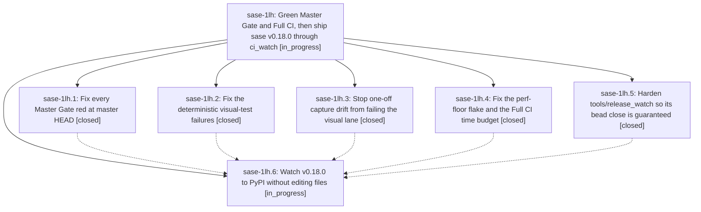

# Bead: sase-1lh — Green Master Gate and Full CI, then ship sase v0.18.0 through ci\_watch

[Bead Pages](../README.md) / sase-1lh

**Status:** ◐ in_progress · **Type:** ▸ plan · **Tier:** epic
**Owner:** `bryanbugyi34@gmail.com` · **Created by:** [bbugyi200.athena.10q](https://github.com/sase-org/sase--agents/blob/main/sessions/bbugyi200.athena.10q.md) · **Assignee:** `sase-1lh.land`
**Created:** 2026-10-16 13:00:19 EDT
**Plan:** [202610/v0\_18\_0\_green\_ci\_release.md](https://github.com/sase-org/sase--plans/blob/main/202610/v0_18_0_green_ci_release.md)

<!-- sase:links:start -->

## Links

| Relation | Artifact | Why |
| --- | --- | --- |
| implemented-by | [plan:202610/v0_18_0_green_ci_release.md][1] | derived from the plan's `bead_id:` frontmatter field |

_Plus 1 automatic references — see [Referenced By](#referenced-by)._

[1]: https://github.com/sase-org/sase--plans/blob/main/202610/v0_18_0_green_ci_release.md

<!-- sase:links:end -->

## Description

Master Gate is green at master HEAD and a fresh Full CI run passes every job, so ci_watch merges release-please PR #299 and sase 0.18.0 installs from PyPI. The release-wait phase closes its bead on every path that does not need a human. The land agent confirms the release before it lands, and repairs the release itself when something unexpected blocks it.

## Phases

| Bead | Title | Status | Size | Created | Agents | Commits |
|---|---|---|---|---|---:|---:|
| [sase-1lh.1](sase-1lh.1.md) | Fix every Master Gate red at master HEAD | ✓ closed | medium | 2026-10-16 | 1 | 1 |
| [sase-1lh.2](sase-1lh.2.md) | Fix the deterministic visual-test failures | ✓ closed | medium | 2026-10-16 | 1 | 1 |
| [sase-1lh.3](sase-1lh.3.md) | Stop one-off capture drift from failing the visual lane | ✓ closed | medium | 2026-10-16 | 1 | 0 |
| [sase-1lh.4](sase-1lh.4.md) | Fix the perf-floor flake and the Full CI time budget | ✓ closed | small | 2026-10-16 | 1 | 1 |
| [sase-1lh.5](sase-1lh.5.md) | Harden tools/release\_watch so its bead close is guaranteed | ✓ closed | medium | 2026-10-16 | 1 | 1 |
| [sase-1lh.6](sase-1lh.6.md) | Watch v0.18.0 to PyPI without editing files | ◐ in_progress | small | 2026-10-16 | 1 | 0 |

## Lineage

## Agents

| Agent | Bead | Commits |
|---|---|---:|
| [bbugyi200.athena.sase-1lh.1](https://github.com/sase-org/sase--agents/blob/main/agents/bbugyi200.athena.sase-1lh.1/README.md) | [sase-1lh.1](sase-1lh.1.md) | 1 |
| [bbugyi200.athena.sase-1lh.2](https://github.com/sase-org/sase--agents/blob/main/agents/bbugyi200.athena.sase-1lh.2/README.md) | [sase-1lh.2](sase-1lh.2.md) | 1 |
| [bbugyi200.athena.sase-1lh.3](https://github.com/sase-org/sase--agents/blob/main/agents/bbugyi200.athena.sase-1lh.3/README.md) | [sase-1lh.3](sase-1lh.3.md) | 0 |
| [bbugyi200.athena.sase-1lh.4](https://github.com/sase-org/sase--agents/blob/main/agents/bbugyi200.athena.sase-1lh.4/README.md) | [sase-1lh.4](sase-1lh.4.md) | 1 |
| [bbugyi200.athena.sase-1lh.5](https://github.com/sase-org/sase--agents/blob/main/agents/bbugyi200.athena.sase-1lh.5/README.md) | [sase-1lh.5](sase-1lh.5.md) | 1 |
| [bbugyi200.athena.sase-1lh.6](https://github.com/sase-org/sase--agents/blob/main/agents/bbugyi200.athena.sase-1lh.6/README.md) | [sase-1lh.6](sase-1lh.6.md) | 0 |
| [bbugyi200.athena.sase-1lh.land](https://github.com/sase-org/sase--agents/blob/main/agents/bbugyi200.athena.sase-1lh.land/README.md) | [sase-1lh](README.md) | 0 |

## Commits

| Repo | Commit | Subject | Bead | Committed |
|---|---|---|---|---|
| sase | [`e69c455`](https://github.com/sase-org/sase/commit/e69c455bd6a65d69727711fcfe9a308e1674c3fc) | perf(ci-budget): recalibrate persistent\_query\_keystroke floor to 3.10x | [sase-1lh.4](sase-1lh.4.md) | 2026-10-16 13:14:27 EDT |
| sase | [`909d55d`](https://github.com/sase-org/sase/commit/909d55df5e948968c6c40e9dde5166d47b10433b) | feat(release-watch): harden watcher close guarantees and stuck-gate exit | [sase-1lh.5](sase-1lh.5.md) | 2026-10-16 13:34:32 EDT |
| sase | [`c0ac5e5`](https://github.com/sase-org/sase/commit/c0ac5e5f569af5370559ddb4645e1d7acb025e38) | fix(docs): repair nested split links and gate regressions | [sase-1lh.1](sase-1lh.1.md) | 2026-10-16 14:07:14 EDT |
| sase | [`2e94255`](https://github.com/sase-org/sase/commit/2e94255b214d151ffea0f2e5642657b3b328b5e0) | fix(visual): repair deterministic visual-test failures (sase-1lh.2) | [sase-1lh.2](sase-1lh.2.md) | 2026-10-16 14:29:07 EDT |

<!-- sase:referenced-by:start -->

## Referenced By

| Relation | Artifact | Why | Uses |
| --- | --- | --- | ---: |
| read-by | [agent:sase-1lh.5][1] | inspect epic children statuses for closed-bead output shape | 1 |

[1]: https://github.com/sase-org/sase--agents/blob/main/agents/bbugyi200.athena.sase-1lh.5/README.md

<!-- sase:referenced-by:end -->
