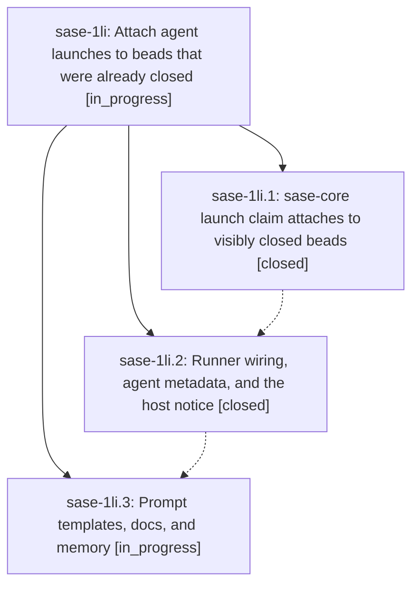

# Bead: sase-1li — Attach agent launches to beads that were already closed

[Bead Pages](../README.md) / sase-1li

**Status:** ◐ in_progress · **Type:** ▸ plan · **Tier:** epic
**Owner:** `bryanbugyi34@gmail.com` · **Created by:** [bbugyi200.athena.research.4n.linker.w0](https://github.com/sase-org/sase--agents/blob/main/sessions/bbugyi200.athena.research.4n.linker.w0.md) · **Assignee:** `sase-1li.land`
**Created:** 2026-10-16 13:03:48 EDT
**Plan:** [202610/closed\_bead\_launch\_attach.md](https://github.com/sase-org/sase--plans/blob/main/202610/closed_bead_launch_attach.md)

<!-- sase:links:start -->

## Links

| Relation | Artifact | Why |
| --- | --- | --- |
| implemented-by | [plan:202610/closed_bead_launch_attach.md][1] | derived from the plan's `bead_id:` frontmatter field |

_Plus 1 automatic references — see [Referenced By](#referenced-by)._

[1]: https://github.com/sase-org/sase--plans/blob/main/202610/closed_bead_launch_attach.md

<!-- sase:links:end -->

## Description

An agent launched with `%id(..., bead=<id>)` against a bead that was already closed when the launch was submitted (the common `,x` / `sase agent restart` recovery case) runs attached to that closed bead instead of failing: the bead stays closed with its close metadata and ancestors untouched, the host appends one timestamped `CLOSED-BEAD LAUNCH:` audit note authored by the launching agent, and the agent is told its bead is already closed. A bead closed after the launch was submitted still refuses the launch, now with a clear `closed_while_queued` error.

## Phases

| Bead | Title | Status | Size | Created | Agents | Commits |
|---|---|---|---|---|---:|---:|
| [sase-1li.1](sase-1li.1.md) | sase-core launch claim attaches to visibly closed beads | ✓ closed | medium | 2026-10-16 | 1 | 1 |
| [sase-1li.2](sase-1li.2.md) | Runner wiring, agent metadata, and the host notice | ✓ closed | medium | 2026-10-16 | 1 | 1 |
| [sase-1li.3](sase-1li.3.md) | Prompt templates, docs, and memory | ◐ in_progress | small | 2026-10-16 | 1 | 0 |

## Lineage

## Agents

| Agent | Bead | Commits |
|---|---|---:|
| [bbugyi200.athena.sase-1li.1](https://github.com/sase-org/sase--agents/blob/main/agents/bbugyi200.athena.sase-1li.1/README.md) | [sase-1li.1](sase-1li.1.md) | 1 |
| [bbugyi200.athena.sase-1li.2](https://github.com/sase-org/sase--agents/blob/main/agents/bbugyi200.athena.sase-1li.2/README.md) | [sase-1li.2](sase-1li.2.md) | 1 |
| [bbugyi200.athena.sase-1li.3](https://github.com/sase-org/sase--agents/blob/main/agents/bbugyi200.athena.sase-1li.3/README.md) | [sase-1li.3](sase-1li.3.md) | 0 |
| [bbugyi200.athena.sase-1li.land](https://github.com/sase-org/sase--agents/blob/main/agents/bbugyi200.athena.sase-1li.land/README.md) | [sase-1li](README.md) | 0 |

## Commits

| Repo | Commit | Subject | Bead | Committed |
|---|---|---|---|---|
| sase-core | [`sase-core@594faf3`](https://github.com/sase-org/sase-core/commit/594faf31d80af79a148cb67968318b2bfb1a5770) | feat(bead): attach launch claims to beads closed before submission | [sase-1li.1](sase-1li.1.md) | 2026-10-16 14:27:54 EDT |
| sase | [`881f444`](https://github.com/sase-org/sase/commit/881f44477864bdb876d4747645e9dfd3da1c9907) | feat(axe): attach launches to closed beads | [sase-1li.2](sase-1li.2.md) | 2026-10-16 15:39:17 EDT |

<!-- sase:referenced-by:start -->

## Referenced By

| Relation | Artifact | Why | Uses |
| --- | --- | --- | ---: |
| read-by | [agent:sase-1li.1][1] | Need parent epic decisions and full plan context | 1 |

[1]: https://github.com/sase-org/sase--agents/blob/main/agents/bbugyi200.athena.sase-1li.1/README.md

<!-- sase:referenced-by:end -->
