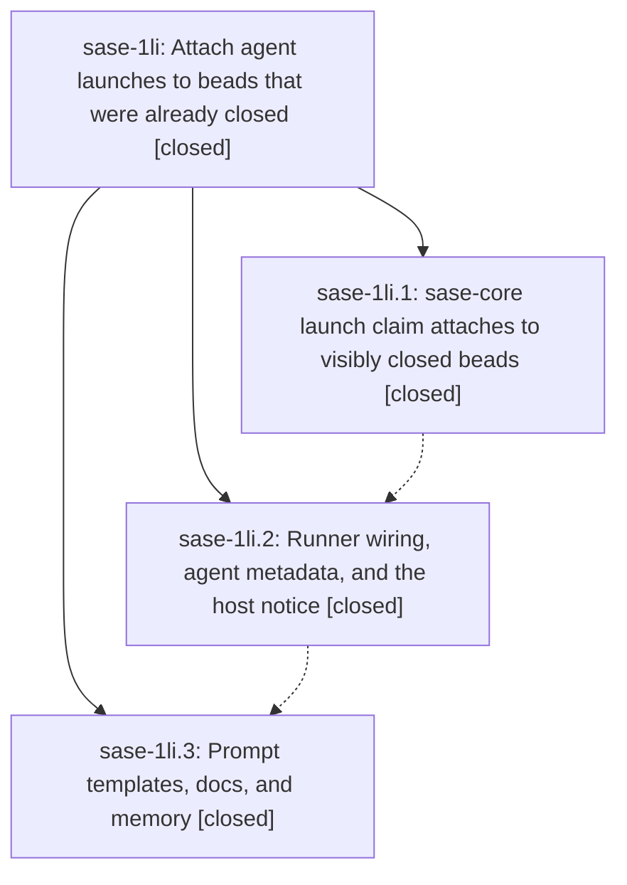

# Bead: sase-1li — Attach agent launches to beads that were already closed

[Bead Pages](../README.md) / sase-1li

**Status:** ✓ closed · **Resolution:** done · **Type:** ▸ plan · **Tier:** epic
**Owner:** `bryanbugyi34@gmail.com` · **Created by:** [bbugyi200.athena.research.4n.linker.w0](https://github.com/sase-org/sase--agents/blob/main/sessions/bbugyi200.athena.research.4n.linker.w0.md) · **Assignee:** `sase-1li.land`
**Created:** 2026-10-16 13:03:48 EDT · **Closed:** 2026-10-16 18:47:53 EDT
**Plan:** [202610/closed\_bead\_launch\_attach.md](https://github.com/sase-org/sase--plans/blob/main/202610/closed_bead_launch_attach.md)

<!-- sase:links:start -->

## Links

| Relation | Artifact | Why |
| --- | --- | --- |
| implemented-by | [plan:202610/closed_bead_launch_attach.md][1] | derived from the plan's `bead_id:` frontmatter field |
| related | file:explicit:7216f9267aba3db812ee92eb | attached via sase artifact create --bead |

_Plus 1 automatic references — see [Referenced By](#referenced-by)._

[1]: https://github.com/sase-org/sase--plans/blob/main/202610/closed_bead_launch_attach.md

<!-- sase:links:end -->

## Description

An agent launched with `%id(..., bead=<id>)` against a bead that was already closed when the launch was submitted (the common `,x` / `sase agent restart` recovery case) runs attached to that closed bead instead of failing: the bead stays closed with its close metadata and ancestors untouched, the host appends one timestamped `CLOSED-BEAD LAUNCH:` audit note authored by the launching agent, and the agent is told its bead is already closed. A bead closed after the launch was submitted still refuses the launch, now with a clear `closed_while_queued` error.

## Notes

[2026-10-16T22:19:35Z · sase-1li.land] LANDER FOLLOW-UP TRIAGE (2026-10-16, f3087c86ac). Reviewed all 8 PROPOSED FOLLOW-UP entries under /sase_new_task, searched all-status tasks, swept 71 tasks created in the last week, and inspected active-epic scopes.
- sase-1li.1 #1: +1 sase-1gz for the exact federation_worker listener flake; relayed phase failure/isolation evidence, no new lander failure.
- sase-1li.2 #1: declined reopening superseded sase-i7. Fresh sase memory init --check --diff fails on 8 files; home diffs match neutral file/bundle wording from 97825eee1d / sase-1lj.1. Recorded DISCOVERED ISSUE on active epic sase-1lj. No new task or memory edits.
- sase-1li.2 #2: +1 sase-xo for the exact blocked-render loaded-lane flake and its later passing focused ToolRun 6c4b12f686b38bef5f9af72898544425.
- sase-1li.3 #1: +1 sase-193. Source confirms phase/task prompts close during the turn before post-commit close_assigned_bead_after_commit. Same premature-close defect; no duplicate task. Existing finalizer epics sase-rr/sase-zq do not establish a new causal introduction of those prompt instructions.
- sase-1li.3 #2: created medium feature sase-1lu, Show closed-bead attachment in restart previews; READY. CLI preview currently displays ID without close disposition; bounded CLI/TUI hint work.
- sase-1li.3 #3: created large feature sase-1lv, Represent closed-while-queued launches as stood down; READY. Separate lifecycle/outcome design explicitly deferred by the original plan.
- sase-1li.3 #4: +1 sase-1ic for the phase's clean-base 3520/strict-3520 import-budget failure (+0 from phase). Historical independent phase evidence, not a new lander measurement.
- sase-1li.3 #5: +1 sase-1k3 for the exact supervisor SIGTERM settlement node and SQLITE_BUSY signature in ToolRun 08b068d595c66dc15469c69de3b1f275. Declined an additional task or duplicate +1 on neighboring sase-18t; it is already related and the exact node has its own task.
Carry these outcomes into the eventual close note; do not refile them.

[2026-10-16T22:21:56Z · sase-1li.land] LANDING AUDIT, incomplete (2026-10-16, f3087c86ac = fetched origin/master). Read epic, all children and every note, original plan, implementation commits core 594faf31 / runner 881f444778 / guidance 4b000ca2c6, actual Rust and Python sources, and later commits. Core pin exactly contains phase .1. Confirmed atomic existing-note event, preserved close fields/ancestors, legacy error, queued refusal, equality, note author, replay coverage; runner forwarding/notice/meta/commit subject and guidance honor healer_done_only=no and beads_memory=yes. Later docs, projection, plan-decision, artifact-cache, release-watch and visual changes do not add conflicting claim paths. 69 focused tests passed in 11.62s. Phase .3 uncertainty note #7 is resolved as implemented guidance, but phase .2's claimed completion missed the required JIT matrix and real closed prior-owner force-reuse test.
BLOCKER: state.timestamp is a synthetic unique launch ID. Rust batch allocation advances IDs past wall time. Isolated real-binding probe: actual submission 12:00:00Z, closed_at 12:00:01Z, third allocated ID 260101_120002 -> current runner attaches; true submission correctly yields closed_while_queued. A valid fractional close 12:00:00.1Z before actual submission .9Z is conversely rejected when ID conversion truncates submission to whole seconds (normal close clocks use seconds; this probe explicitly supplied supported fractional RFC3339). Need actual UTC submission provenance captured before admission, retained across wait/refresh, fresh on true resubmission, plus missing integration coverage. This is epic-caused R2 work, not a new follow-up task.
No epic-symbol entries and no parent_bead. Original plan remains unfinished. All 8 out-of-scope proposals have dispositions in the preceding LANDER FOLLOW-UP TRIAGE note. Audit artifact file:explicit:7216f9267aba3db812ee92eb. Proposing one medium tale, sase_plan_closed_bead_submission_time.md; validation with --explain passed, plan refined, validation without --explain passed with 0 warnings. Its final step owns normal sase-1li close, post-close just symvision and original plan status: done, before host commit; no waiting for its own SHA/CI and no force-close. No check-full run.

[2026-10-16T22:47:53Z · sase-1li.land] Implemented the real launch submission timestamp contract: capture one UTC RFC3339 stamp at ingress before admission waits, carry it through fanout/request/environment and durable runner metadata across waits and refresh, capture fresh stamps for new retries/restarts, prevent ambient parent-stamp leakage, and pass the trusted stamp with the unchanged artifact run ID into both claim paths. Removed the unused synthetic-ID timestamp conversion. The Rust comparison remains authoritative. Honored `healer_done_only=no` and `beads_memory=yes`; made no other memory edits.

Added the requested real-binding future-ID and fractional-time regressions, equality/non-UTC coverage, phase/epic visible/queued/legacy integration matrix, real force-reuse closed-prior-owner coverage, ordinary-open and notice checks, and transport/restart/refresh tests. Re-read this epic and children `.1`, `.2`, `.3` with their notes; all three phases are closed, the implementation is complete, and `sase bead epic-symbols sase-1li` reports none.

Verification: the exact original focused set plus launch transport/restart/refresh coverage passed, 159 tests total. `just fmt` passed. `sase tool run check` exited 1 at SASE validation: `init memory --check` requests a generated README totals update (`sase/memory/README.md`, +2 lines/+49 approximate tokens); the committed README reports 1,597 lines/22,672 tokens while the generated values are 1,599/22,721. Other listed formatter, lint, Symvision, and docs-contract checks passed. The memory README is outside this plan's authorized `sase_beads.md` edit, so it was not changed. No `just check-full` run.

Carried the prior triage outcomes forward without refiling: `.1 #1` corroborated `sase-1gz` (gateway listener flake); `.2 #1` recorded the current home-shim drift as a DISCOVERED ISSUE on `sase-1lj`, declined reopening superseded `sase-i7` and creating a duplicate; `.2 #2` corroborated `sase-xo` (blocked-render flake); `.3 #1` corroborated `sase-193` (premature provider-turn close), with no new task; `.3 #2` created READY medium feature `sase-1lu` (restart attachment hint); `.3 #3` created READY large feature `sase-1lv` (stood-down outcome); `.3 #4` corroborated `sase-1ic` (baseline import budget); `.3 #5` corroborated exact-node `sase-1k3` (SIGTERM settlement SQLITE_BUSY), declining another task or duplicate corroboration on `sase-18t`.

## Phases

| Bead | Title | Status | Size | Created | Agents | Commits |
|---|---|---|---|---|---:|---:|
| [sase-1li.1](sase-1li.1.md) | sase-core launch claim attaches to visibly closed beads | ✓ closed | medium | 2026-10-16 | 1 | 1 |
| [sase-1li.2](sase-1li.2.md) | Runner wiring, agent metadata, and the host notice | ✓ closed | medium | 2026-10-16 | 1 | 1 |
| [sase-1li.3](sase-1li.3.md) | Prompt templates, docs, and memory | ✓ closed | small | 2026-10-16 | 1 | 1 |

## Lineage

## Agents

| Agent | Bead | Commits |
|---|---|---:|
| [bbugyi200.athena.sase-1li.1](https://github.com/sase-org/sase--agents/blob/main/agents/bbugyi200.athena.sase-1li.1/README.md) | [sase-1li.1](sase-1li.1.md) | 1 |
| [bbugyi200.athena.sase-1li.2](https://github.com/sase-org/sase--agents/blob/main/agents/bbugyi200.athena.sase-1li.2/README.md) | [sase-1li.2](sase-1li.2.md) | 1 |
| [bbugyi200.athena.sase-1li.3](https://github.com/sase-org/sase--agents/blob/main/sessions/bbugyi200.athena.sase-1li.3.md) | [sase-1li.3](sase-1li.3.md) | 1 |
| [bbugyi200.athena.sase-1li.land](https://github.com/sase-org/sase--agents/blob/main/sessions/bbugyi200.athena.sase-1li.land.md) | [sase-1li](README.md) | 1 |

## Commits

| Repo | Commit | Subject | Bead | Committed |
|---|---|---|---|---|
| sase-core | [`sase-core@594faf3`](https://github.com/sase-org/sase-core/commit/594faf31d80af79a148cb67968318b2bfb1a5770) | feat(bead): attach launch claims to beads closed before submission | [sase-1li.1](sase-1li.1.md) | 2026-10-16 14:27:54 EDT |
| sase | [`881f444`](https://github.com/sase-org/sase/commit/881f44477864bdb876d4747645e9dfd3da1c9907) | feat(axe): attach launches to closed beads | [sase-1li.2](sase-1li.2.md) | 2026-10-16 15:39:17 EDT |
| sase | [`4b000ca`](https://github.com/sase-org/sase/commit/4b000ca2c6a966966fe7819c2ef2c73e0191efb7) | docs(beads): document closed-bead launch attach in prompts and memory | [sase-1li.3](sase-1li.3.md) | 2026-10-16 17:28:15 EDT |
| sase | [`fae5cf5`](https://github.com/sase-org/sase/commit/fae5cf5076cc79d0dae670113fb5b63eac59c694) | fix(agent): preserve launch submission timestamps | [sase-1li](README.md) | 2026-10-16 18:50:09 EDT |

<!-- sase:referenced-by:start -->

## Referenced By

| Relation | Artifact | Why | Uses |
| --- | --- | --- | ---: |
| read-by | [agent:sase-1li.1][1] | Need parent epic decisions and full plan context | 1 |

[1]: https://github.com/sase-org/sase--agents/blob/main/agents/bbugyi200.athena.sase-1li.1/README.md

<!-- sase:referenced-by:end -->
