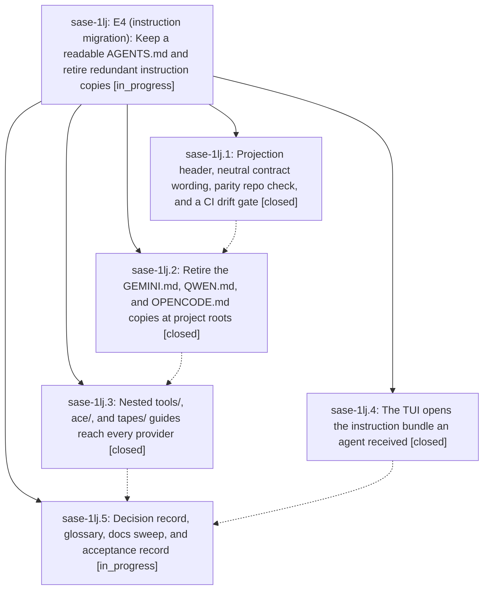

# Bead: sase-1lj — E4 (instruction migration): Keep a readable AGENTS.md and retire redundant instruction copies

[Bead Pages](../README.md) / sase-1lj

**Status:** ◐ in_progress · **Type:** ▸ plan · **Tier:** epic
**Owner:** `bryanbugyi34@gmail.com` · **Created by:** [bbugyi200.athena.10r](https://github.com/sase-org/sase--agents/blob/main/sessions/bbugyi200.athena.10r.md) · **Assignee:** `sase-1lj.land`
**Created:** 2026-10-16 15:15:55 EDT
**Plan:** [202610/e4\_readable\_agents\_md.md](https://github.com/sase-org/sase--plans/blob/main/202610/e4_readable_agents_md.md)

<!-- sase:links:start -->

## Links

| Relation | Artifact | Why |
| --- | --- | --- |
| implemented-by | [plan:202610/e4_readable_agents_md.md][1] | derived from the plan's `bead_id:` frontmatter field |

_Plus 1 automatic references — see [Referenced By](#referenced-by)._

[1]: https://github.com/sase-org/sase--plans/blob/main/202610/e4_readable_agents_md.md

<!-- sase:links:end -->

## Description

The sase repo keeps one full, CI-checked AGENTS.md (plus its CLAUDE.md copy) that people, GitHub readers, and non-SASE tools can read. That file names where it comes from and how to see an agent's real bundle. The GEMINI.md, QWEN.md, and OPENCODE.md copies are retired, and the nested guides reach every provider. The TUI opens the bundle an agent actually received. A new decision record makes this the durable shape of E4.

## Notes

[2026-10-16T22:17:18Z · sase-1li.land] DISCOVERED ISSUE: Relayed from sase-1li.2 note #1 and independently reproduced while landing sase-1li on f3087c86ac: sase memory init --check --diff exits 1, currently listing 8 files (project memory README counts plus 7 home files). The home diff is exactly the neutral file/bundle wording introduced by sase-1lj.1 / 97825eee1d in memory-sase.template.md, propagating into home sase.md, README, and five provider shims. This is causal to readable-projection integration, not closed-bead attach. Old cited task sase-i7 is superseded and explicitly directs recurrence elsewhere; do not reopen that obsolete refresh task. Please finish the authorized projection/home integration and regenerate applicable outputs through the sanctioned repository/memory workflow. No home files changed by this audit.

## Phases

| Bead | Title | Status | Size | Created | Agents | Commits |
|---|---|---|---|---|---:|---:|
| [sase-1lj.1](sase-1lj.1.md) | Projection header, neutral contract wording, parity repo check, and a CI drift gate | ✓ closed | medium | 2026-10-16 | 1 | 1 |
| [sase-1lj.2](sase-1lj.2.md) | Retire the GEMINI.md, QWEN.md, and OPENCODE.md copies at project roots | ✓ closed | medium | 2026-10-16 | 1 | 1 |
| [sase-1lj.3](sase-1lj.3.md) | Nested tools/, ace/, and tapes/ guides reach every provider | ✓ closed | medium | 2026-10-16 | 1 | 1 |
| [sase-1lj.4](sase-1lj.4.md) | The TUI opens the instruction bundle an agent received | ✓ closed | medium | 2026-10-16 | 1 | 1 |
| [sase-1lj.5](sase-1lj.5.md) | Decision record, glossary, docs sweep, and acceptance record | ◐ in_progress | medium | 2026-10-16 | 1 | 0 |

## Lineage

## Agents

| Agent | Bead | Commits |
|---|---|---:|
| [bbugyi200.athena.sase-1lj.1](https://github.com/sase-org/sase--agents/blob/main/agents/bbugyi200.athena.sase-1lj.1/README.md) | [sase-1lj.1](sase-1lj.1.md) | 1 |
| [bbugyi200.athena.sase-1lj.2](https://github.com/sase-org/sase--agents/blob/main/agents/bbugyi200.athena.sase-1lj.2/README.md) | [sase-1lj.2](sase-1lj.2.md) | 1 |
| [bbugyi200.athena.sase-1lj.3](https://github.com/sase-org/sase--agents/blob/main/agents/bbugyi200.athena.sase-1lj.3/README.md) | [sase-1lj.3](sase-1lj.3.md) | 1 |
| [bbugyi200.athena.sase-1lj.4](https://github.com/sase-org/sase--agents/blob/main/agents/bbugyi200.athena.sase-1lj.4/README.md) | [sase-1lj.4](sase-1lj.4.md) | 1 |
| [bbugyi200.athena.sase-1lj.5](https://github.com/sase-org/sase--agents/blob/main/agents/bbugyi200.athena.sase-1lj.5/README.md) | [sase-1lj.5](sase-1lj.5.md) | 0 |
| [bbugyi200.athena.sase-1lj.land](https://github.com/sase-org/sase--agents/blob/main/agents/bbugyi200.athena.sase-1lj.land/README.md) | [sase-1lj](README.md) | 0 |

## Commits

| Repo | Commit | Subject | Bead | Committed |
|---|---|---|---|---|
| sase | [`97825ee`](https://github.com/sase-org/sase/commit/97825eee1d2c9d2db63ab9427d0fe153145a8bd0) | feat(instructions): readable AGENTS.md projection with header, parity check, and CI drift gate | [sase-1lj.1](sase-1lj.1.md) | 2026-10-16 16:07:53 EDT |
| sase | [`552b38f`](https://github.com/sase-org/sase/commit/552b38f7ed078ace50c73e1ca44fe40d4ebd9f51) | feat(tui): open the launched instruction bundle from MEMORY and Files | [sase-1lj.4](sase-1lj.4.md) | 2026-10-16 16:30:26 EDT |
| sase-core | [`sase-core@181072b`](https://github.com/sase-org/sase-core/commit/181072b58e82a92c88f57a3d58952b049a50ddfe) | feat(content-layout): list only AGENTS.md and CLAUDE.md in project agent documents | [sase-1lj.2](sase-1lj.2.md) | 2026-10-16 18:06:18 EDT |
| sase | [`8fde75d`](https://github.com/sase-org/sase/commit/8fde75d7ae6dedce07d38e342d8d974f2cf4b815) | feat(memory): fold nested tools/ace/tapes guides into reference notes | [sase-1lj.3](sase-1lj.3.md) | 2026-10-16 19:28:03 EDT |

<!-- sase:referenced-by:start -->

## Referenced By

| Relation | Artifact | Why | Uses |
| --- | --- | --- | ---: |
| read-by | [agent:sase-1lj.1][1] | parent epic scope | 1 |

[1]: https://github.com/sase-org/sase--agents/blob/main/agents/bbugyi200.athena.sase-1lj.1/README.md

<!-- sase:referenced-by:end -->
