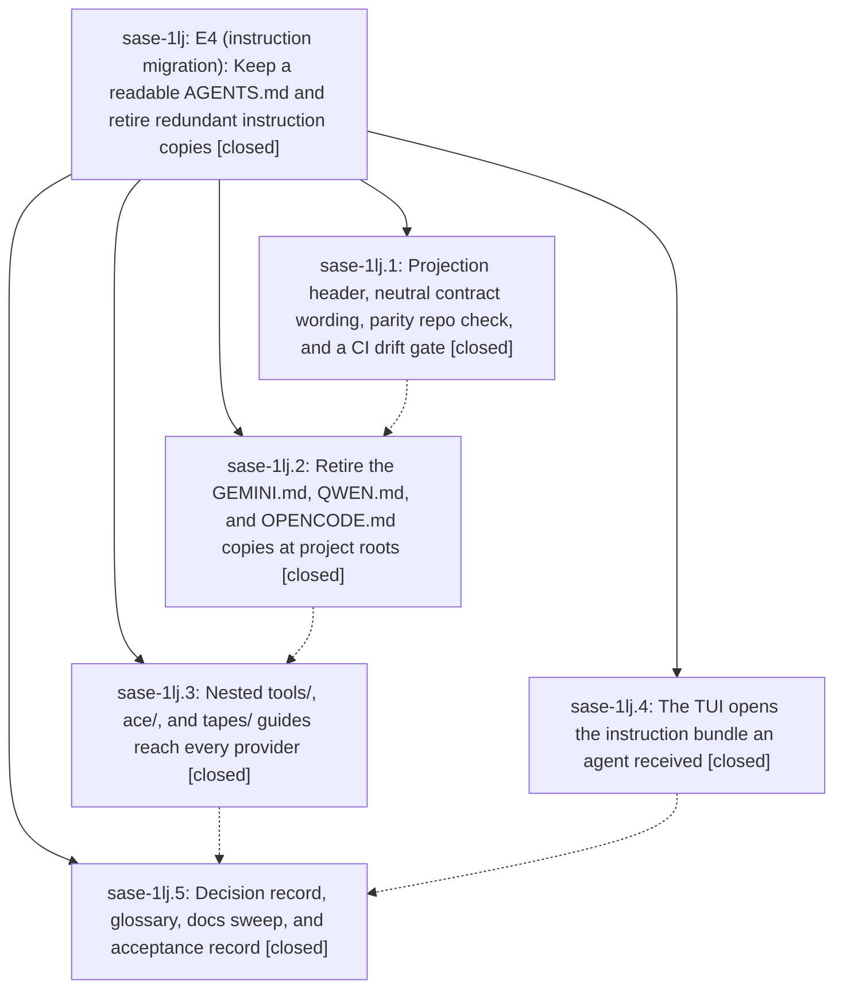

# Bead: sase-1lj — E4 (instruction migration): Keep a readable AGENTS.md and retire redundant instruction copies

[Bead Pages](../README.md) / sase-1lj

**Status:** ✓ closed · **Resolution:** done · **Type:** ▸ plan · **Tier:** epic
**Owner:** `bryanbugyi34@gmail.com` · **Created by:** [bbugyi200.athena.10r](https://github.com/sase-org/sase--agents/blob/main/sessions/bbugyi200.athena.10r.md) · **Assignee:** `sase-1lj.land`
**Created:** 2026-10-16 15:15:55 EDT · **Closed:** 2026-10-16 21:19:43 EDT
**Plan:** [202610/e4\_readable\_agents\_md.md](https://github.com/sase-org/sase--plans/blob/main/202610/e4_readable_agents_md.md)

<!-- sase:links:start -->

## Links

| Relation | Artifact | Why |
| --- | --- | --- |
| implemented-by | [plan:202610/e4_readable_agents_md.md][1] | derived from the plan's `bead_id:` frontmatter field |

_Plus 2 automatic references — see [Referenced By](#referenced-by)._

[1]: https://github.com/sase-org/sase--plans/blob/main/202610/e4_readable_agents_md.md

<!-- sase:links:end -->

## Description

The sase repo keeps one full, CI-checked AGENTS.md (plus its CLAUDE.md copy) that people, GitHub readers, and non-SASE tools can read. That file names where it comes from and how to see an agent's real bundle. The GEMINI.md, QWEN.md, and OPENCODE.md copies are retired, and the nested guides reach every provider. The TUI opens the bundle an agent actually received. A new decision record makes this the durable shape of E4.

## Notes

[2026-10-16T22:17:18Z · sase-1li.land] DISCOVERED ISSUE: Relayed from sase-1li.2 note #1 and independently reproduced while landing sase-1li on f3087c86ac: sase memory init --check --diff exits 1, currently listing 8 files (project memory README counts plus 7 home files). The home diff is exactly the neutral file/bundle wording introduced by sase-1lj.1 / 97825eee1d in memory-sase.template.md, propagating into home sase.md, README, and five provider shims. This is causal to readable-projection integration, not closed-bead attach. Old cited task sase-i7 is superseded and explicitly directs recurrence elsewhere; do not reopen that obsolete refresh task. Please finish the authorized projection/home integration and regenerate applicable outputs through the sanctioned repository/memory workflow. No home files changed by this audit.

[2026-10-16T23:54:17Z · sase-1lj.5] E4 acceptance record: decision+glossary landed, docs swept, verification and failed-criteria handoff

🔒 e4\_acceptance\_record.md

[2026-10-17T00:13:55Z · sase-1lh.7.land] DISCOVERED ISSUE: sase-1lh.7 landing follow-up triage: phase sase-1lh.7.2 #2 requested a Full CI run containing 552b38f7ed instruction-bundle goldens. Full CI 38980994819 at fae5cf5076 includes that commit and visual-test completed red (job 117244671206, 33m21s): archive help still drifts after both recaptures, along with three real-fakey retry images. The four instruction-bundle-specific goldens are not listed among remaining drifts. Please reconcile agents_archive_help_120x40.png with the help changes in 552b38f7ed; inspect actual/expected images before regenerating. Also, .7.2 #4 home-shim drift was the same E4 projection issue already in your note #1; current f6ff20ef2a local init memory --check --diff passes, so no new home-memory task or edits are warranted.

[2026-10-17T00:21:37Z · sase-1lj.land] LAND TRIAGE (sase-1lj.land): PROPOSED FOLLOW-UP outcomes. (1) sase-1lj.2 #2 agy explicit-channel spike -> new task sase-1lz (feature, large; D4 reopen-trigger investigation, out of E4 scope). (2) sase-1lj.2 #3 + sase-1lj.3 #4 project-label audit violation in repair_archived_prompt_path (introduced by a9701c36e6, reproduced on master f6ff20ef2a) -> new task sase-1ly (ci, small), linked related to sase-1k4. (3) sase-1lj.2 #4 revert_agent_git stale-index-lock flake -> +1 on existing sase-1kr (same run_with_git_lock_retry remediation). (4) sase-1lj.3 #3 test_root_help_renders_compact_help -> declined as a new task: caused by 367562ba52 (sase-1le.20.1.15) and already recorded on its active epic sase-1le.20.1. (5) sase-1lj.2 #6/#7, sase-1lj.3 #1/#2, sase-1lj.5 #1/#2, sase-1lj.4 #1 and epic note #1 -> NOT follow-ups: caused by this epic, remaining epic work. Verified on master f6ff20ef2a: 5 instruction files still tracked (root GEMINI/QWEN/OPENCODE), PROVIDER_SHIM_FILES still lists all four, sase-core-revision.txt still 594faf31 while sase-core 181072b5 (pushed) drops the three names, so tests/test_content_layout.py fails locally. Planned as a lander-authored tale. Home drift (note #1): regenerated home files are staged but uncommitted in the chezmoi source since 18:22; sase memory init --check exits 0.

[2026-10-17T01:19:43Z · sase-1lj.land] E4 land complete. Phases 1, 3, 4, and 5 verified in code and commits (97825eee1d, 552b38f7ed, 8fde75d7ae, f6ff20ef2a).

Sase-side shim retirement finished here: PROJECT/HOME/RETIRED/RECOGNIZED provider-shim constants; production routed by include_project_memory (project+nested CLAUDE.md only; home/chezmoi keep four until E5); identical and legacy retired copies deleted through _PlannedDelete; custom retired files kept with a warning and no blocker; tracking, inventory (retired/custom, no missing retired names), history scopes, launch evidence, recognition lists, and tests updated. Root GEMINI.md, QWEN.md, and OPENCODE.md deleted (git status D); instruction-file count 5 → 2 once those deletions are staged. cmp AGENTS.md CLAUDE.md is clean.

Pin moved to 181072b58e82a92c88f57a3d58952b049a50ddfe. tests/test_content_layout.py expects project {AGENTS.md, CLAUDE.md} and home/chezmoi still five names. tools/check_sase_core_rs_bindings passed. sase-core was not changed.

sase memory init --check exits 0. A second sase memory init -C recreates no retired file (chezmoi publish guard still reports the seven staged home files). sase instructions render -p exits 0. sase instructions list shows project/home/chezmoi "all shims" and no missing rows for retired names.

sase tool run check 1e9ef0c0dcdae8fd00dbb47b790602c6: lint/symvision/docs green; scoped tests 10647 passed. Remaining failure: tests/test_project_display_presentation_audit.py::test_project_labels_never_derive_from_paths (task sase-1ly). test_root_help_renders_compact_help did not fail this run. Nested onboarding plural-shim assertion was this work and is fixed. just symvision is clean; no --epic-symbol entries for sase-1lj.

Integration: commits since 97825eee1d only regenerated instruction files, and stale nested-guide and shim references were fixed.

Follow-up triage (already recorded): sase-1lz new (agy explicit-channel spike), sase-1ly new (project-label audit), +1 on sase-1kr (stale-lock flake), root-help declined because it is recorded on sase-1le.20.1.

Chezmoi source still has seven home files staged but uncommitted since 2026-10-16 18:22: home/AGENTS.md.tmpl, home/CLAUDE.md.tmpl, home/GEMINI.md.tmpl, home/QWEN.md.tmpl, home/OPENCODE.md.tmpl, home/sase/memory/README.md, home/sase/memory/sase.md. They hold the sase-1lj.1 neutral-wording regeneration. Human follow-up: commit and apply; this lander did not commit them.

## Attachments

- 🔒 e4\_acceptance\_record.md · text/markdown · 4.37402 KiB (private attachment)

## Phases

| Bead | Title | Status | Size | Created | Agents | Commits |
|---|---|---|---|---|---:|---:|
| [sase-1lj.1](sase-1lj.1.md) | Projection header, neutral contract wording, parity repo check, and a CI drift gate | ✓ closed | medium | 2026-10-16 | 1 | 1 |
| [sase-1lj.2](sase-1lj.2.md) | Retire the GEMINI.md, QWEN.md, and OPENCODE.md copies at project roots | ✓ closed | medium | 2026-10-16 | 1 | 1 |
| [sase-1lj.3](sase-1lj.3.md) | Nested tools/, ace/, and tapes/ guides reach every provider | ✓ closed | medium | 2026-10-16 | 1 | 1 |
| [sase-1lj.4](sase-1lj.4.md) | The TUI opens the instruction bundle an agent received | ✓ closed | medium | 2026-10-16 | 1 | 1 |
| [sase-1lj.5](sase-1lj.5.md) | Decision record, glossary, docs sweep, and acceptance record | ✓ closed | medium | 2026-10-16 | 1 | 1 |

## Lineage

## Agents

| Agent | Bead | Commits |
|---|---|---:|
| [bbugyi200.athena.sase-1lj.1](https://github.com/sase-org/sase--agents/blob/main/agents/bbugyi200.athena.sase-1lj.1/README.md) | [sase-1lj.1](sase-1lj.1.md) | 1 |
| [bbugyi200.athena.sase-1lj.2](https://github.com/sase-org/sase--agents/blob/main/agents/bbugyi200.athena.sase-1lj.2/README.md) | [sase-1lj.2](sase-1lj.2.md) | 1 |
| [bbugyi200.athena.sase-1lj.3](https://github.com/sase-org/sase--agents/blob/main/agents/bbugyi200.athena.sase-1lj.3/README.md) | [sase-1lj.3](sase-1lj.3.md) | 1 |
| [bbugyi200.athena.sase-1lj.4](https://github.com/sase-org/sase--agents/blob/main/agents/bbugyi200.athena.sase-1lj.4/README.md) | [sase-1lj.4](sase-1lj.4.md) | 1 |
| [bbugyi200.athena.sase-1lj.5](https://github.com/sase-org/sase--agents/blob/main/agents/bbugyi200.athena.sase-1lj.5/README.md) | [sase-1lj.5](sase-1lj.5.md) | 1 |
| [bbugyi200.athena.sase-1lj.land](https://github.com/sase-org/sase--agents/blob/main/sessions/bbugyi200.athena.sase-1lj.land.md) | [sase-1lj](README.md) | 2 |

## Commits

| Repo | Commit | Subject | Bead | Committed |
|---|---|---|---|---|
| sase | [`97825ee`](https://github.com/sase-org/sase/commit/97825eee1d2c9d2db63ab9427d0fe153145a8bd0) | feat(instructions): readable AGENTS.md projection with header, parity check, and CI drift gate | [sase-1lj.1](sase-1lj.1.md) | 2026-10-16 16:07:53 EDT |
| sase | [`552b38f`](https://github.com/sase-org/sase/commit/552b38f7ed078ace50c73e1ca44fe40d4ebd9f51) | feat(tui): open the launched instruction bundle from MEMORY and Files | [sase-1lj.4](sase-1lj.4.md) | 2026-10-16 16:30:26 EDT |
| sase-core | [`sase-core@181072b`](https://github.com/sase-org/sase-core/commit/181072b58e82a92c88f57a3d58952b049a50ddfe) | feat(content-layout): list only AGENTS.md and CLAUDE.md in project agent documents | [sase-1lj.2](sase-1lj.2.md) | 2026-10-16 18:06:18 EDT |
| sase | [`8fde75d`](https://github.com/sase-org/sase/commit/8fde75d7ae6dedce07d38e342d8d974f2cf4b815) | feat(memory): fold nested tools/ace/tapes guides into reference notes | [sase-1lj.3](sase-1lj.3.md) | 2026-10-16 19:28:03 EDT |
| sase | [`f6ff20e`](https://github.com/sase-org/sase/commit/f6ff20ef2a68185187e3fcceab2b95529054a9d6) | docs(memory): record E4 readable-AGENTS.md decision, glossary, and acceptance | [sase-1lj.5](sase-1lj.5.md) | 2026-10-16 19:56:12 EDT |
| sase | [`ea84bd8`](https://github.com/sase-org/sase/commit/ea84bd8786dddecc971c46717c5c70edc8771ca5) | feat(amd): retire project-root GEMINI, QWEN, and OPENCODE shims | [sase-1lj](README.md) | 2026-10-16 21:22:14 EDT |
| sase--plans | [`sase--plans@d27510c`](https://github.com/sase-org/sase--plans/commit/d27510c30787054db889ca3f78c6b85ce8a4bf60) | docs(plan): mark E4 readable-agents-md epic done | [sase-1lj](README.md) | 2026-10-16 21:25:46 EDT |

<!-- sase:referenced-by:start -->

## Referenced By

| Relation | Artifact | Why | Uses |
| --- | --- | --- | ---: |
| read-by | [agent:sase-1lj.1][1] | parent epic scope | 1 |
| read-by | [agent:sase-1lj.5][2] | Check epic scope and prior phase completion for record phase | 1 |

[1]: https://github.com/sase-org/sase--agents/blob/main/agents/bbugyi200.athena.sase-1lj.1/README.md
[2]: https://github.com/sase-org/sase--agents/blob/main/agents/bbugyi200.athena.sase-1lj.5/README.md

<!-- sase:referenced-by:end -->
