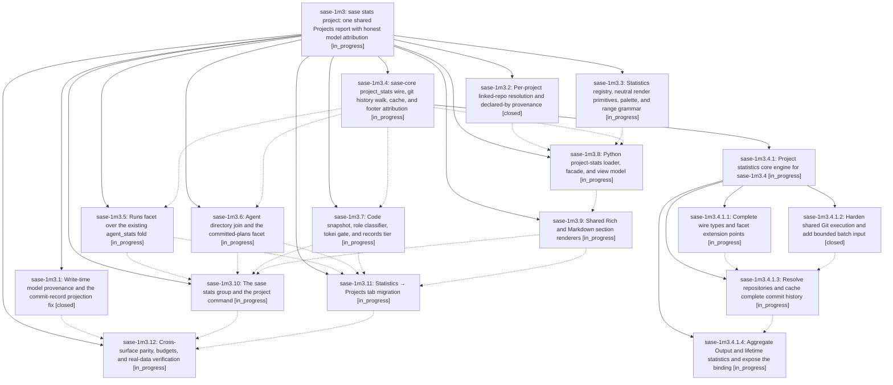

# Bead: sase-1m3 — sase stats project: one shared Projects report with honest model attribution

[Bead Pages](../README.md) / sase-1m3

**Status:** ◐ in_progress · **Type:** ▸ plan · **Tier:** epic
**Owner:** `bryanbugyi34@gmail.com` · **Created by:** [bbugyi200.apollo.research.1s.linker.w0](https://github.com/sase-org/sase--agents/blob/main/sessions/bbugyi200.apollo.research.1s.linker.w0.md) · **Assignee:** `sase-1m3.land`
**Created:** 2026-10-16 22:05:20 EDT
**Plan:** [202610/sase\_stats\_project.md](https://github.com/sase-org/sase--plans/blob/main/202610/sase_stats_project.md)

<!-- sase:links:start -->

## Links

| Relation | Artifact | Why |
| --- | --- | --- |
| implemented-by | [plan:202610/sase_stats_project.md][1] | derived from the plan's `bead_id:` frontmatter field |

[1]: https://github.com/sase-org/sase--plans/blob/main/202610/sase_stats_project.md

<!-- sase:links:end -->

## Description

`sase stats project` and the Admin Center's Statistics → Projects tab render one Rust-backed report through the same loader, view model, legends, and section renderers. The report shows landed commits and committed plans attributed to a provider/model with visible coverage, a lifetime code snapshot, and this machine's agent runs. Every new agent commit and proposed plan records its model at write time.

## Phases

| Bead | Title | Status | Size | Created | Agents | Commits |
|---|---|---|---|---|---:|---:|
| [sase-1m3.1](sase-1m3.1.md) | Write-time model provenance and the commit-record projection fix | ✓ closed | medium | 2026-10-16 | 1 | 2 |
| [sase-1m3.10](sase-1m3.10.md) | The sase stats group and the project command | ◐ in_progress | medium | 2026-10-16 | 1 | 0 |
| [sase-1m3.11](sase-1m3.11.md) | Statistics → Projects tab migration | ◐ in_progress | large | 2026-10-16 | 1 | 0 |
| [sase-1m3.12](sase-1m3.12.md) | Cross-surface parity, budgets, and real-data verification | ◐ in_progress | small | 2026-10-16 | 1 | 0 |
| [sase-1m3.2](sase-1m3.2.md) | Per-project linked-repo resolution and declared-by provenance | ✓ closed | medium | 2026-10-16 | 1 | 1 |
| [sase-1m3.3](sase-1m3.3.md) | Statistics registry, neutral render primitives, palette, and range grammar | ◐ in_progress | medium | 2026-10-16 | 1 | 0 |
| [sase-1m3.4](sase-1m3.4.md) | sase-core project\_stats wire, git history walk, cache, and footer attribution | ◐ in_progress | large | 2026-10-16 | 1 | 0 |
| [sase-1m3.5](sase-1m3.5.md) | Runs facet over the existing agent\_stats fold | ◐ in_progress | small | 2026-10-16 | 1 | 0 |
| [sase-1m3.6](sase-1m3.6.md) | Agent directory join and the committed-plans facet | ◐ in_progress | medium | 2026-10-16 | 1 | 0 |
| [sase-1m3.7](sase-1m3.7.md) | Code snapshot, role classifier, tokei gate, and records tier | ◐ in_progress | large | 2026-10-16 | 1 | 0 |
| [sase-1m3.8](sase-1m3.8.md) | Python project-stats loader, facade, and view model | ◐ in_progress | medium | 2026-10-16 | 1 | 0 |
| [sase-1m3.9](sase-1m3.9.md) | Shared Rich and Markdown section renderers | ◐ in_progress | medium | 2026-10-16 | 1 | 0 |

## Lineage

## Agents

| Agent | Bead | Commits |
|---|---|---:|
| [bbugyi200.apollo.sase-1m3.1](https://github.com/sase-org/sase--agents/blob/main/agents/bbugyi200.apollo.sase-1m3.1/README.md) | [sase-1m3.1](sase-1m3.1.md) | 2 |
| [bbugyi200.apollo.sase-1m3.10](https://github.com/sase-org/sase--agents/blob/main/agents/bbugyi200.apollo.sase-1m3.10/README.md) | [sase-1m3.10](sase-1m3.10.md) | 0 |
| [bbugyi200.apollo.sase-1m3.11](https://github.com/sase-org/sase--agents/blob/main/agents/bbugyi200.apollo.sase-1m3.11/README.md) | [sase-1m3.11](sase-1m3.11.md) | 0 |
| [bbugyi200.apollo.sase-1m3.12](https://github.com/sase-org/sase--agents/blob/main/agents/bbugyi200.apollo.sase-1m3.12/README.md) | [sase-1m3.12](sase-1m3.12.md) | 0 |
| [bbugyi200.apollo.sase-1m3.2](https://github.com/sase-org/sase--agents/blob/main/agents/bbugyi200.apollo.sase-1m3.2/README.md) | [sase-1m3.2](sase-1m3.2.md) | 1 |
| [bbugyi200.apollo.sase-1m3.3](https://github.com/sase-org/sase--agents/blob/main/agents/bbugyi200.apollo.sase-1m3.3/README.md) | [sase-1m3.3](sase-1m3.3.md) | 0 |
| [bbugyi200.apollo.sase-1m3.4](https://github.com/sase-org/sase--agents/blob/main/sessions/bbugyi200.apollo.sase-1m3.4.md) | [sase-1m3.4](sase-1m3.4.md) | 0 |
| [bbugyi200.apollo.sase-1m3.4.1.1](https://github.com/sase-org/sase--agents/blob/main/agents/bbugyi200.apollo.sase-1m3.4.1.1/README.md) | [sase-1m3.4.1.1](sase-1m3.4.1.1.md) | 0 |
| [bbugyi200.apollo.sase-1m3.4.1.2](https://github.com/sase-org/sase--agents/blob/main/agents/bbugyi200.apollo.sase-1m3.4.1.2/README.md) | [sase-1m3.4.1.2](sase-1m3.4.1.2.md) | 1 |
| [bbugyi200.apollo.sase-1m3.4.1.3](https://github.com/sase-org/sase--agents/blob/main/agents/bbugyi200.apollo.sase-1m3.4.1.3/README.md) | [sase-1m3.4.1.3](sase-1m3.4.1.3.md) | 0 |
| [bbugyi200.apollo.sase-1m3.4.1.4](https://github.com/sase-org/sase--agents/blob/main/agents/bbugyi200.apollo.sase-1m3.4.1.4/README.md) | [sase-1m3.4.1.4](sase-1m3.4.1.4.md) | 0 |
| [bbugyi200.apollo.sase-1m3.4.1.land](https://github.com/sase-org/sase--agents/blob/main/agents/bbugyi200.apollo.sase-1m3.4.1.land/README.md) | [sase-1m3.4.1](sase-1m3.4.1.md) | 0 |
| [bbugyi200.apollo.sase-1m3.5](https://github.com/sase-org/sase--agents/blob/main/agents/bbugyi200.apollo.sase-1m3.5/README.md) | [sase-1m3.5](sase-1m3.5.md) | 0 |
| [bbugyi200.apollo.sase-1m3.6](https://github.com/sase-org/sase--agents/blob/main/agents/bbugyi200.apollo.sase-1m3.6/README.md) | [sase-1m3.6](sase-1m3.6.md) | 0 |
| [bbugyi200.apollo.sase-1m3.7](https://github.com/sase-org/sase--agents/blob/main/agents/bbugyi200.apollo.sase-1m3.7/README.md) | [sase-1m3.7](sase-1m3.7.md) | 0 |
| [bbugyi200.apollo.sase-1m3.8](https://github.com/sase-org/sase--agents/blob/main/agents/bbugyi200.apollo.sase-1m3.8/README.md) | [sase-1m3.8](sase-1m3.8.md) | 0 |
| [bbugyi200.apollo.sase-1m3.9](https://github.com/sase-org/sase--agents/blob/main/agents/bbugyi200.apollo.sase-1m3.9/README.md) | [sase-1m3.9](sase-1m3.9.md) | 0 |
| [bbugyi200.apollo.sase-1m3.land](https://github.com/sase-org/sase--agents/blob/main/agents/bbugyi200.apollo.sase-1m3.land/README.md) | [sase-1m3](README.md) | 0 |

## Commits

| Repo | Commit | Subject | Bead | Committed |
|---|---|---|---|---|
| sase-core | [`sase-core@ac37073`](https://github.com/sase-org/sase-core/commit/ac370734cb939a4930c6126ea93046ba2dda6613) | feat(file\_history): scrub git routing env and add bounded batch stdin | [sase-1m3.4.1.2](sase-1m3.4.1.2.md) | 2026-10-16 23:03:57 EDT |
| sase | [`7c6b324`](https://github.com/sase-org/sase/commit/7c6b32457bdc26d6dda8362c93774b17c5550c23) | feat(repo): resolve linked repo config by target path | [sase-1m3.2](sase-1m3.2.md) | 2026-10-16 23:06:03 EDT |
| sase-core | [`sase-core@305b7b8`](https://github.com/sase-org/sase-core/commit/305b7b808ae17e325cc1aa45299514f6c265202e) | feat(plan): validate proposed\_with provenance | [sase-1m3.1](sase-1m3.1.md) | 2026-10-16 23:08:30 EDT |
| sase | [`7545e85`](https://github.com/sase-org/sase/commit/7545e85abf213f9db7ca60a517ac82c8ab26383e) | feat(provenance): stamp model attribution and fix commit metadata | [sase-1m3.1](sase-1m3.1.md) | 2026-10-16 23:13:47 EDT |
