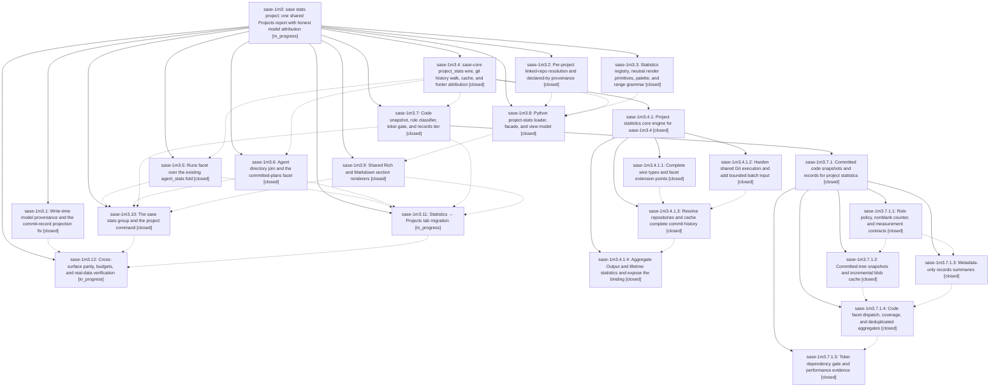

# Bead: sase-1m3 — sase stats project: one shared Projects report with honest model attribution

[Bead Pages](../README.md) / sase-1m3

**Status:** ◐ in_progress · **Type:** ▸ plan · **Tier:** epic
**Owner:** `bryanbugyi34@gmail.com` · **Created by:** [bbugyi200.apollo.research.1s.linker.w0](https://github.com/sase-org/sase--agents/blob/main/sessions/bbugyi200.apollo.research.1s.linker.w0.md) · **Assignee:** `sase-1m3.land`
**Created:** 2026-10-16 22:05:20 EDT
**Plan:** [202610/sase\_stats\_project.md](https://github.com/sase-org/sase--plans/blob/main/202610/sase_stats_project.md)

<!-- sase:links:start -->

## Links

| Relation | Artifact | Why |
| --- | --- | --- |
| implemented-by | [plan:202610/sase_stats_project.md][1] | derived from the plan's `bead_id:` frontmatter field |

_Plus 5 automatic references — see [Referenced By](#referenced-by)._

[1]: https://github.com/sase-org/sase--plans/blob/main/202610/sase_stats_project.md

<!-- sase:links:end -->

## Description

`sase stats project` and the Admin Center's Statistics → Projects tab render one Rust-backed report through the same loader, view model, legends, and section renderers. The report shows landed commits and committed plans attributed to a provider/model with visible coverage, a lifetime code snapshot, and this machine's agent runs. Every new agent commit and proposed plan records its model at write time.

## Notes

[2026-10-17T04:15:13Z · sase-1lh.7.5.4.land] DISCOVERED ISSUE: sase-1lh.7.5.4 landing at 28ced2a125 reproduced 15 deterministic failures in 13.25s (32 passed), matching Master Gate 38999581980 and 39000343130. Commit 7545e85abf changed commit metadata to accept 7-40 hex SHAs; tests/test_done_agent_loader.py (7 nodes), tests/test_axe_run_agent_exec_finalize_attachments.py::test_finalize_loop_legacy_commit_metadata_scans_workspace_head and tests/test_bead/test_bead_page_publication.py::test_sidecar_publication_anchors_associations_and_commit_links_to_primary still use old output/invalid SHA fixtures. Its resolve_turn_model_label also produces mypy object-to-str assignment errors at identity.py:183-184 (now 200-201). Commit 7c6b32457b changed resolution_config to load_merged_config_for_local_path; tests/main/test_repo_path.py (2 legacy nodes), test_workspace_handler_project_resolution.py (4 nodes), and CI test_workspace_handler_list_path.py::TestList::test_json_list_includes_registered_workspace still depend on the former mocked/cwd config seam. These are causally owned by .1/.2, not new tasks. Release landing needs these gates reconciled; a bounded release-integration plan will adopt remaining fixes after checking concurrent changes.

[2026-10-17T04:52:28Z · sase-1lh.7.5.4.3.1] sase-1lh.7.5.4.3.1 adopted remaining .1/.2 Master Gate fixtures: 7-40 hex SHA fixtures, git SHA strip, identity.py typed candidates, project-local sase.yml via write_project_local_config (keeps load_merged_config_for_local_path isolation), schema_version 3 beads store record, and research availability on in_tree/local/separate_repo. Do not repeat these as remaining .1/.2 work.

[2026-10-18T22:50:51Z · sase-1m3.7.1.land] DISCOVERED ISSUE (routed by sase-1m3.7.1 land from sase-1m3.7.1.5 note #6 / sase-1m3.7 notes #2,#4; belongs with budgets phase sase-1m3.12): Project Code runtime misses two parent-design budgets. Release binding on sase tree c4299924ba07377277914e4c7b6304b3f1ec90e7 (14,477 tracked / 12,432 code files, core b8737fa5, tokei SLOC): cold 7.628 s vs <=5 s (fixture 6.397-8.571 s); warm after one commit 0.922 s vs <0.5 s; same-tip 37.187 ms meets <150 ms. Audit: 13,249 unique cold blob reads, zero same-tip, exactly one changed-tip blob, changed result == cold. Instrumented changed-tip Git time 0.575 s = ls-tree 0.177 s + committed check-attr 0.336 s + cat-file 0.005 s; host load 12-14 on 16 vCPU. Nonblank baseline also missed changed-tip (0.616 s), so the tokei adoption is not the cause. Concrete leads: (1) on a cached-tree transition use 'git diff-tree -r -z <cached_tree> <new_tree>' and only re-run check-attr for changed paths when no .gitattributes blob changed, instead of a full ls-tree + full check-attr; (2) parallelize cold per-blob classification/counting; (3) the sase-1m3.7.1 landing tale fixes the per-blob cache growing forever and the double BlobEvidence scan, both of which add to warm/cold cost. Evidence: report file:explicit:f8fc12f54cb3f9b647451035, bundle file:explicit:cf0a3ec863e10c52c0785b78. Not filed as a separate task because the approved plan sends unresolved budget misses to the outer epic's land agent, and sase-1m3.12 owns measuring budgets.

## References

- file:explicit:7a86bb9a4fdfa3b2768be6c1

## Phases

| Bead | Title | Status | Size | Created | Agents | Commits |
|---|---|---|---|---|---:|---:|
| [sase-1m3.1](sase-1m3.1.md) | Write-time model provenance and the commit-record projection fix | ✓ closed | medium | 2026-10-16 | 1 | 2 |
| [sase-1m3.10](sase-1m3.10.md) | The sase stats group and the project command | ✓ closed | medium | 2026-10-16 | 1 | 1 |
| [sase-1m3.11](sase-1m3.11.md) | Statistics → Projects tab migration | ◐ in_progress | large | 2026-10-16 | 1 | 1 |
| [sase-1m3.12](sase-1m3.12.md) | Cross-surface parity, budgets, and real-data verification | ◐ in_progress | small | 2026-10-16 | 1 | 0 |
| [sase-1m3.2](sase-1m3.2.md) | Per-project linked-repo resolution and declared-by provenance | ✓ closed | medium | 2026-10-16 | 1 | 1 |
| [sase-1m3.3](sase-1m3.3.md) | Statistics registry, neutral render primitives, palette, and range grammar | ✓ closed | medium | 2026-10-16 | 1 | 1 |
| [sase-1m3.4](sase-1m3.4.md) | sase-core project\_stats wire, git history walk, cache, and footer attribution | ✓ closed | large | 2026-10-16 | 1 | 0 |
| [sase-1m3.5](sase-1m3.5.md) | Runs facet over the existing agent\_stats fold | ✓ closed | small | 2026-10-16 | 1 | 2 |
| [sase-1m3.6](sase-1m3.6.md) | Agent directory join and the committed-plans facet | ✓ closed | medium | 2026-10-16 | 1 | 1 |
| [sase-1m3.7](sase-1m3.7.md) | Code snapshot, role classifier, tokei gate, and records tier | ✓ closed | large | 2026-10-16 | 1 | 0 |
| [sase-1m3.8](sase-1m3.8.md) | Python project-stats loader, facade, and view model | ✓ closed | medium | 2026-10-16 | 1 | 0 |
| [sase-1m3.9](sase-1m3.9.md) | Shared Rich and Markdown section renderers | ✓ closed | medium | 2026-10-16 | 1 | 1 |

## Lineage

## Agents

| Agent | Bead | Commits |
|---|---|---:|
| [bbugyi200.apollo.sase-1m3.1](https://github.com/sase-org/sase--agents/blob/main/agents/bbugyi200.apollo.sase-1m3.1/README.md) | [sase-1m3.1](sase-1m3.1.md) | 2 |
| [bbugyi200.apollo.sase-1m3.10](https://github.com/sase-org/sase--agents/blob/main/agents/bbugyi200.apollo.sase-1m3.10/README.md) | [sase-1m3.10](sase-1m3.10.md) | 1 |
| [bbugyi200.apollo.sase-1m3.11](https://github.com/sase-org/sase--agents/blob/main/sessions/bbugyi200.apollo.sase-1m3.11.md) | [sase-1m3.11](sase-1m3.11.md) | 1 |
| [bbugyi200.apollo.sase-1m3.12](https://github.com/sase-org/sase--agents/blob/main/agents/bbugyi200.apollo.sase-1m3.12/README.md) | [sase-1m3.12](sase-1m3.12.md) | 0 |
| [bbugyi200.apollo.sase-1m3.2](https://github.com/sase-org/sase--agents/blob/main/agents/bbugyi200.apollo.sase-1m3.2/README.md) | [sase-1m3.2](sase-1m3.2.md) | 1 |
| [bbugyi200.apollo.sase-1m3.3](https://github.com/sase-org/sase--agents/blob/main/agents/bbugyi200.apollo.sase-1m3.3/README.md) | [sase-1m3.3](sase-1m3.3.md) | 1 |
| [bbugyi200.apollo.sase-1m3.4](https://github.com/sase-org/sase--agents/blob/main/sessions/bbugyi200.apollo.sase-1m3.4.md) | [sase-1m3.4](sase-1m3.4.md) | 0 |
| [bbugyi200.apollo.sase-1m3.4.1.1](https://github.com/sase-org/sase--agents/blob/main/sessions/bbugyi200.apollo.sase-1m3.4.1.1.md) | [sase-1m3.4.1.1](sase-1m3.4.1.1.md) | 1 |
| [bbugyi200.apollo.sase-1m3.4.1.2](https://github.com/sase-org/sase--agents/blob/main/agents/bbugyi200.apollo.sase-1m3.4.1.2/README.md) | [sase-1m3.4.1.2](sase-1m3.4.1.2.md) | 1 |
| [bbugyi200.apollo.sase-1m3.4.1.3](https://github.com/sase-org/sase--agents/blob/main/agents/bbugyi200.apollo.sase-1m3.4.1.3/README.md) | [sase-1m3.4.1.3](sase-1m3.4.1.3.md) | 1 |
| [bbugyi200.apollo.sase-1m3.4.1.4](https://github.com/sase-org/sase--agents/blob/main/agents/bbugyi200.apollo.sase-1m3.4.1.4/README.md) | [sase-1m3.4.1.4](sase-1m3.4.1.4.md) | 1 |
| [bbugyi200.apollo.sase-1m3.4.1.land](https://github.com/sase-org/sase--agents/blob/main/sessions/bbugyi200.apollo.sase-1m3.4.1.land.md) | [sase-1m3.4.1](sase-1m3.4.1.md) | 2 |
| [bbugyi200.apollo.sase-1m3.5](https://github.com/sase-org/sase--agents/blob/main/agents/bbugyi200.apollo.sase-1m3.5/README.md) | [sase-1m3.5](sase-1m3.5.md) | 2 |
| [bbugyi200.apollo.sase-1m3.6](https://github.com/sase-org/sase--agents/blob/main/agents/bbugyi200.apollo.sase-1m3.6/README.md) | [sase-1m3.6](sase-1m3.6.md) | 1 |
| [bbugyi200.apollo.sase-1m3.7](https://github.com/sase-org/sase--agents/blob/main/sessions/bbugyi200.apollo.sase-1m3.7.md) | [sase-1m3.7](sase-1m3.7.md) | 0 |
| [bbugyi200.apollo.sase-1m3.7.1.1](https://github.com/sase-org/sase--agents/blob/main/agents/bbugyi200.apollo.sase-1m3.7.1.1/README.md) | [sase-1m3.7.1.1](sase-1m3.7.1.1.md) | 1 |
| [bbugyi200.apollo.sase-1m3.7.1.2](https://github.com/sase-org/sase--agents/blob/main/sessions/bbugyi200.apollo.sase-1m3.7.1.2.md) | [sase-1m3.7.1.2](sase-1m3.7.1.2.md) | 1 |
| [bbugyi200.apollo.sase-1m3.7.1.3](https://github.com/sase-org/sase--agents/blob/main/agents/bbugyi200.apollo.sase-1m3.7.1.3/README.md) | [sase-1m3.7.1.3](sase-1m3.7.1.3.md) | 1 |
| [bbugyi200.apollo.sase-1m3.7.1.4](https://github.com/sase-org/sase--agents/blob/main/agents/bbugyi200.apollo.sase-1m3.7.1.4/README.md) | [sase-1m3.7.1.4](sase-1m3.7.1.4.md) | 1 |
| [bbugyi200.apollo.sase-1m3.7.1.5](https://github.com/sase-org/sase--agents/blob/main/sessions/bbugyi200.apollo.sase-1m3.7.1.5.md) | [sase-1m3.7.1.5](sase-1m3.7.1.5.md) | 2 |
| [bbugyi200.apollo.sase-1m3.7.1.land](https://github.com/sase-org/sase--agents/blob/main/sessions/bbugyi200.apollo.sase-1m3.7.1.land.md) | [sase-1m3.7.1](sase-1m3.7.1.md) | 3 |
| [bbugyi200.apollo.sase-1m3.8](https://github.com/sase-org/sase--agents/blob/main/sessions/bbugyi200.apollo.sase-1m3.8.md) | [sase-1m3.8](sase-1m3.8.md) | 0 |
| [bbugyi200.apollo.sase-1m3.9](https://github.com/sase-org/sase--agents/blob/main/sessions/bbugyi200.apollo.sase-1m3.9.md) | [sase-1m3.9](sase-1m3.9.md) | 1 |
| [bbugyi200.apollo.sase-1m3.land](https://github.com/sase-org/sase--agents/blob/main/agents/bbugyi200.apollo.sase-1m3.land/README.md) | [sase-1m3](README.md) | 0 |

## Commits

| Repo | Commit | Subject | Bead | Committed |
|---|---|---|---|---|
| sase-core | [`sase-core@ac37073`](https://github.com/sase-org/sase-core/commit/ac370734cb939a4930c6126ea93046ba2dda6613) | feat(file\_history): scrub git routing env and add bounded batch stdin | [sase-1m3.4.1.2](sase-1m3.4.1.2.md) | 2026-10-16 23:03:57 EDT |
| sase | [`7c6b324`](https://github.com/sase-org/sase/commit/7c6b32457bdc26d6dda8362c93774b17c5550c23) | feat(repo): resolve linked repo config by target path | [sase-1m3.2](sase-1m3.2.md) | 2026-10-16 23:06:03 EDT |
| sase-core | [`sase-core@305b7b8`](https://github.com/sase-org/sase-core/commit/305b7b808ae17e325cc1aa45299514f6c265202e) | feat(plan): validate proposed\_with provenance | [sase-1m3.1](sase-1m3.1.md) | 2026-10-16 23:08:30 EDT |
| sase | [`7545e85`](https://github.com/sase-org/sase/commit/7545e85abf213f9db7ca60a517ac82c8ab26383e) | feat(provenance): stamp model attribution and fix commit metadata | [sase-1m3.1](sase-1m3.1.md) | 2026-10-16 23:13:47 EDT |
| sase-core | [`sase-core@b0cd62b`](https://github.com/sase-org/sase-core/commit/b0cd62b931d9d637a3fa9ede1e7d5b2cf9cf02eb) | feat(project-stats): add wire contracts and facet seams | [sase-1m3.4.1.1](sase-1m3.4.1.1.md) | 2026-10-16 23:32:49 EDT |
| sase-core | [`sase-core@855ed4c`](https://github.com/sase-org/sase-core/commit/855ed4c3788f6564c9a00a8838ae005aed882bcc) | feat(project-stats): cache complete repository history | [sase-1m3.4.1.3](sase-1m3.4.1.3.md) | 2026-10-17 00:04:23 EDT |
| sase-core | [`sase-core@be2bfbe`](https://github.com/sase-org/sase-core/commit/be2bfbee126354e387e093bbbdb37c9b2ad35114) | feat(project-stats): aggregate Output and expose project\_stats\_query | [sase-1m3.4.1.4](sase-1m3.4.1.4.md) | 2026-10-17 01:38:02 EDT |
| sase-core | [`sase-core@8df5efd`](https://github.com/sase-org/sase-core/commit/8df5efda95b48fdb7e23d9ca3c66fc8a92118235) | fix(project-stats)!: distinguish unavailable counts from measured zeros | [sase-1m3.4.1](sase-1m3.4.1.md) | 2026-10-17 03:26:33 EDT |
| sase--plans | [`sase--plans@1d0f2d0`](https://github.com/sase-org/sase--plans/commit/1d0f2d04bc800b1fa0e2570f4acccd5a25ad4651) | chore(plans): mark project\_stats core engine and landing tales done | [sase-1m3.4.1](sase-1m3.4.1.md) | 2026-10-17 03:30:31 EDT |
| sase-core | [`sase-core@7dc6f6c`](https://github.com/sase-org/sase-core/commit/7dc6f6ce25d5f76f4f9c07e7be427884a70c5784) | feat(project-stats): fill the Runs facet from agent\_stats | [sase-1m3.5](sase-1m3.5.md) | 2026-10-17 04:57:04 EDT |
| sase-core | [`sase-core@da22713`](https://github.com/sase-org/sase-core/commit/da22713e71a91545c0e48eb2e16797c7165d115b) | fix: restore a green sase-core check | [sase-1m3.5](sase-1m3.5.md) | 2026-10-17 05:05:20 EDT |
| sase | [`c68a303`](https://github.com/sase-org/sase/commit/c68a30365f616b8096e5e7ff02cd5e0b43cbca20) | feat(stats): extract Statistics registry, loader, palette, and range parser | [sase-1m3.3](sase-1m3.3.md) | 2026-10-17 05:29:02 EDT |
| sase-core | [`sase-core@df833a0`](https://github.com/sase-org/sase-core/commit/df833a04beaa4205620a75f0b2a11c1fc89a9db4) | feat(project-stats): add classifier, nonblank counter, and wire contracts | [sase-1m3.7.1.1](sase-1m3.7.1.1.md) | 2026-10-17 07:54:34 EDT |
| sase-core | [`sase-core@9c16796`](https://github.com/sase-org/sase-core/commit/9c16796d7d9052a9d5b1fa1d5732a70c41f234cc) | feat(project-stats): add metadata-only records snapshots | [sase-1m3.7.1.3](sase-1m3.7.1.3.md) | 2026-10-17 08:29:41 EDT |
| sase-core | [`sase-core@7a46109`](https://github.com/sase-org/sase-core/commit/7a46109f2abf81d5251334088331f1ef96c917ae) | feat(project-stats): join the agent directory and count committed plans | [sase-1m3.6](sase-1m3.6.md) | 2026-10-17 08:43:14 EDT |
| sase-core | [`sase-core@733256e`](https://github.com/sase-org/sase-core/commit/733256ede964bc99e46f8ce7faffb690df0c6a49) | feat(project-stats): add committed-tree code snapshots and incremental blob cache | [sase-1m3.7.1.2](sase-1m3.7.1.2.md) | 2026-10-17 09:44:30 EDT |
| sase-core | [`sase-core@99b10bd`](https://github.com/sase-org/sase-core/commit/99b10bd06212cb2e00d5e78433d0140591cd8cc5) | feat(stats): populate Code facet with identity-deduplicated snapshots | [sase-1m3.7.1.4](sase-1m3.7.1.4.md) | 2026-10-18 08:42:53 EDT |
| sase-core | [`sase-core@b8737fa`](https://github.com/sase-org/sase-core/commit/b8737fa56f9367f60f28ecd35cfd8bc9369efb27) | feat(stats): count committed source lines with tokei | [sase-1m3.7.1.5](sase-1m3.7.1.5.md) | 2026-10-18 18:14:45 EDT |
| sase | [`5fe54b5`](https://github.com/sase-org/sase/commit/5fe54b59745c9351702b8df667eb99fc927e8911) | feat(stats): advance core pin for measured SLOC snapshots | [sase-1m3.7.1.5](sase-1m3.7.1.5.md) | 2026-10-18 18:20:26 EDT |
| sase-core | [`sase-core@6a626d1`](https://github.com/sase-org/sase-core/commit/6a626d10091dd3888973d77dd2b55a92d8cd41f9) | fix(project-stats): complete classifier and snapshot landing | [sase-1m3.7.1](sase-1m3.7.1.md) | 2026-10-18 21:27:23 EDT |
| sase | [`dd963c0`](https://github.com/sase-org/sase/commit/dd963c0fa64ab25beeaf84ac8e9d073bbb518c91) | fix(stats): align project code counter with SLOC | [sase-1m3.7.1](sase-1m3.7.1.md) | 2026-10-18 21:32:50 EDT |
| sase--plans | [`sase--plans@b0dac8f`](https://github.com/sase-org/sase--plans/commit/b0dac8fe62572f4f659225ee43bc083c8ea51d2c) | docs(plan): mark project stats plan done | [sase-1m3.7.1](sase-1m3.7.1.md) | 2026-10-18 21:36:22 EDT |
| sase | [`9c4c262`](https://github.com/sase-org/sase/commit/9c4c262559b566309111ca8a37c18d83a62aff26) | feat(stats): add shared Rich and Markdown Projects section renderers | [sase-1m3.9](sase-1m3.9.md) | 2026-10-19 08:50:34 EDT |
| sase | [`a53f10f`](https://github.com/sase-org/sase/commit/a53f10f6a6ce1103dfe7ce30653ba6712ed24478) | feat(stats): add sase stats project CLI | [sase-1m3.10](sase-1m3.10.md) | 2026-10-19 12:23:58 EDT |
| sase | [`0f2052b`](https://github.com/sase-org/sase/commit/0f2052be6a375357e7918fdea02d68032eae9326) | feat(tui): migrate Statistics Projects tab to shared report | [sase-1m3.11](sase-1m3.11.md) | 2026-10-19 13:09:08 EDT |

<!-- sase:referenced-by:start -->

## Referenced By

| Relation | Artifact | Why | Uses |
| --- | --- | --- | ---: |
| read-by | [agent:8k--1][1] | Confirm completed loader phase closure and unchanged open parent before finalization | 1 |
| read-by | [agent:sase-1lh.7.5.4.3.1][2] | Need sase-1m3 notes so adopted fixture/config fixes can be recorded without duplicating its lander | 2 |
| read-by | [agent:sase-1m3.3][3] | Need parent epic DECISIONS, phases, and design | 2 |
| read-by | [agent:sase-1m3.6][4] | Need parent epic plan and predecessor phase scope | 1 |
| read-by | [agent:sase-1m3.7.1.land--2][5] | Final verification that only the assigned phase closed and the outer epic remains active | 2 |

[1]: https://github.com/sase-org/sase--agents/blob/main/sessions/bbugyi200.apollo.8k.md
[2]: https://github.com/sase-org/sase--agents/blob/main/agents/bbugyi200.apollo.sase-1lh.7.5.4.3.1/README.md
[3]: https://github.com/sase-org/sase--agents/blob/main/agents/bbugyi200.apollo.sase-1m3.3/README.md
[4]: https://github.com/sase-org/sase--agents/blob/main/agents/bbugyi200.apollo.sase-1m3.6/README.md
[5]: https://github.com/sase-org/sase--agents/blob/main/sessions/bbugyi200.apollo.sase-1m3.7.1.land.md

<!-- sase:referenced-by:end -->
