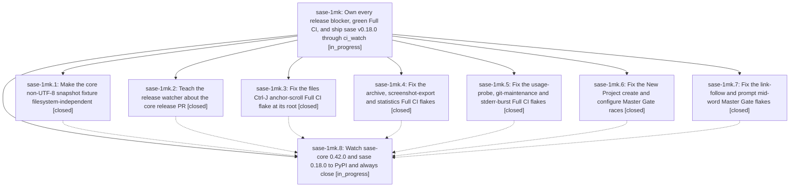

# Bead: sase-1mk — Own every release blocker, green Full CI, and ship sase v0.18.0 through ci\_watch

[Bead Pages](../README.md) / sase-1mk

**Status:** ◐ in_progress · **Type:** ▸ plan · **Tier:** epic
**Owner:** `bryanbugyi34@gmail.com` · **Created by:** [bbugyi200.athena.11b](https://github.com/sase-org/sase--agents/blob/main/sessions/bbugyi200.athena.11b.md) · **Assignee:** `sase-1mk.land`
**Created:** 2026-10-18 09:58:28 EDT
**Plan:** [202610/ship\_v0\_18\_0\_owned\_blockers.md](https://github.com/sase-org/sase--plans/blob/main/202610/ship_v0_18_0_owned_blockers.md)

<!-- sase:links:start -->

## Links

| Relation | Artifact | Why |
| --- | --- | --- |
| implemented-by | [plan:202610/ship_v0_18_0_owned_blockers.md][1] | derived from the plan's `bead_id:` frontmatter field |

_Plus 2 automatic references — see [Referenced By](#referenced-by)._

[1]: https://github.com/sase-org/sase--plans/blob/main/202610/ship_v0_18_0_owned_blockers.md

<!-- sase:links:end -->

## Description

sase 0.18.0 is on PyPI, published from release-please PR #299 after ci_watch merged it on a green Master Gate and a fresh green Full CI, with sase-core-rs 0.42.0 published as its core floor. The release is confirmed before landing and recorded in an evidence artifact by the final epic lander.

## Phases

| Bead | Title | Status | Size | Created | Agents | Commits |
|---|---|---|---|---|---:|---:|
| [sase-1mk.1](sase-1mk.1.md) | Make the core non-UTF-8 snapshot fixture filesystem-independent | ✓ closed | small | 2026-10-18 | 1 | 1 |
| [sase-1mk.2](sase-1mk.2.md) | Teach the release watcher about the core release PR | ✓ closed | medium | 2026-10-18 | 1 | 1 |
| [sase-1mk.3](sase-1mk.3.md) | Fix the files Ctrl-J anchor-scroll Full CI flake at its root | ✓ closed | medium | 2026-10-18 | 1 | 1 |
| [sase-1mk.4](sase-1mk.4.md) | Fix the archive, screenshot-export and statistics Full CI flakes | ✓ closed | medium | 2026-10-18 | 1 | 1 |
| [sase-1mk.5](sase-1mk.5.md) | Fix the usage-probe, git-maintenance and stderr-burst Full CI flakes | ✓ closed | medium | 2026-10-18 | 1 | 1 |
| [sase-1mk.6](sase-1mk.6.md) | Fix the New Project create and configure Master Gate races | ✓ closed | medium | 2026-10-18 | 1 | 1 |
| [sase-1mk.7](sase-1mk.7.md) | Fix the link-follow and prompt mid-word Master Gate flakes | ✓ closed | medium | 2026-10-18 | 1 | 1 |
| [sase-1mk.8](sase-1mk.8.md) | Watch sase-core 0.42.0 and sase 0.18.0 to PyPI and always close | ◐ in_progress | small | 2026-10-18 | 1 | 0 |

## Lineage

## Agents

| Agent | Bead | Commits |
|---|---|---:|
| [bbugyi200.athena.sase-1mk.1](https://github.com/sase-org/sase--agents/blob/main/agents/bbugyi200.athena.sase-1mk.1/README.md) | [sase-1mk.1](sase-1mk.1.md) | 1 |
| [bbugyi200.athena.sase-1mk.2](https://github.com/sase-org/sase--agents/blob/main/agents/bbugyi200.athena.sase-1mk.2/README.md) | [sase-1mk.2](sase-1mk.2.md) | 1 |
| [bbugyi200.athena.sase-1mk.3](https://github.com/sase-org/sase--agents/blob/main/agents/bbugyi200.athena.sase-1mk.3/README.md) | [sase-1mk.3](sase-1mk.3.md) | 1 |
| [bbugyi200.athena.sase-1mk.4](https://github.com/sase-org/sase--agents/blob/main/agents/bbugyi200.athena.sase-1mk.4/README.md) | [sase-1mk.4](sase-1mk.4.md) | 1 |
| [bbugyi200.athena.sase-1mk.5](https://github.com/sase-org/sase--agents/blob/main/agents/bbugyi200.athena.sase-1mk.5/README.md) | [sase-1mk.5](sase-1mk.5.md) | 1 |
| [bbugyi200.athena.sase-1mk.6](https://github.com/sase-org/sase--agents/blob/main/sessions/bbugyi200.athena.sase-1mk.6.md) | [sase-1mk.6](sase-1mk.6.md) | 1 |
| [bbugyi200.athena.sase-1mk.7](https://github.com/sase-org/sase--agents/blob/main/agents/bbugyi200.athena.sase-1mk.7/README.md) | [sase-1mk.7](sase-1mk.7.md) | 1 |
| [bbugyi200.athena.sase-1mk.8](https://github.com/sase-org/sase--agents/blob/main/agents/bbugyi200.athena.sase-1mk.8/README.md) | [sase-1mk.8](sase-1mk.8.md) | 0 |
| [bbugyi200.athena.sase-1mk.land](https://github.com/sase-org/sase--agents/blob/main/agents/bbugyi200.athena.sase-1mk.land/README.md) | [sase-1mk](README.md) | 0 |

## Commits

| Repo | Commit | Subject | Bead | Committed |
|---|---|---|---|---|
| sase-core | [`sase-core@80dc704`](https://github.com/sase-org/sase-core/commit/80dc704a4f2e1f640f7caa9e578957669c31367d) | test(project-stats): stage non-UTF-8 snapshot fixture path in the Git index only | [sase-1mk.1](sase-1mk.1.md) | 2026-10-18 10:16:36 EDT |
| sase | [`7dd39ff`](https://github.com/sase-org/sase/commit/7dd39ff95f7720417fe021307673bb439aed7742) | fix(ace): defer Files spread scroll until layout settles | [sase-1mk.3](sase-1mk.3.md) | 2026-10-18 11:08:45 EDT |
| sase | [`f1c20a9`](https://github.com/sase-org/sase/commit/f1c20a9f6b729aebbf47246294fe4185b4392ea2) | fix(tests): remove timing races from the usage-probe, git-maintenance and stderr-burst flakes | [sase-1mk.5](sase-1mk.5.md) | 2026-10-18 11:10:24 EDT |
| sase | [`3b78c03`](https://github.com/sase-org/sase/commit/3b78c034416896078989ebf6274034223ff00d16) | feat(release-watch): watch the sase-core release PR and add CORE\_CI\_RED | [sase-1mk.2](sase-1mk.2.md) | 2026-10-18 11:53:42 EDT |
| sase | [`f27d630`](https://github.com/sase-org/sase/commit/f27d630c8202e735adf6e55561e21f6980ed9811) | fix(tui): complete link-follow misses during pane refresh | [sase-1mk.7](sase-1mk.7.md) | 2026-10-18 11:56:27 EDT |
| sase | [`551a0f7`](https://github.com/sase-org/sase/commit/551a0f75553fe1037f0ebdb92f1c0af64b388655) | fix(ace): stop three Full CI TUI flakes in archive, screenshot export, and statistics | [sase-1mk.4](sase-1mk.4.md) | 2026-10-18 11:57:30 EDT |
| sase | [`dabd231`](https://github.com/sase-org/sase/commit/dabd231e82511d41a1a96b9b021d1e6c4322265c) | fix(ace): make New Project form races deterministic | [sase-1mk.6](sase-1mk.6.md) | 2026-10-18 12:03:48 EDT |

<!-- sase:referenced-by:start -->

## Referenced By

| Relation | Artifact | Why | Uses |
| --- | --- | --- | ---: |
| read-by | [agent:research.22.cld][1] | Check current Track 0 owner state for PyPI release reliability research | 1 |
| read-by | [agent:sase-1mk.4][2] | Need the flake beads and parent epic scope for tui-pilots phase | 1 |

[1]: https://github.com/sase-org/sase--agents/blob/main/agents/bbugyi200.athena.research.22.cld/README.md
[2]: https://github.com/sase-org/sase--agents/blob/main/agents/bbugyi200.athena.sase-1mk.4/README.md

<!-- sase:referenced-by:end -->
