# Bead: sase-1mk — Own every release blocker, green Full CI, and ship sase v0.18.0 through ci\_watch

[Bead Pages](../README.md) / sase-1mk

**Status:** ✓ closed · **Resolution:** done · **Type:** ▸ plan · **Tier:** epic
**Owner:** `bryanbugyi34@gmail.com` · **Created by:** [bbugyi200.athena.11b](https://github.com/sase-org/sase--agents/blob/main/sessions/bbugyi200.athena.11b.md) · **Assignee:** `sase-1mk.land`
**Created:** 2026-10-18 09:58:28 EDT · **Closed:** 2026-10-19 09:12:48 EDT
**Plan:** [202610/ship\_v0\_18\_0\_owned\_blockers.md](https://github.com/sase-org/sase--plans/blob/main/202610/ship_v0_18_0_owned_blockers.md)

<!-- sase:links:start -->

## Links

| Relation | Artifact | Why |
| --- | --- | --- |
| implemented-by | [plan:202610/ship_v0_18_0_owned_blockers.md][1] | derived from the plan's `bead_id:` frontmatter field |
| related | file:explicit:9081ec33b5a3236258f4df39 | Release proof for the owned-blockers epic closeout. |
| related | file:explicit:f26a32de792db684b7c3d8bd | Final release proof for the owned-blockers epic closeout. |

_Plus 3 automatic references — see [Referenced By](#referenced-by)._

[1]: https://github.com/sase-org/sase--plans/blob/main/202610/ship_v0_18_0_owned_blockers.md

<!-- sase:links:end -->

## Description

sase 0.18.0 is on PyPI, published from release-please PR #299 after ci_watch merged it on a green Master Gate and a fresh green Full CI, with sase-core-rs 0.42.0 published as its core floor. The release is confirmed before landing and recorded in an evidence artifact by the final epic lander.

## Notes

[2026-10-18T19:39:54Z · sase-1mk.8--1] Release watch verdict: MASTER_GATE_RED (watcher exit 17); verdict file: /home/bryan/.sase/projects/gh_sase-org__sase/artifacts/ace-run/202610/18/20261018121855/diagnostics/release_verdict.md. Last state: 2026-10-18T19:29:40Z stage=watch pypi=absent release_pr=#299:open full_ci=in_flight:1 master_gate=39143297524:failure:dabd231e8251 publish=39149037943:success core_pypi=0.42.0@2026-10-18T17:18:53Z core_pr=off action=verdict:MASTER_GATE_RED. Phase sase-1mk.8 was closed canceled because Master Gate run 39143297524 failed lint, so release confirmation did not occur.

[2026-10-18T20:20:46Z · sase-1mk.land] LANDER FOLLOW-UP TRIAGE (sase-1mk.land, 2026-10-18): every child PROPOSED FOLLOW-UP routed through /sase_new_task. (1) zsh sbd completion PTY flake from sase-1mk.2 #1 and sase-1mk.6 #2 -> +1 on existing sase-13a (same node; one reporter). (2) monitor-capacity delayed-child-bootstrap e2e flake from sase-1mk.3 #1 and sase-1mk.5 #2 -> +1 on existing sase-12f (same node, renamed land_family->land_agent_session). (3) memory-panel test_web_expands_and_strand_preview_waits_for_audit from sase-1mk.4 #2 -> new flake task sase-1mq (large, ready; no existing bead or causal active epic). (4) test_observe sample-count flake from sase-1mk.5 #1 -> +1 on existing sase-19u. (5) settlement_retention SQLite 'tool run store is busy' flake from sase-1mk.7 #2 -> +1 on existing sase-18t. None declined; none caused by this epic.

[2026-10-18T20:44:51Z · sase-1mk.land] LANDING VERIFICATION + NESTING (sase-1mk.land, 2026-10-18 ~20:50Z). Verified: all 8 phases closed (1-7 done; 8 canceled MASTER_GATE_RED, exit 17); every repair change is on origin/master with no revert (7dd39ff95f 1mk.3, f1c20a9f6b 1mk.5, 3b78c03441 1mk.2, f27d630c82 1mk.7, 551a0f7555 1mk.4, dabd231e82 1mk.6) and core 80dc704a (1mk.1) is in tag v0.42.0 (07bfb83f); DECISIONS honored (--dispatch-core-cut implemented and used; stale_epics untouched pending release). Core healed: sase-core-rs 0.42.0 on PyPI (5 dists, 17:18:53Z); released-commit macOS CI passed on rerun (core run 39146142422 attempt 2, job 117779108636; attempt 1 failed a bead_read_model_parity concurrency test later hardened by non-epic 0834d844); PR #299 head 280ebad298 CLEAN with release-core-floor-smoke green. epic-symbols: none (epic and all phases). RELEASE NOT CONFIRMED: sase 0.18.0 absent from PyPI; Master Gate red at tip 457dd728d5 (run 39159243248); Full CI 39155173153 red. Remaining blockers, owned by a nested child epic (parent_bead sase-1mk): (1) lint in both lanes: research sidecar README hand-edit dcbfd0dc (task sase-1mm) -> phase research-readme; (2) Full CI visual-test agents_jump_panel_collapsed_in_flight_mix_120x40 drift caused by concurrent db14df00e6 (bisected locally) -> phase jump-golden; (3) test_owner_switch_preserves_per_owner_drafts fails in Master Gate and all three Full CI legs: NoMatches #repo-creation-form-errors from the never-reset _controls_ready flag added by THIS EPIC's dabd231e82 (sase-1mk.6) -> phase new-project-owner; (4) test_link_follow_planner::test_epic_context_selects_and_expands regression from THIS EPIC's f27d630c82 (sase-1mk.7) exact-kind _complete_pending_inventory_miss -> phase link-follow-kind; (5) test_known_continuation::test_agent_run_stops_on_generic_output and sase-1k2 provider-drain JSONDecodeError -> phase runtime-flakes; then a verbatim watch phase and verbatim Landing that resumes this epic at Landing step 4. Integration: concurrent 457dd728d5 (Publish build from release-please sha) needs no watcher/Landing change; db14df00e6 integration handled by jump-golden.

[2026-10-19T13:12:48Z · sase-1mk.9.7.land] Release confirmed: sase 0.18.0 is on PyPI after PR #299 merged at 4b7b98153227a355e7d183ea25df4d56694e2998; core 0.42.1 tag and distributions verified, Full CI 39229885153 and pre-merge Master Gate 39237716543 passed, and publish run 39242329155 passed all required jobs. Fresh unpinned install and repaired ReleaseWatcher.install_attempt both verified host 0.18.0/core >=0.42.1; lifecycle tests passed (134), just fix passed, and ToolRun checks e5db254ed09efda1dd895042cec8382c and eff907c124d2abe182fbcdbc899ff7d0 passed. Rechecked all descendants and notes: phases 1-7 done, .8 retained canceled MASTER_GATE_RED history, .9 and .9.7 closed normally; no epic-symbol entries. Reused release evidence file:explicit:f26a32de792db684b7c3d8bd. Follow-ups were triaged; supported repair tasks closed. Remaining independent work stays open: sase-1l8, sase-1ky, sase-v8, sase-1i5.9.1, sase-1jz, sase-1mv. Closed stale release-only sase-1lh, sase-1kx, and sase-1c1 chains deepest-first as superseded by the approved decision; kept sase-1i5.9.1 and sase-1jz open for plugin-floor and golden scope. Install-smoke workflow contract is now green in run 39250237504.

## Phases

| Bead | Title | Status | Size | Created | Agents | Commits |
|---|---|---|---|---|---:|---:|
| [sase-1mk.1](sase-1mk.1.md) | Make the core non-UTF-8 snapshot fixture filesystem-independent | ✓ closed | small | 2026-10-18 | 1 | 1 |
| [sase-1mk.2](sase-1mk.2.md) | Teach the release watcher about the core release PR | ✓ closed | medium | 2026-10-18 | 1 | 1 |
| [sase-1mk.3](sase-1mk.3.md) | Fix the files Ctrl-J anchor-scroll Full CI flake at its root | ✓ closed | medium | 2026-10-18 | 1 | 1 |
| [sase-1mk.4](sase-1mk.4.md) | Fix the archive, screenshot-export and statistics Full CI flakes | ✓ closed | medium | 2026-10-18 | 1 | 1 |
| [sase-1mk.5](sase-1mk.5.md) | Fix the usage-probe, git-maintenance and stderr-burst Full CI flakes | ✓ closed | medium | 2026-10-18 | 1 | 1 |
| [sase-1mk.6](sase-1mk.6.md) | Fix the New Project create and configure Master Gate races | ✓ closed | medium | 2026-10-18 | 1 | 1 |
| [sase-1mk.7](sase-1mk.7.md) | Fix the link-follow and prompt mid-word Master Gate flakes | ✓ closed | medium | 2026-10-18 | 1 | 1 |
| [sase-1mk.8](sase-1mk.8.md) | Watch sase-core 0.42.0 and sase 0.18.0 to PyPI and always close | ✓ closed | small | 2026-10-18 | 1 | 0 |

## Lineage

```mermaid
flowchart TD
    n0["sase-1mk: Own every release blocker, green Full CI, and ship sase v0.18.0 through ci_watch [closed]"]
    n1["sase-1mk.1: Make the core non-UTF-8 snapshot fixture filesystem-independent [closed]"]
    n2["sase-1mk.2: Teach the release watcher about the core release PR [closed]"]
    n3["sase-1mk.3: Fix the files Ctrl-J anchor-scroll Full CI flake at its root [closed]"]
    n4["sase-1mk.4: Fix the archive, screenshot-export and statistics Full CI flakes [closed]"]
    n5["sase-1mk.5: Fix the usage-probe, git-maintenance and stderr-burst Full CI flakes [closed]"]
    n6["sase-1mk.6: Fix the New Project create and configure Master Gate races [closed]"]
    n7["sase-1mk.7: Fix the link-follow and prompt mid-word Master Gate flakes [closed]"]
    n8["sase-1mk.8: Watch sase-core 0.42.0 and sase 0.18.0 to PyPI and always close [closed]"]
    n9["sase-1mk.9: Clear the post-repair Master Gate and Full CI reds and ship sase v0.18.0 through ci_watch [closed]"]
    n10["sase-1mk.9.1: Restore the generated research sidecar README [closed]"]
    n11["sase-1mk.9.2: Resolve the agents JUMP panel golden drift from the clan Enter change [closed]"]
    n12["sase-1mk.9.3: Stop inventory-miss completion from overriding kind-corrected link follows [closed]"]
    n13["sase-1mk.9.4: Fix the New Project create-form readiness regression on owner switch [closed]"]
    n14["sase-1mk.9.5: Fix the known-continuation and provider-drain flakes [closed]"]
    n15["sase-1mk.9.6: Watch sase 0.18.0 to PyPI and always close [closed]"]
    n16["sase-1mk.9.7: Repair the marker-audit catalog drift from e5c02dc8a4 and ship sase v0.18.0 through ci_watch [closed]"]
    n17["sase-1mk.9.7.1: Bring the agent-artifact marker audits in line with the atomic done.json writers [closed]"]
    n18["sase-1mk.9.7.2: Watch sase 0.18.0 to PyPI and always close [closed]"]
    n0 --> n1
    n0 --> n2
    n0 --> n3
    n0 --> n4
    n0 --> n5
    n0 --> n6
    n0 --> n7
    n0 --> n8
    n0 --> n9
    n9 --> n10
    n9 --> n11
    n9 --> n12
    n9 --> n13
    n9 --> n14
    n9 --> n15
    n9 --> n16
    n16 --> n17
    n16 --> n18
    n1 -.-> n8
    n2 -.-> n8
    n3 -.-> n8
    n4 -.-> n8
    n5 -.-> n8
    n6 -.-> n8
    n7 -.-> n8
    n10 -.-> n15
    n11 -.-> n15
    n12 -.-> n15
    n13 -.-> n15
    n14 -.-> n15
    n17 -.-> n18
```

## Agents

| Agent | Bead | Commits |
|---|---|---:|
| [bbugyi200.athena.sase-1mk.1](https://github.com/sase-org/sase--agents/blob/main/agents/bbugyi200.athena.sase-1mk.1/README.md) | [sase-1mk.1](sase-1mk.1.md) | 1 |
| [bbugyi200.athena.sase-1mk.2](https://github.com/sase-org/sase--agents/blob/main/agents/bbugyi200.athena.sase-1mk.2/README.md) | [sase-1mk.2](sase-1mk.2.md) | 1 |
| [bbugyi200.athena.sase-1mk.3](https://github.com/sase-org/sase--agents/blob/main/agents/bbugyi200.athena.sase-1mk.3/README.md) | [sase-1mk.3](sase-1mk.3.md) | 1 |
| [bbugyi200.athena.sase-1mk.4](https://github.com/sase-org/sase--agents/blob/main/agents/bbugyi200.athena.sase-1mk.4/README.md) | [sase-1mk.4](sase-1mk.4.md) | 1 |
| [bbugyi200.athena.sase-1mk.5](https://github.com/sase-org/sase--agents/blob/main/agents/bbugyi200.athena.sase-1mk.5/README.md) | [sase-1mk.5](sase-1mk.5.md) | 1 |
| [bbugyi200.athena.sase-1mk.6](https://github.com/sase-org/sase--agents/blob/main/sessions/bbugyi200.athena.sase-1mk.6.md) | [sase-1mk.6](sase-1mk.6.md) | 1 |
| [bbugyi200.athena.sase-1mk.7](https://github.com/sase-org/sase--agents/blob/main/agents/bbugyi200.athena.sase-1mk.7/README.md) | [sase-1mk.7](sase-1mk.7.md) | 1 |
| [bbugyi200.athena.sase-1mk.8](https://github.com/sase-org/sase--agents/blob/main/sessions/bbugyi200.athena.sase-1mk.8.md) | [sase-1mk.8](sase-1mk.8.md) | 0 |
| [bbugyi200.athena.sase-1mk.9.1](https://github.com/sase-org/sase--agents/blob/main/agents/bbugyi200.athena.sase-1mk.9.1/README.md) | [sase-1mk.9.1](sase-1mk.9.1.md) | 0 |
| [bbugyi200.athena.sase-1mk.9.2](https://github.com/sase-org/sase--agents/blob/main/agents/bbugyi200.athena.sase-1mk.9.2/README.md) | [sase-1mk.9.2](sase-1mk.9.2.md) | 1 |
| [bbugyi200.athena.sase-1mk.9.3](https://github.com/sase-org/sase--agents/blob/main/sessions/bbugyi200.athena.sase-1mk.9.3.md) | [sase-1mk.9.3](sase-1mk.9.3.md) | 1 |
| [bbugyi200.athena.sase-1mk.9.4](https://github.com/sase-org/sase--agents/blob/main/sessions/bbugyi200.athena.sase-1mk.9.4.md) | [sase-1mk.9.4](sase-1mk.9.4.md) | 1 |
| [bbugyi200.athena.sase-1mk.9.5](https://github.com/sase-org/sase--agents/blob/main/sessions/bbugyi200.athena.sase-1mk.9.5.md) | [sase-1mk.9.5](sase-1mk.9.5.md) | 1 |
| [bbugyi200.athena.sase-1mk.9.6](https://github.com/sase-org/sase--agents/blob/main/sessions/bbugyi200.athena.sase-1mk.9.6.md) | [sase-1mk.9.6](sase-1mk.9.6.md) | 0 |
| [bbugyi200.athena.sase-1mk.9.7.1](https://github.com/sase-org/sase--agents/blob/main/agents/bbugyi200.athena.sase-1mk.9.7.1/README.md) | [sase-1mk.9.7.1](sase-1mk.9.7.1.md) | 1 |
| [bbugyi200.athena.sase-1mk.9.7.2](https://github.com/sase-org/sase--agents/blob/main/sessions/bbugyi200.athena.sase-1mk.9.7.2.md) | [sase-1mk.9.7.2](sase-1mk.9.7.2.md) | 0 |
| [bbugyi200.athena.sase-1mk.9.7.land](https://github.com/sase-org/sase--agents/blob/main/sessions/bbugyi200.athena.sase-1mk.9.7.land.md) | [sase-1mk.9.7](sase-1mk.9.7.md) | 1 |
| [bbugyi200.athena.sase-1mk.9.land](https://github.com/sase-org/sase--agents/blob/main/sessions/bbugyi200.athena.sase-1mk.9.land.md) | [sase-1mk.9](sase-1mk.9.md) | 0 |
| [bbugyi200.athena.sase-1mk.land](https://github.com/sase-org/sase--agents/blob/main/sessions/bbugyi200.athena.sase-1mk.land.md) | [sase-1mk](README.md) | 0 |

## Commits

| Repo | Commit | Subject | Bead | Committed |
|---|---|---|---|---|
| sase-core | [`sase-core@80dc704`](https://github.com/sase-org/sase-core/commit/80dc704a4f2e1f640f7caa9e578957669c31367d) | test(project-stats): stage non-UTF-8 snapshot fixture path in the Git index only | [sase-1mk.1](sase-1mk.1.md) | 2026-10-18 10:16:36 EDT |
| sase | [`7dd39ff`](https://github.com/sase-org/sase/commit/7dd39ff95f7720417fe021307673bb439aed7742) | fix(ace): defer Files spread scroll until layout settles | [sase-1mk.3](sase-1mk.3.md) | 2026-10-18 11:08:45 EDT |
| sase | [`f1c20a9`](https://github.com/sase-org/sase/commit/f1c20a9f6b729aebbf47246294fe4185b4392ea2) | fix(tests): remove timing races from the usage-probe, git-maintenance and stderr-burst flakes | [sase-1mk.5](sase-1mk.5.md) | 2026-10-18 11:10:24 EDT |
| sase | [`3b78c03`](https://github.com/sase-org/sase/commit/3b78c034416896078989ebf6274034223ff00d16) | feat(release-watch): watch the sase-core release PR and add CORE\_CI\_RED | [sase-1mk.2](sase-1mk.2.md) | 2026-10-18 11:53:42 EDT |
| sase | [`f27d630`](https://github.com/sase-org/sase/commit/f27d630c8202e735adf6e55561e21f6980ed9811) | fix(tui): complete link-follow misses during pane refresh | [sase-1mk.7](sase-1mk.7.md) | 2026-10-18 11:56:27 EDT |
| sase | [`551a0f7`](https://github.com/sase-org/sase/commit/551a0f75553fe1037f0ebdb92f1c0af64b388655) | fix(ace): stop three Full CI TUI flakes in archive, screenshot export, and statistics | [sase-1mk.4](sase-1mk.4.md) | 2026-10-18 11:57:30 EDT |
| sase | [`dabd231`](https://github.com/sase-org/sase/commit/dabd231e82511d41a1a96b9b021d1e6c4322265c) | fix(ace): make New Project form races deterministic | [sase-1mk.6](sase-1mk.6.md) | 2026-10-18 12:03:48 EDT |
| sase | [`b68b516`](https://github.com/sase-org/sase/commit/b68b5166ad6c14bf7549d3b42b37bb698eb70db3) | test(tui): update JUMP mix golden for clan Enter footer hint | [sase-1mk.9.2](sase-1mk.9.2.md) | 2026-10-18 17:32:41 EDT |
| sase | [`7f3c8d0`](https://github.com/sase-org/sase/commit/7f3c8d0965b2c7df116ba254ae07fd320f88eab1) | fix(ace): keep New Project form controls ready after owner switch | [sase-1mk.9.4](sase-1mk.9.4.md) | 2026-10-18 17:34:27 EDT |
| sase | [`e5c02dc`](https://github.com/sase-org/sase/commit/e5c02dc8a439c0df5610d0e07ea5e1b0b5a59e6a) | fix(runtime): harden triage and provider drain handling | [sase-1mk.9.5](sase-1mk.9.5.md) | 2026-10-18 17:55:29 EDT |
| sase | [`f457166`](https://github.com/sase-org/sase/commit/f457166f4a6e2edae0971ed33f08152b7c436bbf) | fix(ace): preserve kind-corrected artifact link follows | [sase-1mk.9.3](sase-1mk.9.3.md) | 2026-10-18 18:56:29 EDT |
| sase | [`850b9fd`](https://github.com/sase-org/sase/commit/850b9fdfcb8e691ecf9c19926535439e84e003d8) | fix(tests): recognize atomic JSON marker writes in artifact audits | [sase-1mk.9.7.1](sase-1mk.9.7.1.md) | 2026-10-19 00:47:30 EDT |
| sase | [`41b0a73`](https://github.com/sase-org/sase/commit/41b0a73b069f0b50fa61aa16d566460c17aab528) | fix(release-watch): verify installed release inventory | [sase-1mk.9.7](sase-1mk.9.7.md) | 2026-10-19 09:15:15 EDT |

<!-- sase:referenced-by:start -->

## Referenced By

| Relation | Artifact | Why | Uses |
| --- | --- | --- | ---: |
| read-by | [agent:research.22.cld][1] | Check current Track 0 owner state for PyPI release reliability research | 1 |
| read-by | [agent:research.22.final][2] | Check Track 0 release-blocker epic status for PyPI reliability consolidation | 1 |
| read-by | [agent:sase-1mk.4][3] | Need the flake beads and parent epic scope for tui-pilots phase | 1 |

[1]: https://github.com/sase-org/sase--agents/blob/main/agents/bbugyi200.athena.research.22.cld/README.md
[2]: https://github.com/sase-org/sase--agents/blob/main/agents/bbugyi200.athena.research.22.final/README.md
[3]: https://github.com/sase-org/sase--agents/blob/main/agents/bbugyi200.athena.sase-1mk.4/README.md

<!-- sase:referenced-by:end -->
