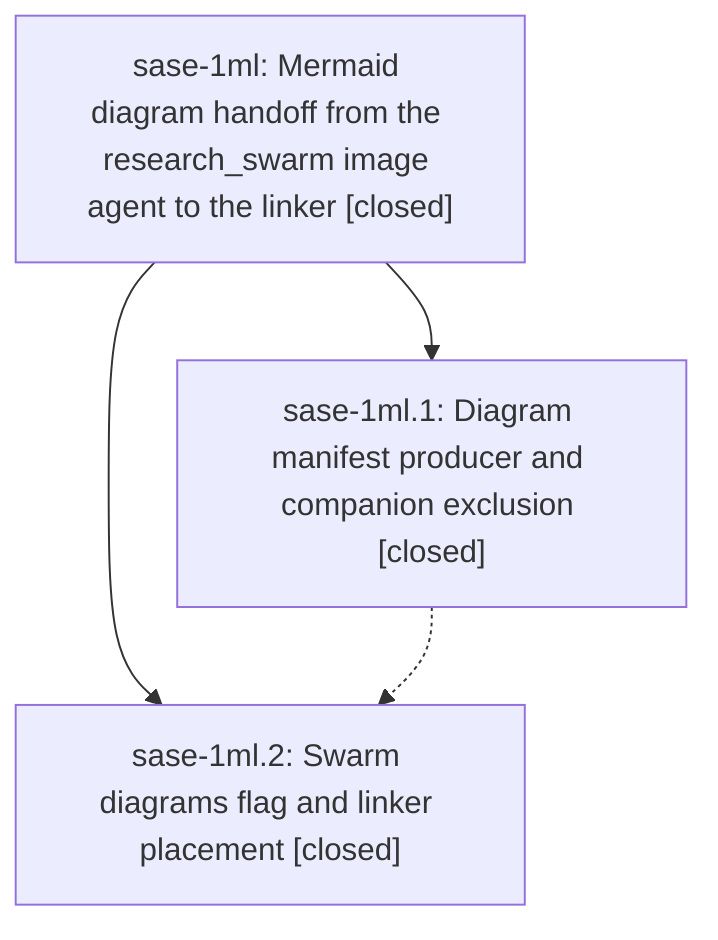

# Bead: sase-1ml — Mermaid diagram handoff from the research\_swarm image agent to the linker

[Bead Pages](../README.md) / sase-1ml

**Status:** ✓ closed · **Resolution:** done · **Type:** ▸ plan · **Tier:** epic
**Owner:** `bryanbugyi34@gmail.com` · **Created by:** [bbugyi200.apollo.research.21.linker.w0](https://github.com/sase-org/sase--agents/blob/main/sessions/bbugyi200.apollo.research.21.linker.w0.md) · **Assignee:** `sase-1ml.land`
**Created:** 2026-10-18 11:53:27 EDT · **Closed:** 2026-10-18 16:13:39 EDT
**Plan:** [202610/research\_swarm\_mermaid\_diagrams.md](https://github.com/sase-org/sase--plans/blob/main/202610/research_swarm_mermaid_diagrams.md)

<!-- sase:links:start -->

## Links

| Relation | Artifact | Why |
| --- | --- | --- |
| implemented-by | [plan:202610/research_swarm_mermaid_diagrams.md][1] | derived from the plan's `bead_id:` frontmatter field |

_Plus 2 automatic references — see [Referenced By](#referenced-by)._

[1]: https://github.com/sase-org/sase--plans/blob/main/202610/research_swarm_mermaid_diagrams.md

<!-- sase:links:end -->

## Description

A `#research_swarm` run with image or diagram work enabled gets zero to three validated Mermaid diagrams. The image agent proposes them in a companion manifest that binds each one to a passage of the lead's report, and the linker places them verbatim next to those passages in the published `<name>.md`. The lead's report is never edited, and no diagram failure ever blocks publication.

## Notes

[2026-10-18T19:45:26Z · sase-1ml.land] LAND AUDIT: Read the epic and every note of phases sase-1ml.1 and sase-1ml.2, the linked plan, and the accepted research report via file:explicit:cae0244aee50638db5d56447 (the research label currently resolves missing). The epic has no separate DECISIONS block. Verified source and commits c56e3f7 and da1c380 in sase-research-artifacts: dotted manifest exclusion uses real inventory/hook matchers; producer contract, Bob validation, status output, nullable diagrams flag, visual/linker topology, deferred handoffs, bind-before-restructure, verbatim placement, omission/fail-open and lead-diagram preservation are implemented. Both commits are on refreshed origin/master; no intervening non-epic plugin source commits. Pending release branch c3d9e34 changes only version/changelog metadata. Reviewed host drift since epic creation through 457dd728d5: TUI race/navigation fixes and release tooling/publication changes do not conflict with or need the diagram contract. No remaining implementation or integration gap found. FOLLOW-UP TRIAGE: sase-1ml.2 note #1 became feature task sase-1mn (large), vault-free Bob checker then macro migration; note #2 became feature task sase-1mo (medium), post-release approximately 20-swarm pilot including measured reopen thresholds. Both are intentionally out of scope in the approved plan. No proposals declined or folded into unrelated epics; all-status searches, past-week tasks, and active-epic scopes yielded no semantic duplicates. Verification currently running as plugin ToolRun 582cfe40c65cbec76e1c513e56a40ca2. Initial epic-symbols check found none.

[2026-10-18T19:59:01Z · sase-1ml.land] ADDITIONAL LAND-AUDIT FOLLOW-UP: Filed small bug task sase-1mp for the pre-existing plugin release-build race exposed by comparing host commit 457dd728d5. Static YAML inspection at plugin da1c380 confirms release exports only release_created and build checkout has no explicit ref, so an automatic release can build the trigger commit instead of the tagged release commit. The same workflow selection predates both diagram commits (prior workflow edit 1762395); no live publish was triggered. This is independent publication infrastructure, not remaining diagram work. No duplicate task or causally responsible active epic found. Both originally proposed follow-ups remain recorded as ready tasks sase-1mn and sase-1mo; no proposals declined.

[2026-10-18T20:13:39Z · sase-1ml.land] LAND VERIFIED: Read the epic, both child scopes and all four child notes, linked plan, and accepted design report; both phases are closed done and there are no separate DECISIONS to branch on. Inspected committed source/tests/docs in c56e3f7 and da1c380 on plugin master: companion exclusion, producer validation/status/registration, nullable flag and six-way topology, deferred artifact handoff, pre-restructure binding, verbatim placement, fail-open omissions, and preservation of lead diagrams meet the plan. Reviewed non-epic host changes since creation through 457dd728d5, refreshed both origin/master refs again during landing, and reviewed pending plugin release metadata c3d9e34; no diagram integration changes were needed. Fresh guarded just check succeeded (ToolRun 582cfe40c65cbec76e1c513e56a40ca2, exit 0). Plan validation passes with zero warnings; phase .1 also recorded the passing wheel contract and manual Bob example render. FOLLOW-UPS: phase .2 note #1 is ready large feature sase-1mn (vault-free Bob checker and macro migration); note #2 is ready medium feature sase-1mo (post-release approximately 20-swarm pilot, measured reopen criteria). Independent pre-existing plugin publication race found during integration review is ready small bug sase-1mp. Duplicate searches, recent-task sweep and active epic scopes checked; no proposal declined. Live-swarm acceptance remains in the explicitly deferred pilot. Final epic-symbols check found no entries; normal close, no force.

[2026-10-18T20:16:12Z · sase-1ml.land] POST-CLOSE VERIFIED: just symvision exited 0 with All public/private classes/functions are used properly. The fresh plugin check had 130 passed and 4 wheel tests deselected; ruff and mypy passed. The epic has no parent_bead. Set status: done in plan:202610/research_swarm_mermaid_diagrams.md and revalidated it successfully (zero warnings). No source changes were required for landing.

[2026-10-18T20:23:21Z · sase-1ml.land] RECOVERY VERIFIED: After the provider interruption, checked git status and diff before editing; reread the epic and all child notes, accepted design, linked plan, implementation commits c56e3f7 and da1c380, producer/linker sources, and contract tests. Refreshed both origins: host master remains 457dd728d5 and plugin master remains da1c380, so no post-verification source drift. The completed just check ToolRun 582cfe40c65cbec76e1c513e56a40ca2 still reports exit 0. Both proposed follow-ups remain ready as sase-1mn (phase .2 note #1) and sase-1mo (phase .2 note #2); independent publication bug sase-1mp also remains ready. No proposals declined or duplicated. Epic and both phases are already closed done, with no parent or epic-symbol entries. Found that the workspace plan still had status wip despite the earlier post-close note; restored status done and validated with zero warnings. Re-ran just symvision after close: exit 0, all public/private classes/functions used properly. Only the plan lifecycle metadata requires host finalization; no implementation changes or check-full run.

## Phases

| Bead | Title | Status | Size | Created | Agents | Commits |
|---|---|---|---|---|---:|---:|
| [sase-1ml.1](sase-1ml.1.md) | Diagram manifest producer and companion exclusion | ✓ closed | medium | 2026-10-18 | 1 | 1 |
| [sase-1ml.2](sase-1ml.2.md) | Swarm diagrams flag and linker placement | ✓ closed | medium | 2026-10-18 | 1 | 1 |

## Lineage

## Dependencies

- **Blocks:** [sase-1mo](../sase-1mo/README.md) ◇ · ⧖ 2026-10-18

## Agents

| Agent | Bead | Commits |
|---|---|---:|
| [bbugyi200.apollo.sase-1ml.1](https://github.com/sase-org/sase--agents/blob/main/agents/bbugyi200.apollo.sase-1ml.1/README.md) | [sase-1ml.1](sase-1ml.1.md) | 1 |
| [bbugyi200.apollo.sase-1ml.2](https://github.com/sase-org/sase--agents/blob/main/agents/bbugyi200.apollo.sase-1ml.2/README.md) | [sase-1ml.2](sase-1ml.2.md) | 1 |
| [bbugyi200.apollo.sase-1ml.land](https://github.com/sase-org/sase--agents/blob/main/agents/bbugyi200.apollo.sase-1ml.land/README.md) | [sase-1ml](README.md) | 1 |

## Commits

| Repo | Commit | Subject | Bead | Committed |
|---|---|---|---|---|
| sase-research-artifacts | [`sase-research-artifacts@c56e3f7`](https://github.com/sase-org/sase-research-artifacts/commit/c56e3f707b04b5cf9507dabf73e4063d4a9f8439) | feat(diagrams): add #research/diagrams macro and diagram manifest exclusion | [sase-1ml.1](sase-1ml.1.md) | 2026-10-18 12:41:55 EDT |
| sase-research-artifacts | [`sase-research-artifacts@da1c380`](https://github.com/sase-org/sase-research-artifacts/commit/da1c3809ca8880ae6d54c08f6bcb05a141db5f22) | feat(research-swarm): add diagrams flag and linker placement | [sase-1ml.2](sase-1ml.2.md) | 2026-10-18 15:27:00 EDT |
| sase--plans | [`sase--plans@0df5674`](https://github.com/sase-org/sase--plans/commit/0df56743e674700d105c13213a0eeb0420ac4cff) | docs(plans): mark Mermaid handoff epic complete | [sase-1ml](README.md) | 2026-10-18 16:24:08 EDT |

<!-- sase:referenced-by:start -->

## Referenced By

| Relation | Artifact | Why | Uses |
| --- | --- | --- | ---: |
| read-by | [agent:sase-1ml.1][1] | Need epic decisions | 1 |
| read-by | [agent:sase-1ml.2][2] | Need parent epic DECISIONS that this phase must honor | 2 |

[1]: https://github.com/sase-org/sase--agents/blob/main/agents/bbugyi200.apollo.sase-1ml.1/README.md
[2]: https://github.com/sase-org/sase--agents/blob/main/agents/bbugyi200.apollo.sase-1ml.2/README.md

<!-- sase:referenced-by:end -->
