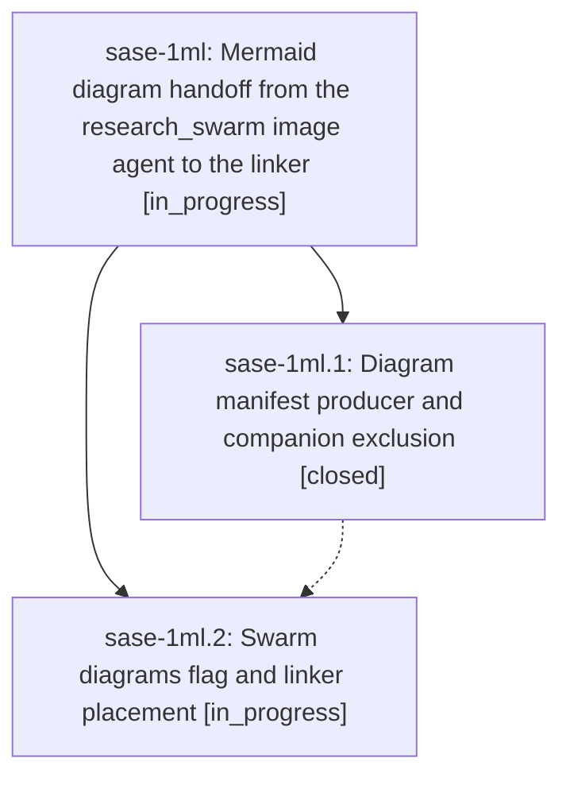

# Bead: sase-1ml — Mermaid diagram handoff from the research\_swarm image agent to the linker

[Bead Pages](../README.md) / sase-1ml

**Status:** ◐ in_progress · **Type:** ▸ plan · **Tier:** epic
**Owner:** `bryanbugyi34@gmail.com` · **Created by:** [bbugyi200.apollo.research.21.linker.w0](https://github.com/sase-org/sase--agents/blob/main/sessions/bbugyi200.apollo.research.21.linker.w0.md) · **Assignee:** `sase-1ml.land`
**Created:** 2026-10-18 11:53:27 EDT
**Plan:** [202610/research\_swarm\_mermaid\_diagrams.md](https://github.com/sase-org/sase--plans/blob/main/202610/research_swarm_mermaid_diagrams.md)

<!-- sase:links:start -->

## Links

| Relation | Artifact | Why |
| --- | --- | --- |
| implemented-by | [plan:202610/research_swarm_mermaid_diagrams.md][1] | derived from the plan's `bead_id:` frontmatter field |

[1]: https://github.com/sase-org/sase--plans/blob/main/202610/research_swarm_mermaid_diagrams.md

<!-- sase:links:end -->

## Description

A `#research_swarm` run with image or diagram work enabled gets zero to three validated Mermaid diagrams. The image agent proposes them in a companion manifest that binds each one to a passage of the lead's report, and the linker places them verbatim next to those passages in the published `<name>.md`. The lead's report is never edited, and no diagram failure ever blocks publication.

## Phases

| Bead | Title | Status | Size | Created | Agents | Commits |
|---|---|---|---|---|---:|---:|
| [sase-1ml.1](sase-1ml.1.md) | Diagram manifest producer and companion exclusion | ✓ closed | medium | 2026-10-18 | 1 | 1 |
| [sase-1ml.2](sase-1ml.2.md) | Swarm diagrams flag and linker placement | ◐ in_progress | medium | 2026-10-18 | 1 | 0 |

## Lineage

## Agents

| Agent | Bead | Commits |
|---|---|---:|
| [bbugyi200.apollo.sase-1ml.1](https://github.com/sase-org/sase--agents/blob/main/agents/bbugyi200.apollo.sase-1ml.1/README.md) | [sase-1ml.1](sase-1ml.1.md) | 1 |
| [bbugyi200.apollo.sase-1ml.2](https://github.com/sase-org/sase--agents/blob/main/agents/bbugyi200.apollo.sase-1ml.2/README.md) | [sase-1ml.2](sase-1ml.2.md) | 0 |
| [bbugyi200.apollo.sase-1ml.land](https://github.com/sase-org/sase--agents/blob/main/agents/bbugyi200.apollo.sase-1ml.land/README.md) | [sase-1ml](README.md) | 0 |

## Commits

| Repo | Commit | Subject | Bead | Committed |
|---|---|---|---|---|
| sase-research-artifacts | [`sase-research-artifacts@c56e3f7`](https://github.com/sase-org/sase-research-artifacts/commit/c56e3f707b04b5cf9507dabf73e4063d4a9f8439) | feat(diagrams): add #research/diagrams macro and diagram manifest exclusion | [sase-1ml.1](sase-1ml.1.md) | 2026-10-18 12:41:55 EDT |
