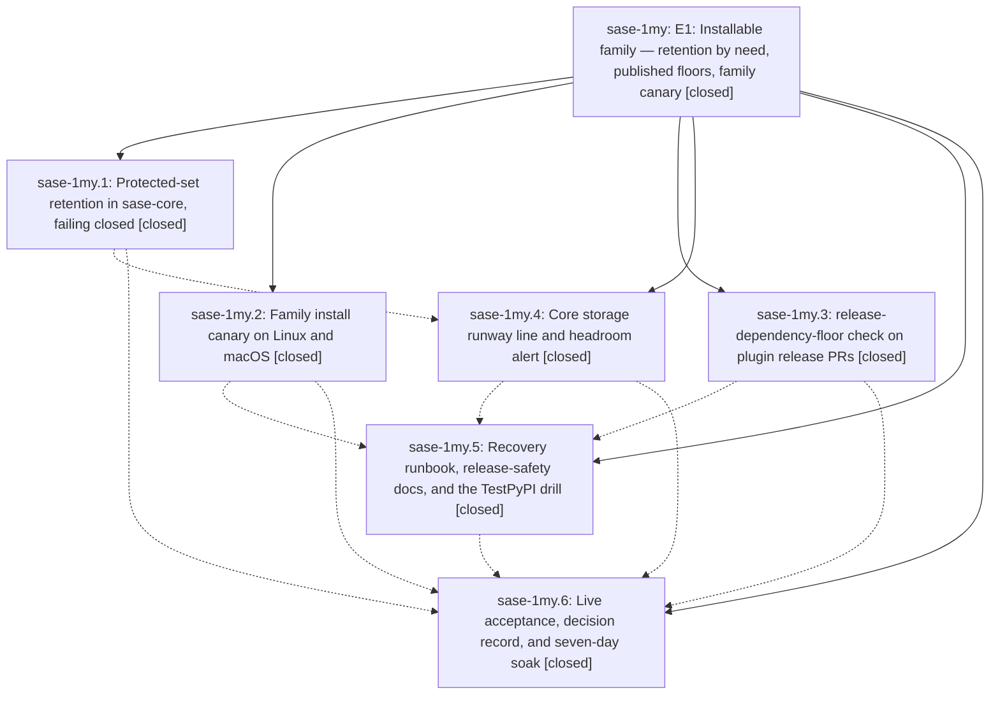

# Bead: sase-1my — E1: Installable family — retention by need, published floors, family canary

[Bead Pages](../README.md) / sase-1my

**Status:** ✓ closed · **Resolution:** done · **Type:** ▸ plan · **Tier:** epic
**Owner:** `bryanbugyi34@gmail.com` · **Created by:** [bbugyi200.athena.11s](https://github.com/sase-org/sase--agents/blob/main/sessions/bbugyi200.athena.11s.md) · **Assignee:** `sase-1my.land`
**Created:** 2026-10-19 10:16:26 EDT · **Closed:** 2026-10-19 16:11:34 EDT
**Plan:** [202610/e1\_installable\_family.md](https://github.com/sase-org/sase--plans/blob/main/202610/e1_installable_family.md)

<!-- sase:links:start -->

## Links

| Relation | Artifact | Why |
| --- | --- | --- |
| implemented-by | [plan:202610/e1_installable_family.md][1] | derived from the plan's `bead_id:` frontmatter field |

_Plus 4 automatic references — see [Referenced By](#referenced-by)._

[1]: https://github.com/sase-org/sase--plans/blob/main/202610/e1_installable_family.md

<!-- sase:links:end -->

## Description

A clean `uv tool install` of sase, alone or with the family plugins, installs the newest family release on Linux and macOS, and that release works. Retention can never delete, and no family release can declare, a dependency that a supported release cannot resolve. A broken install is caught within a day and reaches an owner.

## Notes

[2026-10-19T16:52:14Z · sase-1my.5] Runbook gate raised (notification custom-4ae4587d-01e0-47b6-a5fc-8104710a843c): yank sase 0.1.0 on PyPI + register the TestPyPI drill publisher (project sase-yank-drill, owner sase-org, workflow testpypi-drill.yml, env testpypi). Exit phase: run sase gate show/list for the outcome; drill order is in the testpypi-drill.yml header. Note: sase gate create --turn failed with missing_gate_turn_row (server-side routing bug), so this is a plain notification gate with no automatic follow-up.

[2026-10-19T18:12:04Z · sase-1my.land] LAND TRIAGE (sase-1my.land, 2026-10-19):

Live proof since the exits:
- V-E1b is now proven live on master a9046529ca. Dispatch run 39298640599 was green on both ubuntu and macOS. Probe run 39298650862 (probe_expect sase==0.0.0) was red on both legs, with the alert off.

Follow-up outcomes:
1. sase-1my.4 PROPOSED FOLLOW-UP (two gateway flakes): recorded as +1 on the existing tasks sase-1gz (federation_worker AlreadyRunning) and sase-15h (sudo_runner ETXTBSY). No new task.
2. Discovered, not caused by the epic: the Muse runtime run sase-1my.6 submitted the same accepted final declaration 42 times in one provider turn and added 22 duplicate recheck notes. Filed as new bug task sase-1n0 (large, ready), linked to sase-16i and sase-1my.6.
3. The 7-day canary soak is declined as a task.
   - The user closed exit phase sase-1my.6, which owned the soak.
   - A pure wait fits no task type, and it cannot sit in the remaining-work tale because it needs that tale's own commit.
   - The fixed canary's alert issue, mirrored into a task bead, is the durable detector afterwards.
4. The TestPyPI drill is declined, per the user's sase-1my.6 close reason. The tooling stays dispatch-only and is not run. sase 0.1.0 is confirmed yanked.
5. Declined as minor or not actionable:
   - Plugin contract tests assert enforcement only through the absence of `if:`. sase's own contract test covers the shared workflow.
   - There is no live sase-telegram floor probe. The plan requires one plugin, and sase-github was probed.
   - GitHub has delayed or not delivered scheduled cron runs. This is GitHub-side.

Remaining epic-caused defects, planned as a tale:
- sase-core: setup-uv@v10 does not exist, so CI release-scripts has been red on master since 9876b3ae and pypi-headroom.yml cannot run.
- canary alert job: has no GH_REPO, so it cannot open or close an issue.
- canary: a red job can upload a green artifact.
- canary: early failures leave weak fallback artifacts.
- canary alert: a single missing leg artifact reads as green.
- canary: the plugin proof does not load entry points.
- canary: minor core-window, os-field and probe-injection issues.
- release-safety.md: its claims are inaccurate.
- pypi_delete: the --package normalization gap.
- sase-core backfill docs: the `status` commands are missing EXPECTED_DIST_SUFFIXES.

[2026-10-19T20:11:34Z · sase-1my.land] E1 LAND VERIFICATION — 2026-10-19

Implemented the approved landing branches. The TestPyPI drill tooling remains in the repository, dormant and dispatch-only. No memory note was edited and no installable-releases decision record was added.

Live acceptance proofs:
- V-E1a (sase-1my.6 note 1): pypi_retention with --keep 30 protects sase-core-rs 0.42.0 and 0.42.1 for sase 0.18.0 (five files each, excluded from deletion). Planted --list 0.42.0 and a planted win_amd64 wheel were refused with the sase 0.18.0 window named. Simulated unreachable PyPI failed closed without listing. The already-unresolvable 0.17.x windows remain reported-not-refused.
- V-E1b: canary dispatch 39298640599 was green on ubuntu-latest and macos-latest; probe dispatch 39298650862 with probe_expect=sase==0.0.0 was red on both legs.
- V-E1c: sase-github probe 39292291601 failed with DEPENDENCY_UNPUBLISHED for sase>=99, naming newest published 0.18.0; normal run 39292296600 succeeded.

Core fixes:
- setup-uv now uses v4 in ci.yml and pypi-headroom.yml. The v4 tag was confirmed upstream.
- pypi_delete canonicalizes package names before applying the protected-package guard. A SASE_Core_RS alias is refused before credential access.
- The backfill runbook derives EXPECTED_DIST_SUFFIXES from release-plz.yml and includes it in the status commands.
- The headroom issue title and label description are threshold-free; the configured threshold appears in the issue body.

Primary canary and release-safety fixes:
- The alert receives GH_REPO and only reports green when the smoke job succeeded and exactly the expected Ubuntu and macOS artifacts are present, readable, and green.
- Every pre-merge step has an id; the merged result carries OS, run id, attempt, SHA, and the first failed step. The fallback result retains identity and fails closed.
- Both checks pass the matrix OS explicitly. The probe value is passed through the environment. Exact-version checks use the version pins produced by the isolated install.
- Plugin proof runs the installed SASE interpreter, calls load() for every recognized family entry point, and checks the resulting report.
- release-safety.md now documents attempt and SHA, both required artifacts, the hourly first-day then four-hour floor-check schedule (50-attempt cap), the family install command and research-artifacts addition, and the optional unrun practice drill with its human setup prerequisite.
- The selected drill_tooling=keep branch is implemented: the TestPyPI workflow, checker, and contract coverage remain. Test functions stay in their original test modules. The 77-file contract manifest was re-curated for the two external workflow contracts and measured at 118.48 serial seconds (861 passed).

Local verification:
- Core ToolRun 7000bcc4c4808b7841dd5ef150de6060 succeeded; Rust checks and all 95 .github/scripts tests passed.
- Final primary ToolRun 20c517b32902455dddee1b8dde1b449b exited 1 with only the two unrelated Python 3.14 stats parser-help failures below: 56,687 passed, 15 skipped. Formatting, docs, policy, whole-repo lint including Symvision, SASE validation, committed-plan checks, docs build, and the E1 workflow/manifest tests passed. No check-full was run.
- Focused install-canary, TestPyPI, and contract-manifest checks passed: 27 tests.
- Isolated public-index install resolved sase 0.18.0, sase-core-rs 0.42.1, sase-github 0.2.24, sase-telegram 0.4.29, and sase-research-artifacts 0.2.0. The newest-version checker was green. All 9 recognized family plugin entry points loaded. Forcing sase==0.0.0 returned red with the expected mismatch.

Human-only items and follow-ups:
- sase 0.1.0 is already confirmed yanked; it was not yanked again. The existing human notification gate was not duplicated. TestPyPI publisher setup remains human-owned. The drill was not run.
- The 7-day scheduled-canary soak was not completed. The install-canary alert issue, mirrored into a task bead, remains the ongoing detector.
- Existing follow-up outcomes stand: +1 reports are recorded on sase-1gz and sase-15h; bug sase-1n0 was filed; the soak and drill were declined by the owner; the previously triaged minor items were declined.
- The unrelated Python 3.14 stats parser-help mismatch was reproduced and routed to active epic sase-1m3 and corroborated on sase-14p; it was not changed in this E1 landing.
- Integration review of primary and core history since the epic began found no non-E1 commit touching E1 surfaces. The stats, release-watch, deck, and gate commits are disjoint.

[2026-10-19T21:34:03Z · sase-1my.land] E1 LAND VERIFICATION — recovery turn 2026-10-19

Implemented the approved landing tale (plan:202610/land_e1_installable_family.md). Selected branches: drill_tooling=keep; floor_check_home=shared; research_artifacts=yes; yank_0_1_0=propose; testpypi_drill=yes; decision_record=no. No memory note was edited.

Live acceptance proofs:
- V-E1a (sase-1my.6 note #1): `plan --keep 30` protects sase-core-rs 0.42.0 and 0.42.1 "by sase 0.18.0".
- V-E1b: dispatch 39298640599 green on ubuntu-latest and macos-latest; probe 39298650862 (probe_expect=sase==0.0.0) red on both legs.
- V-E1c: sase-github probe 39292291601 red with DEPENDENCY_UNPUBLISHED sase>=99 (newest published 0.18.0); normal run 39292296600 green.

Fixes this tale landed:
- Part A (sase-core): setup-uv pin @v4 in ci.yml and pypi-headroom.yml (v4 tag confirmed upstream); pypi_delete canonicalizes package names before the protected-set guard (SASE_Core_RS refused before credentials); backfill status commands set EXPECTED_DIST_SUFFIXES from release-plz.yml; headroom issue title/label are threshold-free and the body uses the configured MIN_RUNWAY_DAYS.
- Part B items 1–9: alert GH_REPO; both OS artifacts plus needs.install-smoke.result required for green; pre-merge step ids and toJSON(steps) force red on the first failed step; fallback identity from matrix.os / GITHUB_RUN_ID / GITHUB_RUN_ATTEMPT / GITHUB_SHA; --os matrix.os on both assertions; probe_expect via env (no ${{ inputs. in run:); refetch recomputes core_expectation; exact assertion uses --expect pins; plugin proof loads recognized entry points under the installed interpreter.
- Part C: release-safety.md now documents attempt and sha, both required OS artifacts, the hourly-then-four-hour floor-check schedule with the 50-attempt cap, the family command as INSTALL.md's github+telegram form plus sase-research-artifacts, and the optional unrun practice drill.
- drill_tooling=keep: testpypi-drill.yml, tools/check_testpypi_drill, and their tests remain, dispatch-only and unrun.

Local proof (isolated UV_TOOL_DIR/BIN/HOME):
- Family install resolved sase 0.18.0, sase-core-rs 0.42.1, sase-github 0.2.24, sase-telegram 0.4.29, sase-research-artifacts 0.2.0.
- Newest check green. Plugin load green (9 recognized entry points: github 5, telegram 1, research-artifacts 3). --force-expect sase==0.0.0 red with "sase 0.18.0 (expected 0.0.0)".

Verification:
- sase-core ToolRun f908ca17c196a8d5c895eb50867577b7 succeeded (exit 0, triage pass), including 95 .github/script

… and 850 more characters

## Phases

| Bead | Title | Status | Size | Created | Agents | Commits |
|---|---|---|---|---|---:|---:|
| [sase-1my.1](sase-1my.1.md) | Protected-set retention in sase-core, failing closed | ✓ closed | medium | 2026-10-19 | 1 | 1 |
| [sase-1my.2](sase-1my.2.md) | Family install canary on Linux and macOS | ✓ closed | medium | 2026-10-19 | 1 | 1 |
| [sase-1my.3](sase-1my.3.md) | release-dependency-floor check on plugin release PRs | ✓ closed | medium | 2026-10-19 | 1 | 4 |
| [sase-1my.4](sase-1my.4.md) | Core storage runway line and headroom alert | ✓ closed | small | 2026-10-19 | 1 | 1 |
| [sase-1my.5](sase-1my.5.md) | Recovery runbook, release-safety docs, and the TestPyPI drill | ✓ closed | medium | 2026-10-19 | 1 | 2 |
| [sase-1my.6](sase-1my.6.md) | Live acceptance, decision record, and seven-day soak | ✓ closed | small | 2026-10-19 | 1 | 1 |

## Lineage

## Agents

| Agent | Bead | Commits |
|---|---|---:|
| [bbugyi200.athena.sase-1my.1](https://github.com/sase-org/sase--agents/blob/main/agents/bbugyi200.athena.sase-1my.1/README.md) | [sase-1my.1](sase-1my.1.md) | 1 |
| [bbugyi200.athena.sase-1my.2](https://github.com/sase-org/sase--agents/blob/main/agents/bbugyi200.athena.sase-1my.2/README.md) | [sase-1my.2](sase-1my.2.md) | 1 |
| [bbugyi200.athena.sase-1my.3](https://github.com/sase-org/sase--agents/blob/main/agents/bbugyi200.athena.sase-1my.3/README.md) | [sase-1my.3](sase-1my.3.md) | 4 |
| [bbugyi200.athena.sase-1my.4](https://github.com/sase-org/sase--agents/blob/main/agents/bbugyi200.athena.sase-1my.4/README.md) | [sase-1my.4](sase-1my.4.md) | 1 |
| [bbugyi200.athena.sase-1my.5](https://github.com/sase-org/sase--agents/blob/main/agents/bbugyi200.athena.sase-1my.5/README.md) | [sase-1my.5](sase-1my.5.md) | 2 |
| [bbugyi200.athena.sase-1my.6](https://github.com/sase-org/sase--agents/blob/main/agents/bbugyi200.athena.sase-1my.6/README.md) | [sase-1my.6](sase-1my.6.md) | 1 |
| [bbugyi200.athena.sase-1my.land](https://github.com/sase-org/sase--agents/blob/main/sessions/bbugyi200.athena.sase-1my.land.md) | [sase-1my](README.md) | 1 |

## Commits

| Repo | Commit | Subject | Bead | Committed |
|---|---|---|---|---|
| sase | [`6a0090f`](https://github.com/sase-org/sase/commit/6a0090f0d90008a4ad382a608dc2196eed63813d) | feat(install): add family install canary workflow and checks | [sase-1my.2](sase-1my.2.md) | 2026-10-19 10:41:36 EDT |
| sase-core | [`sase-core@9876b3a`](https://github.com/sase-org/sase-core/commit/9876b3ae557e7dfacb012507d80b22ebb2a6dc7f) | feat(releases): protect PyPI consumer windows | [sase-1my.1](sase-1my.1.md) | 2026-10-19 10:46:42 EDT |
| sase-core | [`sase-core@a908ceb`](https://github.com/sase-org/sase-core/commit/a908ceb30ca385ec3ac564f1a84203ff02054a0a) | feat(pypi): add runway threshold and weekly headroom alert | [sase-1my.4](sase-1my.4.md) | 2026-10-19 11:17:11 EDT |
| sase | [`2d7c282`](https://github.com/sase-org/sase/commit/2d7c282b24e7f8cafe413f283980a9bd074851b6) | feat(release): add shared plugin release-dependency-floor check | [sase-1my.3](sase-1my.3.md) | 2026-10-19 11:53:40 EDT |
| sase-github | [`sase-github@e4f8bf4`](https://github.com/sase-org/sase-github/commit/e4f8bf47c8b0e89b3b46b35369e3574fcf97d0ed) | ci: call the shared release-dependency-floor check | [sase-1my.3](sase-1my.3.md) | 2026-10-19 11:58:13 EDT |
| sase-research-artifacts | [`sase-research-artifacts@0189278`](https://github.com/sase-org/sase-research-artifacts/commit/01892780223a935cde39e31223535d3197a19b11) | ci: call the shared release-dependency-floor check | [sase-1my.3](sase-1my.3.md) | 2026-10-19 12:01:36 EDT |
| sase-telegram | [`sase-telegram@af65e20`](https://github.com/sase-org/sase-telegram/commit/af65e20ffbdb2e5d8e9f2ed22d8cd159a5a56daa) | ci: call the shared release-dependency-floor check | [sase-1my.3](sase-1my.3.md) | 2026-10-19 12:12:04 EDT |
| sase-core | [`sase-core@f0f2275`](https://github.com/sase-org/sase-core/commit/f0f2275f9d38db3dc4e80aa4c2635017696a7e93) | docs(retention): document the core backfill route | [sase-1my.5](sase-1my.5.md) | 2026-10-19 12:53:01 EDT |
| sase | [`2a83edf`](https://github.com/sase-org/sase/commit/2a83edf9961fc0f9e7b241987af71ab7149ee7aa) | feat(release): add recovery runbook, release-safety docs, and TestPyPI drill | [sase-1my.5](sase-1my.5.md) | 2026-10-19 12:57:49 EDT |
| sase | [`a904652`](https://github.com/sase-org/sase/commit/a9046529cac4783593fb9161b10ba25334517af4) | fix(install): derive canary isolated paths from RUNNER\_TEMP via GITHUB\_ENV | [sase-1my.6](sase-1my.6.md) | 2026-10-19 13:38:32 EDT |
| sase-core | [`sase-core@e0ddc10`](https://github.com/sase-org/sase-core/commit/e0ddc100eb32097393daa0fd099b3017b1b1cfee) | fix(pypi): pin setup-uv v4 and canonicalize the delete guard | [sase-1my](README.md) | 2026-10-19 17:46:02 EDT |

<!-- sase:referenced-by:start -->

## Referenced By

| Relation | Artifact | Why | Uses |
| --- | --- | --- | ---: |
| read-by | [agent:sase-1my.1][1] | Need the epic design file and final decisions | 1 |
| read-by | [agent:sase-1my.3][2] | Need parent epic DECISIONS and remaining phases | 1 |
| read-by | [agent:sase-1my.5][3] | need parent epic scope and design | 1 |
| read-by | [agent:sase-1my.6][4] | epic context for phase 6 | 1 |

[1]: https://github.com/sase-org/sase--agents/blob/main/agents/bbugyi200.athena.sase-1my.1/README.md
[2]: https://github.com/sase-org/sase--agents/blob/main/agents/bbugyi200.athena.sase-1my.3/README.md
[3]: https://github.com/sase-org/sase--agents/blob/main/agents/bbugyi200.athena.sase-1my.5/README.md
[4]: https://github.com/sase-org/sase--agents/blob/main/agents/bbugyi200.athena.sase-1my.6/README.md

<!-- sase:referenced-by:end -->
