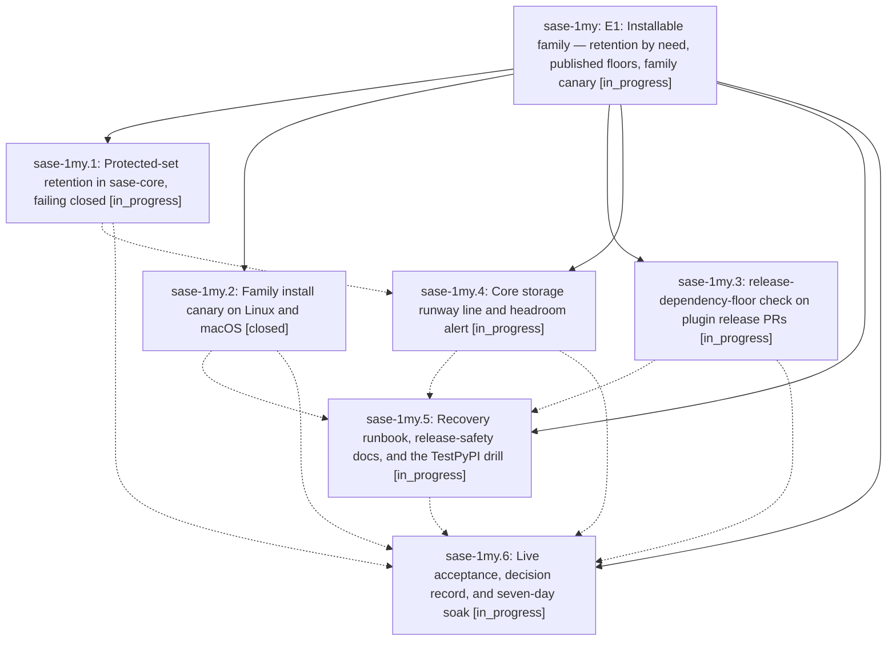

# Bead: sase-1my — E1: Installable family — retention by need, published floors, family canary

[Bead Pages](../README.md) / sase-1my

**Status:** ◐ in_progress · **Type:** ▸ plan · **Tier:** epic
**Owner:** `bryanbugyi34@gmail.com` · **Created by:** [bbugyi200.athena.11s](https://github.com/sase-org/sase--agents/blob/main/sessions/bbugyi200.athena.11s.md) · **Assignee:** `sase-1my.land`
**Created:** 2026-10-19 10:16:26 EDT
**Plan:** [202610/e1\_installable\_family.md](https://github.com/sase-org/sase--plans/blob/main/202610/e1_installable_family.md)

## Description

A clean `uv tool install` of sase, alone or with the family plugins, installs the newest family release on Linux and macOS, and that release works. Retention can never delete, and no family release can declare, a dependency that a supported release cannot resolve. A broken install is caught within a day and reaches an owner.

## Phases

| Bead | Title | Status | Size | Created | Agents | Commits |
|---|---|---|---|---|---:|---:|
| [sase-1my.1](sase-1my.1.md) | Protected-set retention in sase-core, failing closed | ◐ in_progress | medium | 2026-10-19 | 1 | 0 |
| [sase-1my.2](sase-1my.2.md) | Family install canary on Linux and macOS | ✓ closed | medium | 2026-10-19 | 1 | 1 |
| [sase-1my.3](sase-1my.3.md) | release-dependency-floor check on plugin release PRs | ◐ in_progress | medium | 2026-10-19 | 1 | 0 |
| [sase-1my.4](sase-1my.4.md) | Core storage runway line and headroom alert | ◐ in_progress | small | 2026-10-19 | 1 | 0 |
| [sase-1my.5](sase-1my.5.md) | Recovery runbook, release-safety docs, and the TestPyPI drill | ◐ in_progress | medium | 2026-10-19 | 1 | 0 |
| [sase-1my.6](sase-1my.6.md) | Live acceptance, decision record, and seven-day soak | ◐ in_progress | small | 2026-10-19 | 1 | 0 |

## Lineage

## Agents

| Agent | Bead | Commits |
|---|---|---:|
| [bbugyi200.athena.sase-1my.1](https://github.com/sase-org/sase--agents/blob/main/agents/bbugyi200.athena.sase-1my.1/README.md) | [sase-1my.1](sase-1my.1.md) | 0 |
| [bbugyi200.athena.sase-1my.2](https://github.com/sase-org/sase--agents/blob/main/agents/bbugyi200.athena.sase-1my.2/README.md) | [sase-1my.2](sase-1my.2.md) | 1 |
| [bbugyi200.athena.sase-1my.3](https://github.com/sase-org/sase--agents/blob/main/agents/bbugyi200.athena.sase-1my.3/README.md) | [sase-1my.3](sase-1my.3.md) | 0 |
| [bbugyi200.athena.sase-1my.4](https://github.com/sase-org/sase--agents/blob/main/agents/bbugyi200.athena.sase-1my.4/README.md) | [sase-1my.4](sase-1my.4.md) | 0 |
| [bbugyi200.athena.sase-1my.5](https://github.com/sase-org/sase--agents/blob/main/agents/bbugyi200.athena.sase-1my.5/README.md) | [sase-1my.5](sase-1my.5.md) | 0 |
| [bbugyi200.athena.sase-1my.6](https://github.com/sase-org/sase--agents/blob/main/agents/bbugyi200.athena.sase-1my.6/README.md) | [sase-1my.6](sase-1my.6.md) | 0 |
| [bbugyi200.athena.sase-1my.land](https://github.com/sase-org/sase--agents/blob/main/agents/bbugyi200.athena.sase-1my.land/README.md) | [sase-1my](README.md) | 0 |

## Commits

| Repo | Commit | Subject | Bead | Committed |
|---|---|---|---|---|
| sase | [`6a0090f`](https://github.com/sase-org/sase/commit/6a0090f0d90008a4ad382a608dc2196eed63813d) | feat(install): add family install canary workflow and checks | [sase-1my.2](sase-1my.2.md) | 2026-10-19 10:41:36 EDT |
