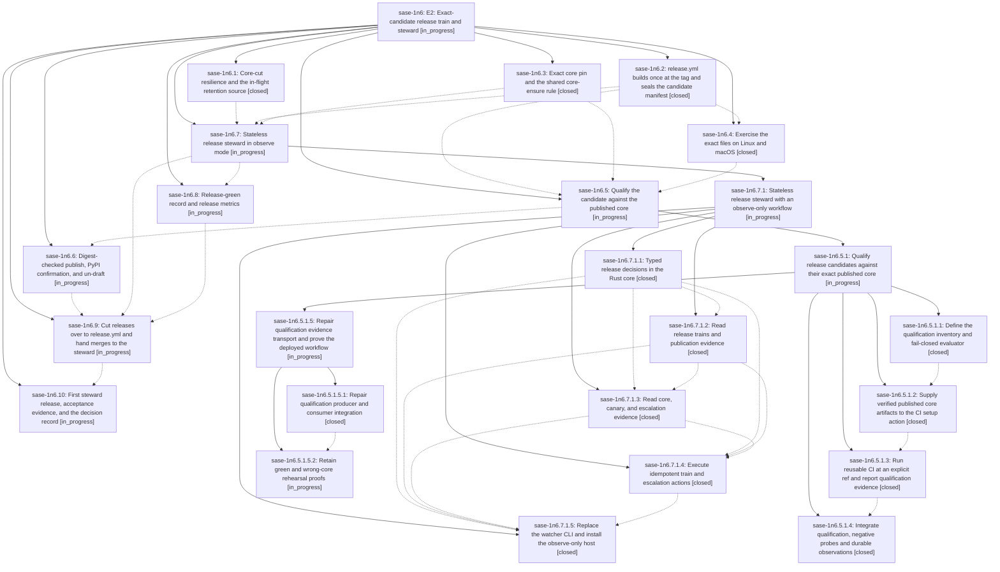

# Bead: sase-1n6 — E2: Exact-candidate release train and steward

[Bead Pages](../README.md) / sase-1n6

**Status:** ◐ in_progress · **Type:** ▸ plan · **Tier:** epic
**Owner:** `bryanbugyi34@gmail.com` · **Created by:** [bbugyi200.athena.11y](https://github.com/sase-org/sase--agents/blob/main/sessions/bbugyi200.athena.11y.md) · **Assignee:** `sase-1n6.land`
**Created:** 2026-10-19 16:40:07 EDT
**Plan:** [202610/e2\_release\_train\_steward.md](https://github.com/sase-org/sase--plans/blob/main/202610/e2_release_train_steward.md)

<!-- sase:links:start -->

## Links

| Relation | Artifact | Why |
| --- | --- | --- |
| implemented-by | [plan:202610/e2_release_train_steward.md][1] | derived from the plan's `bead_id:` frontmatter field |

_Plus 1 automatic references — see [Referenced By](#referenced-by)._

[1]: https://github.com/sase-org/sase--plans/blob/main/202610/e2_release_train_steward.md

<!-- sase:links:end -->

## Description

Every sase release is a sealed candidate built once at its tag: the wheel and sdist plus an exact `sase-core-rs==X.Y.Z` with its full file set and digests. It is qualified against the published core, exercised on Linux and macOS, published from the retained bytes with digest-checked resume, and confirmed from PyPI before it is un-drafted. One stateless steward decides release merges and the core cut, and every blocked release names a typed reason and its owner.

## Notes

[2026-10-20T04:24:15Z · sase-1n6.5.1.land] DISCOVERED ISSUE from sase-1n6.5.1.land (2026-10-20, reviewed master 54a9c14d2393ed168504eb64b2335b2e8fd1825e): the pre-existing exact-build/core-pin seam does not retain or validate the core source revision. release.yml build passes --core-source-pin from grep of the sase-core-rs requirement in pyproject.toml instead of sase-core-revision.txt. tools/release_candidate seal_manifest accepts an arbitrary core_source_pin and evaluate_manifest public_dependency_contract_satisfied only checks nonempty version/live file list; neither proves the selected published tag contains the source pin. Reproduction with tests._release_candidate_tool_helpers: seal_kwargs(core_source_pin="not-a-source-commit") seals successfully and the dependency clause is ok=True. git show 443fba33d9^ confirms both behaviors predate the qualification child epic. This undermines the outer plan's source-containment promise and the bounded CORE_LAG rehearsal path. /sase_new_task searched bug/all task statuses, swept all tasks created in the last week, and inspected active epic ownership; no semantic duplicate found. Routed here because sase-1n6.2/.3 introduced and own this seam; no standalone task created. Qualification transport/evidence repairs remain on sase-1n6.5.1.

## Phases

| Bead | Title | Status | Size | Created | Agents | Commits |
|---|---|---|---|---|---:|---:|
| [sase-1n6.1](sase-1n6.1.md) | Core-cut resilience and the in-flight retention source | ✓ closed | medium | 2026-10-19 | 1 | 1 |
| [sase-1n6.10](sase-1n6.10.md) | First steward release, acceptance evidence, and the decision record | ◐ in_progress | medium | 2026-10-19 | 1 | 0 |
| [sase-1n6.2](sase-1n6.2.md) | release.yml builds once at the tag and seals the candidate manifest | ✓ closed | medium | 2026-10-19 | 1 | 1 |
| [sase-1n6.3](sase-1n6.3.md) | Exact core pin and the shared core-ensure rule | ✓ closed | medium | 2026-10-19 | 1 | 1 |
| [sase-1n6.4](sase-1n6.4.md) | Exercise the exact files on Linux and macOS | ✓ closed | medium | 2026-10-19 | 1 | 1 |
| [sase-1n6.5](sase-1n6.5.md) | Qualify the candidate against the published core | ◐ in_progress | large | 2026-10-19 | 1 | 0 |
| [sase-1n6.6](sase-1n6.6.md) | Digest-checked publish, PyPI confirmation, and un-draft | ◐ in_progress | medium | 2026-10-19 | 1 | 0 |
| [sase-1n6.7](sase-1n6.7.md) | Stateless release steward in observe mode | ◐ in_progress | large | 2026-10-19 | 1 | 0 |
| [sase-1n6.8](sase-1n6.8.md) | Release-green record and release metrics | ◐ in_progress | medium | 2026-10-19 | 1 | 0 |
| [sase-1n6.9](sase-1n6.9.md) | Cut releases over to release.yml and hand merges to the steward | ◐ in_progress | medium | 2026-10-19 | 1 | 0 |

## Lineage

## Agents

| Agent | Bead | Commits |
|---|---|---:|
| [bbugyi200.athena.sase-1n6.1](https://github.com/sase-org/sase--agents/blob/main/agents/bbugyi200.athena.sase-1n6.1/README.md) | [sase-1n6.1](sase-1n6.1.md) | 1 |
| [bbugyi200.athena.sase-1n6.10](https://github.com/sase-org/sase--agents/blob/main/agents/bbugyi200.athena.sase-1n6.10/README.md) | [sase-1n6.10](sase-1n6.10.md) | 0 |
| [bbugyi200.athena.sase-1n6.2](https://github.com/sase-org/sase--agents/blob/main/agents/bbugyi200.athena.sase-1n6.2/README.md) | [sase-1n6.2](sase-1n6.2.md) | 1 |
| [bbugyi200.athena.sase-1n6.3](https://github.com/sase-org/sase--agents/blob/main/agents/bbugyi200.athena.sase-1n6.3/README.md) | [sase-1n6.3](sase-1n6.3.md) | 1 |
| [bbugyi200.athena.sase-1n6.4](https://github.com/sase-org/sase--agents/blob/main/sessions/bbugyi200.athena.sase-1n6.4.md) | [sase-1n6.4](sase-1n6.4.md) | 1 |
| [bbugyi200.athena.sase-1n6.5](https://github.com/sase-org/sase--agents/blob/main/sessions/bbugyi200.athena.sase-1n6.5.md) | [sase-1n6.5](sase-1n6.5.md) | 0 |
| [bbugyi200.athena.sase-1n6.5.1.1](https://github.com/sase-org/sase--agents/blob/main/agents/bbugyi200.athena.sase-1n6.5.1.1/README.md) | [sase-1n6.5.1.1](sase-1n6.5.1.1.md) | 1 |
| [bbugyi200.athena.sase-1n6.5.1.2](https://github.com/sase-org/sase--agents/blob/main/sessions/bbugyi200.athena.sase-1n6.5.1.2.md) | [sase-1n6.5.1.2](sase-1n6.5.1.2.md) | 1 |
| [bbugyi200.athena.sase-1n6.5.1.3](https://github.com/sase-org/sase--agents/blob/main/agents/bbugyi200.athena.sase-1n6.5.1.3/README.md) | [sase-1n6.5.1.3](sase-1n6.5.1.3.md) | 1 |
| [bbugyi200.athena.sase-1n6.5.1.4](https://github.com/sase-org/sase--agents/blob/main/agents/bbugyi200.athena.sase-1n6.5.1.4/README.md) | [sase-1n6.5.1.4](sase-1n6.5.1.4.md) | 1 |
| [bbugyi200.athena.sase-1n6.5.1.5.1](https://github.com/sase-org/sase--agents/blob/main/agents/bbugyi200.athena.sase-1n6.5.1.5.1/README.md) | [sase-1n6.5.1.5.1](sase-1n6.5.1.5.1.md) | 1 |
| [bbugyi200.athena.sase-1n6.5.1.5.2](https://github.com/sase-org/sase--agents/blob/main/agents/bbugyi200.athena.sase-1n6.5.1.5.2/README.md) | [sase-1n6.5.1.5.2](sase-1n6.5.1.5.2.md) | 1 |
| [bbugyi200.athena.sase-1n6.5.1.5.land](https://github.com/sase-org/sase--agents/blob/main/agents/bbugyi200.athena.sase-1n6.5.1.5.land/README.md) | [sase-1n6.5.1.5](sase-1n6.5.1.5.md) | 0 |
| [bbugyi200.athena.sase-1n6.5.1.land](https://github.com/sase-org/sase--agents/blob/main/sessions/bbugyi200.athena.sase-1n6.5.1.land.md) | [sase-1n6.5.1](sase-1n6.5.1.md) | 0 |
| [bbugyi200.athena.sase-1n6.6](https://github.com/sase-org/sase--agents/blob/main/agents/bbugyi200.athena.sase-1n6.6/README.md) | [sase-1n6.6](sase-1n6.6.md) | 0 |
| [bbugyi200.athena.sase-1n6.7](https://github.com/sase-org/sase--agents/blob/main/sessions/bbugyi200.athena.sase-1n6.7.md) | [sase-1n6.7](sase-1n6.7.md) | 0 |
| [bbugyi200.athena.sase-1n6.7.1.1](https://github.com/sase-org/sase--agents/blob/main/agents/bbugyi200.athena.sase-1n6.7.1.1/README.md) | [sase-1n6.7.1.1](sase-1n6.7.1.1.md) | 2 |
| [bbugyi200.athena.sase-1n6.7.1.2](https://github.com/sase-org/sase--agents/blob/main/sessions/bbugyi200.athena.sase-1n6.7.1.2.md) | [sase-1n6.7.1.2](sase-1n6.7.1.2.md) | 1 |
| [bbugyi200.athena.sase-1n6.7.1.3](https://github.com/sase-org/sase--agents/blob/main/agents/bbugyi200.athena.sase-1n6.7.1.3/README.md) | [sase-1n6.7.1.3](sase-1n6.7.1.3.md) | 1 |
| [bbugyi200.athena.sase-1n6.7.1.4](https://github.com/sase-org/sase--agents/blob/main/sessions/bbugyi200.athena.sase-1n6.7.1.4.md) | [sase-1n6.7.1.4](sase-1n6.7.1.4.md) | 1 |
| [bbugyi200.athena.sase-1n6.7.1.5](https://github.com/sase-org/sase--agents/blob/main/sessions/bbugyi200.athena.sase-1n6.7.1.5.md) | [sase-1n6.7.1.5](sase-1n6.7.1.5.md) | 1 |
| [bbugyi200.athena.sase-1n6.7.1.land](https://github.com/sase-org/sase--agents/blob/main/agents/bbugyi200.athena.sase-1n6.7.1.land/README.md) | [sase-1n6.7.1](sase-1n6.7.1.md) | 0 |
| [bbugyi200.athena.sase-1n6.8](https://github.com/sase-org/sase--agents/blob/main/agents/bbugyi200.athena.sase-1n6.8/README.md) | [sase-1n6.8](sase-1n6.8.md) | 0 |
| [bbugyi200.athena.sase-1n6.9](https://github.com/sase-org/sase--agents/blob/main/agents/bbugyi200.athena.sase-1n6.9/README.md) | [sase-1n6.9](sase-1n6.9.md) | 0 |
| [bbugyi200.athena.sase-1n6.land](https://github.com/sase-org/sase--agents/blob/main/agents/bbugyi200.athena.sase-1n6.land/README.md) | [sase-1n6](README.md) | 0 |

## Commits

| Repo | Commit | Subject | Bead | Committed |
|---|---|---|---|---|
| sase | [`110214f`](https://github.com/sase-org/sase/commit/110214f51cbe8ea7deb3e08cfa2aa579f00958ac) | feat(release): build once at the tag and seal the candidate manifest | [sase-1n6.2](sase-1n6.2.md) | 2026-10-19 17:36:18 EDT |
| sase-core | [`sase-core@3f0920f`](https://github.com/sase-org/sase-core/commit/3f0920f89d70f307469d6826fd94bda1c9b441d4) | feat(release): add bounded core-cut retries and in-flight retention | [sase-1n6.1](sase-1n6.1.md) | 2026-10-19 18:02:32 EDT |
| sase | [`befa41b`](https://github.com/sase-org/sase/commit/befa41b575abbc0745bd7aa33019126760110a58) | feat(release): pin sase-core-rs to an exact published version | [sase-1n6.3](sase-1n6.3.md) | 2026-10-19 19:34:39 EDT |
| sase | [`cc59e6f`](https://github.com/sase-org/sase/commit/cc59e6f114dcf62bfaf1b2a0e85a3449a7f14e41) | feat(release): exercise the exact candidate on Linux and macOS | [sase-1n6.4](sase-1n6.4.md) | 2026-10-19 20:01:41 EDT |
| sase | [`443fba3`](https://github.com/sase-org/sase/commit/443fba33d997ba89f189eb10ee1ff273a52eefec) | feat(release): add fail-closed qualification evaluator | [sase-1n6.5.1.1](sase-1n6.5.1.1.md) | 2026-10-19 21:09:54 EDT |
| sase-core | [`sase-core@dd817d5`](https://github.com/sase-org/sase-core/commit/dd817d5679409aaa2eefa0c3e517e8cfe91c37ef) | feat(release\_steward): add typed release decision policy | [sase-1n6.7.1.1](sase-1n6.7.1.1.md) | 2026-10-19 21:36:45 EDT |
| sase | [`5003ef6`](https://github.com/sase-org/sase/commit/5003ef69bd9810b0a88df5fc426f3bb8d5f2d1e7) | feat(release-watch): add thin release\_steward\_decide adapter | [sase-1n6.7.1.1](sase-1n6.7.1.1.md) | 2026-10-19 21:42:11 EDT |
| sase | [`9edbacd`](https://github.com/sase-org/sase/commit/9edbacd4efbde6ed91c1e5da5c37d9918e9e6e81) | feat(ci): supply verified published core artifacts to setup-sase | [sase-1n6.5.1.2](sase-1n6.5.1.2.md) | 2026-10-19 22:36:02 EDT |
| sase | [`23cccbc`](https://github.com/sase-org/sase/commit/23cccbc969ed14f970ac509ccedfd5358f7a93d8) | feat(release): add read-only release facts reader | [sase-1n6.7.1.2](sase-1n6.7.1.2.md) | 2026-10-19 23:27:01 EDT |
| sase | [`8afb1b7`](https://github.com/sase-org/sase/commit/8afb1b7e57e4e3494074a73adde2d3cee2fa5148) | feat(ci): collect identity-bound qualification evidence from reusable CI | [sase-1n6.5.1.3](sase-1n6.5.1.3.md) | 2026-10-19 23:35:38 EDT |
| sase | [`112a5f4`](https://github.com/sase-org/sase/commit/112a5f47576af6ab294354339873e15047fe5156) | feat(release-watch): add health reader, snapshot composition, and tests | [sase-1n6.7.1.3](sase-1n6.7.1.3.md) | 2026-10-20 00:07:49 EDT |
| sase | [`54a9c14`](https://github.com/sase-org/sase/commit/54a9c14d2393ed168504eb64b2335b2e8fd1825e) | feat(release): qualify release candidates against their exact published core | [sase-1n6.5.1.4](sase-1n6.5.1.4.md) | 2026-10-20 00:09:08 EDT |
| sase | [`dab5776`](https://github.com/sase-org/sase/commit/dab57765835ea8f61dfe1143570ce5a0bb0c2235) | feat(release-watch): add restart-safe actions and issue sinks | [sase-1n6.7.1.4](sase-1n6.7.1.4.md) | 2026-10-20 00:49:28 EDT |
| sase | [`400572e`](https://github.com/sase-org/sase/commit/400572eab602681aa64f44653484a1dfc9ab0b38) | fix(release): repair qualification evidence transport and prove it | [sase-1n6.5.1.5.1](sase-1n6.5.1.5.1.md) | 2026-10-20 00:53:39 EDT |
| sase | [`812cdd9`](https://github.com/sase-org/sase/commit/812cdd9e21ae5bc164d6d149b34ab9866207db03) | feat(release): replace release\_watch with an observe-only steward tick | [sase-1n6.7.1.5](sase-1n6.7.1.5.md) | 2026-10-20 01:29:29 EDT |
| sase | [`e10fa95`](https://github.com/sase-org/sase/commit/e10fa95c0dec856fe1cc0426bfb35fac1f0834a8) | fix(ci): move qualify session path off reusable job env | [sase-1n6.5.1.5.2](sase-1n6.5.1.5.2.md) | 2026-10-20 01:36:57 EDT |

<!-- sase:referenced-by:start -->

## Referenced By

| Relation | Artifact | Why | Uses |
| --- | --- | --- | ---: |
| read-by | [agent:sase-1n6.5.1.4][1] | Need epic DECISIONS and land context | 1 |

[1]: https://github.com/sase-org/sase--agents/blob/main/agents/bbugyi200.athena.sase-1n6.5.1.4/README.md

<!-- sase:referenced-by:end -->
