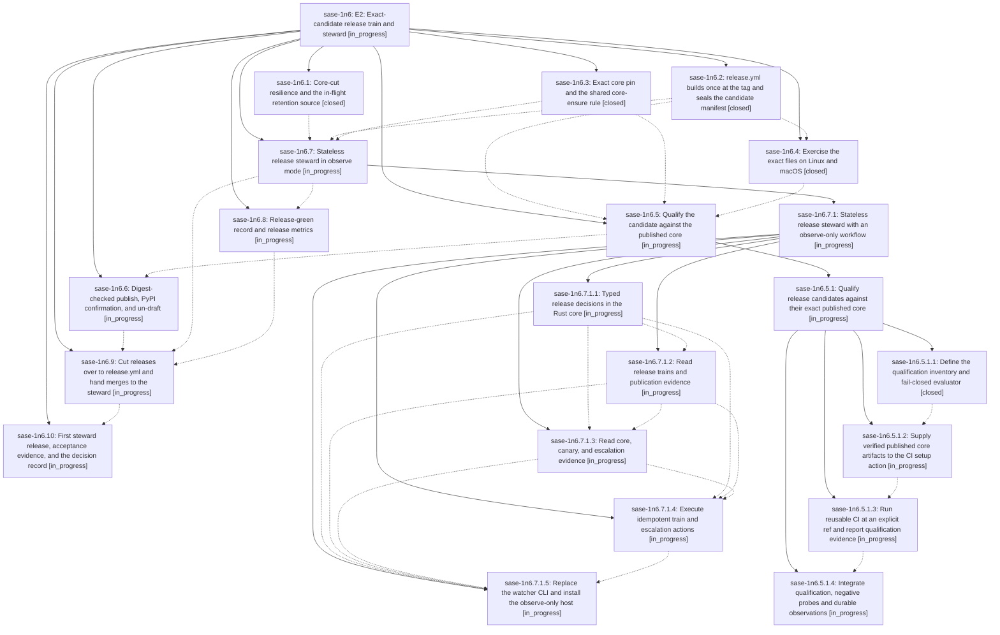

# Bead: sase-1n6 — E2: Exact-candidate release train and steward

[Bead Pages](../README.md) / sase-1n6

**Status:** ◐ in_progress · **Type:** ▸ plan · **Tier:** epic
**Owner:** `bryanbugyi34@gmail.com` · **Created by:** [bbugyi200.athena.11y](https://github.com/sase-org/sase--agents/blob/main/sessions/bbugyi200.athena.11y.md) · **Assignee:** `sase-1n6.land`
**Created:** 2026-10-19 16:40:07 EDT
**Plan:** [202610/e2\_release\_train\_steward.md](https://github.com/sase-org/sase--plans/blob/main/202610/e2_release_train_steward.md)

<!-- sase:links:start -->

## Links

| Relation | Artifact | Why |
| --- | --- | --- |
| implemented-by | [plan:202610/e2_release_train_steward.md][1] | derived from the plan's `bead_id:` frontmatter field |

[1]: https://github.com/sase-org/sase--plans/blob/main/202610/e2_release_train_steward.md

<!-- sase:links:end -->

## Description

Every sase release is a sealed candidate built once at its tag: the wheel and sdist plus an exact `sase-core-rs==X.Y.Z` with its full file set and digests. It is qualified against the published core, exercised on Linux and macOS, published from the retained bytes with digest-checked resume, and confirmed from PyPI before it is un-drafted. One stateless steward decides release merges and the core cut, and every blocked release names a typed reason and its owner.

## Phases

| Bead | Title | Status | Size | Created | Agents | Commits |
|---|---|---|---|---|---:|---:|
| [sase-1n6.1](sase-1n6.1.md) | Core-cut resilience and the in-flight retention source | ✓ closed | medium | 2026-10-19 | 1 | 1 |
| [sase-1n6.10](sase-1n6.10.md) | First steward release, acceptance evidence, and the decision record | ◐ in_progress | medium | 2026-10-19 | 1 | 0 |
| [sase-1n6.2](sase-1n6.2.md) | release.yml builds once at the tag and seals the candidate manifest | ✓ closed | medium | 2026-10-19 | 1 | 1 |
| [sase-1n6.3](sase-1n6.3.md) | Exact core pin and the shared core-ensure rule | ✓ closed | medium | 2026-10-19 | 1 | 1 |
| [sase-1n6.4](sase-1n6.4.md) | Exercise the exact files on Linux and macOS | ✓ closed | medium | 2026-10-19 | 1 | 1 |
| [sase-1n6.5](sase-1n6.5.md) | Qualify the candidate against the published core | ◐ in_progress | large | 2026-10-19 | 1 | 0 |
| [sase-1n6.6](sase-1n6.6.md) | Digest-checked publish, PyPI confirmation, and un-draft | ◐ in_progress | medium | 2026-10-19 | 1 | 0 |
| [sase-1n6.7](sase-1n6.7.md) | Stateless release steward in observe mode | ◐ in_progress | large | 2026-10-19 | 1 | 0 |
| [sase-1n6.8](sase-1n6.8.md) | Release-green record and release metrics | ◐ in_progress | medium | 2026-10-19 | 1 | 0 |
| [sase-1n6.9](sase-1n6.9.md) | Cut releases over to release.yml and hand merges to the steward | ◐ in_progress | medium | 2026-10-19 | 1 | 0 |

## Lineage

## Agents

| Agent | Bead | Commits |
|---|---|---:|
| [bbugyi200.athena.sase-1n6.1](https://github.com/sase-org/sase--agents/blob/main/agents/bbugyi200.athena.sase-1n6.1/README.md) | [sase-1n6.1](sase-1n6.1.md) | 1 |
| [bbugyi200.athena.sase-1n6.10](https://github.com/sase-org/sase--agents/blob/main/agents/bbugyi200.athena.sase-1n6.10/README.md) | [sase-1n6.10](sase-1n6.10.md) | 0 |
| [bbugyi200.athena.sase-1n6.2](https://github.com/sase-org/sase--agents/blob/main/agents/bbugyi200.athena.sase-1n6.2/README.md) | [sase-1n6.2](sase-1n6.2.md) | 1 |
| [bbugyi200.athena.sase-1n6.3](https://github.com/sase-org/sase--agents/blob/main/agents/bbugyi200.athena.sase-1n6.3/README.md) | [sase-1n6.3](sase-1n6.3.md) | 1 |
| [bbugyi200.athena.sase-1n6.4](https://github.com/sase-org/sase--agents/blob/main/sessions/bbugyi200.athena.sase-1n6.4.md) | [sase-1n6.4](sase-1n6.4.md) | 1 |
| [bbugyi200.athena.sase-1n6.5](https://github.com/sase-org/sase--agents/blob/main/sessions/bbugyi200.athena.sase-1n6.5.md) | [sase-1n6.5](sase-1n6.5.md) | 0 |
| [bbugyi200.athena.sase-1n6.5.1.1](https://github.com/sase-org/sase--agents/blob/main/agents/bbugyi200.athena.sase-1n6.5.1.1/README.md) | [sase-1n6.5.1.1](sase-1n6.5.1.1.md) | 1 |
| [bbugyi200.athena.sase-1n6.5.1.2](https://github.com/sase-org/sase--agents/blob/main/agents/bbugyi200.athena.sase-1n6.5.1.2/README.md) | [sase-1n6.5.1.2](sase-1n6.5.1.2.md) | 0 |
| [bbugyi200.athena.sase-1n6.5.1.3](https://github.com/sase-org/sase--agents/blob/main/agents/bbugyi200.athena.sase-1n6.5.1.3/README.md) | [sase-1n6.5.1.3](sase-1n6.5.1.3.md) | 0 |
| [bbugyi200.athena.sase-1n6.5.1.4](https://github.com/sase-org/sase--agents/blob/main/agents/bbugyi200.athena.sase-1n6.5.1.4/README.md) | [sase-1n6.5.1.4](sase-1n6.5.1.4.md) | 0 |
| [bbugyi200.athena.sase-1n6.5.1.land](https://github.com/sase-org/sase--agents/blob/main/agents/bbugyi200.athena.sase-1n6.5.1.land/README.md) | [sase-1n6.5.1](sase-1n6.5.1.md) | 0 |
| [bbugyi200.athena.sase-1n6.6](https://github.com/sase-org/sase--agents/blob/main/agents/bbugyi200.athena.sase-1n6.6/README.md) | [sase-1n6.6](sase-1n6.6.md) | 0 |
| [bbugyi200.athena.sase-1n6.7](https://github.com/sase-org/sase--agents/blob/main/sessions/bbugyi200.athena.sase-1n6.7.md) | [sase-1n6.7](sase-1n6.7.md) | 0 |
| [bbugyi200.athena.sase-1n6.7.1.1](https://github.com/sase-org/sase--agents/blob/main/agents/bbugyi200.athena.sase-1n6.7.1.1/README.md) | [sase-1n6.7.1.1](sase-1n6.7.1.1.md) | 0 |
| [bbugyi200.athena.sase-1n6.7.1.2](https://github.com/sase-org/sase--agents/blob/main/agents/bbugyi200.athena.sase-1n6.7.1.2/README.md) | [sase-1n6.7.1.2](sase-1n6.7.1.2.md) | 0 |
| [bbugyi200.athena.sase-1n6.7.1.3](https://github.com/sase-org/sase--agents/blob/main/agents/bbugyi200.athena.sase-1n6.7.1.3/README.md) | [sase-1n6.7.1.3](sase-1n6.7.1.3.md) | 0 |
| [bbugyi200.athena.sase-1n6.7.1.4](https://github.com/sase-org/sase--agents/blob/main/agents/bbugyi200.athena.sase-1n6.7.1.4/README.md) | [sase-1n6.7.1.4](sase-1n6.7.1.4.md) | 0 |
| [bbugyi200.athena.sase-1n6.7.1.5](https://github.com/sase-org/sase--agents/blob/main/agents/bbugyi200.athena.sase-1n6.7.1.5/README.md) | [sase-1n6.7.1.5](sase-1n6.7.1.5.md) | 0 |
| [bbugyi200.athena.sase-1n6.7.1.land](https://github.com/sase-org/sase--agents/blob/main/agents/bbugyi200.athena.sase-1n6.7.1.land/README.md) | [sase-1n6.7.1](sase-1n6.7.1.md) | 0 |
| [bbugyi200.athena.sase-1n6.8](https://github.com/sase-org/sase--agents/blob/main/agents/bbugyi200.athena.sase-1n6.8/README.md) | [sase-1n6.8](sase-1n6.8.md) | 0 |
| [bbugyi200.athena.sase-1n6.9](https://github.com/sase-org/sase--agents/blob/main/agents/bbugyi200.athena.sase-1n6.9/README.md) | [sase-1n6.9](sase-1n6.9.md) | 0 |
| [bbugyi200.athena.sase-1n6.land](https://github.com/sase-org/sase--agents/blob/main/agents/bbugyi200.athena.sase-1n6.land/README.md) | [sase-1n6](README.md) | 0 |

## Commits

| Repo | Commit | Subject | Bead | Committed |
|---|---|---|---|---|
| sase | [`110214f`](https://github.com/sase-org/sase/commit/110214f51cbe8ea7deb3e08cfa2aa579f00958ac) | feat(release): build once at the tag and seal the candidate manifest | [sase-1n6.2](sase-1n6.2.md) | 2026-10-19 17:36:18 EDT |
| sase-core | [`sase-core@3f0920f`](https://github.com/sase-org/sase-core/commit/3f0920f89d70f307469d6826fd94bda1c9b441d4) | feat(release): add bounded core-cut retries and in-flight retention | [sase-1n6.1](sase-1n6.1.md) | 2026-10-19 18:02:32 EDT |
| sase | [`befa41b`](https://github.com/sase-org/sase/commit/befa41b575abbc0745bd7aa33019126760110a58) | feat(release): pin sase-core-rs to an exact published version | [sase-1n6.3](sase-1n6.3.md) | 2026-10-19 19:34:39 EDT |
| sase | [`cc59e6f`](https://github.com/sase-org/sase/commit/cc59e6f114dcf62bfaf1b2a0e85a3449a7f14e41) | feat(release): exercise the exact candidate on Linux and macOS | [sase-1n6.4](sase-1n6.4.md) | 2026-10-19 20:01:41 EDT |
| sase | [`443fba3`](https://github.com/sase-org/sase/commit/443fba33d997ba89f189eb10ee1ff273a52eefec) | feat(release): add fail-closed qualification evaluator | [sase-1n6.5.1.1](sase-1n6.5.1.1.md) | 2026-10-19 21:09:54 EDT |
