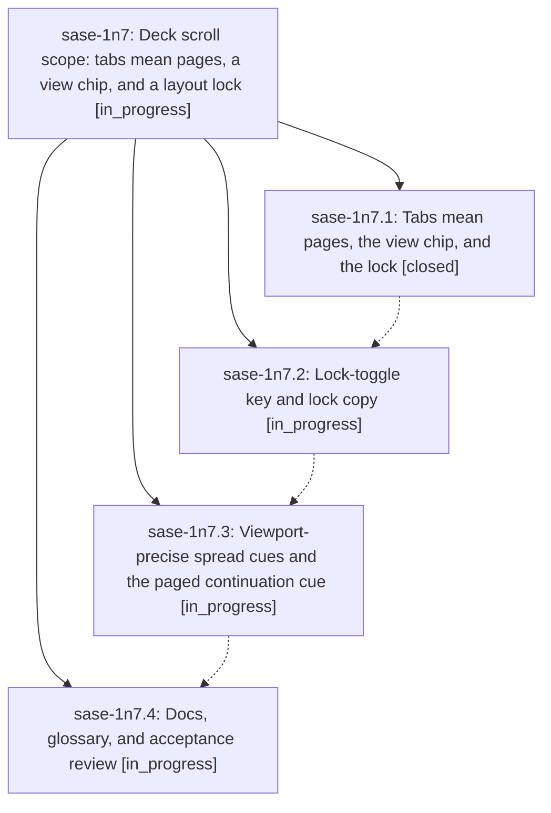

# Bead: sase-1n7 — Deck scroll scope: tabs mean pages, a view chip, and a layout lock

[Bead Pages](../README.md) / sase-1n7

**Status:** ◐ in_progress · **Type:** ▸ plan · **Tier:** epic
**Owner:** `bryanbugyi34@gmail.com` · **Created by:** [bbugyi200.athena.research.52.linker.w0](https://github.com/sase-org/sase--agents/blob/main/sessions/bbugyi200.athena.research.52.linker.w0.md) · **Assignee:** `sase-1n7.land`
**Created:** 2026-10-19 17:08:01 EDT
**Plan:** [202610/deck\_scroll\_scope.md](https://github.com/sase-org/sase--plans/blob/main/202610/deck_scroll_scope.md)

<!-- sase:links:start -->

## Links

| Relation | Artifact | Why |
| --- | --- | --- |
| implemented-by | [plan:202610/deck_scroll_scope.md][1] | derived from the plan's `bead_id:` frontmatter field |

[1]: https://github.com/sase-org/sase--plans/blob/main/202610/deck_scroll_scope.md

<!-- sase:links:end -->

## Description

From the deck panel's chrome alone, a user can tell whether the focused deck is one scrollable document or split into pages, which way the rest of it lies, and whether its layout is locked; the auto/fixed words give way to a lock icon with a real lock/unlock key.

## Phases

| Bead | Title | Status | Size | Created | Agents | Commits |
|---|---|---|---|---|---:|---:|
| [sase-1n7.1](sase-1n7.1.md) | Tabs mean pages, the view chip, and the lock | ✓ closed | medium | 2026-10-19 | 1 | 1 |
| [sase-1n7.2](sase-1n7.2.md) | Lock-toggle key and lock copy | ◐ in_progress | medium | 2026-10-19 | 1 | 0 |
| [sase-1n7.3](sase-1n7.3.md) | Viewport-precise spread cues and the paged continuation cue | ◐ in_progress | medium | 2026-10-19 | 1 | 0 |
| [sase-1n7.4](sase-1n7.4.md) | Docs, glossary, and acceptance review | ◐ in_progress | small | 2026-10-19 | 1 | 0 |

## Lineage

## Agents

| Agent | Bead | Commits |
|---|---|---:|
| [bbugyi200.athena.sase-1n7.1](https://github.com/sase-org/sase--agents/blob/main/agents/bbugyi200.athena.sase-1n7.1/README.md) | [sase-1n7.1](sase-1n7.1.md) | 1 |
| [bbugyi200.athena.sase-1n7.2](https://github.com/sase-org/sase--agents/blob/main/agents/bbugyi200.athena.sase-1n7.2/README.md) | [sase-1n7.2](sase-1n7.2.md) | 0 |
| [bbugyi200.athena.sase-1n7.3](https://github.com/sase-org/sase--agents/blob/main/agents/bbugyi200.athena.sase-1n7.3/README.md) | [sase-1n7.3](sase-1n7.3.md) | 0 |
| [bbugyi200.athena.sase-1n7.4](https://github.com/sase-org/sase--agents/blob/main/agents/bbugyi200.athena.sase-1n7.4/README.md) | [sase-1n7.4](sase-1n7.4.md) | 0 |
| [bbugyi200.athena.sase-1n7.land](https://github.com/sase-org/sase--agents/blob/main/agents/bbugyi200.athena.sase-1n7.land/README.md) | [sase-1n7](README.md) | 0 |

## Commits

| Repo | Commit | Subject | Bead | Committed |
|---|---|---|---|---|
| sase | [`9ece19c`](https://github.com/sase-org/sase/commit/9ece19c4af9e6569769d2e9b85e99a73b71e7d46) | feat(tui): paint deck view as chip, lock, and paged tabs | [sase-1n7.1](sase-1n7.1.md) | 2026-10-19 19:24:26 EDT |
