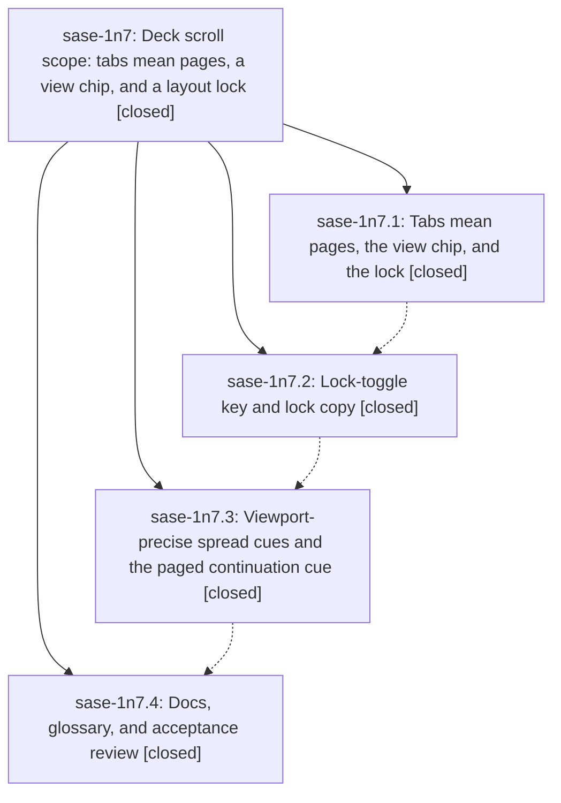

# Bead: sase-1n7 — Deck scroll scope: tabs mean pages, a view chip, and a layout lock

[Bead Pages](../README.md) / sase-1n7

**Status:** ✓ closed · **Resolution:** done · **Type:** ▸ plan · **Tier:** epic
**Owner:** `bryanbugyi34@gmail.com` · **Created by:** [bbugyi200.athena.research.52.linker.w0](https://github.com/sase-org/sase--agents/blob/main/sessions/bbugyi200.athena.research.52.linker.w0.md) · **Assignee:** `sase-1n7.land`
**Created:** 2026-10-19 17:08:01 EDT · **Closed:** 2026-10-20 09:24:24 EDT
**Plan:** [202610/deck\_scroll\_scope.md](https://github.com/sase-org/sase--plans/blob/main/202610/deck_scroll_scope.md)

<!-- sase:links:start -->

## Links

| Relation | Artifact | Why |
| --- | --- | --- |
| implemented-by | [plan:202610/deck_scroll_scope.md][1] | derived from the plan's `bead_id:` frontmatter field |

_Plus 1 automatic references — see [Referenced By](#referenced-by)._

[1]: https://github.com/sase-org/sase--plans/blob/main/202610/deck_scroll_scope.md

<!-- sase:links:end -->

## Description

From the deck panel's chrome alone, a user can tell whether the focused deck is one scrollable document or split into pages, which way the rest of it lies, and whether its layout is locked; the auto/fixed words give way to a lock icon with a real lock/unlock key.

## Notes

[2026-10-20T11:56:33Z · sase-1n7.land] LANDING AUDIT at e77280c873 (2026-10-20): read the epic and all four children, all child notes, approved plan, and commits 9ece19c4af / 798e786c88 / de1d960d11 / 3dbe570462. DECISIONS honored: Shift+B toggle wired through config/actions/palette/footer/help, P widening unchanged; only glossary:agent-data-card was edited. Reviewed effective-vs-shown chrome, held partial paints, tabs/chip visibility, scroll/layout scope-key hooks, continuation styling, docs, and later history. Fetch confirms origin/master == HEAD. Post-epic overlap: 3217324d9a splits the 11 deck-view snapshot tests; AST diff preserves every case/assertion/golden name and only renames moved helpers; use the new *_main.py / *_files.py paths for repairs. 25d14fae6c touches default_config only for monitor cleanup; other intervening commits are release/CI/monitor work with no deck feature integration needed. No epic-symbol entries, and no parent_bead shown.

FOLLOW-UP TRIAGE COMPLETE via /sase_new_task: (1) sase-1n7.1 note #1 manifest missing install_smoke/testpypi_drill: declined a new task because both exact entries are present, added by 110214f51c; historical phase-check mismatch is resolved on this tree. This does not certify the whole manifest or unrelated release changes. (2) sase-1n7.1 note #2 loaded bounded-drain 15s versus 5s: exact duplicate sase-xo, recorded +1 relaying that independent phase evidence; no new task, no new lander failure claimed. (3) sase-1n7.2 note #1 sticky Reply snapshot timeout: exact duplicate sase-1ii, recorded +1; also appended DISCOVERED ISSUE to causal active epic sase-1jz, whose open phase .3 explicitly owns that node. No new task. Other notes are completion evidence/relaunch notes, not follow-up proposals.

EPIC-CAUSED REMAINING WORK (do not close yet): (A) title_scope._cue_body and spread_title_candidates treat empty above/below as all_in_view even when the viewport resolver explicitly returns False. Repro: Context rows 0..80, Reply 80..100, viewport 70..100, here=Context, max_scroll_y=70 -> resolve_viewport_spread returns ((), (), False, True), yet deck_title says both cards in view while 70 rows of Context are hidden. (B) zoomed deck_subtitle falls back to restore-only after counts-only candidates fail; with single zoom, Z restore, +3 blocks / +1 card, width 25 it returns only Z restore, losing the required continuation counts rather than truncating them last. Both are bounded presentation repairs, with regression/pilot and targeted PNG evidence needed. Preparing a medium tale containing only these repairs, validation, and this epic closeout; it must close before its own host commit, without force or self-SHA/CI waits.

[2026-10-20T11:59:39Z · sase-1n7.land] LANDING VERIFICATION LIMIT: The optional six-module focused just test audit did not reach pytest: _setup detected stale linked-core build identity and waited on the shared wheel-build lock. The lander stopped only that owned command and setup children (exit 143) before proposing the required repair tale; no focused-suite pass is claimed. Both remaining chrome defects were reproduced directly in the installed Python environment. No production files were changed by this lander; the tale requires regressions, inspected targeted PNG captures, and wrapped just check before close. No just check-full was run.

[2026-10-20T13:24:24Z · sase-1n7.land--1] Landing review at e77280c873 covered epic plus 4 closed phases, approved plan decisions (Shift+B lock toggle, P widening unchanged, glossary:agent-data-card only), commits 9ece19c4af/798e786c88/de1d960d11/3dbe570462, and later overlap 3217324d9a (11 deck-view snapshot tests split, AST-preserved) and 25d14fae6c (monitor cleanup only). Repaired (A) viewport truth in title_scope.py: _cue_body and spread_title_candidates now use only cue.all_in_view for the all-in-view wording; empty above/below with all_in_view=False keeps the here-name ladder with no false arrows/phrase (repro Context 0..80/Reply 80..100 viewport 70..100 keeps Context, no both-cards-in-view). Repaired (B) zoom continuation in titles.py: removed restore-only fallback, added cell-width _truncated_copy preserving Rich spans; restore hint plus truncated continuation kept, restore-only only when no continuation cell fits (width 25 keeps Z restore +3 blocks, split/bound/unbound/boundary covered). Verification: sase tool run check f80b5930f87052008d3585d3ee25b2ce -> 56923 passed, 2 failed but triage no_new_failures (1 KNOWN import-budget witness 010c1d685dac36b0dd2ae407ea5c3c82, 1 FLAKY contract-manifest); focused decks suites 61 passed (scope_cues+deck_titles incl new regressions) and 65 passed (chrome/keys/policy); visual Main 8 passed and Files 3 passed exact goldens, no updates; just symvision clean. Follow-ups: (1) 1n7.1 note1 declined new manifest task, both entries present via 110214f51c, not a whole-manifest claim; (2) 1n7.1 note2 bounded-drain 15s vs 5s is exact duplicate sase-xo, +1 recorded, no new task; (3) 1n7.2 note1 sticky Reply timeout is exact duplicate sase-1ii, +1 recorded plus DISCOVERED ISSUE on active sase-1jz phase .3, no new task. No epic-symbol entries; close leaves 4 modified files for host commit, no check-full per explicit-only rule.

## Phases

| Bead | Title | Status | Size | Created | Agents | Commits |
|---|---|---|---|---|---:|---:|
| [sase-1n7.1](sase-1n7.1.md) | Tabs mean pages, the view chip, and the lock | ✓ closed | medium | 2026-10-19 | 1 | 1 |
| [sase-1n7.2](sase-1n7.2.md) | Lock-toggle key and lock copy | ✓ closed | medium | 2026-10-19 | 1 | 1 |
| [sase-1n7.3](sase-1n7.3.md) | Viewport-precise spread cues and the paged continuation cue | ✓ closed | medium | 2026-10-19 | 1 | 1 |
| [sase-1n7.4](sase-1n7.4.md) | Docs, glossary, and acceptance review | ✓ closed | small | 2026-10-19 | 1 | 1 |

## Lineage

## Agents

| Agent | Bead | Commits |
|---|---|---:|
| [bbugyi200.athena.sase-1n7.1](https://github.com/sase-org/sase--agents/blob/main/agents/bbugyi200.athena.sase-1n7.1/README.md) | [sase-1n7.1](sase-1n7.1.md) | 1 |
| [bbugyi200.athena.sase-1n7.2](https://github.com/sase-org/sase--agents/blob/main/sessions/bbugyi200.athena.sase-1n7.2.md) | [sase-1n7.2](sase-1n7.2.md) | 1 |
| [bbugyi200.athena.sase-1n7.3](https://github.com/sase-org/sase--agents/blob/main/sessions/bbugyi200.athena.sase-1n7.3.md) | [sase-1n7.3](sase-1n7.3.md) | 1 |
| [bbugyi200.athena.sase-1n7.4](https://github.com/sase-org/sase--agents/blob/main/sessions/bbugyi200.athena.sase-1n7.4.md) | [sase-1n7.4](sase-1n7.4.md) | 1 |
| [bbugyi200.athena.sase-1n7.land](https://github.com/sase-org/sase--agents/blob/main/sessions/bbugyi200.athena.sase-1n7.land.md) | [sase-1n7](README.md) | 2 |

## Commits

| Repo | Commit | Subject | Bead | Committed |
|---|---|---|---|---|
| sase | [`9ece19c`](https://github.com/sase-org/sase/commit/9ece19c4af9e6569769d2e9b85e99a73b71e7d46) | feat(tui): paint deck view as chip, lock, and paged tabs | [sase-1n7.1](sase-1n7.1.md) | 2026-10-19 19:24:26 EDT |
| sase | [`798e786`](https://github.com/sase-org/sase/commit/798e786c88c01c265748f294cc7af700d0099b3f) | feat(ace): add Agents deck view lock toggle | [sase-1n7.2](sase-1n7.2.md) | 2026-10-19 20:48:05 EDT |
| sase | [`de1d960`](https://github.com/sase-org/sase/commit/de1d960d11292255e6af5a879e1bc91481ac208d) | feat(decks): add viewport-precise scope cues for spread and paged panels | [sase-1n7.3](sase-1n7.3.md) | 2026-10-19 22:31:50 EDT |
| sase | [`3dbe570`](https://github.com/sase-org/sase/commit/3dbe5704627fc397dee88b7e9ff9c630929237c4) | docs(tui): document tabs-mean-pages deck chrome and lock vocabulary | [sase-1n7.4](sase-1n7.4.md) | 2026-10-20 07:09:04 EDT |
| sase | [`d9f711b`](https://github.com/sase-org/sase/commit/d9f711bbca354d9008a7a6d32378bb4f89044f53) | fix(decks): viewport-truth spread titles and zoom continuation counts | [sase-1n7](README.md) | 2026-10-20 09:26:09 EDT |
| sase--plans | [`sase--plans@d51c337`](https://github.com/sase-org/sase--plans/commit/d51c3379a2da0b9ff9385a134a90958607f158ca) | docs(plans): mark deck scroll scope plan done | [sase-1n7](README.md) | 2026-10-20 09:30:54 EDT |

<!-- sase:referenced-by:start -->

## Referenced By

| Relation | Artifact | Why | Uses |
| --- | --- | --- | ---: |
| read-by | [agent:sase-1n7.land--1][1] | verify phases remain done for landing | 2 |

[1]: https://github.com/sase-org/sase--agents/blob/main/sessions/bbugyi200.athena.sase-1n7.land.md

<!-- sase:referenced-by:end -->
