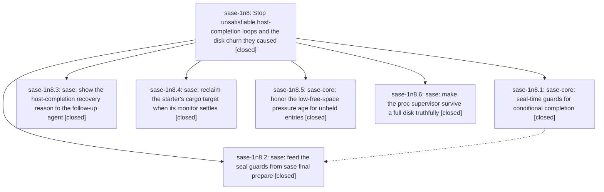

# Bead: sase-1n8 — Stop unsatisfiable host-completion loops and the disk churn they caused

[Bead Pages](../README.md) / sase-1n8

**Status:** ✓ closed · **Resolution:** done · **Type:** ▸ plan · **Tier:** epic
**Owner:** `bryanbugyi34@gmail.com` · **Created by:** `bbugyi200.apollo.96` · **Assignee:** `sase-1n8.land`
**Created:** 2026-10-20 06:52:59 EDT · **Closed:** 2026-10-20 10:16:12 EDT
**Plan:** [202610/host\_completion\_loop\_and\_disk\_churn.md](https://github.com/sase-org/sase--plans/blob/main/202610/host_completion_loop_and_disk_churn.md)

<!-- sase:links:start -->

## Links

| Relation | Artifact | Why |
| --- | --- | --- |
| implemented-by | [plan:202610/host_completion_loop_and_disk_churn.md][1] | derived from the plan's `bead_id:` frontmatter field |
| related | [bead:sase-1n9][2] | Epic whose phase sase-1n8.4 added monitor-settlement reclaim of the starter cargo target; a shared target must cooperate with that reclaim |

[1]: https://github.com/sase-org/sase--plans/blob/main/202610/host_completion_loop_and_disk_churn.md
[2]: https://github.com/sase-org/sase--beads/blob/main/pages/sase-1n9/README.md

<!-- sase:links:end -->

## Description

A verified agent can never loop on a host completion that cannot succeed, its recovery prompts say why completion refused, monitor cycles no longer pile up cargo targets, and a full disk yields a truthful, recoverable monitor outcome instead of a silent lost turn.

## Notes

[2026-10-20T13:52:39Z · sase-1n8.land] LAND TRIAGE (sase-1n8 land agent, 2026-10-20):
(a) sase-1n8.6 #1, 7 host-completion controller test failures. Epic-caused, not a follow-up. Phase 2's stage_source guard refuses tests/monitor/test_monitor_host_completion_controller.py, whose tmp project has no tool catalog, so prepare seals stage_source none for just check-full. Reproduced at HEAD 2648c7cddf (7 failed). Folded into the landing tale.
(b) sase-1n8.3 #1 and sase-1n8.4 #7, TUI import-budget overage. Epic-caused, not sase-1ic. tools/tui_import_closure -d 3dbe570462 shows pre-epic 3521 (< cap 3522) and HEAD 3524. The epic added +3 modules: sase.axe.run_agent_runner_scratch and sase.core.managed_tmp_reaper through proc_adapter's top-level cleanup import (25d14fae6c), plus sase.procs.supervisor_storage through procs.submission (2648c7cddf). The phases' 'clean base' already contained 25d14fae6c. Folded into the landing tale.
(c) sase-1n8.3 #1 and sase-1n8.4 #8, stale tests/contract_manifest.txt (test_github_actions_release_steward.py missing). Declined as already owned: it was caused by 812cdd9e21 (sase-1n6.7.1.5), and the sase-1n6.7.1 land triage (g) already folded it into that epic's tale. Still reproduces at HEAD.
(d) sase-1n8.3 #1, test_models_panel_provider_modal_priority full-suite ordering flake. Declined for insufficient evidence: no node ID, no failure output, and no reproduction (it passes in isolation). File it with the failing node and assertion if it recurs.
(e) sase-1n8.4 #9, publication bounded-drain flakes. Corroborated existing sase-xo with +1.
(f) sase-1n8.5 #1, federation_worker listener socket collision in sase-core. Corroborated existing sase-1gz with +1.
(g) sase-1n8.4 #3, cargo-target reuse across a session. Created feature task sase-1n9 (large, ready, linked to sase-1n8).
(h) Phase 2 left the generated skills undeployed. The land agent deployed them from clean landed master 2648c7cddf with sase skill init -y (chezmoi f5012be5).
Epic-symbols: none.

[2026-10-20T14:16:12Z · sase-1n8.land] Verified all six phases against plan:202610/host_completion_loop_and_disk_churn.md and the epic commits (sase 25d14fae6c, e77280c873, 321d881250, 379040e699, 2648c7cddf; sase-core b664b15b, 2f433851; pin b664b15b). Every DECISION was honored (no_stage_source=refuse, repeat_guard=guard). Land fixes for two epic-caused regressions: deferred proc_adapter's scratch-cleanup import and submission's supervisor_storage import, which restores the TUI import closure to 3521 under the 3522 cap; shared the run_silent catalog stub and applied it to the 7 failing host-completion controller tests. Integration: post-epic master commits (3dbe570462, 3cb4c57ca3, b79549090b, d9f711bbca, 043d67a919) do not touch the epic's surfaces. Generated skills were deployed from landed master. Follow-up triage is in the LAND TRIAGE note: +1 sase-xo, +1 sase-1gz, new feature sase-1n9; the stale contract manifest is owned by sase-1n6.7.1 (did not appear in this scoped just check). just check passed clean (sase tool run check, exit 0).

## Phases

| Bead | Title | Status | Size | Created | Agents | Commits |
|---|---|---|---|---|---:|---:|
| [sase-1n8.1](sase-1n8.1.md) | sase-core: seal-time guards for conditional completion | ✓ closed | medium | 2026-10-20 | 1 | 1 |
| [sase-1n8.2](sase-1n8.2.md) | sase: feed the seal guards from sase final prepare | ✓ closed | medium | 2026-10-20 | 1 | 1 |
| [sase-1n8.3](sase-1n8.3.md) | sase: show the host-completion recovery reason to the follow-up agent | ✓ closed | small | 2026-10-20 | 1 | 1 |
| [sase-1n8.4](sase-1n8.4.md) | sase: reclaim the starter's cargo target when its monitor settles | ✓ closed | medium | 2026-10-20 | 2 | 2 |
| [sase-1n8.5](sase-1n8.5.md) | sase-core: honor the low-free-space pressure age for unheld entries | ✓ closed | small | 2026-10-20 | 1 | 1 |
| [sase-1n8.6](sase-1n8.6.md) | sase: make the proc supervisor survive a full disk truthfully | ✓ closed | medium | 2026-10-20 | 1 | 1 |

## Lineage

## Agents

| Agent | Bead | Commits |
|---|---|---:|
| [bbugyi200.apollo.sase-1n8.4](https://github.com/sase-org/sase--agents/blob/main/agents/bbugyi200.apollo.sase-1n8.4/README.md) | [sase-1n8.4](sase-1n8.4.md) | 1 |
| [bbugyi200.athena.sase-1n8.1](https://github.com/sase-org/sase--agents/blob/main/agents/bbugyi200.athena.sase-1n8.1/README.md) | [sase-1n8.1](sase-1n8.1.md) | 1 |
| [bbugyi200.athena.sase-1n8.2](https://github.com/sase-org/sase--agents/blob/main/agents/bbugyi200.athena.sase-1n8.2/README.md) | [sase-1n8.2](sase-1n8.2.md) | 1 |
| [bbugyi200.athena.sase-1n8.3](https://github.com/sase-org/sase--agents/blob/main/agents/bbugyi200.athena.sase-1n8.3/README.md) | [sase-1n8.3](sase-1n8.3.md) | 1 |
| [bbugyi200.athena.sase-1n8.4](https://github.com/sase-org/sase--agents/blob/main/agents/bbugyi200.athena.sase-1n8.4/README.md) | [sase-1n8.4](sase-1n8.4.md) | 1 |
| [bbugyi200.athena.sase-1n8.5](https://github.com/sase-org/sase--agents/blob/main/agents/bbugyi200.athena.sase-1n8.5/README.md) | [sase-1n8.5](sase-1n8.5.md) | 1 |
| [bbugyi200.athena.sase-1n8.6](https://github.com/sase-org/sase--agents/blob/main/agents/bbugyi200.athena.sase-1n8.6/README.md) | [sase-1n8.6](sase-1n8.6.md) | 1 |
| [bbugyi200.athena.sase-1n8.land](https://github.com/sase-org/sase--agents/blob/main/sessions/bbugyi200.athena.sase-1n8.land.md) | [sase-1n8](README.md) | 2 |

## Commits

| Repo | Commit | Subject | Bead | Committed |
|---|---|---|---|---|
| sase | [`25d14fa`](https://github.com/sase-org/sase/commit/25d14fae6c39fbea6cc43eb86984475c7a8aacea) | feat(monitor): reclaim starter cargo targets on settlement | [sase-1n8.4](sase-1n8.4.md) | 2026-10-20 07:09:21 EDT |
| sase-core | [`sase-core@2f43385`](https://github.com/sase-org/sase-core/commit/2f4338511dbb8230d2254bee7da52798d6a65aca) | fix(managed-tmp): honor emergency pressure age | [sase-1n8.5](sase-1n8.5.md) | 2026-10-20 07:35:57 EDT |
| sase-core | [`sase-core@b664b15`](https://github.com/sase-org/sase-core/commit/b664b15bf7b27cc10c342f99d9777409495956e3) | feat(continuation): refuse unsatisfiable and repeated conditional completion seals | [sase-1n8.1](sase-1n8.1.md) | 2026-10-20 07:43:14 EDT |
| sase | [`e77280c`](https://github.com/sase-org/sase/commit/e77280c873763035f3e03cd4256f06af95d52f80) | feat(monitor): show host-completion recovery reasons in follow-up prompts | [sase-1n8.3](sase-1n8.3.md) | 2026-10-20 07:46:47 EDT |
| sase | [`321d881`](https://github.com/sase-org/sase/commit/321d88125082614188f79cbbdadfe3bfd282982b) | feat(final): seal prepare completion stage source, refusals and project | [sase-1n8.2](sase-1n8.2.md) | 2026-10-20 08:41:38 EDT |
| sase | [`379040e`](https://github.com/sase-org/sase/commit/379040e699e50e283bc72e7d598541206c6b29d3) | fix(monitor): read starter metadata when reclaiming cargo targets | [sase-1n8.4](sase-1n8.4.md) | 2026-10-20 08:55:42 EDT |
| sase | [`2648c7c`](https://github.com/sase-org/sase/commit/2648c7cddf2e644d73fd1cacdc81d59a3c5466ff) | fix(procs): preserve command outcomes under disk exhaustion | [sase-1n8.6](sase-1n8.6.md) | 2026-10-20 09:31:22 EDT |
| sase | [`9ecb80c`](https://github.com/sase-org/sase/commit/9ecb80cf0e2f374e36345dd6b94eed5db03c6699) | fix(final): defer epic imports out of TUI closure, share run\_silent catalog stub | [sase-1n8](README.md) | 2026-10-20 10:18:43 EDT |
| sase--plans | [`sase--plans@a193822`](https://github.com/sase-org/sase--plans/commit/a19382246eac85100b4d151c2d8c35e506a82891) | docs(plans): mark sase-1n8 epic plan done | [sase-1n8](README.md) | 2026-10-20 10:22:30 EDT |
