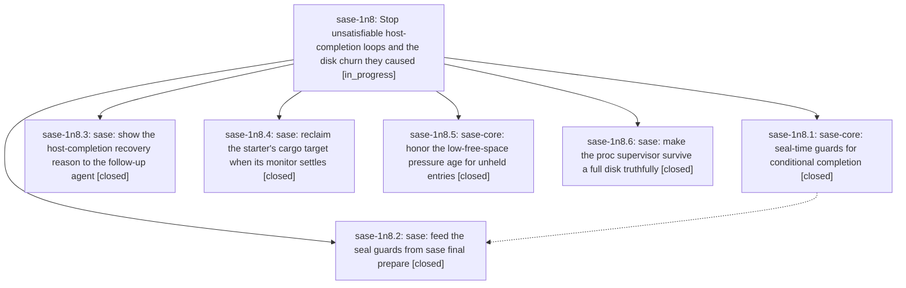

# Bead: sase-1n8 — Stop unsatisfiable host-completion loops and the disk churn they caused

[Bead Pages](../README.md) / sase-1n8

**Status:** ◐ in_progress · **Type:** ▸ plan · **Tier:** epic
**Owner:** `bryanbugyi34@gmail.com` · **Created by:** `bbugyi200.apollo.96` · **Assignee:** `sase-1n8.land`
**Created:** 2026-10-20 06:52:59 EDT
**Plan:** [202610/host\_completion\_loop\_and\_disk\_churn.md](https://github.com/sase-org/sase--plans/blob/main/202610/host_completion_loop_and_disk_churn.md)

<!-- sase:links:start -->

## Links

| Relation | Artifact | Why |
| --- | --- | --- |
| implemented-by | [plan:202610/host_completion_loop_and_disk_churn.md][1] | derived from the plan's `bead_id:` frontmatter field |

[1]: https://github.com/sase-org/sase--plans/blob/main/202610/host_completion_loop_and_disk_churn.md

<!-- sase:links:end -->

## Description

A verified agent can never loop on a host completion that cannot succeed, its recovery prompts say why completion refused, monitor cycles no longer pile up cargo targets, and a full disk yields a truthful, recoverable monitor outcome instead of a silent lost turn.

## Phases

| Bead | Title | Status | Size | Created | Agents | Commits |
|---|---|---|---|---|---:|---:|
| [sase-1n8.1](sase-1n8.1.md) | sase-core: seal-time guards for conditional completion | ✓ closed | medium | 2026-10-20 | 1 | 1 |
| [sase-1n8.2](sase-1n8.2.md) | sase: feed the seal guards from sase final prepare | ✓ closed | medium | 2026-10-20 | 1 | 1 |
| [sase-1n8.3](sase-1n8.3.md) | sase: show the host-completion recovery reason to the follow-up agent | ✓ closed | small | 2026-10-20 | 1 | 1 |
| [sase-1n8.4](sase-1n8.4.md) | sase: reclaim the starter's cargo target when its monitor settles | ✓ closed | medium | 2026-10-20 | 2 | 2 |
| [sase-1n8.5](sase-1n8.5.md) | sase-core: honor the low-free-space pressure age for unheld entries | ✓ closed | small | 2026-10-20 | 1 | 1 |
| [sase-1n8.6](sase-1n8.6.md) | sase: make the proc supervisor survive a full disk truthfully | ✓ closed | medium | 2026-10-20 | 1 | 1 |

## Lineage

## Agents

| Agent | Bead | Commits |
|---|---|---:|
| [bbugyi200.apollo.sase-1n8.4](https://github.com/sase-org/sase--agents/blob/main/agents/bbugyi200.apollo.sase-1n8.4/README.md) | [sase-1n8.4](sase-1n8.4.md) | 1 |
| [bbugyi200.athena.sase-1n8.1](https://github.com/sase-org/sase--agents/blob/main/agents/bbugyi200.athena.sase-1n8.1/README.md) | [sase-1n8.1](sase-1n8.1.md) | 1 |
| [bbugyi200.athena.sase-1n8.2](https://github.com/sase-org/sase--agents/blob/main/agents/bbugyi200.athena.sase-1n8.2/README.md) | [sase-1n8.2](sase-1n8.2.md) | 1 |
| [bbugyi200.athena.sase-1n8.3](https://github.com/sase-org/sase--agents/blob/main/agents/bbugyi200.athena.sase-1n8.3/README.md) | [sase-1n8.3](sase-1n8.3.md) | 1 |
| [bbugyi200.athena.sase-1n8.4](https://github.com/sase-org/sase--agents/blob/main/agents/bbugyi200.athena.sase-1n8.4/README.md) | [sase-1n8.4](sase-1n8.4.md) | 1 |
| [bbugyi200.athena.sase-1n8.5](https://github.com/sase-org/sase--agents/blob/main/agents/bbugyi200.athena.sase-1n8.5/README.md) | [sase-1n8.5](sase-1n8.5.md) | 1 |
| [bbugyi200.athena.sase-1n8.6](https://github.com/sase-org/sase--agents/blob/main/agents/bbugyi200.athena.sase-1n8.6/README.md) | [sase-1n8.6](sase-1n8.6.md) | 1 |
| [bbugyi200.athena.sase-1n8.land](https://github.com/sase-org/sase--agents/blob/main/agents/bbugyi200.athena.sase-1n8.land/README.md) | [sase-1n8](README.md) | 0 |

## Commits

| Repo | Commit | Subject | Bead | Committed |
|---|---|---|---|---|
| sase | [`25d14fa`](https://github.com/sase-org/sase/commit/25d14fae6c39fbea6cc43eb86984475c7a8aacea) | feat(monitor): reclaim starter cargo targets on settlement | [sase-1n8.4](sase-1n8.4.md) | 2026-10-20 07:09:21 EDT |
| sase-core | [`sase-core@2f43385`](https://github.com/sase-org/sase-core/commit/2f4338511dbb8230d2254bee7da52798d6a65aca) | fix(managed-tmp): honor emergency pressure age | [sase-1n8.5](sase-1n8.5.md) | 2026-10-20 07:35:57 EDT |
| sase-core | [`sase-core@b664b15`](https://github.com/sase-org/sase-core/commit/b664b15bf7b27cc10c342f99d9777409495956e3) | feat(continuation): refuse unsatisfiable and repeated conditional completion seals | [sase-1n8.1](sase-1n8.1.md) | 2026-10-20 07:43:14 EDT |
| sase | [`e77280c`](https://github.com/sase-org/sase/commit/e77280c873763035f3e03cd4256f06af95d52f80) | feat(monitor): show host-completion recovery reasons in follow-up prompts | [sase-1n8.3](sase-1n8.3.md) | 2026-10-20 07:46:47 EDT |
| sase | [`321d881`](https://github.com/sase-org/sase/commit/321d88125082614188f79cbbdadfe3bfd282982b) | feat(final): seal prepare completion stage source, refusals and project | [sase-1n8.2](sase-1n8.2.md) | 2026-10-20 08:41:38 EDT |
| sase | [`379040e`](https://github.com/sase-org/sase/commit/379040e699e50e283bc72e7d598541206c6b29d3) | fix(monitor): read starter metadata when reclaiming cargo targets | [sase-1n8.4](sase-1n8.4.md) | 2026-10-20 08:55:42 EDT |
| sase | [`2648c7c`](https://github.com/sase-org/sase/commit/2648c7cddf2e644d73fd1cacdc81d59a3c5466ff) | fix(procs): preserve command outcomes under disk exhaustion | [sase-1n8.6](sase-1n8.6.md) | 2026-10-20 09:31:22 EDT |
