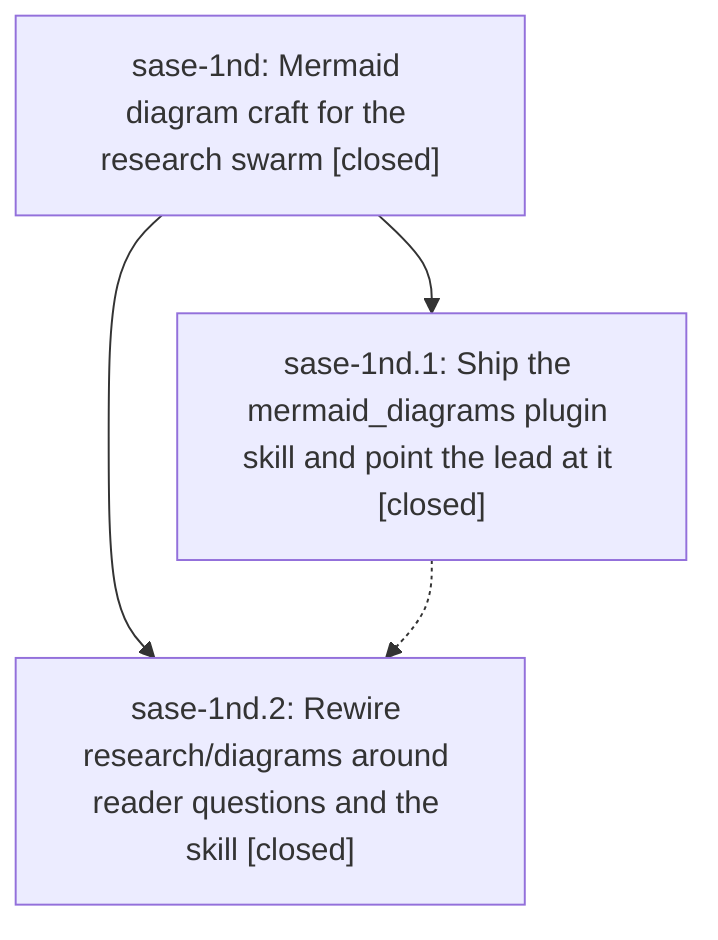

# Bead: sase-1nd — Mermaid diagram craft for the research swarm

[Bead Pages](../README.md) / sase-1nd

**Status:** ✓ closed · **Resolution:** done · **Type:** ▸ plan · **Tier:** epic
**Owner:** `bryanbugyi34@gmail.com` · **Created by:** [bbugyi200.athena.research.54.linker.w0](https://github.com/sase-org/sase--agents/blob/main/sessions/bbugyi200.athena.research.54.linker.w0.md) · **Assignee:** `sase-1nd.land`
**Created:** 2026-10-20 11:52:09 EDT · **Closed:** 2026-10-20 15:07:34 EDT
**Plan:** [202610/research\_mermaid\_diagram\_craft.md](https://github.com/sase-org/sase--plans/blob/main/202610/research_mermaid_diagram_craft.md)

<!-- sase:links:start -->

## Links

| Relation | Artifact | Why |
| --- | --- | --- |
| implemented-by | [plan:202610/research_mermaid_diagram_craft.md][1] | derived from the plan's `bead_id:` frontmatter field |

_Plus 1 automatic references — see [Referenced By](#referenced-by)._

[1]: https://github.com/sase-org/sase--plans/blob/main/202610/research_mermaid_diagram_craft.md

<!-- sase:links:end -->

## Description

The research swarm's diagrams agent proposes fewer, better Mermaid figures. Each one answers a named reader question, reads on its own from figure, in-figure title, and caption, uses a small semantic palette, and passes a look at a PDF-settings render that prints at 75% scale or more. The craft lives in one shared `mermaid_diagrams` plugin skill. `#research/diagrams` inlines it, and the swarm lead loads it on demand.

## Notes

[2026-10-20T17:27:06Z · sase-1nd.land] LAND FOLLOW-UP TRIAGE (all three proposals from sase-1nd.2 reviewed using /sase_new_task): note #1 (quality evaluation after 5-10 swarms) corroborated ready task sase-1mo with +1 and added the early checkpoint, title/question, 80% full-size/75% floor, blind rating, omission, type-mix, runtime, version-cohort, and measured split criteria. Note #2 (optional deterministic lint) declined for now: explicitly conditional on a noisy look loop, with no post-change evidence of that condition; this would add speculative tooling beyond the approved epic. Note #3 (renderer parity / house theme) split by outcome: renderer-parity checker corroborated ready task sase-1mn with +1, explaining that mmdc replaced its historical vault-dependent producer and that actual-renderer parity is the remaining benefit; optional house theme declined pending measured quality need and a renderer-owner decision. Searched feature tasks across all statuses, swept the last week, broadened the lint/theme search to all task types, and reviewed active epic scopes (including sase-s5, which owns duplicate publication rather than diagram quality/parity). No new task or active-epic discovered-issue routing warranted. Preserve all these outcomes in the eventual close note.

[2026-10-20T17:27:27Z · sase-1nd.land] LAND AUDIT: Read the epic and every note on sase-1nd.1 and .2, plan:202610/research_mermaid_diagram_craft.md, and the accepted research report. Reviewed plugin commits b16687b and af3a591 and their current sources/tests/docs. Reader-question ranking, fidelity, 3/5 caps, one inlined guide, manifest audit fields, fail-open behavior, linker placement, and packaged skill/examples are present. Remaining epic work: standalone skill recipe lacks pinned CLI-first selection, short TMPDIR, sandbox retry, scaled bounded PNG command, and root-SVG fit calculation/viewBox fallback; the lead pointer lacks its fallback and is incorrectly conditional on run_diagrams; generated-skill round-trip coverage is missing; the fixed palette/proposed modifier and several explicit craft rules, example fidelity, and home-override/AGENTS documentation need reconciliation with the approved plan. Phase .2 could not view its PNG, so the repair must render/look/measure all final examples. Integration: freshly opened plugin HEAD/origin/master af3a591 has only the two epic commits since b16687b; fetched SASE origin/master 9188cc5733 adds only unrelated deck-title test splits since epic creation, with no macro/skill integration needed. No parent_bead and no epic-symbol entries at audit time. Do not close yet: proposing one medium tale limited to these repairs, verification, and this epics same-turn closeout; all follow-up triage is already recorded separately.

[2026-10-20T19:07:34Z · sase-1nd.land--4] Implemented and verified the approved landing repairs. `sase tool run -- just test-wheel` completed with exit 0; host-workspace `just symvision` completed with exit 0. Rendered with Mermaid CLI 12.0.0 and visually inspected the four final PNG examples. Their PNG dimensions match the measured SVGs at 1.5x; layout-modes is 677.312 x 346 px with 96.4% fit, above the 75% floor. Plugin review: HEAD af3a591 contains epic commits b16687b and af3a591; SASE origin/master 9188cc5733 added only unrelated deck-title test splits, so no integration changes were needed. CHANGELOG.md is untouched. Follow-ups: corroborated sase-1mo with a post-release 5-10 swarm evaluation checkpoint; corroborated sase-1mn and kept renderer parity in the renderer project. Declined deterministic lint because the look loop has not shown noise, and declined a house theme pending measured need and renderer-owner decision. `sase bead epic-symbols sase-1nd` reported no symbols.

## Phases

| Bead | Title | Status | Size | Created | Agents | Commits |
|---|---|---|---|---|---:|---:|
| [sase-1nd.1](sase-1nd.1.md) | Ship the mermaid\_diagrams plugin skill and point the lead at it | ✓ closed | medium | 2026-10-20 | 1 | 1 |
| [sase-1nd.2](sase-1nd.2.md) | Rewire research/diagrams around reader questions and the skill | ✓ closed | medium | 2026-10-20 | 1 | 1 |

## Lineage

## Agents

| Agent | Bead | Commits |
|---|---|---:|
| [bbugyi200.athena.sase-1nd.1](https://github.com/sase-org/sase--agents/blob/main/agents/bbugyi200.athena.sase-1nd.1/README.md) | [sase-1nd.1](sase-1nd.1.md) | 1 |
| [bbugyi200.athena.sase-1nd.2](https://github.com/sase-org/sase--agents/blob/main/agents/bbugyi200.athena.sase-1nd.2/README.md) | [sase-1nd.2](sase-1nd.2.md) | 1 |
| [bbugyi200.athena.sase-1nd.land](https://github.com/sase-org/sase--agents/blob/main/sessions/bbugyi200.athena.sase-1nd.land.md) | [sase-1nd](README.md) | 1 |

## Commits

| Repo | Commit | Subject | Bead | Committed |
|---|---|---|---|---|
| sase-research-artifacts | [`sase-research-artifacts@b16687b`](https://github.com/sase-org/sase-research-artifacts/commit/b16687b9254d7c8257ef66b09500d163c90a7707) | feat(skills): add mermaid diagram craft guidance | [sase-1nd.1](sase-1nd.1.md) | 2026-10-20 12:37:11 EDT |
| sase-research-artifacts | [`sase-research-artifacts@af3a591`](https://github.com/sase-org/sase-research-artifacts/commit/af3a591c776d1d28206b55dbcb4be3c0d61aaada) | feat(research-diagrams): answer reader questions via the inlined skill guide | [sase-1nd.2](sase-1nd.2.md) | 2026-10-20 13:12:11 EDT |
| sase-research-artifacts | [`sase-research-artifacts@1333261`](https://github.com/sase-org/sase-research-artifacts/commit/133326168f8d5810a0b7e7f94191bf3111b3a6c1) | feat(research-diagrams): finish Mermaid craft landing repairs | [sase-1nd](README.md) | 2026-10-20 15:08:28 EDT |

<!-- sase:referenced-by:start -->

## Referenced By

| Relation | Artifact | Why | Uses |
| --- | --- | --- | ---: |
| read-by | [agent:sase-1nd.2][1] | epic scope and decisions | 1 |

[1]: https://github.com/sase-org/sase--agents/blob/main/agents/bbugyi200.athena.sase-1nd.2/README.md

<!-- sase:referenced-by:end -->
