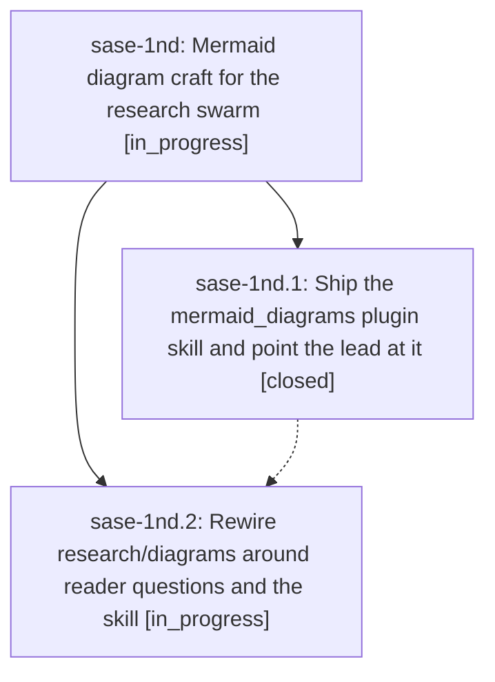

# Bead: sase-1nd — Mermaid diagram craft for the research swarm

[Bead Pages](../README.md) / sase-1nd

**Status:** ◐ in_progress · **Type:** ▸ plan · **Tier:** epic
**Owner:** `bryanbugyi34@gmail.com` · **Created by:** [bbugyi200.athena.research.54.linker.w0](https://github.com/sase-org/sase--agents/blob/main/sessions/bbugyi200.athena.research.54.linker.w0.md) · **Assignee:** `sase-1nd.land`
**Created:** 2026-10-20 11:52:09 EDT
**Plan:** [202610/research\_mermaid\_diagram\_craft.md](https://github.com/sase-org/sase--plans/blob/main/202610/research_mermaid_diagram_craft.md)

## Description

The research swarm's diagrams agent proposes fewer, better Mermaid figures. Each one answers a named reader question, reads on its own from figure, in-figure title, and caption, uses a small semantic palette, and passes a look at a PDF-settings render that prints at 75% scale or more. The craft lives in one shared `mermaid_diagrams` plugin skill. `#research/diagrams` inlines it, and the swarm lead loads it on demand.

## Phases

| Bead | Title | Status | Size | Created | Agents | Commits |
|---|---|---|---|---|---:|---:|
| [sase-1nd.1](sase-1nd.1.md) | Ship the mermaid\_diagrams plugin skill and point the lead at it | ✓ closed | medium | 2026-10-20 | 1 | 1 |
| [sase-1nd.2](sase-1nd.2.md) | Rewire research/diagrams around reader questions and the skill | ◐ in_progress | medium | 2026-10-20 | 1 | 0 |

## Lineage

## Agents

| Agent | Bead | Commits |
|---|---|---:|
| [bbugyi200.athena.sase-1nd.1](https://github.com/sase-org/sase--agents/blob/main/agents/bbugyi200.athena.sase-1nd.1/README.md) | [sase-1nd.1](sase-1nd.1.md) | 1 |
| [bbugyi200.athena.sase-1nd.2](https://github.com/sase-org/sase--agents/blob/main/agents/bbugyi200.athena.sase-1nd.2/README.md) | [sase-1nd.2](sase-1nd.2.md) | 0 |
| [bbugyi200.athena.sase-1nd.land](https://github.com/sase-org/sase--agents/blob/main/agents/bbugyi200.athena.sase-1nd.land/README.md) | [sase-1nd](README.md) | 0 |

## Commits

| Repo | Commit | Subject | Bead | Committed |
|---|---|---|---|---|
| sase-research-artifacts | [`sase-research-artifacts@b16687b`](https://github.com/sase-org/sase-research-artifacts/commit/b16687b9254d7c8257ef66b09500d163c90a7707) | feat(skills): add mermaid diagram craft guidance | [sase-1nd.1](sase-1nd.1.md) | 2026-10-20 12:37:11 EDT |
