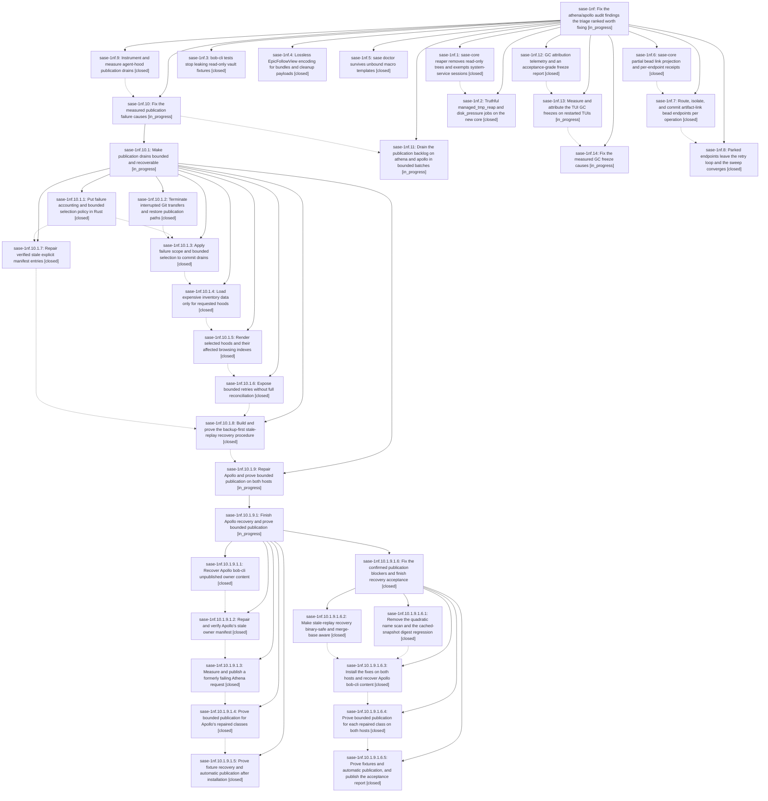

# Bead: sase-1nf — Fix the athena/apollo audit findings the triage ranked worth fixing

[Bead Pages](../README.md) / sase-1nf

**Status:** ◐ in_progress · **Type:** ▸ plan · **Tier:** epic
**Owner:** `bryanbugyi34@gmail.com` · **Created by:** [bbugyi200.athena.12i](https://github.com/sase-org/sase--agents/blob/main/sessions/bbugyi200.athena.12i.md) · **Assignee:** `sase-1nf.land`
**Created:** 2026-10-20 13:36:13 EDT
**Plan:** [202610/athena\_apollo\_audit\_fixes.md](https://github.com/sase-org/sase--plans/blob/main/202610/athena_apollo_audit_fixes.md)

<!-- sase:links:start -->

## Links

| Relation | Artifact | Why |
| --- | --- | --- |
| implemented-by | [plan:202610/athena_apollo_audit_fixes.md][1] | derived from the plan's `bead_id:` frontmatter field |

_Plus 4 automatic references — see [Referenced By](#referenced-by)._

[1]: https://github.com/sase-org/sase--plans/blob/main/202610/athena_apollo_audit_fixes.md

<!-- sase:links:end -->

## Description

Apollo's and athena's managed-tmp reaper reclaims dead scratch even with SSH sessions open and read-only test trees present, and its jobs report failures truthfully. Agent cleanup works while any agent waits on an epic. `sase doctor -j` always prints JSON. Artifact-link projection converges past missing or foreign bead endpoints. Agent-hood publication drains its quarantine backlog through measured fixes and bounded retries. The TUI's multi-second GC freezes are attributed and fixed against sase-1f3's targets. Task beads sase-1bw, sase-1ne, sase-1nb, sase-1na, sase-1c5, sase-1f4, sase-1f3, sase-10x, and sase-1nc are closed with evidence, and the stalled epic sase-11o is superseded.

## Phases

| Bead | Title | Status | Size | Created | Agents | Commits |
|---|---|---|---|---|---:|---:|
| [sase-1nf.1](sase-1nf.1.md) | sase-core reaper removes read-only trees and exempts system-service sessions | ✓ closed | medium | 2026-10-20 | 1 | 1 |
| [sase-1nf.10](sase-1nf.10.md) | Fix the measured publication failure causes | ◐ in_progress | large | 2026-10-20 | 1 | 0 |
| [sase-1nf.11](sase-1nf.11.md) | Drain the publication backlog on athena and apollo in bounded batches | ◐ in_progress | medium | 2026-10-20 | 1 | 0 |
| [sase-1nf.12](sase-1nf.12.md) | GC attribution telemetry and an acceptance-grade freeze report | ✓ closed | medium | 2026-10-20 | 1 | 1 |
| [sase-1nf.13](sase-1nf.13.md) | Measure and attribute the TUI GC freezes on restarted TUIs | ◐ in_progress | medium | 2026-10-20 | 1 | 1 |
| [sase-1nf.14](sase-1nf.14.md) | Fix the measured GC freeze causes | ◐ in_progress | large | 2026-10-20 | 1 | 0 |
| [sase-1nf.2](sase-1nf.2.md) | Truthful managed\_tmp\_reap and disk\_pressure jobs on the new core | ✓ closed | medium | 2026-10-20 | 1 | 1 |
| [sase-1nf.3](sase-1nf.3.md) | bob-cli tests stop leaking read-only vault fixtures | ✓ closed | small | 2026-10-20 | 1 | 0 |
| [sase-1nf.4](sase-1nf.4.md) | Lossless EpicFollowView encoding for bundles and cleanup payloads | ✓ closed | medium | 2026-10-20 | 1 | 1 |
| [sase-1nf.5](sase-1nf.5.md) | sase doctor survives unbound macro templates | ✓ closed | small | 2026-10-20 | 1 | 1 |
| [sase-1nf.6](sase-1nf.6.md) | sase-core partial bead link projection and per-endpoint receipts | ✓ closed | medium | 2026-10-20 | 1 | 1 |
| [sase-1nf.7](sase-1nf.7.md) | Route, isolate, and commit artifact-link bead endpoints per operation | ✓ closed | medium | 2026-10-20 | 1 | 1 |
| [sase-1nf.8](sase-1nf.8.md) | Parked endpoints leave the retry loop and the sweep converges | ✓ closed | medium | 2026-10-20 | 1 | 1 |
| [sase-1nf.9](sase-1nf.9.md) | Instrument and measure agent-hood publication drains | ✓ closed | medium | 2026-10-20 | 1 | 2 |

## Lineage

## Agents

| Agent | Bead | Commits |
|---|---|---:|
| [bbugyi200.athena.sase-1nf.1](https://github.com/sase-org/sase--agents/blob/main/agents/bbugyi200.athena.sase-1nf.1/README.md) | [sase-1nf.1](sase-1nf.1.md) | 1 |
| [bbugyi200.athena.sase-1nf.10](https://github.com/sase-org/sase--agents/blob/main/sessions/bbugyi200.athena.sase-1nf.10.md) | [sase-1nf.10](sase-1nf.10.md) | 0 |
| [bbugyi200.athena.sase-1nf.10.1.1](https://github.com/sase-org/sase--agents/blob/main/agents/bbugyi200.athena.sase-1nf.10.1.1/README.md) | [sase-1nf.10.1.1](sase-1nf.10.1.1.md) | 2 |
| [bbugyi200.athena.sase-1nf.10.1.2](https://github.com/sase-org/sase--agents/blob/main/agents/bbugyi200.athena.sase-1nf.10.1.2/README.md) | [sase-1nf.10.1.2](sase-1nf.10.1.2.md) | 1 |
| [bbugyi200.athena.sase-1nf.10.1.3](https://github.com/sase-org/sase--agents/blob/main/agents/bbugyi200.athena.sase-1nf.10.1.3/README.md) | [sase-1nf.10.1.3](sase-1nf.10.1.3.md) | 1 |
| [bbugyi200.athena.sase-1nf.10.1.4](https://github.com/sase-org/sase--agents/blob/main/sessions/bbugyi200.athena.sase-1nf.10.1.4.md) | [sase-1nf.10.1.4](sase-1nf.10.1.4.md) | 1 |
| [bbugyi200.athena.sase-1nf.10.1.5](https://github.com/sase-org/sase--agents/blob/main/agents/bbugyi200.athena.sase-1nf.10.1.5/README.md) | [sase-1nf.10.1.5](sase-1nf.10.1.5.md) | 1 |
| [bbugyi200.athena.sase-1nf.10.1.6](https://github.com/sase-org/sase--agents/blob/main/agents/bbugyi200.athena.sase-1nf.10.1.6/README.md) | [sase-1nf.10.1.6](sase-1nf.10.1.6.md) | 1 |
| [bbugyi200.athena.sase-1nf.10.1.7](https://github.com/sase-org/sase--agents/blob/main/sessions/bbugyi200.athena.sase-1nf.10.1.7.md) | [sase-1nf.10.1.7](sase-1nf.10.1.7.md) | 2 |
| [bbugyi200.athena.sase-1nf.10.1.8](https://github.com/sase-org/sase--agents/blob/main/agents/bbugyi200.athena.sase-1nf.10.1.8/README.md) | [sase-1nf.10.1.8](sase-1nf.10.1.8.md) | 2 |
| [bbugyi200.athena.sase-1nf.10.1.9](https://github.com/sase-org/sase--agents/blob/main/sessions/bbugyi200.athena.sase-1nf.10.1.9.md) | [sase-1nf.10.1.9](sase-1nf.10.1.9.md) | 0 |
| [bbugyi200.athena.sase-1nf.10.1.9.1.6.1](https://github.com/sase-org/sase--agents/blob/main/agents/bbugyi200.athena.sase-1nf.10.1.9.1.6.1/README.md) | [sase-1nf.10.1.9.1.6.1](sase-1nf.10.1.9.1.6.1.md) | 1 |
| [bbugyi200.athena.sase-1nf.10.1.9.1.6.2](https://github.com/sase-org/sase--agents/blob/main/agents/bbugyi200.athena.sase-1nf.10.1.9.1.6.2/README.md) | [sase-1nf.10.1.9.1.6.2](sase-1nf.10.1.9.1.6.2.md) | 2 |
| [bbugyi200.athena.sase-1nf.10.1.9.1.6.3](https://github.com/sase-org/sase--agents/blob/main/sessions/bbugyi200.athena.sase-1nf.10.1.9.1.6.3.md) | [sase-1nf.10.1.9.1.6.3](sase-1nf.10.1.9.1.6.3.md) | 0 |
| [bbugyi200.athena.sase-1nf.10.1.9.1.6.4](https://github.com/sase-org/sase--agents/blob/main/agents/bbugyi200.athena.sase-1nf.10.1.9.1.6.4/README.md) | [sase-1nf.10.1.9.1.6.4](sase-1nf.10.1.9.1.6.4.md) | 0 |
| [bbugyi200.athena.sase-1nf.10.1.9.1.6.5](https://github.com/sase-org/sase--agents/blob/main/agents/bbugyi200.athena.sase-1nf.10.1.9.1.6.5/README.md) | [sase-1nf.10.1.9.1.6.5](sase-1nf.10.1.9.1.6.5.md) | 1 |
| [bbugyi200.athena.sase-1nf.10.1.9.1.6.land](https://github.com/sase-org/sase--agents/blob/main/agents/bbugyi200.athena.sase-1nf.10.1.9.1.6.land/README.md) | [sase-1nf.10.1.9.1.6](sase-1nf.10.1.9.1.6.md) | 1 |
| [bbugyi200.athena.sase-1nf.10.1.land](https://github.com/sase-org/sase--agents/blob/main/agents/bbugyi200.athena.sase-1nf.10.1.land/README.md) | [sase-1nf.10.1](sase-1nf.10.1.md) | 0 |
| [bbugyi200.athena.sase-1nf.11](https://github.com/sase-org/sase--agents/blob/main/agents/bbugyi200.athena.sase-1nf.11/README.md) | [sase-1nf.11](sase-1nf.11.md) | 0 |
| [bbugyi200.athena.sase-1nf.12](https://github.com/sase-org/sase--agents/blob/main/agents/bbugyi200.athena.sase-1nf.12/README.md) | [sase-1nf.12](sase-1nf.12.md) | 1 |
| [bbugyi200.athena.sase-1nf.13](https://github.com/sase-org/sase--agents/blob/main/sessions/bbugyi200.athena.sase-1nf.13.md) | [sase-1nf.13](sase-1nf.13.md) | 1 |
| [bbugyi200.athena.sase-1nf.14](https://github.com/sase-org/sase--agents/blob/main/agents/bbugyi200.athena.sase-1nf.14/README.md) | [sase-1nf.14](sase-1nf.14.md) | 0 |
| [bbugyi200.athena.sase-1nf.2](https://github.com/sase-org/sase--agents/blob/main/agents/bbugyi200.athena.sase-1nf.2/README.md) | [sase-1nf.2](sase-1nf.2.md) | 1 |
| [bbugyi200.athena.sase-1nf.3](https://github.com/sase-org/sase--agents/blob/main/agents/bbugyi200.athena.sase-1nf.3/README.md) | [sase-1nf.3](sase-1nf.3.md) | 0 |
| [bbugyi200.athena.sase-1nf.4](https://github.com/sase-org/sase--agents/blob/main/sessions/bbugyi200.athena.sase-1nf.4.md) | [sase-1nf.4](sase-1nf.4.md) | 1 |
| [bbugyi200.athena.sase-1nf.5](https://github.com/sase-org/sase--agents/blob/main/agents/bbugyi200.athena.sase-1nf.5/README.md) | [sase-1nf.5](sase-1nf.5.md) | 1 |
| [bbugyi200.athena.sase-1nf.6](https://github.com/sase-org/sase--agents/blob/main/sessions/bbugyi200.athena.sase-1nf.6.md) | [sase-1nf.6](sase-1nf.6.md) | 1 |
| [bbugyi200.athena.sase-1nf.7](https://github.com/sase-org/sase--agents/blob/main/sessions/bbugyi200.athena.sase-1nf.7.md) | [sase-1nf.7](sase-1nf.7.md) | 1 |
| [bbugyi200.athena.sase-1nf.8](https://github.com/sase-org/sase--agents/blob/main/agents/bbugyi200.athena.sase-1nf.8/README.md) | [sase-1nf.8](sase-1nf.8.md) | 1 |
| [bbugyi200.athena.sase-1nf.9](https://github.com/sase-org/sase--agents/blob/main/sessions/bbugyi200.athena.sase-1nf.9.md) | [sase-1nf.9](sase-1nf.9.md) | 2 |
| [bbugyi200.athena.sase-1nf.land](https://github.com/sase-org/sase--agents/blob/main/agents/bbugyi200.athena.sase-1nf.land/README.md) | [sase-1nf](README.md) | 0 |

## Commits

| Repo | Commit | Subject | Bead | Committed |
|---|---|---|---|---|
| sase | [`d958a16`](https://github.com/sase-org/sase/commit/d958a168fc1b21fa68a8cc457f711b6680fb5dcc) | fix(doctor): survive unbound macro templates in model-macro check | [sase-1nf.5](sase-1nf.5.md) | 2026-10-20 13:56:12 EDT |
| sase | [`682e52f`](https://github.com/sase-org/sase/commit/682e52fc716fd93a1481abbad57a9f219c6877a1) | fix(cleanup): losslessly encode EpicFollowView wait\_epic\_follows in bundles | [sase-1nf.4](sase-1nf.4.md) | 2026-10-20 14:06:08 EDT |
| sase-core | [`sase-core@6f354df`](https://github.com/sase-org/sase-core/commit/6f354df4d9650777087c06cc937526d95671d493) | fix(managed-tmp): repair 0555 trees and exempt system-service sessions | [sase-1nf.1](sase-1nf.1.md) | 2026-10-20 14:23:21 EDT |
| sase | [`4136946`](https://github.com/sase-org/sase/commit/413694618eb7ee102ce8f5b785575c605353ee98) | fix(cleanup): report managed tmp and disk pressure outcomes | [sase-1nf.2](sase-1nf.2.md) | 2026-10-20 15:09:12 EDT |
| sase-core | [`sase-core@ce6104b`](https://github.com/sase-org/sase-core/commit/ce6104b19cf36a8c71267c67c1afa0b52ac4c8ec) | feat(artifact-links): add partial projection receipts | [sase-1nf.6](sase-1nf.6.md) | 2026-10-20 15:13:16 EDT |
| sase | [`1325078`](https://github.com/sase-org/sase/commit/1325078a8edd30df84eaa6356863a8fd35f63c80) | feat(agents-sync): instrument and measure publication drains (sase-1nf.9) | [sase-1nf.9](sase-1nf.9.md) | 2026-10-20 15:17:08 EDT |
| sase | [`aae7eae`](https://github.com/sase-org/sase/commit/aae7eae66779aa03486f215f7b44defa2912a508) | feat(tui): add GC attribution telemetry and an acceptance freeze report | [sase-1nf.12](sase-1nf.12.md) | 2026-10-20 15:19:41 EDT |
| sase--research | [`sase--research@9b6e0fc`](https://github.com/sase-org/sase--research/commit/9b6e0fc3ba059cd5f9825122036d2146e8797d68) | docs(research): publish agent-hood publication drain measurement report | [sase-1nf.9](sase-1nf.9.md) | 2026-10-20 15:21:54 EDT |
| sase | [`4adee84`](https://github.com/sase-org/sase/commit/4adee846d3c32f0927639193f3d3c2717df946ee) | fix(agents-sync): bound publication cleanup on interruption | [sase-1nf.10.1.2](sase-1nf.10.1.2.md) | 2026-10-20 16:41:08 EDT |
| sase | [`eb96eaf`](https://github.com/sase-org/sase/commit/eb96eafd442a28cd96ad2e4c35603845d179450c) | feat(artifact-links): classify and isolate bead endpoints per operation | [sase-1nf.7](sase-1nf.7.md) | 2026-10-20 16:56:11 EDT |
| sase-core | [`sase-core@f9aa563`](https://github.com/sase-org/sase-core/commit/f9aa563c114c1fb1a4ee6a22f6b893ee42ef756f) | feat(publication-recovery): add failure accounting and bounded drain selection | [sase-1nf.10.1.1](sase-1nf.10.1.1.md) | 2026-10-20 17:20:54 EDT |
| sase | [`69dc952`](https://github.com/sase-org/sase/commit/69dc95277dd42d5758f6f122550e51916dc17acb) | feat(publication-recovery): facade for failure accounting and drain selection | [sase-1nf.10.1.1](sase-1nf.10.1.1.md) | 2026-10-20 18:41:04 EDT |
| sase | [`1a69c89`](https://github.com/sase-org/sase/commit/1a69c8947d47666c0e4a548ee21bc41ba1e9d9e1) | feat(agents-sync): commit publication drain accounting | [sase-1nf.10.1.3](sase-1nf.10.1.3.md) | 2026-10-20 19:44:10 EDT |
| sase | [`40c47cf`](https://github.com/sase-org/sase/commit/40c47cf6cd48ff94d8a1130b76e8be9f24f216fd) | feat(artifact-links): park unconverged outbox operations off the retry loop | [sase-1nf.8](sase-1nf.8.md) | 2026-10-20 19:44:42 EDT |
| sase-core | [`sase-core@cfae073`](https://github.com/sase-org/sase-core/commit/cfae07381f846808ab7708e108456d1fea0fba5c) | feat(vcs): expose verified manifest repair policy | [sase-1nf.10.1.7](sase-1nf.10.1.7.md) | 2026-10-20 20:05:42 EDT |
| sase | [`b6a7a58`](https://github.com/sase-org/sase/commit/b6a7a58fdd0afb34310f6786d6e2ebfa310cf3e1) | feat(agents-sync): repair verified stale manifest lists | [sase-1nf.10.1.7](sase-1nf.10.1.7.md) | 2026-10-20 20:10:06 EDT |
| sase | [`1f107c4`](https://github.com/sase-org/sase/commit/1f107c4a891953fc02c2276e1ae27c18002d5a61) | feat(agents-sync): scope inventory hydration to requested hoods | [sase-1nf.10.1.4](sase-1nf.10.1.4.md) | 2026-10-20 21:36:29 EDT |
| sase | [`8c6699f`](https://github.com/sase-org/sase/commit/8c6699f413fd89607a250cb82d04cffbb9d91ae8) | feat(agents-sync): render targeted payloads for selected hoods | [sase-1nf.10.1.5](sase-1nf.10.1.5.md) | 2026-10-20 22:06:51 EDT |
| sase | [`7a08bf2`](https://github.com/sase-org/sase/commit/7a08bf2fda1afae8950d04730092fd27df847092) | feat(agents-sync): expose bounded publication retries | [sase-1nf.10.1.6](sase-1nf.10.1.6.md) | 2026-10-20 23:05:54 EDT |
| sase-core | [`sase-core@461e7a1`](https://github.com/sase-org/sase-core/commit/461e7a1818903ac578c0c0bf0377a9c206bacf32) | feat(vcs): add stale-replay conflict and preservation policy | [sase-1nf.10.1.8](sase-1nf.10.1.8.md) | 2026-10-21 01:22:19 EDT |
| sase | [`5803ddf`](https://github.com/sase-org/sase/commit/5803ddfa0b900dfbff7829e06fb71b10868cc8f5) | feat(agents-sync): add backup-first stale-replay recovery | [sase-1nf.10.1.8](sase-1nf.10.1.8.md) | 2026-10-21 01:26:43 EDT |
| sase | [`54779b6`](https://github.com/sase-org/sase/commit/54779b62f57805fbec295240f4de7201c87a4376) | perf(agents-sync): fix quadratic reserved-session scan and snapshot digest regression | [sase-1nf.10.1.9.1.6.1](sase-1nf.10.1.9.1.6.1.md) | 2026-10-21 11:19:30 EDT |
| sase-core | [`sase-core@1503d60`](https://github.com/sase-org/sase-core/commit/1503d604844a32a8a93e944addabb0887f8d9bc4) | feat(replay): accept merge-base bytes in recovery policy | [sase-1nf.10.1.9.1.6.2](sase-1nf.10.1.9.1.6.2.md) | 2026-10-21 12:08:48 EDT |
| sase | [`16d63cf`](https://github.com/sase-org/sase/commit/16d63cf9b0a4fc1a4e5c56a4660d2e45348ea0e8) | fix(agents-sync): preserve binary replay changes from merge base | [sase-1nf.10.1.9.1.6.2](sase-1nf.10.1.9.1.6.2.md) | 2026-10-21 12:12:14 EDT |
| sase--research | [`sase--research@d8c6067`](https://github.com/sase-org/sase--research/commit/d8c60672d0b4b55bb6953f0a17a544959acf573b) | docs(research): publish publication recovery acceptance | [sase-1nf.10.1.9.1.6.5](sase-1nf.10.1.9.1.6.5.md) | 2026-10-22 08:21:25 EDT |
| sase--plans | [`sase--plans@8ecd7e0`](https://github.com/sase-org/sase--plans/commit/8ecd7e09ff7c476a7a8126db2d7aa524dc6e0e43) | chore(plans): mark publication blockers acceptance plan done | [sase-1nf.10.1.9.1.6](sase-1nf.10.1.9.1.6.md) | 2026-10-22 08:48:02 EDT |
| sase--research | [`sase--research@5ca8834`](https://github.com/sase-org/sase--research/commit/5ca8834314d253e69ad67ffea782e42fd637fcd1) | docs(research): record verified four-hour TUI GC measurements | [sase-1nf.13](sase-1nf.13.md) | 2026-10-23 22:34:58 EDT |

<!-- sase:referenced-by:start -->

## Referenced By

| Relation | Artifact | Why | Uses |
| --- | --- | --- | ---: |
| read-by | [agent:sase-1nf.1][1] | Need parent epic DECISIONS and phase list | 1 |
| read-by | [agent:sase-1nf.10.1.6][2] | Need parent scopes and epic decisions for this phase | 1 |
| read-by | [agent:sase-1nf.3][3] | Need parent epic context and remaining phases | 1 |
| read-by | [agent:sase-1nf.8][4] | Need parent epic scope and remaining phases | 1 |

[1]: https://github.com/sase-org/sase--agents/blob/main/agents/bbugyi200.athena.sase-1nf.1/README.md
[2]: https://github.com/sase-org/sase--agents/blob/main/agents/bbugyi200.athena.sase-1nf.10.1.6/README.md
[3]: https://github.com/sase-org/sase--agents/blob/main/agents/bbugyi200.athena.sase-1nf.3/README.md
[4]: https://github.com/sase-org/sase--agents/blob/main/agents/bbugyi200.athena.sase-1nf.8/README.md

<!-- sase:referenced-by:end -->
