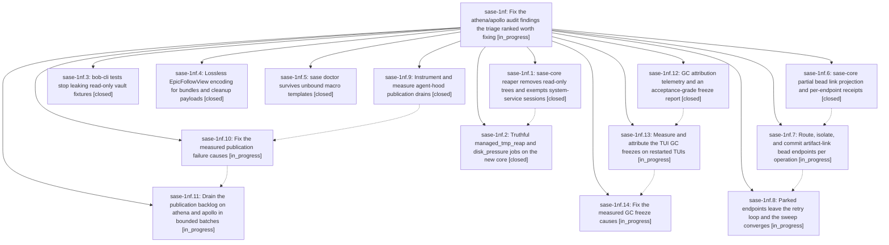

# Bead: sase-1nf — Fix the athena/apollo audit findings the triage ranked worth fixing

[Bead Pages](../README.md) / sase-1nf

**Status:** ◐ in_progress · **Type:** ▸ plan · **Tier:** epic
**Owner:** `bryanbugyi34@gmail.com` · **Created by:** [bbugyi200.athena.12i](https://github.com/sase-org/sase--agents/blob/main/sessions/bbugyi200.athena.12i.md) · **Assignee:** `sase-1nf.land`
**Created:** 2026-10-20 13:36:13 EDT
**Plan:** [202610/athena\_apollo\_audit\_fixes.md](https://github.com/sase-org/sase--plans/blob/main/202610/athena_apollo_audit_fixes.md)

<!-- sase:links:start -->

## Links

| Relation | Artifact | Why |
| --- | --- | --- |
| implemented-by | [plan:202610/athena_apollo_audit_fixes.md][1] | derived from the plan's `bead_id:` frontmatter field |

_Plus 2 automatic references — see [Referenced By](#referenced-by)._

[1]: https://github.com/sase-org/sase--plans/blob/main/202610/athena_apollo_audit_fixes.md

<!-- sase:links:end -->

## Description

Apollo's and athena's managed-tmp reaper reclaims dead scratch even with SSH sessions open and read-only test trees present, and its jobs report failures truthfully. Agent cleanup works while any agent waits on an epic. `sase doctor -j` always prints JSON. Artifact-link projection converges past missing or foreign bead endpoints. Agent-hood publication drains its quarantine backlog through measured fixes and bounded retries. The TUI's multi-second GC freezes are attributed and fixed against sase-1f3's targets. Task beads sase-1bw, sase-1ne, sase-1nb, sase-1na, sase-1c5, sase-1f4, sase-1f3, sase-10x, and sase-1nc are closed with evidence, and the stalled epic sase-11o is superseded.

## Phases

| Bead | Title | Status | Size | Created | Agents | Commits |
|---|---|---|---|---|---:|---:|
| [sase-1nf.1](sase-1nf.1.md) | sase-core reaper removes read-only trees and exempts system-service sessions | ✓ closed | medium | 2026-10-20 | 1 | 1 |
| [sase-1nf.10](sase-1nf.10.md) | Fix the measured publication failure causes | ◐ in_progress | large | 2026-10-20 | 1 | 0 |
| [sase-1nf.11](sase-1nf.11.md) | Drain the publication backlog on athena and apollo in bounded batches | ◐ in_progress | medium | 2026-10-20 | 1 | 0 |
| [sase-1nf.12](sase-1nf.12.md) | GC attribution telemetry and an acceptance-grade freeze report | ✓ closed | medium | 2026-10-20 | 1 | 0 |
| [sase-1nf.13](sase-1nf.13.md) | Measure and attribute the TUI GC freezes on restarted TUIs | ◐ in_progress | medium | 2026-10-20 | 1 | 0 |
| [sase-1nf.14](sase-1nf.14.md) | Fix the measured GC freeze causes | ◐ in_progress | large | 2026-10-20 | 1 | 0 |
| [sase-1nf.2](sase-1nf.2.md) | Truthful managed\_tmp\_reap and disk\_pressure jobs on the new core | ✓ closed | medium | 2026-10-20 | 1 | 1 |
| [sase-1nf.3](sase-1nf.3.md) | bob-cli tests stop leaking read-only vault fixtures | ✓ closed | small | 2026-10-20 | 1 | 0 |
| [sase-1nf.4](sase-1nf.4.md) | Lossless EpicFollowView encoding for bundles and cleanup payloads | ✓ closed | medium | 2026-10-20 | 1 | 1 |
| [sase-1nf.5](sase-1nf.5.md) | sase doctor survives unbound macro templates | ✓ closed | small | 2026-10-20 | 1 | 1 |
| [sase-1nf.6](sase-1nf.6.md) | sase-core partial bead link projection and per-endpoint receipts | ✓ closed | medium | 2026-10-20 | 1 | 0 |
| [sase-1nf.7](sase-1nf.7.md) | Route, isolate, and commit artifact-link bead endpoints per operation | ◐ in_progress | medium | 2026-10-20 | 1 | 0 |
| [sase-1nf.8](sase-1nf.8.md) | Parked endpoints leave the retry loop and the sweep converges | ◐ in_progress | medium | 2026-10-20 | 1 | 0 |
| [sase-1nf.9](sase-1nf.9.md) | Instrument and measure agent-hood publication drains | ✓ closed | medium | 2026-10-20 | 1 | 2 |

## Lineage

## Agents

| Agent | Bead | Commits |
|---|---|---:|
| [bbugyi200.athena.sase-1nf.1](https://github.com/sase-org/sase--agents/blob/main/agents/bbugyi200.athena.sase-1nf.1/README.md) | [sase-1nf.1](sase-1nf.1.md) | 1 |
| [bbugyi200.athena.sase-1nf.10](https://github.com/sase-org/sase--agents/blob/main/agents/bbugyi200.athena.sase-1nf.10/README.md) | [sase-1nf.10](sase-1nf.10.md) | 0 |
| [bbugyi200.athena.sase-1nf.11](https://github.com/sase-org/sase--agents/blob/main/agents/bbugyi200.athena.sase-1nf.11/README.md) | [sase-1nf.11](sase-1nf.11.md) | 0 |
| [bbugyi200.athena.sase-1nf.12](https://github.com/sase-org/sase--agents/blob/main/agents/bbugyi200.athena.sase-1nf.12/README.md) | [sase-1nf.12](sase-1nf.12.md) | 0 |
| [bbugyi200.athena.sase-1nf.13](https://github.com/sase-org/sase--agents/blob/main/agents/bbugyi200.athena.sase-1nf.13/README.md) | [sase-1nf.13](sase-1nf.13.md) | 0 |
| [bbugyi200.athena.sase-1nf.14](https://github.com/sase-org/sase--agents/blob/main/agents/bbugyi200.athena.sase-1nf.14/README.md) | [sase-1nf.14](sase-1nf.14.md) | 0 |
| [bbugyi200.athena.sase-1nf.2](https://github.com/sase-org/sase--agents/blob/main/agents/bbugyi200.athena.sase-1nf.2/README.md) | [sase-1nf.2](sase-1nf.2.md) | 1 |
| [bbugyi200.athena.sase-1nf.3](https://github.com/sase-org/sase--agents/blob/main/agents/bbugyi200.athena.sase-1nf.3/README.md) | [sase-1nf.3](sase-1nf.3.md) | 0 |
| [bbugyi200.athena.sase-1nf.4](https://github.com/sase-org/sase--agents/blob/main/sessions/bbugyi200.athena.sase-1nf.4.md) | [sase-1nf.4](sase-1nf.4.md) | 1 |
| [bbugyi200.athena.sase-1nf.5](https://github.com/sase-org/sase--agents/blob/main/agents/bbugyi200.athena.sase-1nf.5/README.md) | [sase-1nf.5](sase-1nf.5.md) | 1 |
| [bbugyi200.athena.sase-1nf.6](https://github.com/sase-org/sase--agents/blob/main/sessions/bbugyi200.athena.sase-1nf.6.md) | [sase-1nf.6](sase-1nf.6.md) | 0 |
| [bbugyi200.athena.sase-1nf.7](https://github.com/sase-org/sase--agents/blob/main/agents/bbugyi200.athena.sase-1nf.7/README.md) | [sase-1nf.7](sase-1nf.7.md) | 0 |
| [bbugyi200.athena.sase-1nf.8](https://github.com/sase-org/sase--agents/blob/main/agents/bbugyi200.athena.sase-1nf.8/README.md) | [sase-1nf.8](sase-1nf.8.md) | 0 |
| [bbugyi200.athena.sase-1nf.9](https://github.com/sase-org/sase--agents/blob/main/sessions/bbugyi200.athena.sase-1nf.9.md) | [sase-1nf.9](sase-1nf.9.md) | 2 |
| [bbugyi200.athena.sase-1nf.land](https://github.com/sase-org/sase--agents/blob/main/agents/bbugyi200.athena.sase-1nf.land/README.md) | [sase-1nf](README.md) | 0 |

## Commits

| Repo | Commit | Subject | Bead | Committed |
|---|---|---|---|---|
| sase | [`d958a16`](https://github.com/sase-org/sase/commit/d958a168fc1b21fa68a8cc457f711b6680fb5dcc) | fix(doctor): survive unbound macro templates in model-macro check | [sase-1nf.5](sase-1nf.5.md) | 2026-10-20 13:56:12 EDT |
| sase | [`682e52f`](https://github.com/sase-org/sase/commit/682e52fc716fd93a1481abbad57a9f219c6877a1) | fix(cleanup): losslessly encode EpicFollowView wait\_epic\_follows in bundles | [sase-1nf.4](sase-1nf.4.md) | 2026-10-20 14:06:08 EDT |
| sase-core | [`sase-core@6f354df`](https://github.com/sase-org/sase-core/commit/6f354df4d9650777087c06cc937526d95671d493) | fix(managed-tmp): repair 0555 trees and exempt system-service sessions | [sase-1nf.1](sase-1nf.1.md) | 2026-10-20 14:23:21 EDT |
| sase | [`4136946`](https://github.com/sase-org/sase/commit/413694618eb7ee102ce8f5b785575c605353ee98) | fix(cleanup): report managed tmp and disk pressure outcomes | [sase-1nf.2](sase-1nf.2.md) | 2026-10-20 15:09:12 EDT |
| sase | [`1325078`](https://github.com/sase-org/sase/commit/1325078a8edd30df84eaa6356863a8fd35f63c80) | feat(agents-sync): instrument and measure publication drains (sase-1nf.9) | [sase-1nf.9](sase-1nf.9.md) | 2026-10-20 15:17:08 EDT |
| sase--research | [`sase--research@9b6e0fc`](https://github.com/sase-org/sase--research/commit/9b6e0fc3ba059cd5f9825122036d2146e8797d68) | docs(research): publish agent-hood publication drain measurement report | [sase-1nf.9](sase-1nf.9.md) | 2026-10-20 15:21:54 EDT |

<!-- sase:referenced-by:start -->

## Referenced By

| Relation | Artifact | Why | Uses |
| --- | --- | --- | ---: |
| read-by | [agent:sase-1nf.1][1] | Need parent epic DECISIONS and phase list | 1 |
| read-by | [agent:sase-1nf.3][2] | Need parent epic context and remaining phases | 1 |

[1]: https://github.com/sase-org/sase--agents/blob/main/agents/bbugyi200.athena.sase-1nf.1/README.md
[2]: https://github.com/sase-org/sase--agents/blob/main/agents/bbugyi200.athena.sase-1nf.3/README.md

<!-- sase:referenced-by:end -->
